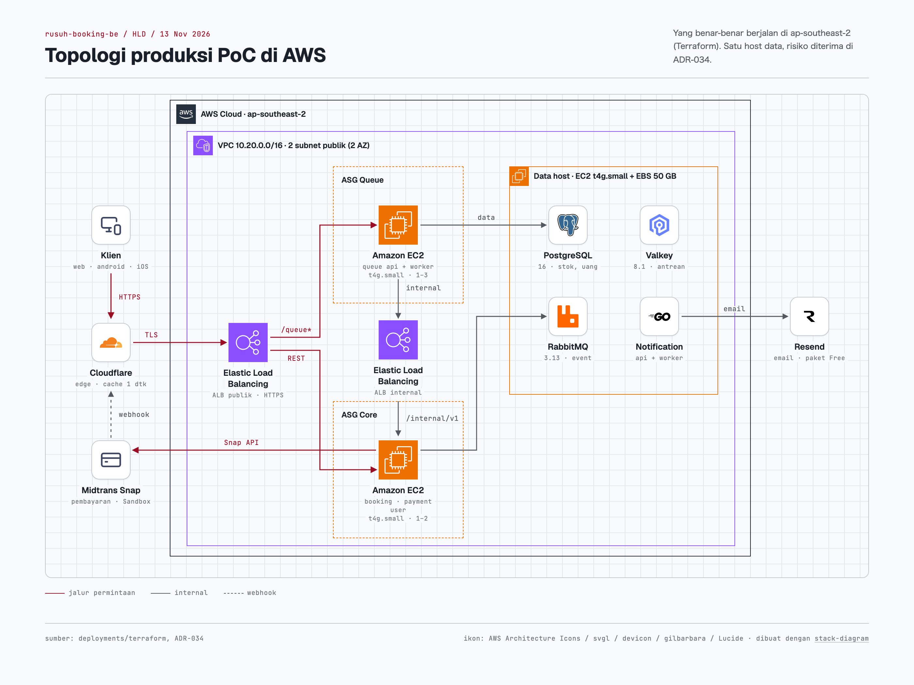
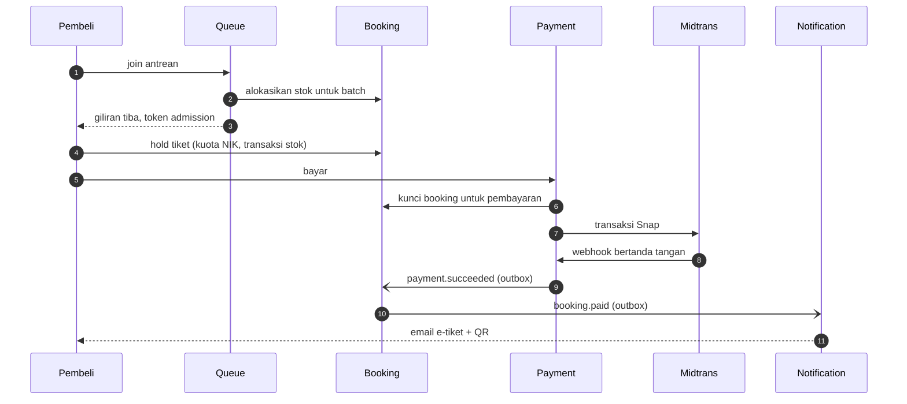

# Rusuh Booking Tiket: Backend

**Platform penjualan tiket konser untuk *war tiket*.** Dirancang agar penjualan dengan permintaan sangat tinggi tetap
terkendali: pembeli masuk lewat waiting room yang adil, stok tiket tidak pernah oversell, pembayaran diproses tepat satu
kali, dan e-tiket sampai ke pemiliknya.

Disusun oleh **PT. Tiket Sampai Nonton Sentosa** untuk **PT. Tiga Sekawan Angin Ribut**.

| | |
|---|---|
| Aplikasi (web) | https://rusuhbooking.my.id |
| API produksi | https://api.rusuhbooking.my.id |
| API pengembangan | https://dev.rusuhbooking.my.id |
| Repository backend | https://github.com/tiket-sampai-nonton/rusuh-booking-be |
| Repository frontend (web, Android, iOS) | https://github.com/tiket-sampai-nonton/rusuh-booking-mobile |

> **Status per 13 November 2026.** Produksi saat ini adalah **PoC di AWS** (data tier satu host, Midtrans Sandbox, email
> paket gratis), disengaja untuk demo dalam kredit cloud dan dicatat sebagai risiko yang diterima di ADR-034. Jalur
> peningkatan ke produksi penuh beserta biayanya ada di bagian [I](#i-strategi-infrastruktur-dan-peningkatan) dan [J](#j-estimasi-biaya-operasional).

## Daftar isi

[A. Ringkasan eksekutif](#a-ringkasan-eksekutif) ·
[B. Kapabilitas bisnis](#b-kapabilitas-bisnis) ·
[C. Keunggulan teknis](#c-keunggulan-teknis) ·
[D. Arsitektur produksi (HLD)](#d-arsitektur-produksi-hld) ·
[E. Arsitektur kode (LLD)](#e-arsitektur-kode-lld) ·
[F. Teknologi](#f-teknologi) ·
[G. Keamanan dan keandalan](#g-keamanan-keandalan-dan-skalabilitas) ·
[H. Kinerja dan kapasitas](#h-bukti-kinerja-dan-kapasitas) ·
[I. Strategi infrastruktur](#i-strategi-infrastruktur-dan-peningkatan) ·
[J. Biaya](#j-estimasi-biaya-operasional) ·
[K. Deployment](#k-deployment-dan-lingkungan) ·
[L. Menjalankan lokal](#l-menjalankan-di-lokal) ·
[M. API](#m-dokumentasi-api-dan-integrasi) ·
[N. Sumber terkait](#n-repository-dan-sumber-terkait) ·
[O. Bukti kualitas](#o-jaminan-kualitas-dan-bukti) ·
[P. Batasan dan roadmap](#p-batasan-dan-roadmap)

---

## A. Ringkasan eksekutif

**Masalah.** Saat tiket konser populer dibuka, ratusan ribu orang datang dalam hitungan menit. Sistem tiket biasa
mengalami salah satu dari empat kegagalan: situs tumbang, tiket terjual melebihi stok, pembeli yang sudah masuk halaman
bayar ternyata kehabisan tiket, atau pembayaran tercatat ganda. Keempatnya merusak kepercayaan pembeli dan reputasi
promotor.

**Solusi.** Rusuh Booking Tiket menjawab keempatnya dengan desain, bukan dengan menambah server saja:

| Pembeda | Arti bagi promotor dan pembeli |
|---|---|
| **Waiting room dengan alokasi di muka** | Stok dipesankan untuk pembeli **sebelum** ia masuk halaman beli. Siapa pun yang sudah masuk dijamin ada tiketnya ("Jangan PHP") |
| **Integritas stok transaksional** | Stok hanya berubah di satu tempat, dalam satu transaksi database. Oversell dicegah oleh desain dan diuji paralel |
| **Pembayaran idempoten berbasis bukti** | Status bayar hanya berubah lewat webhook bertanda tangan atau rekonsiliasi; callback ganda tidak menerbitkan tiket ganda |
| **Kuota per NIK** | Maks 3 tiket per NIK pembeli per event dan 1 per NIK pemegang, lintas sesi dan perangkat, untuk menekan calo |
| **Transaksi tidak bergantung pada email** | Notifikasi lewat outbox, retry, dan DLQ; email gagal tidak membatalkan pembelian |
| **Privasi sejak desain** | NIK hanya disimpan sebagai hash HMAC dan terenkripsi AES-256-GCM, tidak pernah di log |

**Pengguna.** Pembeli tiket (tamu atau akun OTP email), promotor (pengelola event lewat API admin), dan tim operasi.

**Kematangan.** Alur penuh (antre, pilih tiket, bayar, e-tiket, email) berjalan di lokal, dev, dan prod. Didukung 6
lapis bukti otomatis: unit dan integrasi (coverage logika ≥ 80% per modul), E2E lintas service, BDD, UI otomatis, uji
beban k6, dan pentest dengan alat open source. Rinciannya di [O](#o-jaminan-kualitas-dan-bukti).

---

## B. Kapabilitas bisnis

| # | Kapabilitas | Yang dilakukan | Service | Status |
|---|---|---|---|---|
| 1 | Manajemen event | Buat, atur, terbitkan event; unggah gambar; katalog dengan filter kota, genre, harga | Booking, Queue | Deployed (via API admin; dashboard admin belum ada) |
| 2 | Identitas pengguna | Beli sebagai tamu, atau login OTP email tanpa password; profil tersimpan terenkripsi | User | Deployed |
| 3 | Virtual waiting room | Antrean adil saat penjualan dibuka; posisi real-time; heartbeat | Queue | Deployed, diuji beban |
| 4 | Admission | Promosi batch sesuai stok; klaim giliran bertenggat; token admission | Queue, Booking | Deployed |
| 5 | Inventori tiket | Stok per kategori, reservasi, pengembalian unit tidak terpakai | Booking | Deployed |
| 6 | Booking | Hold maks 3 tiket, ubah pesanan dan pemegang sebelum bayar, timer 5 menit, status real-time (SSE) | Booking | Deployed |
| 7 | Pembayaran | Midtrans Snap (VA, QRIS, e-wallet, kartu), timer 10 menit, rekonsiliasi | Payment | Deployed (Sandbox) |
| 8 | Penerbitan tiket | E-tiket per pemegang dengan QR; akses hanya pemilik atau tautan bertoken | Booking, Notification | Deployed |
| 9 | Email dan notifikasi | OTP, giliran tiba, e-tiket, kedaluwarsa; push subscription | Notification | Email deployed; push sebagian |
| 10 | Administrasi dan operasi | API admin berbasis allowlist, metrik bisnis, dashboard dan alarm | Semua | Deployed |

| Tantangan bisnis | Kapabilitas | Nilai bisnis |
|---|---|---|
| Lonjakan trafik saat penjualan dibuka | Waiting room + cache edge Cloudflare | Situs tetap responsif, antrean adil |
| Pembeli kehabisan tiket di halaman bayar | Alokasi sebelum admission | Kepercayaan pembeli |
| Oversell | Kontrol inventori transaksional | Integritas stok |
| Callback pembayaran ganda atau palsu | Verifikasi signature + idempotensi | Tidak ada tiket ganda atau tiket tanpa bayar |
| Email gagal terkirim | Retry dan Dead Letter Queue | Transaksi tetap sah, email dikirim ulang |

Penjelasan per kapabilitas (nilai, cara kerja, status, bukti): [docs/product/CAPABILITIES-AND-EVIDENCE.md](docs/product/CAPABILITIES-AND-EVIDENCE.md).

---

## C. Keunggulan teknis

| Masalah | Solusi | Implementasi | Bukti |
|---|---|---|---|
| Ribuan join per detik pada satu antrean | Operasi antrean atomik di memori | 10 skrip Lua Valkey (`join`, `promote`, `claim`, `heartbeat`, ...), indeks liveness di-shard | k6 joinrate lokal 1.500 join/dtk tanpa error, belum jenuh |
| Polling posisi oleh semua pengantre | Status Document bersama di-cache edge | Cache Rule Cloudflare TTL 1 detik untuk `queue-status` | Panduan infra §4.1, ADR-034 |
| Pembeli masuk tetapi stok habis | Alokasi stok sebelum promosi | Queue memanggil `allocations:batch` Booking, baru `promote.lua` | TC-ADM-01 lulus |
| Oversell di bawah konkurensi | Satu pemilik stok, transaksi dengan urutan kunci tetap, CHECK constraint | `services/booking`, unit of work | E2E konkurensi stok lulus |
| Event hilang saat broker gangguan | Transactional outbox | `pkg/outbox`: event ditulis di transaksi yang sama, relay `FOR UPDATE SKIP LOCKED` | Unit + integrasi |
| Riwayat uang dan booking harus dapat diaudit | Event sourcing terbatas | `pkg/eventstore` untuk agregat Booking dan Payment saja | Unit + integrasi |
| Callback ganda | Konsumen idempoten | Guard state + `ON CONFLICT DO NOTHING`, diuji kiriman ganda | E2E webhook duplikat lulus |
| Kegagalan sementara layanan luar | Retry berjenjang + DLQ | `pkg/rabbitmq` | Unit + integrasi |
| Satu image untuk server x86 dan ARM | Image multi-arsitektur native | CI build `linux/amd64` dan `linux/arm64` tanpa emulasi, manifest gabungan | Stage `package`, `publish` |
| Rilis aman | Gerbang keamanan dan persetujuan | gosec, govulncheck, Trivy, gitleaks; environment `prod` dengan reviewer; smoke test | `.github/workflows/ci.yml` |

---

## D. Arsitektur produksi (HLD)

Topologi yang **benar-benar berjalan** di AWS `ap-southeast-2` (dibangun Terraform, `deployments/terraform`):



Komponen pendukung yang tidak digambar: SSM Parameter Store (env per service), ECR (image), CloudWatch (log, alarm, budget), dan S3 (backup dan gambar event). ALB juga meneruskan `/api/v1/push-subscriptions*` ke Notification di host data.

Arsitektur target (rekomendasi, belum dibangun): [`docs/product/img/hld-target-aws.png`](docs/product/img/hld-target-aws.png).

| Lapisan | Saat ini (PoC, berjalan) | Target produksi (rekomendasi, belum dibangun) |
|---|---|---|
| Edge | Cloudflare Free, cache rule, transform rule CORS | Cloudflare Pro/Business dengan WAF managed rules dan rate limiting |
| Aplikasi | 2 ASG Graviton `t4g.small`, target tracking CPU 60% | ASG `t4g.medium` / `c7g`, scale-out terjadwal sebelum penjualan |
| Database | PostgreSQL di data host tunggal, snapshot harian | RDS PostgreSQL Multi-AZ dengan PITR |
| Cache dan antrean | Valkey di data host | ElastiCache Valkey primary + replika |
| Broker | RabbitMQ di data host | Amazon MQ (single, lalu cluster 3 node) |
| Email | Resend Free (100 per hari) | Resend Pro/Scale atau SES |
| Pembayaran | Midtrans Sandbox | Midtrans production |

Rincian komponen, routing path ALB, keamanan jaringan, dan arsitektur target:
[docs/product/PRODUCTION-ARCHITECTURE.md](docs/product/PRODUCTION-ARCHITECTURE.md). Arsitektur logis lengkap:
[docs/analisa/03-HLD-AD-RBT-001.md](docs/analisa/03-HLD-AD-RBT-001.md).

---

## E. Arsitektur kode (LLD)

- **Lima service Go independen** (Queue 8081, Booking 8082, Payment 8083, Notification 8084, User 8085), masing-masing
  modul Go sendiri, satu schema PostgreSQL dan satu role database per service, tanpa join lintas schema.
- **Hexagonal architecture:** `port/inbound` (interface usecase), `application/usecase` (satu usecase per berkas),
  `domain/{entity,valueobject,dto,mapper}` (hanya standard library), `port/outbound`, `infrastructure/<teknologi>`.
  Wiring di `internal/delivery` (composition root). Lapisan ditegakkan `depguard`.
- **Komunikasi:** sinkron hanya Queue ke Booking dan Payment ke Booking (lewat ALB internal, token service); selebihnya
  event RabbitMQ dengan kontrak JSON Schema (`docs/contracts/events`).
- **Satu binary per service** dengan verb Cobra `api`, `worker`, `migrate`, `healthcheck`; migrasi tertanam di binary
  dengan advisory lock.



Diagram sekuens per alur (waiting room, booking, pembayaran, penerbitan tiket, notifikasi), pola transaksi, dan model
token: [docs/product/PRODUCTION-ARCHITECTURE.md §3–4](docs/product/PRODUCTION-ARCHITECTURE.md#3-lld-implementasi-di-kode-implemented).
SDD per service: [docs/analisa/04-SDD-INDEX.md](docs/analisa/04-SDD-INDEX.md).

---

## F. Teknologi

| Lapisan | Teknologi (versi di repo) | Fungsi | Alasan |
|---|---|---|---|
| Bahasa | Go 1.26 (`net/http`, Cobra) | Semua service | Konkurensi ringan, binary statis kecil, image distroless |
| Database | PostgreSQL 16 (pgx v5) | Stok, uang, akun, event store | ACID; transaksi stok dan outbox dalam satu commit |
| Cache dan antrean | Valkey 8.1 | Waiting room, rate limit, OTP sementara | Skrip Lua atomik, latensi rendah, lisensi open source |
| Broker | RabbitMQ 3.13 (amqp091) | Event antar service | Retry dan DLQ native, publisher confirm |
| Pembayaran | Midtrans Snap | VA, QRIS, e-wallet, kartu | Gateway lokal Indonesia |
| Email | Resend (produksi), Mailpit (lokal) | OTP, e-tiket | API sederhana; SMTP sebagai alternatif |
| Edge | Cloudflare | TLS, cache, CORS, DDoS dasar | Menyerap polling antrean tanpa biaya CDN tambahan |
| Cloud | AWS EC2 Graviton ASG, ALB, SSM, ECR, S3, CloudWatch, Terraform | Produksi | Infrastruktur sebagai kode, biaya ARM lebih rendah |
| Dev | VPS + Docker Compose + Caddy | Lingkungan pengembangan | Murah, identik dengan lokal |
| Observabilitas | Prometheus, Loki, Alloy, Grafana (lokal, dev); CloudWatch Agent EMF (AWS) | Metrik, log, dashboard, alarm | Label metrik tanpa data pribadi |
| Kualitas | testify, mockgen, golangci-lint, gosec, govulncheck, Trivy, SonarCloud, k6, godog, Playwright | CI dan pengujian | Gerbang otomatis setiap PR |
| Frontend | Expo 53, React Native 0.79, React 19, expo-router, TanStack Query 5, Zustand, NativeWind, TypeScript 5.8 | Web, Android, iOS dari satu kode | Repo `rusuh-booking-mobile` |

---

## G. Keamanan, keandalan, dan skalabilitas

| Area | Yang tersedia hari ini | Lokasi |
|---|---|---|
| Autentikasi pembeli | OTP email (TTL 5 menit, 5 percobaan, cooldown 60 dtk); refresh token dirotasi, pemakaian ulang mencabut semua sesi | `services/user` |
| Antar service | Token EdDSA (Ed25519) per scope: `visitor`, `admission`, `buyer`, `service`; admin lewat allowlist email | `pkg/token` |
| Data pribadi | NIK dan email AES-256-GCM + hash HMAC; tidak pernah di log, event, atau label metrik. Satu pengecualian yang diputuskan pemilik: `GET /api/v1/me` mengembalikan email dan NIK asli hanya kepada pemilik akun (`Cache-Control: no-store`) | `pkg/crypto`, ADR-025/026/033 |
| Webhook pembayaran | Signature SHA-512 + cek nominal; redirect klien bukan bukti bayar | `services/payment/.../midtrans/signature.go` |
| Rate limiting | Join antrean per IP (bawaan 200/menit, Valkey), per IP untuk booking dan payment, OTP per email dan IP | `pkg/httpx`, `services/queue` |
| HTTP | CORS allowlist; header keamanan; service di luar lokal menolak start tanpa allowlist CORS (di branch audit) | `pkg/httpx` |
| Konsistensi data | Transaksi stok tunggal, event sourcing, outbox, konsumen idempoten | `pkg/eventstore`, `pkg/outbox` |
| Ketahanan pesan | Retry berjenjang + DLQ; kegagalan email tidak membatalkan transaksi | `pkg/rabbitmq` |
| Kesehatan | `GET /health` untuk ALB dan container; smoke test setelah deploy | semua service |
| Rahasia | SSM Parameter Store SecureString (AWS), `.env` di luar git (dev); gitleaks di CI | `deployments/` |
| Infrastruktur | Tanpa SSH (SSM Session Manager), IMDSv2, EBS dan S3 terenkripsi, ALB hanya menerima IP Cloudflare | `deployments/terraform` |
| Supply chain | Base image distroless nonroot dengan digest, Trivy image, SBOM CycloneDX, Dependabot | CI |

**Butuh investasi infrastruktur:** HA database dan broker, WAF dan rate limiting di edge, kuota email produksi, deploy
lewat OIDC (saat ini IAM user statis, SEC-005). Lihat [I](#i-strategi-infrastruktur-dan-peningkatan).

---

## H. Bukti kinerja dan kapasitas

Alat: **k6** dengan profil smoke, e2e, load, stress, spike, soak, joinrate, dan waiting room.

| Lingkungan | Beban | Throughput | p95 / p99 | Error | Jenis angka |
|---|---|---|---|---|---|
| Lokal (Apple M4, satu mesin) | 3.000 pengantre | 1.792 req/dtk rata-rata | 3 ms / 22 ms | 0% | Terukur |
| Lokal | Kapasitas berkelanjutan campuran (antre + katalog + beli) | 1.524 req/dtk pada 1.300 pengantre | p95 3 ms | 0% | Terukur; jenuh di 1.800 pengantre (PostgreSQL) |
| Lokal | Join antrean | sampai 1.500 join/dtk | p95 2 ms | 0% | Terukur, belum jenuh |
| Dev (VPS, lewat internet dan Cloudflare) | 3.000 VU waiting room | 190 req/dtk | 181 ms / 253 ms | 0% | Terukur |
| Prod (PoC) | 500 VU, dihentikan setelah ±20 dtk | 91 req/dtk | 250 ms / 512 ms | 5,9% (semuanya 429 dari batas join per IP) | Bukan ukuran kapasitas |
| 100 rb / 300 rb / 1 jt pengantre | — | Model: ±112.000 req/dtk origin untuk 300 rb dengan klien sekarang, ±10.600 dengan klien sesuai desain HLD | — | — | **Estimasi, belum diuji** |

Temuan utama: beban origin ditentukan perilaku polling klien, bukan jumlah pengantre. Untuk membuktikan skala ratusan
ribu diperlukan (1) klien yang memakai Status Document ter-cache, (2) infrastruktur Skenario 3, dan (3) uji beban
terdistribusi dari banyak IP sumber. Analisis lengkap: [tests/k6/ANALISIS-KAPASITAS.md](tests/k6/ANALISIS-KAPASITAS.md);
laporan HTML per lingkungan: [tests/README.md](tests/README.md).

---

## I. Strategi infrastruktur dan peningkatan

| Skenario | Arsitektur | Manfaat | Batas |
|---|---|---|---|
| **1. PoC (saat ini)** | 2 ASG `t4g.small` + satu data host, Cloudflare Free, Resend Free, Midtrans Sandbox | Biaya minimal, alur lengkap untuk demo dan penilaian | SPOF data host, RPO 24 jam, 100 email per hari |
| **2. Produksi standar** | RDS Multi-AZ, ElastiCache, Amazon MQ, 2× `t4g.medium` per tier, Cloudflare Pro, Resend Pro | Tanpa SPOF data, PITR, 50.000 email per bulan | Broker single instance; kapasitas puncak perlu diuji |
| **3. Enterprise / trafik tinggi** | ASG `c7g` dengan scale-out terjadwal, RDS `r7g` Multi-AZ, Valkey 3 node, MQ cluster 3 node, Cloudflare Business | Siap lonjakan besar dan WAF di edge | Ukuran final wajib dari uji beban terdistribusi |

Pemicu wajib naik dari Skenario 1 (ADR-034): penjualan berbayar nyata, lebih dari 100 transaksi per hari, ada SLA
tertulis, atau lebih dari 100 email per hari. Rincian: [docs/product/INFRASTRUCTURE-PRICING.md](docs/product/INFRASTRUCTURE-PRICING.md).

---

## J. Estimasi biaya operasional

Harga resmi AWS `ap-southeast-2` on-demand (USD, 730 jam/bulan, tanpa pajak), diambil 13 November 2026.

| Komponen | Skenario 1 (PoC) | Skenario 2 (standar) | Skenario 3 (enterprise) |
|---|---:|---:|---:|
| Compute aplikasi | 30,95 (2× `t4g.small`) | 123,81 | 542,35 |
| Data host (PostgreSQL, Valkey, RabbitMQ) | 15,48 (1× `t4g.small`, ketiganya satu server) | tidak ada | tidak ada |
| Database | termasuk data host | 175,79 (RDS Multi-AZ) | 557,02 |
| Cache | termasuk data host | 110,96 | 343,39 |
| Broker | termasuk data host | 124,76 | 748,32 |
| Load balancer + IPv4 publik | 66,72 | 93,73 | 233,89 |
| Storage, log, transfer data | 19,55 | 71,98 | 449,30 |
| Cloudflare | 0 (Free) | 25 (Pro) | 250 (Business) |
| Email (Resend) | 0 (Free, 100/hari) | 20 (Pro, 50.000/bulan) | 350 (Scale, 500.000/bulan) |
| **Total per bulan (USD)** | **±133** | **±746** | **±3.474** |

- **Biaya PoC terukur** (Cost Explorer 4–13 Nov 2026): sekitar US$1,7 per hari saat menyala. Jam EC2 tidak muncul sebagai biaya pada periode itu dan
  penyebabnya belum dipastikan (dugaan: manfaat free tier atau paket akun), jadi angka ini tidak berlaku untuk produksi.
- **Biaya per transaksi Midtrans** di luar tabel: VA Rp4.000, QRIS 0,7%, GoPay 2%, kartu kredit 2,9% + Rp2.000.
- **Tidak termasuk:** pengembangan, pemeliharaan, dukungan, domain, diskon Savings Plans, dan harga region Jakarta.

Sumber harga, asumsi per baris, dan kuota layanan gratis: [docs/product/INFRASTRUCTURE-PRICING.md](docs/product/INFRASTRUCTURE-PRICING.md).

---

## K. Deployment dan lingkungan

| Lingkungan | URL | Infrastruktur | Deploy |
|---|---|---|---|
| Lokal | `http://localhost:8081..8085` | Docker Compose | `make up` |
| Dev | https://dev.rusuhbooking.my.id (FE dev: https://rusuh-booking.pages.dev) | VPS, Docker Compose, Caddy, Cloudflare | Job `deployment-dev`, persetujuan reviewer |
| Prod (PoC) | https://api.rusuhbooking.my.id (FE: https://rusuhbooking.my.id) | AWS `ap-southeast-2`, Terraform, Cloudflare | Job `deployment-prod`, manual dari `main`, persetujuan reviewer |

**Pipeline** (`.github/workflows/ci.yml`): kualitas kode dan keamanan → coverage ≥ 80% → SonarCloud → build →
image `amd64` + `arm64` → Trivy + SBOM → publish ke GHCR (manifest multi-arch) → deploy.

**Rilis prod** (`deployments/terraform/deploy-aws.sh`): salin image dari GHCR ke ECR, cek kelengkapan env di SSM
(`check-ssm-env.sh`), migrasi, instance refresh ASG, lalu smoke test semua service. **Rollback** memakai skrip yang sama
dengan tag image sebelumnya (`deployments/terraform/README.md`, bagian Rollback). Prod bisa dimatikan antar sesi demo
dengan `aws-power.sh` (snapshot dibuat saat mati).

<details>
<summary>Detail stage CI/CD</summary>

| Stage | Isi |
|---|---|
| `code-quality` | `go.mod` rapi, mock sesuai port, golangci-lint + depguard, go vet, gosec, govulncheck, hadolint, gitleaks |
| `verify-code-quality` | Gagal bila gosec HIGH, kerentanan govulncheck, hadolint error, atau rahasia bocor |
| `case-coverage` | Unit + integrasi `-race` dengan PostgreSQL, Valkey, RabbitMQ sebagai service container; ambang coverage logika 80% |
| `code-rank` | SonarCloud quality gate |
| `build` | Compile + isolation build `GOWORK=off` |
| `package` | Docker build per service, native `linux/amd64` dan `linux/arm64` |
| `scan-package` | Trivy image + SBOM CycloneDX; gagal pada severity `IMAGE_FAIL_SEVERITY` (bawaan CRITICAL) |
| `publish` | Push ke GHCR, gabung manifest multi-arch (`<sha>` dan `main`), hanya dari `main` |
| `deployment-dev` | Persetujuan reviewer, SSH ke VPS, `deploy.sh` (pull, migrasi, `up -d`, smoke test) |
| `deployment-prod` | Manual (`deploy_env=prod`, hanya `main`), environment `prod` dengan Required reviewers, `deploy-aws.sh` |

`ci-ok` adalah satu-satunya check wajib di ruleset `main`. Coverage dihitung atas kode logika; `cmd/`,
`internal/delivery/`, `internal/config/`, dan `_mock/` dikecualikan karena hanya wiring.

</details>

<details>
<summary>Konfigurasi keamanan yang wajib di luar <code>APP_ENV=local</code></summary>

| Variabel | Service | Fungsi |
|---|---|---|
| `ADMIN_EMAILS` | booking, queue | Email (atau `@domain`) yang boleh memakai `/internal/v1/admin/*`; kosong berarti tidak ada |
| `TICKET_LINK_KEY` | booking | Kunci HMAC tautan e-tiket |
| `PII_HASH_KEY`, `PII_ENC_KEY` | queue, booking, notification, user | Harus sama di semua service agar hash NIK cocok dan email bisa dibuka Notification (ADR-026) |
| `CORS_ALLOWED_ORIGINS` | semua | Allowlist origin FE |
| `RATE_LIMIT_PER_IP`, `RATE_LIMIT_WINDOW`, `RATE_LIMIT_WEBHOOK_PER_IP` | booking, payment | Batas per IP (bawaan 300/menit; webhook 600); lewat batas 429 `RATE_LIMITED` |
| `RATE_LIMIT_JOIN_PER_IP` | queue | Batas join antrean per IP (bawaan 200/menit) |
| `IMAGE_STORAGE`, `IMAGE_S3_BUCKET`, `IMAGE_PUBLIC_BASE_URL` | booking | Gambar event: `local` (hanya lokal) atau `s3` (prod) |
| `MIDTRANS_SERVER_KEY`, `MIDTRANS_SNAP_BASE_URL` | payment | Sandbox atau produksi |
| `TICKET_LINK_BASE_URL` | notification | Halaman e-tiket di FE |

Nilai disimpan di SSM Parameter Store (prod) atau `.env` server (dev), tidak pernah di git.

</details>

---

## L. Menjalankan di lokal

**Prasyarat:** Go 1.26, Docker dengan Compose v2, `openssl`, `make`. Opsional: `golangci-lint` v2 (lint), k6 dan
Node 18+ (uji beban dan UI).

```bash
# 1. Clone
git clone https://github.com/tiket-sampai-nonton/rusuh-booking-be.git
cd rusuh-booking-be

# 2. Dependensi Go (sekali)
make tidy

# 3. Jalankan semua: kunci token Ed25519 lokal, PostgreSQL, Valkey, RabbitMQ, Mailpit,
#    migrasi tiap service (container *-migrate), lalu API dan worker kelima service
make up
make ps

# 4. Health check
for p in 8081 8082 8083 8084 8085; do curl -s localhost:$p/health; echo; done

# 5. Swagger UI untuk semua spesifikasi OpenAPI
make docs          # buka http://localhost:8089

# 6. Coba login OTP (kode dibaca di Mailpit http://localhost:8025)
curl -X POST localhost:8085/api/v1/auth/otp/request -H 'Content-Type: application/json' \
  -d '{"email":"kamu@example.test"}'

# 7. Uji
make test               # unit test -race semua modul
make test-integration   # + integrasi (butuh make infra)
make cover              # sama dengan stage coverage CI (ambang 80%)
make test-e2e           # E2E lintas service + BDD (E2E_SLOW=1 untuk skenario kedaluwarsa)
make ci                 # build, lint, coverage, isolation, kontrak

# 8. Berhenti dan hapus volume lokal
make down
```

Menjalankan satu service di host (bukan container): salin `services/<svc>/.env.example` ke `.env`, lalu
`make migrate-<svc>` dan `make run-<svc>` (worker: `make worker-<svc>`). Pembayaran lokal butuh server key Midtrans
Sandbox milik sendiri di `.env` Payment. Observabilitas lokal: `make obs` (Grafana http://localhost:3000).

Catatan port: Compose menerbitkan Valkey di host port 6380 dan PostgreSQL di 5433 (lihat [tests/README.md](tests/README.md)).
UI otomatis, k6, dan pentest: [tests/README.md](tests/README.md).

---

## M. Dokumentasi API dan integrasi

| Spesifikasi | Berkas | Isi |
|---|---|---|
| Queue | [queue.yaml](docs/contracts/openapi/queue.yaml) | Antrean, status, heartbeat, claim |
| Booking | [booking.yaml](docs/contracts/openapi/booking.yaml) | Katalog, sesi, hold, booking, tiket |
| Payment | [payment.yaml](docs/contracts/openapi/payment.yaml) | Pembayaran, halaman bayar, webhook Midtrans |
| User | [user.yaml](docs/contracts/openapi/user.yaml) | OTP, token, profil |
| Notification | [notification.yaml](docs/contracts/openapi/notification.yaml) | Push subscription |
| Internal | [internal-booking.yaml](docs/contracts/openapi/internal-booking.yaml), [internal-payment.yaml](docs/contracts/openapi/internal-payment.yaml) | Alokasi, payment-lock, resolve, admin |
| Event | [docs/contracts/events](docs/contracts/events) | JSON Schema 11 event + envelope |

- **Versi:** semua path publik di bawah `/api/v1`; internal di `/internal/v1`.
- **Autentikasi:** bearer token per scope (bagian G); webhook Midtrans dengan signature.
- **Swagger UI:** `make docs` lalu http://localhost:8089 (belum dipublikasikan di internet).
- **Integrasi FE dan gateway:** [08a-frontend-integration.md](docs/analisa/08a-frontend-integration.md),
  [08b-payment-gateway-integration.md](docs/analisa/08b-payment-gateway-integration.md),
  [08c-inter-service-communication.md](docs/analisa/08c-inter-service-communication.md).

---

## N. Repository dan sumber terkait

| Sumber | URL / lokasi | Keterangan |
|---|---|---|
| Backend | https://github.com/tiket-sampai-nonton/rusuh-booking-be | Repo ini |
| Frontend | https://github.com/tiket-sampai-nonton/rusuh-booking-mobile | Expo: web, Android, iOS |
| Aplikasi produksi | https://rusuhbooking.my.id | Web FE |
| API produksi | https://api.rusuhbooking.my.id | Contoh: `GET /api/v1/events` |
| API dev | https://dev.rusuhbooking.my.id | Contoh: `GET /api/v1/events` |

| Dokumen | Lokasi |
|---|---|
| PRD | [docs/analisa/01-PRD-RBT-001-v5.0.md](docs/analisa/01-PRD-RBT-001-v5.0.md) |
| SRS | [docs/analisa/02-SRS-RBT-001.md](docs/analisa/02-SRS-RBT-001.md) |
| HLD | [docs/analisa/03-HLD-AD-RBT-001.md](docs/analisa/03-HLD-AD-RBT-001.md) |
| SDD (LLD) per service | [docs/analisa/04-SDD-INDEX.md](docs/analisa/04-SDD-INDEX.md) |
| ADR | [docs/analisa/05-ADR-RBT.md](docs/analisa/05-ADR-RBT.md) |
| Test Plan | [docs/analisa/06-TP-RBT-001.md](docs/analisa/06-TP-RBT-001.md) |
| Engineering Handbook | [docs/analisa/07-Engineering-Handbook-RBT.md](docs/analisa/07-Engineering-Handbook-RBT.md) |
| Arsitektur produksi | [docs/product/PRODUCTION-ARCHITECTURE.md](docs/product/PRODUCTION-ARCHITECTURE.md) |
| Kapabilitas dan bukti | [docs/product/CAPABILITIES-AND-EVIDENCE.md](docs/product/CAPABILITIES-AND-EVIDENCE.md) |
| Infrastruktur dan biaya | [docs/product/INFRASTRUCTURE-PRICING.md](docs/product/INFRASTRUCTURE-PRICING.md) |
| Laporan pengujian (TC, k6, pentest) | [tests/README.md](tests/README.md) |
| Audit rekayasa | [docs/engineering/AUDIT-FINAL.md](docs/engineering/AUDIT-FINAL.md) |
| Deployment AWS | [deployments/terraform/README.md](deployments/terraform/README.md) |
| Deployment dev | [deployments/dev/README.md](deployments/dev/README.md) |
| Evidence dan keputusan | [docs/evidence/](docs/evidence/) |
| Penggunaan AI | [docs/ai/README.md](docs/ai/README.md), [docs/ai-log/](docs/ai-log/) |

---

## O. Jaminan kualitas dan bukti

| Area | Alat | Hasil | Bukti |
|---|---|---|---|
| Unit + integrasi | `go test -race`, testify, Postgres/Valkey/RabbitMQ nyata | Coverage logika: pkg 90,6 · queue 83,6 · booking 81,0 · payment 90,0 · notification 82,7 · user 92,4 | [AUDIT-FINAL](docs/engineering/AUDIT-FINAL.md), CI `case-coverage` |
| E2E API | Go `-tags e2e`, respons divalidasi ke OpenAPI | 10/10 lulus | [TC-REPORT](tests/reports/TC-REPORT.md) |
| BDD | godog, 31 skenario | 27 lulus; 4 gagal karena konfigurasi harness, bukan bug yang terbukti | [TC-REPORT](tests/reports/TC-REPORT.md) |
| UI web | Cucumber-js + Playwright | Prod 9/9 desktop, 10/10 mobile; dev sama | [ringkasan UI](tests/reports/ui/ringkasan-ui.html) |
| UI Android | Appium | Belum dijalankan | [TC-REPORT](tests/reports/TC-REPORT.md) |
| Uji beban | k6 | Lihat [H](#h-bukti-kinerja-dan-kapasitas) | [tests/k6](tests/k6/) |
| Keamanan | ZAP, nuclei, Schemathesis, testssl, semgrep, Trivy, gitleaks | 0 High/Critical; 3 Medium; 8 Low/Info | [pentest](tests/pentest/REPORT.md) |
| Analisis statis | golangci-lint, gosec, govulncheck, SonarCloud | Gerbang lulus | CI |
| Image | Trivy, SBOM, hadolint | Lulus | CI |
| Pipeline | GitHub Actions | 5 run terakhir di `main` sukses (11–12 Nov 2026) | tab Actions |

Tangkapan laporan uji sebagai gambar (TC, pentest, k6): [`docs/product/img/bukti/`](docs/product/img/bukti/), daftar dan keterangannya di [`tests/README.md`](tests/README.md#bukti-dalam-bentuk-gambar).

Matriks lengkap dan pemetaan TC: [docs/product/CAPABILITIES-AND-EVIDENCE.md](docs/product/CAPABILITIES-AND-EVIDENCE.md#3-matriks-bukti-kualitas).

---

## P. Batasan dan roadmap

| Area | Kondisi saat ini | Dampak | Mitigasi / rekomendasi | Prioritas |
|---|---|---|---|---|
| Infrastruktur | Data host tunggal, RPO hingga 24 jam | Gangguan host menghentikan layanan | Skenario 2: RDS Multi-AZ, ElastiCache, Amazon MQ | Tinggi sebelum penjualan nyata |
| Infrastruktur | Email Resend Free 100 per hari | E-tiket tidak terkirim di skala produksi | Resend Pro atau SES | Tinggi |
| Infrastruktur | Pembayaran Sandbox | Belum menerima uang nyata | Aktivasi Midtrans production | Tinggi |
| Keamanan aplikasi | Token admission belum diikat ke visitor (PT-F-01, Medium) | Token yang bocor bisa dipakai orang lain selama berlaku | Ikat token ke visitor; perbaikan sedang dikoordinasikan | Tinggi |
| Keamanan edge | WAF dan rate limiting di edge belum ada; TLS 1.0/1.1 dan header keamanan di edge dev | Perlindungan bot bergantung limiter aplikasi | Cloudflare Pro/Business; TLS minimum 1.2 | Sedang |
| Operasi | Deploy prod dengan IAM user statis (SEC-005) | Kredensial jangka panjang di GitHub | Migrasi ke OIDC | Sedang |
| Pengujian | Kapasitas prod belum terukur; 300 ribu pengantre belum dibuktikan | Klaim skala harus berbasis model | Uji beban terdistribusi di infrastruktur Skenario 2/3 | Tinggi sebelum penawaran kapasitas |
| Pengujian | 4 skenario BDD gagal karena harness; Appium belum dijalankan | Bukti belum lengkap | Pasang token service di harness, sesuaikan asersi grace 180 dtk, jalankan di perangkat | Sedang |
| Produk | Belum ada dashboard admin grafis; push notifikasi belum diverifikasi | Promotor bergantung API | Dashboard admin di FE | Rendah |

<details>
<summary>Struktur repository</summary>

```text
services/<svc>/   satu proyek Go per service: cmd (Cobra), internal/<domain>/{port,domain,application,infrastructure},
                  internal/{config,delivery,shared}, _mock, deployments/{Dockerfile,migrations}, assets
pkg/              utilitas lintas service tanpa logika bisnis
deployments/      compose, dev (VPS), terraform (AWS), observability
docs/             analisa (PRD..Handbook), contracts, product, engineering, evidence, ai-log
tests/            e2e Go, features (BDD), ui, k6, pentest, reports
tools/            e2e, coverage, kontrak, verifikasi laporan
```

</details>
