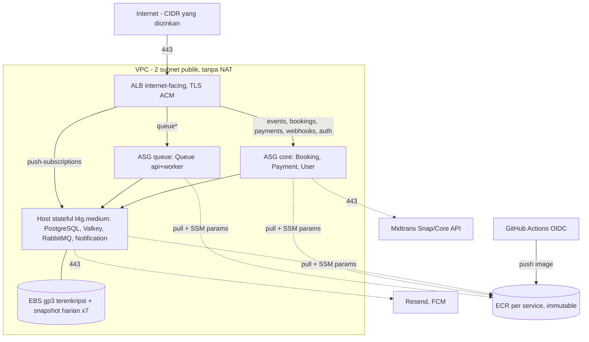

# Terraform — AWS (staging/PoC)

Topologi mengikuti HLD §4.5 (`docs/analisa/03-HLD-AD-RBT-001.md`): ALB di depan dua ASG stateless dan satu host stateful, tanpa NAT Gateway, tanpa SSH (akses admin lewat SSM). Region default `ap-southeast-3`.

**Status:** `terraform fmt -check`, `terraform validate` (Terraform 1.17.1, provider aws ~> 6.0), dan scan statis Trivy (HIGH/CRITICAL) lolos. `terraform plan` dan `apply` **belum dijalankan** (tidak ada akses AWS). Tidak ada resource yang dibuat.



## Yang dibuat

| Modul | Isi |
|---|---|
| `network` | VPC, 2 subnet publik, SG berlapis (ALB ← CIDR; app ← ALB; data ← app; egress hanya 443 + port data) |
| `ecr` | satu repo per service, tag immutable, scan on push, simpan 20 image |
| `iam` | instance profile (SSM, pull ECR, baca `/rusuh-<env>/*`, backup S3, log), role OIDC GitHub (push ECR dari `main` saja) |
| `storage` | bucket backup (versioned, SSE-S3, tanpa akses publik, TLS saja, lifecycle 90 hari) |
| `data_host` | EC2 arm64, IMDSv2, volume data terpisah (`prevent_destroy`) + DLM snapshot harian x7 |
| `compute` | ALB (80→443), target group per service (`/health`), rule path per HLD, launch template + ASG `queue` (1–3) dan `core` (1–2), target tracking CPU 60%, health check tipe EC2 |
| `observability` | alarm ALB 5xx dan unhealthy host per service, SNS email, AWS Budgets 50/100/150 USD |

**Tidak termasuk (follow-up INF-2):** CloudFront + WAF, Route 53, ACM (ARN sertifikat dipasok dari luar), Next.js web, Prometheus/Grafana di host stateful, scheduled scaling sebelum jam penjualan, RDS/ElastiCache/Amazon MQ (tier produksi di HLD §17).
Biaya perkiraan HLD ±US$100–125/bulan bila 24/7; teardown setelah assessment (`expires_on`).

## Prasyarat

- Terraform >= 1.10, AWS CLI, kredensial dengan hak membuat resource di atas (SSO/role; jangan taruh access key di repo).
- Sertifikat ACM di region yang sama dengan ALB (validasi DNS) → `certificate_arn`.
- Image sudah di-push ke ECR (lihat "Build dan push"), tag immutable → `image_tag`.

## Bootstrap state (sekali)

```bash
ACCT=$(aws sts get-caller-identity --query Account --output text)
aws s3api create-bucket --bucket rusuh-tfstate-$ACCT --region ap-southeast-3 \
  --create-bucket-configuration LocationConstraint=ap-southeast-3
aws s3api put-bucket-versioning --bucket rusuh-tfstate-$ACCT --versioning-configuration Status=Enabled
aws s3api put-bucket-encryption --bucket rusuh-tfstate-$ACCT \
  --server-side-encryption-configuration '{"Rules":[{"ApplyServerSideEncryptionByDefault":{"SSEAlgorithm":"AES256"}}]}'
aws s3api put-public-access-block --bucket rusuh-tfstate-$ACCT \
  --public-access-block-configuration BlockPublicAcls=true,IgnorePublicAcls=true,BlockPublicPolicy=true,RestrictPublicBuckets=true
cp backend.tf.example backend.tf   # isi nama bucket
```

State memuat ID resource, bukan rahasia aplikasi (rahasia ada di SSM, dibuat di luar Terraform).

## Rahasia (SSM Parameter Store, SecureString, dibuat manual)

Satu parameter per service berisi isi file env (lihat `services/<svc>/.env.example`), di bawah `/rusuh-<env>/`: `queue.env`, `booking.env`, `payment.env`, `user.env`, `notification.env`, dan `data.env` (`POSTGRES_PASSWORD`, `RABBITMQ_DEFAULT_USER`, `RABBITMQ_DEFAULT_PASS`). Tulis `__DATA_HOST__` sebagai host PostgreSQL/Valkey/RabbitMQ; diganti IP privat host stateful saat boot. `payment.env` memuat `MIDTRANS_SERVER_KEY` (sandbox), `PAYMENT_SUCCESS_RETURN_URL`, `PAYMENT_FAILED_RETURN_URL`, `MIDTRANS_NOTIFICATION_URL` kosong (URL webhook diatur di dashboard Midtrans ke `https://<domain>/api/v1/webhooks/midtrans`).

```bash
aws ssm put-parameter --type SecureString --name /rusuh-staging/payment.env --value file://payment.env --overwrite
```

Kunci token Ed25519 (`make keys` lokal) dipasok sebagai file lewat parameter yang sama atau mount; prosedur lengkapnya mengikuti `.env.example` tiap service.

## Deploy

```bash
cd deployments/terraform
cp envs/staging.tfvars.example envs/staging.tfvars   # isi nilai nyata; file ini tidak di-commit
terraform init
terraform plan  -var-file=envs/staging.tfvars -out=tfplan
terraform apply tfplan                                # hanya setelah plan ditinjau dan disetujui
```

Urutan pertama kali: apply `module.ecr` (`-target`) → push image → apply penuh. Host stateful memakai `ignore_changes = [ami, user_data]` agar perubahan template tidak mengganti host.

### Build dan push image

CI (role `github_ci_role_arn`) atau manual: `docker buildx build --platform linux/arm64 -f services/<svc>/deployments/Dockerfile -t <registry>/rusuh-<env>/<svc>:<tag> --push .` (tag immutable, mis. `git-<sha>`).

### Migrasi database

Setiap instance menjalankan `<svc> migrate up` sebelum `api`; migrasi dikunci advisory lock sehingga aman bila beberapa instance start bersamaan. Role/schema awal (`deployments/compose/postgres-init.sql`) dijalankan sekali oleh operator di host stateful dengan password dari SSM (jangan memakai `postgres-local-passwords.sql`). Migrasi destruktif (DROP) harus ditinjau manual sebelum rilis.

## Validasi pasca-deploy

```bash
ALB=$(terraform output -raw alb_dns_name)
curl -fsS "https://$ALB/api/v1/events" | jq ".meta.code"   # 200 (butuh domain sesuai sertifikat; atau curl --resolve)
aws elbv2 describe-target-health --target-group-arn <arn>        # semua healthy
aws ssm start-session --target $(terraform output -raw data_host_instance_id)
docker ps; docker logs notification-api --tail 50
```

Alur Midtrans Sandbox: buat booking → `POST /payments/{id}/attempts` → buka `redirectUrl`, bayar di simulator → pastikan webhook diterima dan `GET /payments/{id}/status` menjadi `SUCCEEDED`/`PAID`, tiket terbit, dan email e-tiket masuk.

## Rollback

- **Aplikasi:** set `image_tag` ke tag sebelumnya, `terraform apply` (instance refresh bertahap 50%). Image immutable, jadi rollback = mengganti tag. Host stateful: `docker run` ulang dengan tag lama lewat SSM.
- **Migrasi:** rilis kompatibel mundur (expand/contract). Bila migrasi baru bermasalah, pulihkan dari snapshot EBS (DLM, 7 hari) — **langkah destruktif, butuh persetujuan** — atau `<svc> migrate down --steps 1` hanya bila migrasi down aman untuk data.
- **Infrastruktur:** `terraform apply` revisi sebelumnya; volume data `prevent_destroy`, jadi `terraform destroy` akan berhenti di volume. Teardown PoC: hapus volume secara sadar setelah snapshot terakhir.

## Troubleshooting

| Gejala | Periksa |
|---|---|
| Target `unhealthy` | `GET /health` di port service; SG app menerima dari ALB; env file di SSM lengkap; `docker logs <svc>-api` |
| Instance baru tidak menjalankan container | `/var/log/cloud-init-output.log`; izin IAM ke parameter `/rusuh-<env>/*`; `docker login` ECR; tag image ada |
| 503 `PAYMENT_PROVIDER_UNAVAILABLE` | `MIDTRANS_SERVER_KEY`, egress 443, status breaker (log payment), tag key sandbox vs production |
| Webhook Midtrans 401 | server key tidak cocok dengan akun yang mengirim; signature divalidasi `SHA512(order_id+status_code+gross_amount+serverKey)` |
| Notification tidak terkirim | `docker logs notification-worker`, RabbitMQ queue/DLQ, kunci Resend |
| `terraform apply` ditolak pada volume | `prevent_destroy` pada `aws_ebs_volume.data`; ini disengaja |
