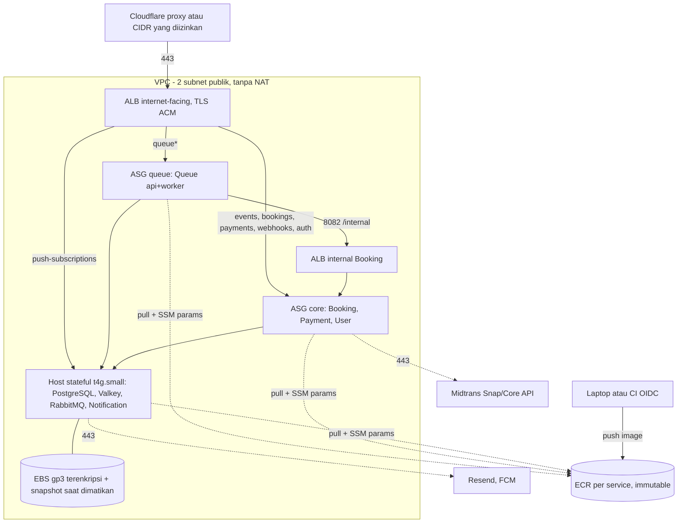

# Terraform — AWS (staging/PoC)

Topologi mengikuti HLD §4.5 (`docs/analisa/03-HLD-AD-RBT-001.md`): ALB di depan dua ASG stateless dan satu host stateful, tanpa NAT Gateway, tanpa SSH (akses admin lewat SSM). Region default `ap-southeast-2` (Sydney), mengikuti akun AWS Free plan.

**Status:** `terraform fmt -check`, `terraform validate` (Terraform 1.17.1, provider aws ~> 6.0), dan scan statis Trivy (HIGH/CRITICAL) lolos. `terraform plan` dan `apply` **belum dijalankan** (tidak ada akses AWS). Tidak ada resource yang dibuat.

**Runbook deploy lengkap (prod di balik Cloudflare):** `panduan-testing/PANDUAN-INFRA-DEV-VPS-DAN-AWS.md` bagian 8.



## Yang dibuat

| Modul | Isi |
|---|---|
| `network` | VPC, 2 subnet publik, SG berlapis (ALB ← IP Cloudflare atau CIDR; app ← ALB; ALB internal ← app; data ← app; egress hanya 443 + port data) |
| `ecr` | satu repo per service, tag immutable, scan on push, simpan 20 image |
| `iam` | instance profile (SSM, pull ECR, baca `/rusuh-<env>/*`, backup S3, log), role OIDC GitHub (`main` atau environment `<env>`: push ECR, set `image_tag`, dokumen deploy notification, instance refresh ASG proyek) |
| `storage` | bucket backup (versioned, SSE-S3, tanpa akses publik, TLS saja, lifecycle 90 hari); bucket gambar (baca publik hanya `events/*`) |
| `data_host` | EC2 arm64, IMDSv2, volume data terpisah (`prevent_destroy`); snapshot harian DLM (simpan 7, `enable_daily_snapshot`) dan snapshot tiap `aws-power.sh off` (simpan 3) |
| `compute` | ALB (80→443), ALB internal Queue → Booking, target group per service (`/health`), rule path per HLD (queue pertama), launch template + ASG `queue` (1–3) dan `core` (1–2), target tracking CPU 60%, health check tipe EC2 |
| `observability` | alarm ALB 5xx dan unhealthy host per service, SNS email, AWS Budgets 50/100/150 USD; NFR-09: dashboard `<name>-business-metrics` (antrean menunggu dan slot aktif, konversi, expired, missed turn per event) dan alarm funnel/antrean tidak terbaca, missed turn > 30%, booking expired > 50% |

**Tidak termasuk (follow-up INF-2):** edge dan DNS dikelola di Cloudflare (`behind_cloudflare = true`), ACM (ARN sertifikat dipasok dari luar), Next.js web, Prometheus/Grafana (AWS memakai CloudWatch), X-Ray (ADR-023), scheduled scaling sebelum jam penjualan, RDS/ElastiCache/Amazon MQ (tier produksi di HLD §17).
Biaya perkiraan ±US$120–150/bulan bila 24/7, termasuk ALB internal; teardown setelah assessment (`expires_on`).

## Prasyarat

- Terraform >= 1.10, AWS CLI, kredensial dengan hak membuat resource di atas (IAM user di `~/.aws/credentials`; jangan taruh access key di repo).
- Sertifikat ACM di region yang sama dengan ALB (validasi DNS) → `certificate_arn`.
- Image sudah di-push ke ECR (lihat "Build dan push"), tag immutable → `image_tag`.

## Bootstrap state (sekali)

```bash
ACCT=$(aws sts get-caller-identity --query Account --output text)
aws s3api create-bucket --bucket rusuh-tfstate-$ACCT --region ap-southeast-2 \
  --create-bucket-configuration LocationConstraint=ap-southeast-2
aws s3api put-bucket-versioning --bucket rusuh-tfstate-$ACCT --versioning-configuration Status=Enabled
aws s3api put-bucket-encryption --bucket rusuh-tfstate-$ACCT \
  --server-side-encryption-configuration '{"Rules":[{"ApplyServerSideEncryptionByDefault":{"SSEAlgorithm":"AES256"}}]}'
aws s3api put-public-access-block --bucket rusuh-tfstate-$ACCT \
  --public-access-block-configuration BlockPublicAcls=true,IgnorePublicAcls=true,BlockPublicPolicy=true,RestrictPublicBuckets=true
cp backend.tf.example backend.tf   # isi nama bucket
```

State memuat ID resource, bukan rahasia aplikasi (rahasia ada di SSM, dibuat di luar Terraform).

## Rahasia (SSM Parameter Store, SecureString, dibuat di luar Terraform)

`seed-ssm.sh` membuat semuanya sekali jalan di `/rusuh-<env>/`: `queue.env`, `booking.env`, `payment.env`, `user.env`, `notification.env`, `data.env`, dan `keys/<svc>-token.pem` + `.pub.pem`. Skrip menolak jalan bila rahasia sudah ada. `__DATA_HOST__` dan `__BOOKING_INTERNAL__` diganti saat boot.

Rantai `X-Forwarded-For`: di balik Cloudflare, ALB memakai mode `preserve`, sehingga entri terakhir adalah IP klien yang ditulis Cloudflare. Karena itu `APP_TRUSTED_PROXY_HOPS` tetap `1` dan rate limit per IP di Queue, Booking, dan Payment benar. Mode ini hanya aman selama ALB tidak bisa dijangkau selain lewat Cloudflare; `behind_cloudflare = true` mengatur keduanya bersamaan.

## Deploy

```bash
cd deployments/terraform
cp envs/prod.tfvars.example envs/prod.tfvars         # isi nilai nyata; file ini tidak di-commit
terraform init
terraform plan  -var-file=envs/prod.tfvars -out=tfplan
terraform apply tfplan                                # hanya setelah plan ditinjau dan disetujui
```

Urutan pertama kali: apply `module.ecr`, `module.storage`, `module.iam` (`-target`) → salin image → `seed-ssm.sh` → apply penuh. Host stateful memakai `ignore_changes = [ami, user_data]` agar perubahan template tidak mengganti host.

### Rilis

Job CI `deployment-prod` menyalin image yang lolos scan dari GHCR ke ECR (tag `git-<sha>`), lalu menjalankan `deploy-aws.sh`. Terraform hanya memakai `image_tag` untuk boot pertama; setelah itu parameter SSM `/rusuh-<env>/image_tag` yang menentukan versi.

### Migrasi database

Setiap container menjalankan `<svc> migrate up` sebelum `api`; migrasi dikunci advisory lock sehingga aman bila beberapa instance start bersamaan. Role dan schema dibuat otomatis saat volume Postgres pertama kali kosong, memakai skrip yang sama dengan dev. Migrasi destruktif (DROP) harus ditinjau manual sebelum rilis.

## Validasi pasca-deploy

```bash
ALB=$(terraform output -raw alb_dns_name)
curl -fsS "https://$ALB/api/v1/events" | jq ".meta.code"   # 200 (butuh domain sesuai sertifikat; atau curl --resolve)
aws elbv2 describe-target-health --target-group-arn <arn>        # semua healthy
aws ssm start-session --target $(terraform output -raw data_host_instance_id)
docker ps; docker logs notification-api --tail 50
```

Alur Midtrans Sandbox: buat booking → `POST /payments/{id}/attempts` → buka `redirectUrl`, bayar di simulator → pastikan webhook diterima dan `GET /payments/{id}/status` menjadi `SUCCEEDED`/`PAID`, tiket terbit, dan email e-tiket masuk.

## Nyala dan mati

`ENV_NAME=prod AWS_REGION=... API_DOMAIN=... bash aws-power.sh on|off`. Volume data dan ALB tetap ada saat mati. Rincian di panduan bagian 8.11.

## Rollback

- **Aplikasi:** `ENV_NAME=prod IMAGE_TAG=git-<sha-lama> AWS_REGION=... API_DOMAIN=... bash deploy-aws.sh` (ganti notification lalu instance refresh, instance baru dulu). Image immutable, jadi rollback = mengganti tag.
- **Migrasi:** rilis kompatibel mundur (expand/contract). Bila migrasi baru bermasalah, pulihkan dari snapshot EBS — **langkah destruktif, butuh persetujuan** — atau `<svc> migrate down --steps 1` hanya bila migrasi down aman untuk data.
- **Infrastruktur:** `terraform apply` revisi sebelumnya; volume data `prevent_destroy`, jadi `terraform destroy` akan berhenti di volume. Teardown PoC: hapus volume secara sadar setelah snapshot terakhir.

## Troubleshooting

| Gejala | Periksa |
|---|---|
| Target `unhealthy` | `GET /health` di port service; SG app menerima dari ALB; env file di SSM lengkap; `docker logs <svc>-api` |
| Instance baru tidak menjalankan container | `/var/log/cloud-init-output.log`; izin IAM ke parameter `/rusuh-<env>/*`; `docker login` ECR; tag image ada |
| 503 `PAYMENT_PROVIDER_UNAVAILABLE` | `MIDTRANS_SERVER_KEY`, egress 443, status breaker (log payment), tag key sandbox vs production |
| Webhook Midtrans 401 | server key tidak cocok dengan akun yang mengirim; signature divalidasi `SHA512(order_id+status_code+gross_amount+serverKey)` |
| Notification tidak terkirim | `docker logs notification-worker`, RabbitMQ queue/DLQ, kunci Resend |
| `terraform apply` ditolak pada volume | `prevent_destroy` pada `aws_ebs_volume.data`; ini disengaja |

## Metrik bisnis (NFR-09)

Instance yang menjalankan `queue-api` atau `booking-api` memasang CloudWatch Agent (`compute/user_data.sh.tftpl`). Agent
men-scrape `/metrics` API itu tiap 30 detik, membuang semua metrik selain tujuh gauge bisnis
(`rbt_queue_waiting_count`, `rbt_queue_active_count`, `rbt_queue_depth_up`, `rbt_booking_{conversion,missed_turn,expired}_percent`,
`rbt_booking_funnel_up`), lalu mengirimnya sebagai EMF ke log group `/<name>/metrics` (retensi 7 hari) dan namespace
`RBT/<name>`. Angkanya dihitung aplikasi dari PostgreSQL/Valkey, sama dengan dashboard Grafana dev; setiap instance
melaporkan nilai yang sama, jadi baca dengan `MAX`/`MIN`, bukan `SUM`.

Biaya: metrik kustom ±US$0,30 per kombinasi metrik dan `event_id` per bulan, yaitu sekitar 5 metrik per event yang
punya pengaturan antrean, ditambah 2 metrik status. Event lama tetap terlapor; hapus pengaturan antreannya bila jumlah
event bertambah banyak. Belum diuji di AWS (`plan`/`apply` belum dijalankan).

## Pengaman rilis

- `smoke-test.sh` (dipakai `deploy-aws.sh` dan `aws-power.sh on`): setelah rilis, setiap service (booking, queue, user, payment,
  notification) harus menjawab rutenya sendiri lewat jalur publik. Dulu hanya `/events` yang dicek, sehingga rilis tetap hijau
  walau queue-api mati (insiden 2026-11-11: env wajib `BOOKING_PAGE_BASE_URL` tidak ada di SSM, dan refresh ASG hanya menunggu
  health check EC2).
- `check-ssm-env.sh` (dipanggil `deploy-aws.sh` di awal): membandingkan nama key `deployments/dev/env/<service>.env.example`
  dengan parameter SSM. Key template yang tidak ada di SSM menggagalkan rilis, kecuali terdaftar di `ssm-env-optional.txt`
  dengan alasan. User CI sengaja tidak boleh membaca env (isinya rahasia), jadi di CI cek ini dilewati; jalankan sebagai
  operator sebelum rilis: `ENV_NAME=prod AWS_REGION=ap-southeast-2 bash deployments/terraform/check-ssm-env.sh`. Menambah env wajib
  baru ke template berarti menambahkannya juga ke SSM: `aws ssm put-parameter --overwrite` pada `/rusuh-<env>/<service>.env`
  (ambil nilai lama, tambah barisnya, simpan; versi lama tetap ada di riwayat SSM untuk rollback).
- `guards_test.sh` menguji keduanya tanpa AWS: `bash deployments/terraform/guards_test.sh`.
