# High-Level Design — Architecture Description (AD) — Rusuh Booking Tiket

| Field | Value |
|-------|-------|
| **System of interest** | Rusuh Booking Tiket |
| **Document ID** | AD-RBT-001 |
| **Version** | 1.1 |
| **Date** | 2026-10-17 |
| **Status** | Draft. Desain baseline = PRD v4.6 Final Canonical; implementasi `NOT_VERIFIED` |
| **Architect(s)** | Tim PT. Tiket Sampai Nonton Sentosa (BE-1, BE-2) |
| **Reviewers / Approvers** | Pak Dinda (CEO), Pak Jabon (CTO), Pak Rahman (CFO), PT. Tiga Sekawan Angin Ribut |
| **Classification** | Internal |
| **Source documents** | PRD-RBT-001 v5.0, SRS-RBT-001 v1.0, ADR-RBT |

> **Reference basis.** Disusun dengan mengacu pada **ISO/IEC/IEEE 42010:2022**. AD ini mengidentifikasi stakeholder dan concern, mendefinisikan viewpoint yang membingkai concern tersebut, menyajikan satu view per viewpoint, mencatat correspondence antar-elemen, serta merujuk keputusan dan rationale ke ADR. Diagram memakai Mermaid: flowchart bergaya C4 untuk struktur, UML sequence untuk perilaku.
>
> **Aturan:** setiap concern di §2 dibingkai oleh viewpoint di §3; setiap viewpoint di §3 memiliki view di §4.
>
> **Kutipan v4.6.** Bagian bertanda *Sumber: PRD v4.6 …* disalin apa adanya. Rujukan § atau Lampiran di dalamnya diberi penanda `[v4.6 → dokumen §x]`.

## Change History

| Version | Date | Author | Summary of change |
|---------|------|--------|-------------------|
| 1.0 | 2026-10-17 | Tim PT. Tiket Sampai Nonton Sentosa | Dipecah dari PRD v4.6 §7–§10, §12.3, §13–§18, Lampiran O; ditambah stakeholder/concern, viewpoint, correspondence |
| 1.1 | 2026-10-17 | Tim PT. Tiket Sampai Nonton Sentosa | Path dan struktur repository disesuaikan dengan standar proyek organisasi (ADR-016) |

---

## 1. Introduction

### 1.1 Purpose and Scope of this AD

AD ini menjelaskan arsitektur Rusuh Booking Tiket untuk PoC (2 sprint) dan arsitektur referensi production per tier kapasitas yang ditawarkan di proposal. Cakupan: empat service backend, web, mobile, edge, data store, broker, dan infrastruktur AWS PoC serta lokal.

### 1.2 System of Interest Overview

Platform penjualan tiket untuk *war tiket* yang memisahkan beban: **lonjakan pengantre ditangani CDN**, **lonjakan join ditangani Queue Service yang di-autoscale terpisah**, dan **transaksi stok hanya disentuh pembeli yang sudah diizinkan masuk**, sehingga database terlindungi. Seluruh perubahan stok terjadi dalam satu transaksi di Booking Service.

### 1.3 Architecture Description Framework / Conventions

| Aspek | Konvensi |
|---|---|
| Struktur | Flowchart bergaya C4 (Context, Container) di Mermaid |
| Perilaku | UML sequence dan state machine (Mermaid; notasi mengikuti ISO/IEC 19505) |
| Data | Mermaid ER diagram |
| Kualitas | Quality attribute scenario dengan karakteristik ISO/IEC 25010:2023 |
| Keputusan | ADR-RBT (format Nygard/MADR) |
| ID komponen | `CMP-*` (§4.2) |

### 1.4 Related Documents

| Document | Relationship |
|----------|--------------|
| PRD-RBT-001 v5.0 | Konteks bisnis, goals, user story |
| SRS-RBT-001 v1.0 | Requirement yang dialokasikan ke arsitektur ini |
| SDD-RBT-001 v1.0 | Desain rinci per service |
| ADR-RBT (ADR-001 … ADR-016) | Keputusan dan rationale |
| TP-RBT-001 | Pembuktian quality scenario |
| Engineering Handbook | CI/CD, Compose lokal, praktik repo |

---

## 2. Stakeholders and Concerns

### 2.1 Stakeholders

| Stakeholder | Role / responsibility |
|-------------|----------------------|
| Klien (PT. Tiga Sekawan Angin Ribut: Pak Dinda, CEO; Pak Jabon, CTO; Pak Rahman, CFO) | Pemilik penjualan; menilai proposal kapasitas dan biaya |
| Assessor / panitia | Menilai kesesuaian requirement, evidence, dan technical defense |
| Product Owner | Prioritas fitur dan jaminan ke pembeli |
| Developers (BE-1, BE-2, WEB-1, WEB-2, MOB-1) | Membangun sesuai arsitektur |
| Ops / SRE | Deploy, monitoring, penanganan REVIEW, DLQ |
| Security | Proteksi bot, token, data pribadi |
| QA | Membuktikan invariant dan quality scenario |
| Customer (diwakili PO) | Pengalaman antre dan membeli |

### 2.2 Concerns

| ID | Concern | Source |
|----|---------|--------|
| CN-01 | Apa yang di dalam dan di luar sistem; sistem eksternal apa yang terlibat? | SRS §1.3, §3.1.3 |
| CN-02 | Bagaimana fungsi dipecah menjadi unit deploy, siapa pemiliknya, dan bagaimana mereka berkomunikasi? | SRS-C-01, SRS §3.2 |
| CN-03 | Di mana setiap data disimpan, siapa pemiliknya, bagaimana konsistensinya, dan apa yang terjadi saat partisi? | SRS §3.4, SRS-Q-REL-02..04 |
| CN-04 | Bagaimana komponen berinteraksi untuk skenario kunci, termasuk kegagalan dan race condition? | SRS §3.2 |
| CN-05 | Di mana dan bagaimana sistem berjalan, di-scale, dan pulih (PoC, lokal, production)? | SRS-Q-REL-06, SRS-Q-FLX-01..03 |
| CN-06 | Bagaimana pengguna dan service diautentikasi, data pribadi dilindungi, dan calo dihambat? | SRS-Q-SEC-*, GR-15 |
| CN-07 | Dapatkah sistem memenuhi target kinerja dan kapasitas 100 ribu–1 juta pengantre dengan biaya wajar? | SRS-Q-PERF-*, GR-11 |
| CN-08 | Dapatkah sistem dioperasikan dan didiagnosis (metrik, trace, rekonsiliasi)? | SRS-Q-MNT-02, SRS §3.7 |
| CN-09 | Apakah setiap keputusan teknologi sesuai tech radar dan dapat dipertanggungjawabkan? | SRS-C-02 |

### 2.3 Stakeholder–Concern Matrix

| Concern | Klien | Assessor | PO | Dev | Ops | Sec | QA |
|---------|-------|----------|----|-----|-----|-----|----|
| CN-01 | ○ | ● | ● | ● | ○ | ○ | ○ |
| CN-02 | | ● | | ● | ○ | | ○ |
| CN-03 | | ● | ○ | ● | ● | ○ | ● |
| CN-04 | | ● | ○ | ● | | | ● |
| CN-05 | ○ | ● | | ○ | ● | | ○ |
| CN-06 | ● | ● | ● | ● | ○ | ● | ○ |
| CN-07 | ● | ● | ● | ● | ● | | ● |
| CN-08 | | ○ | | ○ | ● | | ○ |
| CN-09 | ● | ● | | ● | ○ | ○ | |

● primary, ○ secondary

---

## 3. Viewpoints

| Viewpoint | Concerns framed | Stakeholders | Model kinds | Notation |
|-----------|-----------------|--------------|-------------|----------|
| VP-1 Context | CN-01 | Semua | Diagram konteks, tabel elemen | Flowchart bergaya C4 L1 |
| VP-2 Functional / Container | CN-02 | Dev, Assessor | Diagram container, katalog service, API internal, domain event, request pipeline | Flowchart bergaya C4 L2, tabel, UML sequence |
| VP-3 Information | CN-03 | Dev, Ops, QA | Schema per service, ERD, constraint, peran in-memory store, model konsistensi, sikap CAP/PACELC | ER diagram, tabel |
| VP-4 Runtime | CN-04 | Dev, QA, Assessor | Sequence diagram skenario kunci | UML sequence |
| VP-5 Deployment | CN-05 | Ops, Assessor, Klien | Diagram deployment PoC, environment matrix, arsitektur referensi production, cakupan IaC, konfigurasi edge | Flowchart, tabel |
| VP-6 Security | CN-06 | Security, Assessor, Klien | Jalur akses, tanggung jawab edge, token, kontrol, threat, anti-calo | Tabel, teks |
| VP-7 Quality | CN-07, CN-08 | Klien, Ops, QA | Quality attribute scenario, waiting room at scale, dependency policy, observability, model beban dan biaya | Tabel, flowchart |
| VP-8 Decisions | CN-09 | Klien, Assessor, Dev | Tech stack, indeks ADR | Tabel |

Konvensi per view dan correspondence rule dicatat di §4 dan §6.

---

## 4. Views

### 4.1 Context View (VP-1)

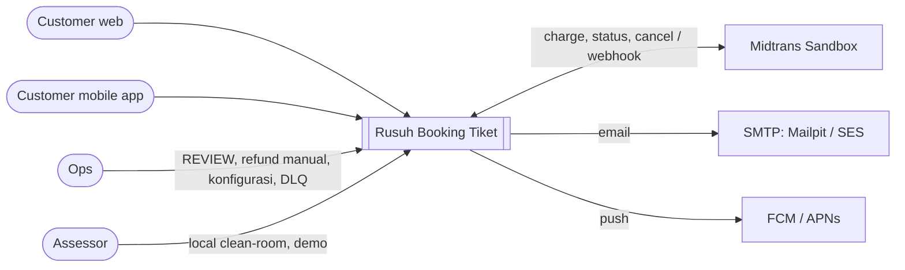

#### Actors

*Sumber: PRD v4.6 §3.2*

| Actor (requirement) | Tipe | Realisasi |
|---|---|---|
| Customer | Manusia | Pembeli tamu (guest) dengan email + NIK pembeli; mengisi NIK pemegang per tiket |
| Web Frontend | Klien | Next.js; juga menyajikan payment page untuk WebView |
| Mobile App | Klien | Layar native + payment page via WebView |
| **Queue Service** | Service | Waiting room, nomor antrean, admission, indikator peluang, guest session |
| **Booking Service** | Service | Event, stok, reservasi, sesi pemilihan, booking, kuota, NIK pemegang, tiket, expiry |
| **Payment Service** | Service | Payment page, metode, charge, webhook, rekonsiliasi, pembatalan transaksi di gateway |
| Payment Gateway | Eksternal | Midtrans Sandbox |
| **Notification Service** | Service | Email e-tiket, expired, pembayaran terlambat; retry dan DLQ |
| Edge | Infrastruktur | CloudFront, WAF, ALB |
| Ops | Manusia | Menangani kasus REVIEW dan refund manual |
| Assessor | Manusia | Menjalankan local flow, membuka demo cloud, memeriksa evidence |


### 4.2 Functional / Container View (VP-2)

#### 4.2.1 Komponen

| ID | Komponen | Tanggung jawab ringkas | Owner |
|----|----------|------------------------|-------|
| CMP-EDGE | CloudFront + AWS WAF + ALB (lokal: nginx edge) | TLS, cache Status Document dan event list, challenge bot, routing per service | BE-1 |
| CMP-QUEUE | Queue Service | Guest session, join, FIFO, promotor, klaim, Status Document, zona peluang | BE-1 |
| CMP-BOOKING | Booking Service | Event, stok, alokasi, sesi, hold, ubah pesanan, kuota, NIK pemegang, settlement, expiry, tiket, konfigurasi | BE-2 |
| CMP-PAYMENT | Payment Service | Payment page view model, attempt, webhook, resolve, page token, refund case | BE-2 |
| CMP-NOTIF | Notification Service | Email dan push; retry, DLQ, redrive | BE-1 |
| CMP-WEB | Next.js web (termasuk payment page `/pay/{bookingId}`) | UI customer web dan payment page reusable | WEB-1, WEB-2 |
| CMP-MOBILE | Aplikasi React Native | UI customer mobile; payment page via WebView | MOB-1 |
| CMP-PLATFORM | Shared utilities `pkg/` (module bersama) | Middleware, error, token, kripto, NIK validator, outbox, consumer, resilience, telemetry | BE-1 (+ review BE-2) |
| DS-PG | PostgreSQL 16 (schema per service) | Otoritas stok dan uang | BE-2 |
| DS-VK | Valkey 8.1 | Antrean, rate limit, cache | BE-1 |
| DS-MQ | RabbitMQ | Event domain, retry, DLQ | BE-1 |

#### Component HLD

*Sumber: PRD v4.6 §8.1*

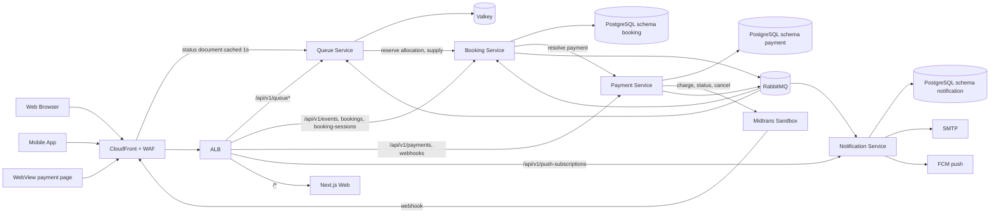

#### Architecture Style

*Sumber: PRD v4.6 §7.1*

**Dipilih: 4 service sesuai requirement dalam satu monorepo, dengan batas data per service.**

| Pertimbangan | Keputusan |
|---|---|
| Penamaan | Mengikuti aktor requirement agar mudah ditelusuri assessor |
| Batas konsistensi | Semua yang menyentuh stok (event supply, alokasi, hold, sold, kuota, NIK pemegang, tiket) berada di Booking Service dan berubah dalam satu transaksi |
| Payment terpisah | Aman karena Payment tidak mengubah stok; hasil pembayaran diterapkan oleh Booking |
| Queue terpisah | Wajib untuk skala: beban join dan antrean berbeda jauh dengan beban transaksi |
| Notification terpisah | Kegagalan email terisolasi (NFR-10) |
| Komunikasi sinkron | Hanya 2 titik: Queue→Booking (reservasi alokasi, supply) dan Booking→Payment (resolve) |
| Komunikasi async | RabbitMQ; transactional outbox di Booking dan Payment; consumer idempoten tanpa tabel inbox (§9.8 [v4.6 → SDD §4.5.2]) |
| Data | Satu cluster PostgreSQL, **schema + user DB terpisah per service**, tanpa FK/join lintas schema; dapat dipindah ke instance sendiri tanpa perubahan kode |
| Repo | Monorepo; satu proyek dan `go.mod` per service sesuai standar proyek (ADR-016), disatukan `go.work`; batas antar-service ditegakkan Go `internal/` dan linter (depguard) di CI |

Trade-off lengkap di Lampiran L [v4.6 → ADR Appendix A].

#### Service Catalogue

*Sumber: PRD v4.6 §9.1*

| Service | Tanggung jawab | Endpoint publik utama | Data (schema) | Bergantung pada | Owner |
|---|---|---|---|---|---|
| **Queue Service** | Guest session, join, sequence FIFO, waiting set, promotor, claim window, admission token, Status Document, indikator peluang, posisi eksak, leave | `POST /events/{id}/queue-entries`, `GET /queue-status/{eventId}`, `GET /queue-entries/me`, `POST /queue-entries/{id}/claim`, `DELETE /queue-entries/{id}` | Valkey; `queue.entry_audit`, `queue.event_settings` | Booking (internal), RabbitMQ | BE-1 |
| **Booking Service** | Event & kategori, supply, alokasi, sesi pemilihan, pemulihan sesi, validasi NIK, kuota, NIK pemegang, hold, ubah pesanan, kunci pesanan, booking, settlement, expiry + resolve, cancel, tiket, tautan tiket, konfigurasi event + audit | `GET /events`, `GET /events/{id}`, `POST /booking-sessions`, `GET /booking-sessions/current`, `GET /booking-sessions/{id}`, `POST /booking-sessions/{id}/attendee-checks`, `POST /booking-sessions/{id}/cancel`, `POST /bookings`, `PUT /bookings/{id}/items`, `GET /bookings/{id}`, `POST /bookings/{id}/cancel`, `GET /bookings/{id}/tickets` | `booking.*` | Payment (internal), RabbitMQ | BE-2 |
| **Payment Service** | Payment page view model, metode, payment page token, attempt/charge, webhook, signature, rekonsiliasi, cancel di gateway, resolve, kasus refund | `GET /payments/{bookingId}/page`, `POST /payments/{bookingId}/page-tokens`, `POST /payment-page-sessions`, `POST /payments/{bookingId}/attempts`, `GET /payments/{bookingId}/status`, `POST /webhooks/midtrans` | `payment.*` | Booking (internal read), Midtrans, RabbitMQ | BE-2 |
| **Notification Service** | Consumer event, template email, SMTP, push notification giliran (FCM), retry, DLQ, redrive | `POST /push-subscriptions`, `DELETE /push-subscriptions/{eventId}` | `notification.*` | RabbitMQ, SMTP, FCM | BE-1 |
| **Platform (shared libs)** | HTTP middleware, error envelope, token (JWT EdDSA), crypto (HMAC, AES-GCM), NIK validator, outbox library, consumer (ack/retry/DLQ), resilience, telemetry, config, clock | — | — | — | BE-1 (+ review BE-2) |

#### Internal APIs (sinkron)

*Sumber: PRD v4.6 §9.2*

| Pemanggil → Penerima | Endpoint | Fungsi | Sifat |
|---|---|---|---|
| Queue → Booking | `POST /internal/v1/allocations:batch` | Reservasi alokasi untuk N entry terdepan | Idempoten per `queueEntryId` |
| Queue → Booking | `GET /internal/v1/events/{id}/supply` | Snapshot stok bebas, teralokasi, di-hold; status sale | Read, di-cache 1 detik |
| Booking → Payment | `POST /internal/v1/payments/{bookingId}/resolve` | `CHECK` atau `CHECK_AND_CANCEL` ke gateway | Idempoten |
| Payment → Booking | `GET /internal/v1/bookings/{id}/payable` | Amount, deadline, status, pemilik | Read |
| Payment → Booking | `POST /internal/v1/bookings/{id}/deadline-extension` | Perpanjangan satu kali saat gateway gangguan (PAY-06, SHOULD) | Idempoten |
| Payment → Booking | `POST /internal/v1/bookings/{id}/payment-lock` | Kunci pesanan saat customer menekan "Bayar"; mengembalikan `version` dan nominal yang ditagih (§5.23 [v4.6 → SRS §3.2.23]) | Idempoten |

Semua panggilan internal: timeout ketat, breaker, retry terbatas untuk operasi idempoten, service token JWT berumur pendek, jaringan privat. Kontrak di `docs/contracts/openapi/internal-*.yaml`. Komunikasi sinkron tetap hanya dua arah (Queue→Booking, Booking↔Payment); `payment-lock` adalah panggilan Payment→Booking yang sejenis dengan `payable`.

#### Domain Events (asinkron)

*Sumber: PRD v4.6 §9.3*

| Event | Producer | Consumer | Fungsi |
|---|---|---|---|
| `booking.journey.ended` | Booking | Queue | Bebaskan slot; outcome `PAID`, `EXPIRED`, `CANCELLED`, `SESSION_EXPIRED`, `UNCLAIMED`, `LEFT_WITHOUT_BUYING` |
| `booking.quota.exhausted` | Booking | Queue | Blokir join ulang NIK pembeli yang kuotanya habis |
| `booking.sold_out` | Booking | Queue | Tutup waiting room |
| `booking.paid` | Booking | Notification | Email e-tiket |
| `booking.expired` | Booking | Notification | Email pembayaran expired |
| `booking.review` | Booking | Notification, Payment | Email pembayaran terlambat; buka kasus refund |
| `payment.succeeded` | Payment | Booking | Terapkan settlement |
| `payment.failed` | Payment | Booking | Informasi; booking tetap menunggu sampai TTL (ganti metode) |
| `queue.turn.soon` | Queue | Notification | Push "giliran sebentar lagi" (sekali per entry) |
| `queue.turn.arrived` | Queue | Notification | Push "giliran Anda tiba" dengan claim deadline; dibuang bila lewat deadline |

Envelope JSON dengan `messageId`, `eventType`, `schemaVersion`, `occurredAt`, `correlationId`, `producer`. Detail di Lampiran E [v4.6 → SDD §4.6.2].

#### Request Pipeline

*Sumber: PRD v4.6 §9.4*

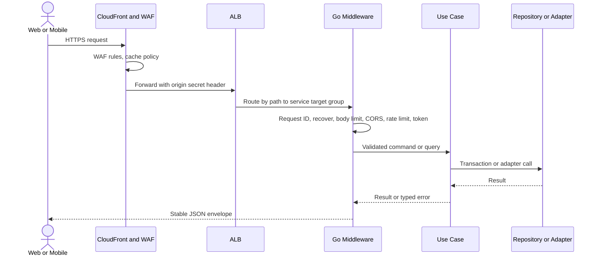


### 4.3 Information View (VP-3)

#### Schema per Service

*Sumber: PRD v4.6 §13.1*

| Schema | Tabel | DB user |
|---|---|---|
| `queue` | `event_settings`, `entry_audit` | `svc_queue` |
| `booking` | `events`, `config_audit`, `ticket_categories`, `category_inventories`, `event_supply`, `admissions`, `attendee_checks`, `buyer_quotas`, `bookings`, `booking_items`, `tickets`, `idempotency_records`, `outbox_events` | `svc_booking` |
| `payment` | `payment_attempts`, `payment_callbacks`, `payment_page_tokens`, `refund_cases`, `idempotency_records`, `outbox_events` | `svc_payment` |
| `notification` | `deliveries`, `push_subscriptions` | `svc_notification` |

Setiap user DB hanya punya hak pada schema miliknya. Referensi lintas service hanya berupa UUID biasa tanpa foreign key. DDL lengkap di Lampiran B [v4.6 → SDD §4.4]. Alasan setiap tabel pendukung dan idempotensi consumer di §9.8 [v4.6 → SDD §4.5.2].

#### ERD Booking Service

*Sumber: PRD v4.6 §13.2*

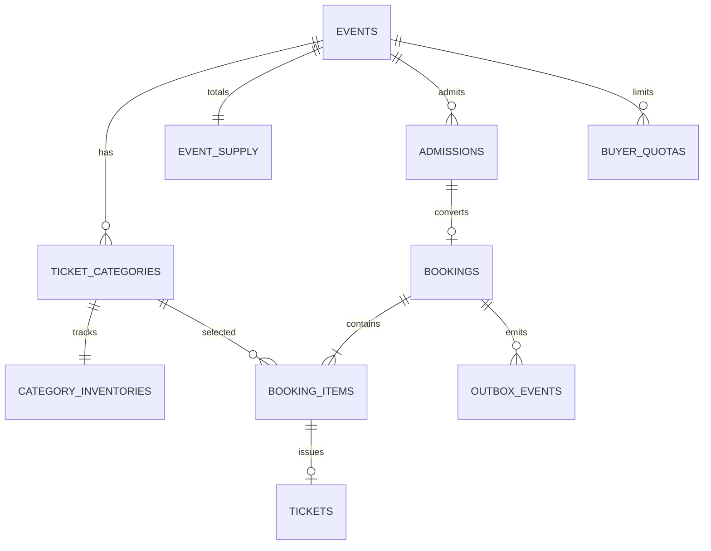

#### Mandatory Constraints

*Sumber: PRD v4.6 §13.3*

- `event_supply`: `allocated_units + held_units + sold_units ≤ total_capacity`, semua counter non-negatif.
- `category_inventories`: `held + sold ≤ capacity`.
- `buyer_quotas`: `held + paid ≤ max_quantity` (3).
- `event_supply.total_capacity = Σ category_inventories.capacity` per event (constraint trigger `DEFERRABLE INITIALLY DEFERRED`; perubahan kapasitas kategori dan supply harus dalam satu transaksi).
- `admissions`: satu admission aktif (`RESERVED`/`ACTIVE`/`EDITABLE`) per (event, NIK pembeli) dan per (event, perangkat/visitor); satu admission per queue entry; `attendee_checks` ≤ batas per sesi; `edit_count` ≤ `cfg_max_edits`; `CONVERTED` ⇔ `lock_reason` terisi; snapshot `cfg_*` wajib.
- Alokasi: `allocated_units` = Σ unit admission `RESERVED`/`ACTIVE` + Σ (unit − item `HELD`) admission `EDITABLE` (dicek rekonsiliasi dan harness).
- `events`: `max_tickets_per_order ≤ max_tickets_per_buyer_nik`, tenggang dan peringatan < TTL Booking, TTL Pembayaran ≥ TTL Booking; aturan pembentuk jaminan tidak dapat diubah setelah `rules_locked_at` (trigger); setiap perubahan ditulis ke `config_audit`.
- `booking_items`: satu NIK pemegang per event untuk item berstatus `HELD`/`PAID` (partial unique index); item yang digantikan saat ubah pesanan berstatus `REPLACED` dan tidak ikut dihitung.
- `bookings`: `payment_started_at` terisi ⇒ admission terkunci; `version` naik setiap ubah pesanan.
- `bookings`: `item_quantity` 1–3; amount `bigint` minor unit; waktu `timestamptz` UTC.
- `tickets`: satu tiket per item; `public_code` unik.
- Idempotency: unik per (scope, owner, key); fingerprint callback unik.

#### Valkey: Peran dan Model Key

*Sumber: PRD v4.6 §13.4*

**Peran Valkey dibatasi tiga hal.** Semua data di Valkey dapat dipulihkan atau dihitung ulang; tidak ada yang menjadi sumber kebenaran stok atau uang.

| Peran | Pemilik | Isi | Bila Valkey gagal |
|---|---|---|---|
| Antrean | Queue | Sequence, waiting set, entry, slot aktif, penanda satu antrean per NIK/perangkat/email, lease promotor | Join/klaim ditolak sementara (fail closed); urutan dipulihkan dari `queue.entry_audit` |
| Rate limit | Semua service publik (middleware `pkg/httpx`) | Token bucket per IP + visitor + event | Fail closed untuk join/klaim/hold; endpoint baca lain fail open |
| Cache | Queue, Booking | Status Document (`q:{e}:status`), snapshot supply untuk Queue (TTL 1 detik), ringkasan ketersediaan kategori untuk SSE (`b:{e}:availability`, TTL 1 detik) | Dibaca langsung dari sumbernya (PostgreSQL / Booking) |

**Tidak pernah di Valkey:** stok, alokasi, hold, sesi pemilihan, kuota, NIK pemegang, booking, atau status pembayaran. Semuanya berada di PostgreSQL Booking/Payment dan berubah dalam transaksi (§9.6 [v4.6 → HLD §4.3]). Dengan begitu kegagalan atau failover Valkey paling buruk memperlambat antrean, tetapi tidak pernah menyebabkan oversell atau hilangnya tiket yang dijanjikan.

**Client:** `valkey-go` (valkey-io, pure Go). Dipakai lewat port `QueueStore`, `RateLimiter`, dan `Cache` sehingga service tidak bergantung langsung pada library (§7.4 [v4.6 → SDD §4.5]). Script Lua dimuat sekali saat start (`SCRIPT LOAD`) dan dipanggil dengan `EVALSHA`.

**Model key antrean (Queue Service).** Semua key per event memakai hash tag `{e:<eventId>}` agar operasi Lua atomik pada satu shard.

| Key | Tipe | Isi |
|---|---|---|
| `q:{e}:seq` | String | Counter sequence |
| `q:{e}:waiting` | Sorted set | member `entryId`, score `seq` |
| `q:{e}:entry:<entryId>` | Hash | seq, visitorId, buyerNikHash, emailEnc, status, joinedAtMs (UTC), admittedAtMs, claimDeadlineMs, allocationId |
| `q:{e}:nik:<buyerNikHash>` | String | entryId aktif (satu slot per NIK) |
| `q:{e}:visitor:<visitorId>` | String | entryId aktif (satu antrean per perangkat) |
| `q:{e}:email:<emailHash>` | String | entryId aktif (satu antrean per email; HMAC email) |
| `q:{e}:quota_exhausted` | Set | buyerNikHash yang kuotanya habis |
| `q:{e}:active` | Sorted set | entry ADMITTED/CLAIMED, score claimDeadline |
| `q:{e}:removed` | Hash | jumlah entry keluar per bucket seq |
| `q:{e}:meta` | Hash | servingSeq, capacity, saleState, soldOut |
| `q:{e}:status` | String | Status Document terakhir (JSON) |
| `q:{e}:promoter` | String | Lease leader promotor |

Valkey di PoC memakai AOF `everysec` (host stateful); di production ElastiCache for Valkey dengan replica Multi-AZ. Hash tag membuat semua key satu event berada di satu shard, sehingga operasi Lua tetap atomik bila cluster mode dipakai. Entry juga ditulis asinkron ke `queue.entry_audit` untuk audit FIFO dan pemulihan.

---

#### Strong and Eventual Consistency

*Sumber: PRD v4.6 §9.6*

| Strong (satu transaksi Booking) | Eventual |
|---|---|
| Supply event, alokasi, hold, sold, kuota, NIK pemegang, status booking, tiket | Status Document (≤ 1–2 detik), pembebasan slot di Queue (event), email, dashboard, status payment di Payment Service vs booking |

Valkey dan RabbitMQ bukan source of truth untuk stok atau uang.

#### Teorema CAP dan PACELC per Komponen

*Sumber: PRD v4.6 §9.7*

**CAP:** saat terjadi partisi jaringan (P), sistem terdistribusi harus memilih antara konsistensi (C, semua pihak melihat data yang sama atau permintaan ditolak) dan ketersediaan (A, permintaan tetap dilayani walau data mungkin basi). **PACELC** melengkapinya: saat normal (*Else*), pilihannya antara latensi (L) dan konsistensi (C).

Rusuh Booking Tiket tidak memakai satu sikap untuk seluruh sistem. Sikap setiap komponen ditentukan oleh **akibat bila datanya salah**:

> **Di mana salah berarti uang atau tiket ganda, kami memilih konsistensi. Di mana salah hanya berarti tampilan telat, kami memilih ketersediaan.**

| Komponen | Data | Saat partisi / gagal (CAP) | Saat normal (PACELC) | Yang dialami customer | Pemulihan |
|---|---|---|---|---|---|
| PostgreSQL Booking | Supply, alokasi, hold, sold, kuota, NIK pemegang, booking, tiket | **CP**: satu primary; bila primary tidak terjangkau, tulis ditolak; tidak ada tulis ke replica | **EC**: keputusan stok selalu di primary dalam satu transaksi; read replica (bila ada) hanya untuk dashboard dan rekonsiliasi | Reservasi/hold gagal sementara (503 + `Retry-After`, pesan "coba lagi"); **tidak pernah oversell atau tiket ganda** | Production: RDS Multi-AZ (standby sinkron, transaksi yang sudah commit tidak hilang saat failover). PoC: backup + restore |
| PostgreSQL Payment | Attempt, callback, refund case | **CP** | **EC** | Pembuatan VA gagal sementara; webhook dibalas non-2xx sehingga Midtrans mengulang | Retry provider + rekonsiliasi lewat status API |
| Valkey: antrean | Seq, waiting set, entry, slot aktif | **Fail closed**: join/klaim ditolak bila Valkey tidak terjangkau, sehingga tidak ada dua nomor antrean dari dua sisi partisi. Replikasi async: tulisan terakhir sebelum failover dapat hilang | **EL**: latensi diutamakan (replikasi async, ±2 ms per join) | Join ditolak beberapa detik; entry yang ada tetap | Urutan dipulihkan dari `queue.entry_audit`; stok tidak terdampak karena tidak disimpan di Valkey (§13.4 [v4.6 → HLD §4.3]) |
| Valkey: rate limit | Token bucket | Fail closed untuk join/klaim/hold; fail open untuk endpoint baca | **EL** | Aksi tulis ditahan sebentar | Otomatis saat Valkey pulih |
| Valkey: cache | Status Document, snapshot supply, ringkasan ketersediaan SSE | **AP**: data boleh basi; bila hilang dibaca ulang dari sumbernya | **EL** | Angka sisa atau posisi telat 1–2 detik; keputusan admit/hold tetap divalidasi server | Dihitung ulang dari PostgreSQL |
| CDN (Status Document) | Status antrean | **AP**: `stale-if-error` | **EL** | Posisi telat beberapa detik | Otomatis |
| RabbitMQ + outbox | Event domain | **AP** untuk producer: transaksi tetap commit; event tertahan di `outbox_events` | **EL**: publish di luar transaksi | Email/push tertunda, tidak hilang; transaksi tidak pernah menunggu broker (NFR-10) | Publisher mengirim ulang setelah broker pulih; consumer idempoten (§9.8 [v4.6 → SDD §4.5.2]) |
| Antar-service (Booking ↔ Payment ↔ Queue) | Status lintas service | Tanpa transaksi terdistribusi (tanpa 2PC/saga) | Eventual (§9.6 [v4.6 → HLD §4.3]) | Status pembayaran di layar bisa telat beberapa detik | Outbox + rekonsiliasi terjadwal (§16.3 [v4.6 → HLD §4.7.1]) |

**Kenapa stok tidak AP.** Bila dua sisi partisi sama-sama boleh menulis stok, keduanya dapat menjual unit yang sama: tiket ganda atau janji "Jangan PHP" yang dilanggar. Menolak sementara lebih jujur daripada menerima lalu membatalkan. Biaya CP kecil karena tulisan stok dibatasi slot aktif (< 250/detik di Tier L).

**Kenapa antrean tidak CP penuh.** Replikasi sinkron di setiap join menambah latensi pada jalur 20.000+ join/detik. Kehilangan beberapa detik join terakhir saat failover dapat dipulihkan dari `entry_audit` dan tidak mengubah stok atau uang. Penerbitan nomor tetap fail closed sehingga FIFO tidak pernah bercabang.

**Kenapa tidak ada transaksi terdistribusi.** Semua yang menyentuh stok ada di satu service (§7.1 [v4.6 → HLD §4.2.1]), sehingga konsistensi kuat cukup dengan satu transaksi PostgreSQL. Hubungan antar-service cukup eventual karena outbox menjamin event tidak hilang dan rekonsiliasi mendeteksi selisih.

Bukti: C.7 (stok, uji paralel), M.1 (Lua, 10.000 join paralel tanpa celah seq), TC-CAP-01..03 dan TC-MSG-01..03 (diuji pada implementasi).


### 4.4 Runtime View (VP-4)

Seluruh sequence lintas service dari v4.6 §10. Detail race condition, outbox, dan breaker ada di SDD-RBT-001 §4.7.

#### Join and Direct Admission

*Sumber: PRD v4.6 §10.1*

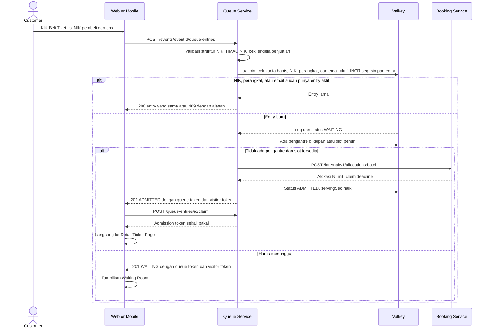

#### Waiting, Promotion, and Claim

*Sumber: PRD v4.6 §10.2*

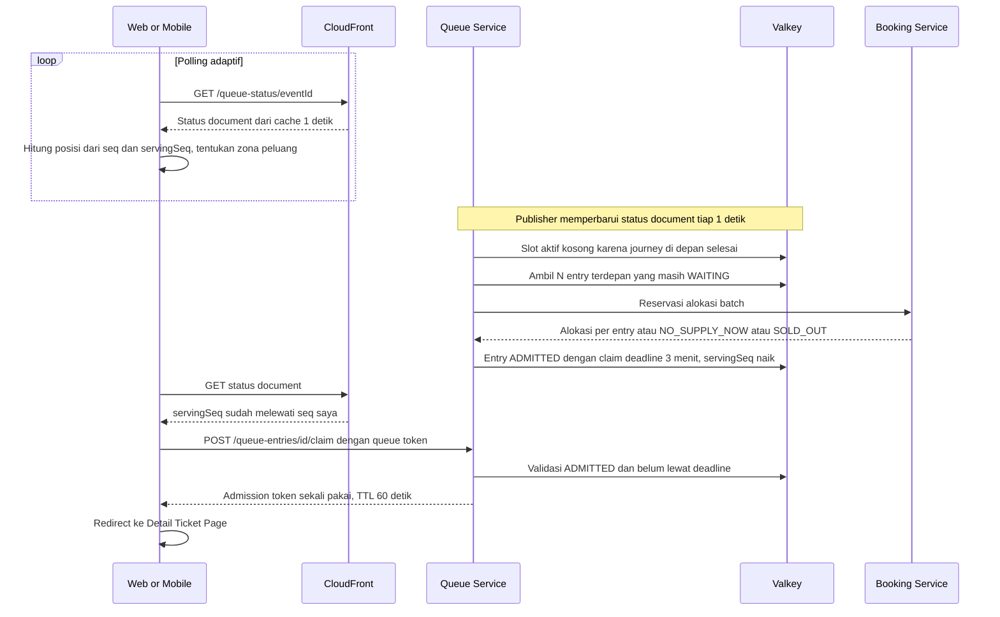

#### Selection Session and Reservation Guarantee

*Sumber: PRD v4.6 §10.3*

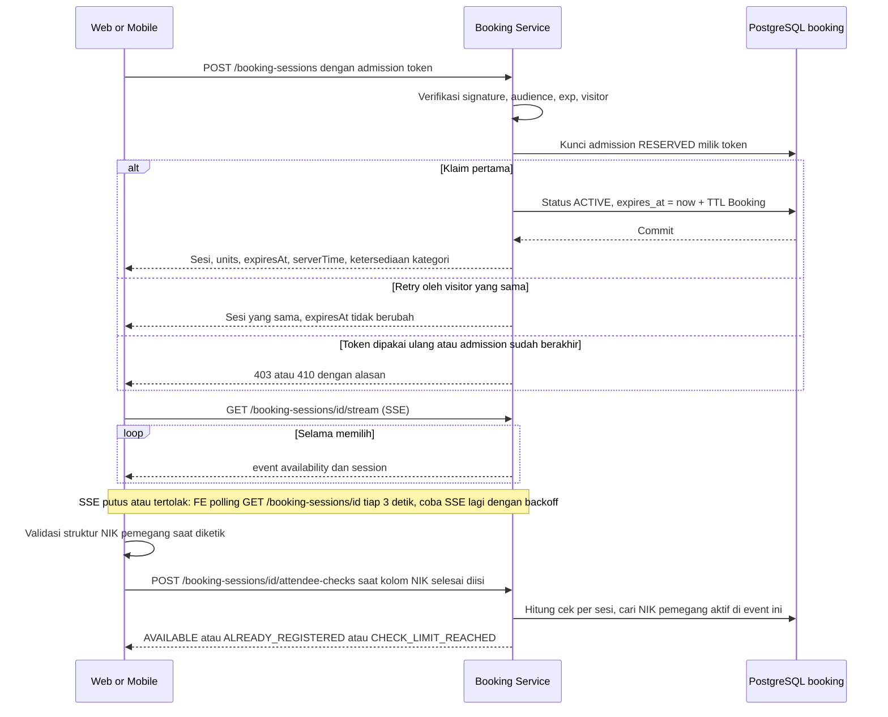

#### Atomic Hold

*Sumber: PRD v4.6 §10.4*

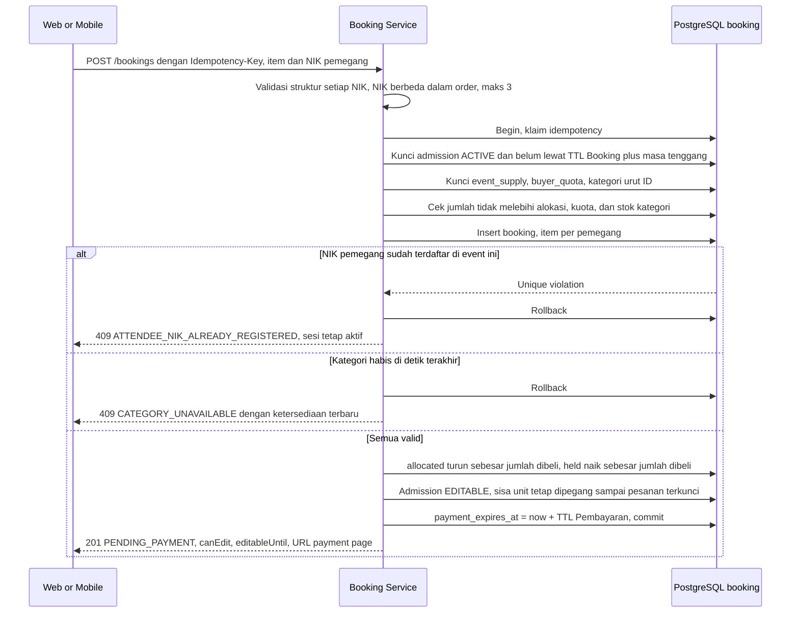

#### Payment Creation (web)

*Sumber: PRD v4.6 §10.5*

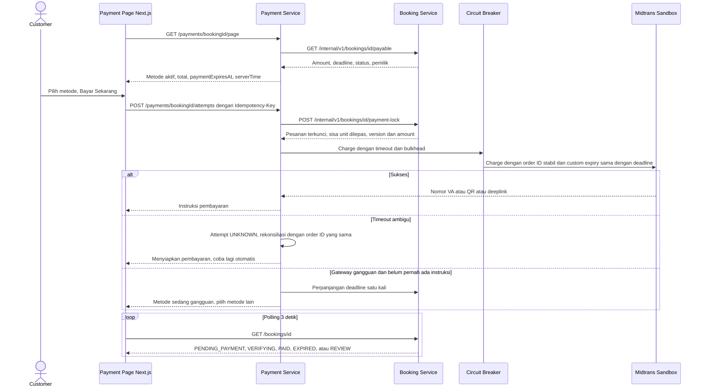

#### Mobile Payment via WebView

*Sumber: PRD v4.6 §10.6*

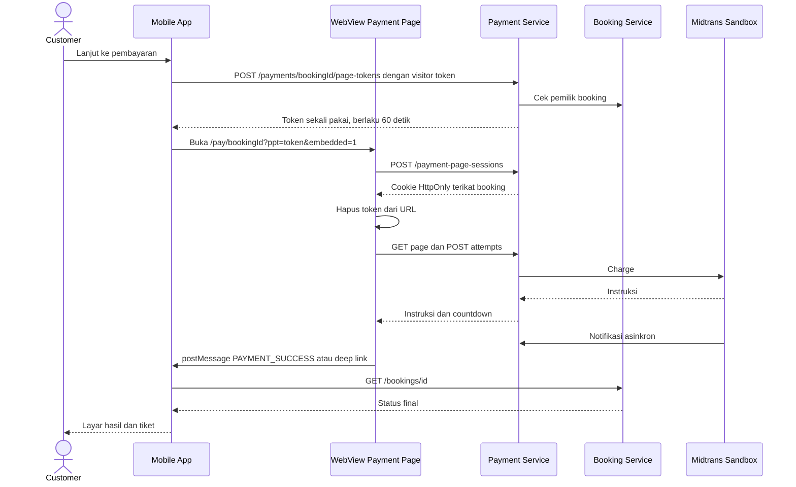

#### Settlement

*Sumber: PRD v4.6 §10.7*

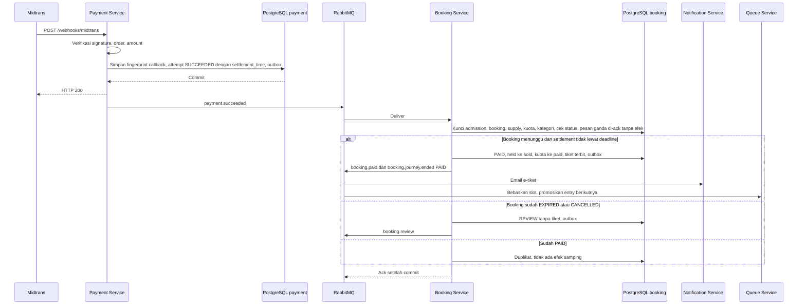

#### Payment Expiry with Reconciliation

*Sumber: PRD v4.6 §10.8*

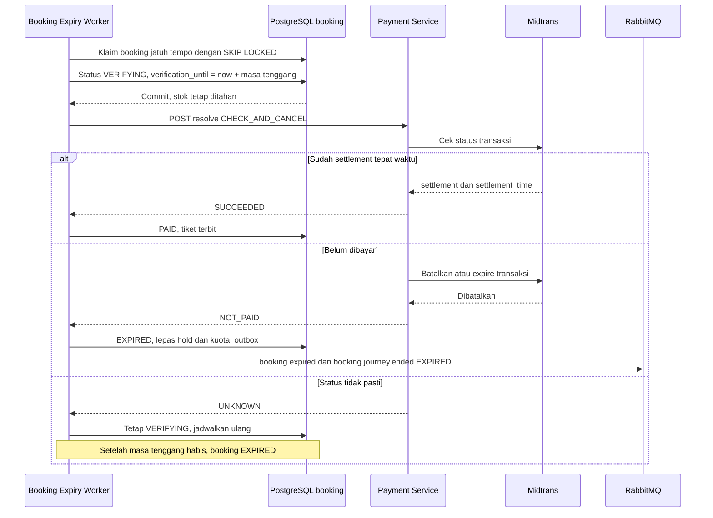

#### Sold-Out Closure and Honest Indicator

*Sumber: PRD v4.6 §10.9*

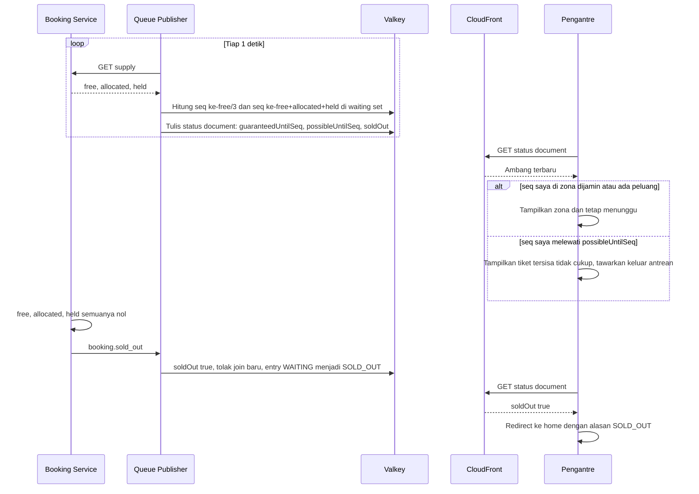

#### Unclaimed Turn and Selection Timeout

*Sumber: PRD v4.6 §10.10*

```mermaid
sequenceDiagram
  participant W as Booking Expiry Worker
  participant PB as PostgreSQL booking
  participant MQ as RabbitMQ
  participant QS as Queue Service
  participant FE as Customer
  W->>PB: Klaim admission RESERVED lewat claim deadline atau ACTIVE lewat TTL Booking
  W->>PB: EXPIRED, allocated dikembalikan ke pool, outbox
  W->>MQ: booking.journey.ended UNCLAIMED atau SESSION_EXPIRED
  MQ->>QS: Deliver
  QS->>QS: Bebaskan slot, entry berakhir, promosikan entry berikutnya sesuai urutan
  FE->>QS: Customer kembali dan memanggil status
  QS-->>FE: TURN_MISSED atau SESSION_EXPIRED
  FE->>FE: Redirect ke home dengan alasan, dapat antre ulang bila kuota masih ada
```

#### Cancel by Customer (SHOULD)

*Sumber: PRD v4.6 §10.11*

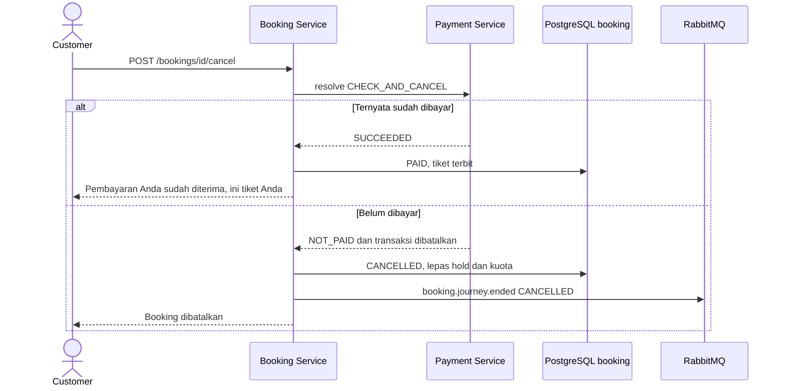

#### Autoscaling Continuity

*Sumber: PRD v4.6 §10.12*

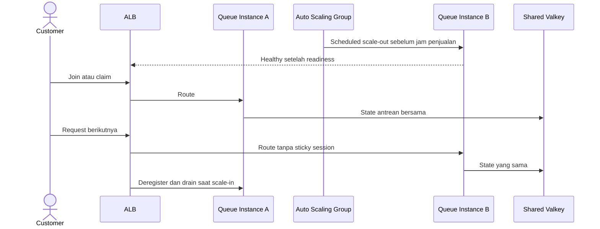

#### Edit Order Before Payment

*Sumber: PRD v4.6 §10.13*

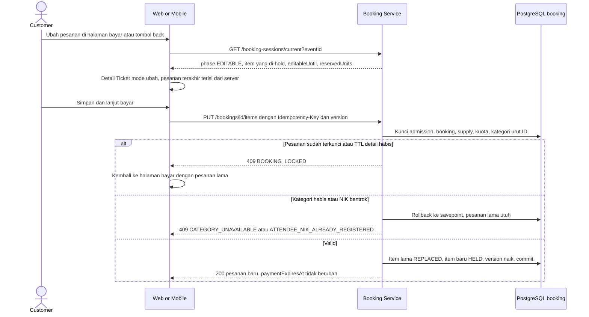

#### Recovery After Connection Loss

*Sumber: PRD v4.6 §10.14*

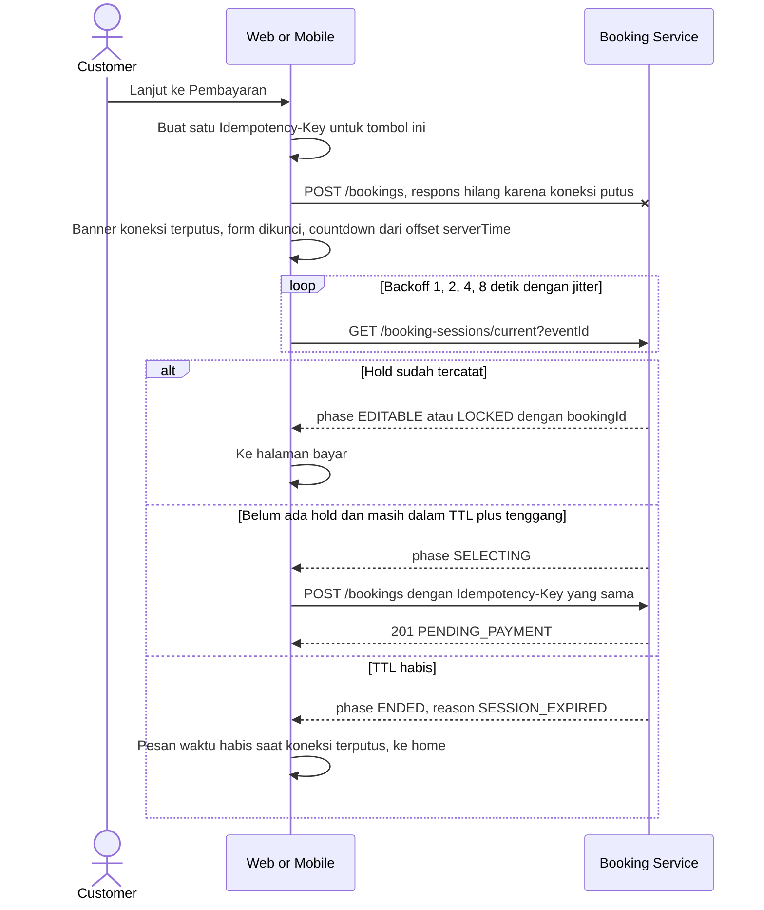

#### Turn Notification

*Sumber: PRD v4.6 §10.15*

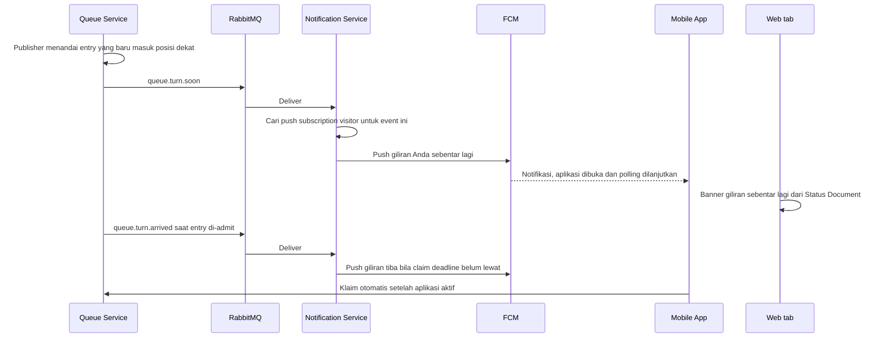

---


### 4.5 Deployment View (VP-5)

#### Deployment HLD (AWS PoC)

*Sumber: PRD v4.6 §8.5*

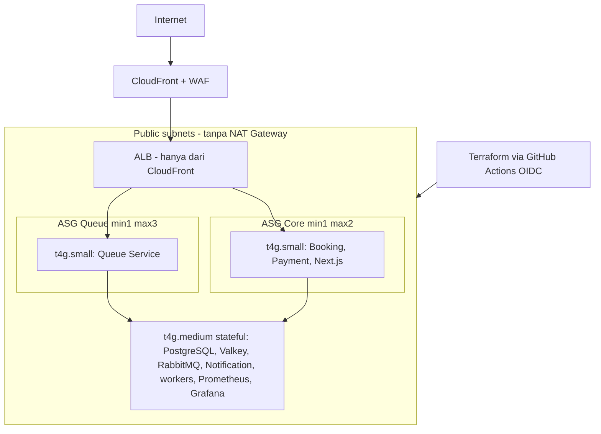

Queue Service di-autoscale terpisah karena menanggung lonjakan join. Security group berlapis, akses admin via SSM, tanpa SSH publik. Arsitektur referensi production per tier kapasitas ada di §17 [v4.6 → HLD §4.7].

---

#### Environment Matrix

*Sumber: PRD v4.6 §18.1*

| Env | Entry | Payment | Email | Tujuan |
|---|---|---|---|---|
| local-assessor | nginx edge (Compose) | Midtrans Sandbox via tunnel; simulator bila offline | Mailpit | Penilaian mandiri |
| development | Compose | Midtrans Sandbox via tunnel | Mailpit | Integrasi |
| CI | Compose sekali pakai | Simulator | Mailpit | Test otomatis |
| staging/demo | CloudFront + WAF + ALB + 2 ASG | Midtrans Sandbox (wajib) | SES sandbox | Load test, security, demo |

#### AWS PoC

*Sumber: PRD v4.6 §18.2*

- Mulai di Free plan; upgrade ke Paid plan bila layanan dibatasi (kredit tetap berlaku). AWS Budgets alert US$50/100/150.
- Region `ap-southeast-3`; tag semua resource `project=rusuh`, `env`, `owner`, `expires-on`.
- Sprint 1 lokal saja; AWS dinyalakan ±D11 dan di-teardown setelah assessment.
- Topologi: CloudFront + WAF → ALB → ASG Queue (t4g.small, min 1 max 3) dan ASG Core (t4g.small, min 1 max 2: Booking, Payment, Next.js) → host stateful t4g.medium (PostgreSQL, Valkey, RabbitMQ, Notification, worker, Prometheus, Grafana). Tanpa NAT Gateway.

| Komponen | Perkiraan/bulan bila 24/7 |
|---|---:|
| ALB | US$18–22 |
| ASG Queue + ASG Core (2–3 × t4g.small) | US$30–45 |
| Host stateful t4g.medium | ±US$30 |
| EBS + snapshot | US$4–6 |
| Public IPv4 | ±US$12 |
| WAF | US$7–10 |
| CloudFront | dalam always-free |
| **Total** | **±US$100–125** |

#### Terraform Scope

*Sumber: PRD v4.6 §18.3*

VPC/subnet/SG (tanpa NAT), CloudFront + WAF, ALB + target group per service, launch template arm64 + 2 ASG (target tracking + scheduled action), host stateful + EBS, IAM/SSM + OIDC role GitHub, ECR per service, S3 state/backup, ACM, Route 53, AWS Budgets.

#### Arsitektur Referensi Production per Tier

*Sumber: PRD v4.6 §17.3*

| Komponen | Tier S | Tier M | Tier L |
|---|---|---|---|
| Queue Service | 2× c7g.large (puncak 3×) | 2× (puncak 4–5×) | 3× (puncak 8–10×) |
| Booking + Payment + Web | 2× c7g.large | 3× c7g.large | 4× c7g.large |
| Notification + worker | 1× c7g.medium | 1× c7g.medium | 2× c7g.medium |
| ElastiCache for Valkey | r7g.large + replica | r7g.large + replica | r7g.xlarge + replica |
| PostgreSQL (RDS Multi-AZ) | db.r7g.large | db.r7g.large | db.r7g.xlarge |
| RabbitMQ (Amazon MQ) | single-instance | single-instance | cluster 3 node |
| Edge | CloudFront + WAF + ALB | sama | sama |
| Email | Amazon SES | sama | sama |

Throughput per instance Queue Service (PROPOSED 3.000 join/s per c7g.large) **diukur pada load test PoC** dan dipakai untuk mengonfirmasi jumlah instance. Scale-out dilakukan terjadwal 30 menit sebelum jam penjualan.

**Indikasi awal (16 Oktober 2026, Valkey 8.1.4, belum menjadi evidence `VERIFIED`):** script Lua join (Lampiran M [v4.6 → SDD §4.9]), dipanggil lewat `valkey-go` (`EVALSHA`) dengan 64 goroutine, mencapai **±23.900–27.000 join/detik** pada satu node Valkey (AOF `everysec`) di container pengembangan 2 vCPU, dengan klien benchmark di mesin yang sama (p50 2,2–2,3 ms, p99 6,5–7,5 ms; 3 kali run × 200.000 join). Pemakaian memori ±620–670 byte per entry, sehingga 1 juta pengantre membutuhkan ±0,65 GB. Sebagai pembanding, script yang sama di Redis 7 (15 Oktober) mencapai ±22.900 join/detik. Untuk Tier L, puncak 20.000 join/detik masih dekat dengan angka ini; karena itu Tier L memakai node Valkey yang lebih besar dan WAF challenge yang meratakan lonjakan join, dan headroom-nya wajib diverifikasi pada load test.


Konfigurasi edge dan security group rinci ada di Appendix B. Pipeline CI/CD, perintah lokal, dan Docker Compose ada di Engineering Handbook.

### 4.6 Security View (VP-6)

#### Access Path

*Sumber: PRD v4.6 §8.2*

```text
https://<domain>/api/v1/queue-status/{eventId}    -> CloudFront (cache 1 s)  -> ALB -> Queue Service
https://<domain>/api/v1/events*                    -> CloudFront (cache 2 s)  -> ALB -> Booking Service
https://<domain>/api/v1/events/{id}/queue-entries  -> CloudFront (no cache, WAF challenge) -> ALB -> Queue Service
https://<domain>/api/v1/queue-entries/*            -> CloudFront (no cache)   -> ALB -> Queue Service
https://<domain>/api/v1/booking-sessions*          -> CloudFront (no cache)   -> ALB -> Booking Service
https://<domain>/api/v1/bookings*                  -> CloudFront (no cache)   -> ALB -> Booking Service
https://<domain>/api/v1/payments*                  -> CloudFront (no cache)   -> ALB -> Payment Service
https://<domain>/api/v1/payment-page-sessions      -> CloudFront (no cache)   -> ALB -> Payment Service
https://<domain>/api/v1/webhooks/midtrans          -> CloudFront (POST)       -> ALB -> Payment Service
https://<domain>/api/v1/push-subscriptions*        -> CloudFront (no cache)   -> ALB -> Notification Service
https://<domain>/pay/{bookingId}, /*               -> CloudFront              -> ALB -> Next.js
```

API internal (`/internal/v1/*`) tidak dirutekan oleh ALB publik; hanya dapat diakses di jaringan privat dengan service token.

#### Edge Responsibilities

*Sumber: PRD v4.6 §8.4*

| Fungsi | Lapisan |
|---|---|
| TLS, Shield Standard, cache aset, Status Document, event list | CloudFront |
| Managed rules, rate-based rule per IP, challenge pada join | AWS WAF |
| Path routing per service, health check | ALB |
| Request ID, CORS, body limit, timeout, rate limit Valkey | Go middleware (`pkg/httpx`) |
| Validasi token, ownership, business guard | Masing-masing service |

#### Edge Configuration Summary

*Sumber: PRD v4.6 §12.3*

| Lapisan | Konfigurasi kunci |
|---|---|
| CloudFront | `/api/v1/queue-status/*` cache 1 s (tanpa cookie/header di cache key); `/api/v1/events*` cache 2 s; `/_next/static/*` cache panjang; sisanya CachingDisabled |
| WAF | Managed rules; rate-based per IP untuk join dan klaim; **challenge** (bukan block) pada join saat jam buka; IP reputation |
| ALB | Rule per service berdasarkan path; header rahasia dari CloudFront wajib; default → web |
| Go middleware | Request ID, recover, body limit, CORS, timeout, rate limit Valkey, token |

Detail di Lampiran O [v4.6 → HLD Appendix B].

#### Token

*Sumber: PRD v4.6 §14.2*

| Token | Penerbit | Verifikator | Isi | TTL |
|---|---|---|---|---|
| Visitor token | Queue | Queue, Booking, Payment | visitorId, buyerNikHash, email | Hingga penjualan berakhir |
| Queue token | Queue | Queue | eventId, entryId, seq, visitorId | Hingga penjualan berakhir |
| Admission token | Queue | Booking | jti, eventId, entryId, allocationId, visitorId | 60 detik, sekali pakai |
| Payment page token | Payment | Payment | bookingId, visitorId | 60 detik, sekali pakai |
| Ticket link token | Booking | Booking | bookingId | Hingga tanggal event + 7 hari |
| Service token | Tiap service | Penerima | iss, aud, exp | 5 menit |

JWT EdDSA; private key hanya di service penerbit; public key didistribusikan. Kunci disimpan di SSM Parameter Store dan dirotasi dengan `kid`.

#### Kontrol Lain

*Sumber: PRD v4.6 §14.3*

- TLS di edge dan ke origin; database, Valkey, AMQP, dan Grafana tidak pernah publik; akses admin via SSM.
- Strict JSON, body limit, parameterized SQL, allowlist validation.
- Signature Midtrans, order, dan amount diverifikasi.
- Secret via SSM dan GitHub Actions secrets; deploy dengan OIDC role.
- Repo public: secret scanning + push protection, CodeQL, Dependabot. PDF requirement dan notulen grooming tidak di-commit.

#### Threats

*Sumber: PRD v4.6 §14.4*

| Threat | Kontrol |
|---|---|
| Bot memborong antrean | WAF challenge, rate limit, satu entry per NIK pembeli, perangkat, dan email, validasi struktur NIK, kuota NIK pembeli |
| Calo memakai banyak NIK palsu | Struktur NIK divalidasi; satu NIK pemegang satu tiket; nama pemegang wajib; kuota pembeli; satu antrean per perangkat/email; verifikasi Dukcapil sebagai opsi lanjutan |
| Queue bypass | Admission token bertanda tangan, sekali pakai, hanya untuk entry yang sudah direservasi |
| Manipulasi posisi di klien | Seq ada di token bertanda tangan; klaim divalidasi server |
| Token replay | jti + one-time claim + binding visitor |
| Kebocoran payment page token | TTL pendek, sekali pakai, dihapus dari URL, `no-referrer` |
| Enumerasi NIK pemegang | Cek NIK hanya untuk sesi aktif hasil antre, maks 10 NIK berbeda per sesi, pesan tanpa identitas pemilik, plain NIK tidak dilog |
| Ubah pesanan untuk memperpanjang waktu menahan stok | TTL Pembayaran tidak di-reset; batas ubah = TTL Booking; maks 3 perubahan |
| Ubah pesanan untuk mengintip/mengunci kategori | Perubahan hanya ≤ N unit milik sendiri; percobaan gagal tidak mengambil stok; batas 3 perubahan |
| Nominal di gateway berbeda dari pesanan | Payment menagih nominal dari `payment-lock` (versi terkunci); ubah setelah kunci ditolak |
| Polling agresif untuk mendahului | Urutan dari seq server; Status Document sama untuk semua; WAF rate-based rule |
| Oversell | Satu transaksi Booking + constraint DB |
| Callback palsu | Signature, order, amount, transisi legal |
| Bypass origin | Prefix list CloudFront + header rahasia |
| Layer-7 flood | CloudFront cache + WAF + waiting room |
| Kebocoran secret di repo public | Push protection, OIDC, review CODEOWNERS |

#### Anti-Calo Controls (ringkasan)

*Sumber: PRD v4.6 §14.5*

| Lapisan | Kontrol | Yang dicegah |
|---|---|---|
| Edge | WAF managed rules, IP reputation, rate-based rule, challenge saat jam buka | Bot dan flood join |
| Antrean | Satu entry aktif per NIK pembeli, per perangkat (visitor token), dan per email per event; join ulang masuk dari belakang | Satu orang/perangkat memegang banyak posisi |
| Kuota pembeli | Maks 3 tiket per NIK pembeli per event, dihitung lintas sesi/perangkat; join ditolak bila habis | Memborong tiket dengan satu identitas |
| Pemegang | 1 NIK pemegang = 1 tiket per event (unique index DB); nama pemegang wajib; NIK tersamar dan nama tercetak di e-tiket | Satu orang menimbun tiket; tiket anonim untuk dijual ulang |
| Validasi NIK | Struktur NIK internal (wilayah, tanggal lahir, nomor urut) | NIK asal-asalan |
| Cek NIK langsung | Hanya sesi aktif, maks 10 cek per sesi, pesan generik | Enumerasi data NIK |
| Token | Admission token sekali pakai, terikat visitor; seq di token bertanda tangan | Bypass antrean, replay |
| Produk | Tidak ada fitur transfer/jual ulang tiket di PoC | Pasar sekunder lewat platform |

Batasan yang dinyatakan jujur: validasi struktur tidak membuktikan NIK milik orang tersebut, dan perangkat/email dapat diganti oleh calo yang gigih. Kontrol di atas menaikkan biaya dan memperlambat calo; penghapusan total butuh verifikasi identitas (Dukcapil) dan pemeriksaan KTP di gerbang, yang ditawarkan sebagai opsi lanjutan.

---


Retensi data pribadi ada di SRS-RBT-001 §3.4; kontrol OWASP ada di Engineering Handbook G.3.

### 4.7 Quality View (VP-7)

#### 4.7.1 Quality Attribute Scenarios

| ID | Characteristic (ISO 25010) | Stimulus | Environment | Response | Measure | SRS ref | Tactic |
|----|----------------------------|----------|-------------|----------|---------|---------|--------|
| QS-01 | Performance efficiency | 5.000 → 50.000 waiter melakukan polling status | Penjualan berjalan | Status dilayani dari cache CDN | RPS origin untuk status sama | SRS-Q-PERF-02 | Status Document per event, cache 1 s, posisi dihitung di klien |
| QS-02 | Performance efficiency | Pengguna membuka home dan status antrean | Beban tinggi | Halaman dan status tersaji | p95 < 1 s | SRS-Q-PERF-01 | CDN cache, endpoint ringan |
| QS-03 | Functional correctness | Ratusan hold paralel atas stok kecil | 500 slot aktif | Semua hold valid atau ditolak bersih | 0 oversell, 0 pelanggaran invariant | SRS-Q-FUN-01, SRS-Q-PERF-04 | Satu transaksi PostgreSQL, urutan lock tetap, constraint DB |
| QS-04 | Functional correctness | Kategori incaran habis saat pembeli admitted memilih | Stok tipis | Hold kategori lain berhasil | 0 pembeli admitted gagal dalam TTL | SRS-Q-FUN-02 | Reservasi tingkat event saat admission |
| QS-05 | Reliability | Stok habis | Ratusan ribu pengantre | Waiting room ditutup | ≤ 5 s (dekat), ≤ 30 s (jauh) | SRS-F-10-02 | `soldOut` di Status Document, `nextPollAfterMs` dipendekkan |
| QS-06 | Reliability | Payment Service / gateway mati saat TTL habis | Pembayaran pending | Booking `VERIFYING`, stok ditahan | 0 booking dibayar tepat waktu yang dibatalkan | SRS-Q-REL-05 | Resolve sebelum release, masa tenggang |
| QS-07 | Reliability | Broker mati saat settlement | Normal | Booking tetap PAID; email menyusul | Outbox lag kembali 0 | SRS-Q-REL-04 | Transactional outbox |
| QS-08 | Reliability | Primary PostgreSQL mati di tengah hold | Normal | Hold gagal 503 | 0 hold setengah jadi | SRS-Q-REL-02 | CP untuk stok |
| QS-09 | Reliability | Valkey mati / failover saat join | Puncak join | Join dan klaim fail closed | Tidak ada seq bercabang; pulih dari audit | SRS-Q-REL-03 | Fail closed, `entry_audit` |
| QS-10 | Flexibility (scalability) | Lonjakan join | Jam buka | Queue ASG scale-out | Sesi tidak hilang, tanpa sticky session | SRS-Q-REL-06, SRS-Q-FLX-01 | ASG Queue terpisah, scheduled scaling, token tanpa session store |
| QS-11 | Security | Request langsung ke ALB | Penyerang tahu DNS ALB | Ditolak | 403 | SRS-Q-SEC-04 | Prefix list CloudFront + header rahasia |
| QS-12 | Security | Replay admission/payment page token | Token bocor | Ditolak | 100% ditolak | SRS-Q-SEC-05 | `jti`, sekali pakai, binding visitor |

#### Waiting Room at Scale (CDN-served)

*Sumber: PRD v4.6 §8.3*

```mermaid
flowchart LR
  subgraph CLIENTS[Hingga 1 juta pengantre]
    C1[Klien jauh: poll 30 s]
    C2[Klien menengah: poll 10 s]
    C3[Klien dekat: poll 3 s]
  end
  C1 -->|GET status document| CF[CloudFront cache TTL 1 s]
  C2 -->|GET status document| CF
  C3 -->|GET posisi eksak| QS[Queue Service]
  CF -->|maks sekitar 1 req per detik per POP| QS
  QS --> R[(Valkey: seq, waiting set, meta)]
  PUB[Publisher tiap 1 s] --> R
  PUB -->|supply snapshot| BS[Booking Service]
```

Kunci skala:

1. Nomor antrean ada di token klien; posisi dihitung di klien dari Status Document yang sama untuk semua orang.
2. Origin hanya melayani join (tulis), klaim admission, dan posisi eksak untuk segelintir pengantre terdepan.
3. Status Document memuat koreksi `removedBuckets` sehingga posisi tetap akurat walaupun ada yang keluar antrean.
4. Interval polling dikirim server di Status Document (`poll`), sehingga beban dan kesegaran dapat dituning per event saat penjualan berjalan tanpa rilis aplikasi.

#### Dependency Policy

*Sumber: PRD v4.6 §15.1*

| Dependency | Pemanggil | Proteksi | Perilaku saat gagal ("jangan PHP") |
|---|---|---|---|
| Booking (reservasi) | Queue | Timeout 500 ms, breaker, retry idempoten | Promosi ditunda; pengantre tetap di posisinya; tidak ada yang di-admit tanpa alokasi |
| Booking (supply) | Queue | Cache 1 s, stale-if-error 30 s | Status Document memakai snapshot terakhir dengan label waktu |
| Payment (resolve) | Booking | Timeout 3 s, breaker, retry | Booking tetap VERIFYING, stok tetap ditahan sampai masa tenggang |
| Midtrans charge | Payment | Deadline, bulkhead, breaker per metode | Pesan jujur + metode lain; perpanjangan deadline sekali (PAY-06) |
| Midtrans status | Payment | Breaker terpisah, retry terbatas | UNKNOWN; Booking menunggu |
| Valkey | Queue, rate limit semua service | Pool, deadline, fail closed untuk join/klaim/hold | Join ditolak sementara dengan pesan "Coba lagi dalam beberapa detik"; entry yang ada tidak hilang |
| PostgreSQL | Booking, Payment | Pool, lock timeout | Tidak ada sukses tanpa commit |
| RabbitMQ | Semua | Outbox, reconnect, publisher confirm | Event tertunda, bukan hilang |
| SMTP | Notification | Timeout, breaker, retry | Booking tidak berubah; tiket tetap terlihat di layar |
| FCM (push) | Notification | Timeout, breaker, tanpa retry setelah claim deadline | Customer tetap mendapat peringatan di aplikasi/tab; giliran tetap berjalan sesuai jendela klaim |
| Booking (`payment-lock`) | Payment | Timeout 2 s, retry idempoten | Transaksi gateway tidak dibuat sebelum pesanan terkunci; customer diminta mencoba lagi |

Breaker per dependency dan operasi; open setelah ambang kegagalan yang dituning dari test; cooldown 20 detik; satu probe half-open. Penolakan bisnis bukan kegagalan dependency. Konfigurasi di Lampiran E [v4.6 → SDD §4.6.2].

#### Retry Ownership

*Sumber: PRD v4.6 §15.2*

Satu lapisan memiliki retry untuk satu operasi. Retry HTTP hanya untuk operasi idempoten atau dapat direkonsiliasi. Broker dan email memakai topologi retry terjadwal, lalu DLQ dengan redrive teraudit.

---

#### Observability Stack

*Sumber: PRD v4.6 §16.1*

| Sinyal | Lokal | AWS |
|---|---|---|
| Instrumentasi | OpenTelemetry SDK, `slog` JSON | sama |
| Metrik | Prometheus + Grafana (dashboard dari repo) | sama, di host stateful |
| Tracing | Jaeger | OTel Collector → X-Ray (opsional) |
| Infrastruktur | — | CloudWatch dasar untuk ALB/ASG/EC2/CloudFront, AWS Budgets |

#### Reconciliation

*Sumber: PRD v4.6 §16.3*

Job terjadwal: persamaan supply event vs jumlah admission/booking (termasuk sisa unit admission `EDITABLE`), kuota vs item, tiket vs item PAID, booking PAID tanpa attempt SUCCEEDED, attempt SUCCEEDED tanpa booking PAID/REVIEW, outbox tertunda, slot aktif di Valkey vs admission aktif di Booking. Hasil berupa alert; perbaikan hanya lewat tool dry-run yang teraudit.

---

#### Capacity and Cost Model (Proposal Tender)

*Sumber: PRD v4.6 §17*

Grooming meminta peserta menawarkan kapasitas beserta justifikasi dan harga, dengan rujukan histori 300 ribu dan Coldplay 1 juta pengantre (GR-11). Bagian ini adalah dasar teknis proposal; angka biaya adalah estimasi kasar yang **wajib difinalkan dengan AWS Pricing Calculator untuk region `ap-southeast-3`**.

##### Tier Kapasitas

*Sumber: PRD v4.6 §17.1*

| Parameter | Tier S | **Tier M (penawaran utama)** | Tier L |
|---|---:|---:|---:|
| Pengantre bersamaan | 100.000 | 300.000 | 1.000.000 |
| Puncak join (menit pertama) | 2.000/s | 6.000/s | 20.000/s |
| Stok per event (asumsi) | 20.000 | 50.000 | 80.000 |
| Slot aktif | 2.000 | 3.000 | 5.000 |
| Perkiraan waktu sold out | ±20 menit | ±40 menit | ±45 menit |
| Rata-rata waktu tunggu | 30 menit | 30 menit | 30 menit |

Tier M dipilih sebagai penawaran utama karena sesuai histori klien (300 ribu). Tier L tersedia per event tanpa perubahan arsitektur, hanya penambahan kapasitas terjadwal.

##### Model Beban

*Sumber: PRD v4.6 §17.2*

| Beban | Rumus | Tier S | Tier M | Tier L |
|---|---|---:|---:|---:|
| Request Status Document per penjualan | pengantre × durasi tunggu ÷ interval rata-rata (±15 s) | 12 juta | 36 juta | 120 juta |
| Request Status Document ke origin | ±1/s per POP CloudFront | puluhan RPS | puluhan RPS | puluhan RPS |
| Join ke origin (puncak) | puncak join | 2.000 RPS | 6.000 RPS | 20.000 RPS |
| Posisi eksak ke origin | 2 × slot aktif ÷ 3 s | 1.300 RPS | 2.000 RPS | 3.300 RPS |
| Booking (polling sesi + hold) | slot aktif ÷ 3 s | 700 RPS | 1.000 RPS | 1.700 RPS |
| Transaksi hold (tulis DB) | laju admission × konversi | < 100/s | < 150/s | < 250/s |

Kesimpulan desain: beban origin ditentukan oleh **laju join dan jumlah slot aktif**, bukan oleh jumlah pengantre. Itulah yang membuat 1 juta pengantre dapat dilayani dengan biaya wajar.

##### Estimasi Biaya Infrastruktur (kasar, ±20–30%)

*Sumber: PRD v4.6 §17.4*

| Komponen biaya | Tier S | Tier M | Tier L |
|---|---:|---:|---:|
| Biaya dasar bulanan (kapasitas minimum, data tier HA) | US$1.000–1.400 | US$1.200–1.700 | US$2.200–3.000 |
| Biaya tambahan per penjualan (scale-out ±3 jam, CloudFront request, WAF request, data transfer) | US$20–40 | US$60–110 | US$200–350 |

Komponen terbesar per penjualan Tier L: request CloudFront (±120 juta request) dan request WAF. Keduanya dapat ditekan dengan interval polling adaptif yang lebih panjang untuk pengantre jauh.

##### Biaya PoC (kredit AWS US$200)

*Sumber: PRD v4.6 §17.5*

| Item | Estimasi |
|---|---:|
| Infrastruktur PoC (±12 hari aktif di Sprint 2) | US$45–60 |
| Load test (instance k6 sementara + request CloudFront) | US$5–15 |
| Domain | di luar kredit |
| Sisa kredit untuk insiden/perpanjangan demo | ±US$125 |

##### Komponen Harga Jasa

*Sumber: PRD v4.6 §17.6*

Harga build (2 sprint, 5 orang), operasi per event, dan maintenance bulanan disusun di dokumen proposal terpisah berdasarkan rate card tim (lihat §20.3 [v4.6 → PRD §13 (OI-10)]).


### 4.8 Decisions View (VP-8)

#### Technology Stack (sesuai tech radar)

*Sumber: PRD v4.6 §7.2*

| Area | Pilihan | Status radar | Catatan |
|---|---|---|---|
| BE language | **Go** | ADOPT | `net/http`, dependency minimal |
| FE web | **TypeScript + Next.js (App Router) + React + Tailwind CSS** | ADOPT | Signal UI bila library internal dapat diakses |
| Mobile | **React Native + TypeScript** (PROPOSED) | ADOPT | Alternatif Kotlin/Compose atau Swift/SwiftUI; keputusan tim FE |
| API spec & doc | **Swagger / OpenAPI 3.1** (public + internal) | ADOPT | `docs/contracts/openapi/*.yaml` |
| API testing & mock | **Apidog** | ADOPT | Mock untuk FE di Sprint 1 |
| Unit test | Go `testing`; Jest/Vitest | ADOPT | Coverage BE ≥ 80% |
| BDD | **Cucumber** (godog) | ADOPT | Gherkin dari acceptance criteria |
| Functional/E2E web & API | **Katalon** | ADOPT | — |
| E2E mobile | **Appium** | ADOPT | Termasuk WebView payment |
| Test management | **Zephyr Scale** | ADOPT | TC-* ↔ requirement |
| Performance | **k6** | ADOPT | JMeter cadangan |
| DB | PostgreSQL 16 | ADOPT | Schema per service |
| In-memory store | **Valkey 8.1** + client **`valkey-go`** | ADOPT | Antrean, rate limit, cache (§13.4 [v4.6 → HLD §4.3]); Lua atomik |
| Broker | RabbitMQ | ADOPT | Topic exchange, retry, DLQ |
| Internal API | REST/JSON + service token (JWT) | — | gRPC hanya bila ada di radar |
| Token | JWT EdDSA (visitor, admission, ticket link) | — | Kunci di SSM |
| Payment | Midtrans Sandbox (Core API) | Mitra eksternal | Lampiran N [v4.6 → SDD §4.6.3] |
| Email | SMTP: Mailpit (lokal), SES sandbox (demo) | — | — |
| Push notification | Firebase Cloud Messaging (Android; iOS via APNs) | Perlu cek radar | Adapter log untuk lokal/CI; iOS butuh akun Apple Developer (OI-06) |
| Observability | OpenTelemetry → Prometheus + Grafana; Jaeger lokal; X-Ray opsional | Perlu cek radar | §16 [v4.6 → HLD §4.7] |
| Edge | CloudFront + WAF + ALB | Perlu cek radar | Lampiran O [v4.6 → HLD Appendix B] |
| IaC | Terraform | Perlu cek radar | — |
| CI/CD | GitHub Actions + OIDC ke AWS | — | — |
| Security scan | gosec, govulncheck, CodeQL, Trivy, ZAP, secret scanning | Perlu cek radar | — |

Komponen "Perlu cek radar" dikonfirmasi pada kickoff; bila HOLD, diganti melalui ADR.


Alasan best practice per komponen ada di ADR-015; matriks trade-off ada di ADR-RBT Appendix A.

---

## 5. Architecture Decisions and Rationale

| ADR | Title | Status | Concerns addressed |
|-----|-------|--------|--------------------|
| ADR-001 | Empat service sesuai aktor requirement, schema per service, monorepo | Accepted | CN-02, CN-03 |
| ADR-002 | Reservasi stok tingkat event saat admission | Accepted | CN-03, CN-04 |
| ADR-003 | Waiting room via polling Status Document di CDN; SSE hanya di halaman detail | Accepted | CN-07 |
| ADR-004 | Guest checkout tanpa OTP email | Accepted | CN-06 |
| ADR-005 | Aturan NIK: validasi struktur, kuota pembeli dan pemegang terpisah, cek langsung tanpa kunci | Accepted | CN-06 |
| ADR-006 | Ubah pesanan hanya sebelum "Bayar", penggantian atomik, sisa unit dipegang | Accepted | CN-04 |
| ADR-007 | Rekonsiliasi pembayaran sebelum melepas stok; refund manual | Accepted | CN-04 |
| ADR-008 | PostgreSQL sebagai otoritas stok dan uang; Valkey hanya antrean, rate limit, cache | Accepted | CN-03 |
| ADR-009 | Sikap CAP/PACELC per komponen | Accepted | CN-03 |
| ADR-010 | Outbox hanya di Booking dan Payment; consumer idempoten tanpa tabel inbox; RabbitMQ + JSON | Accepted | CN-03, CN-04 |
| ADR-011 | REST internal dan JWT EdDSA | Accepted | CN-02, CN-06 |
| ADR-012 | Edge CloudFront + WAF + ALB dan compute EC2 ASG | Accepted | CN-05, CN-06 |
| ADR-013 | Snapshot konfigurasi per sesi; aturan jaminan dikunci saat penjualan dibuka | Accepted | CN-04 |
| ADR-014 | Notifikasi giliran: peringatan + push + jendela klaim 3 menit, tanpa prioritas | Accepted | CN-04 |
| ADR-015 | Tech stack sesuai tech radar dan alasan best practice | Accepted | CN-09 |
| ADR-016 | Struktur proyek mengikuti standar proyek organisasi | Accepted | CN-02, CN-09 |

---

## 6. Correspondences

### 6.1 Correspondence Rules

| ID | Rule |
|----|------|
| CR-01 | Setiap requirement SRS dialokasikan ke ≥ 1 komponen `CMP-*`. |
| CR-02 | Setiap komponen di Container view berjalan di ≥ 1 node Deployment view. |
| CR-03 | Setiap tabel/data di Information view dimiliki tepat satu service. |
| CR-04 | Setiap sequence di Runtime view hanya memakai komponen dan antarmuka dari Container view. |
| CR-05 | Setiap komponen yang memproses data pribadi berada di dalam batas kepercayaan internal (Security view). |
| CR-06 | Setiap quality scenario di §4.7.1 ditautkan ke requirement SRS dan test case. |

### 6.2 Requirement ↔ Component (CR-01)

| SRS §3.2 | Capability | Requirements | Komponen |
|---|---|---|---|
| 3.2.1 | Guest Session (GST-01) | SRS-F-01-01 … SRS-F-01-10 (10) | CMP-QUEUE, CMP-WEB, CMP-MOBILE |
| 3.2.2 | Event List (EVT-01) | SRS-F-02-01 … SRS-F-02-04 (4) | CMP-BOOKING, CMP-WEB, CMP-MOBILE |
| 3.2.3 | Event Detail (EVT-02) | SRS-F-03-01 … SRS-F-03-05 (5) | CMP-BOOKING, CMP-WEB, CMP-MOBILE |
| 3.2.4 | Queue Join and Direct Admission (QUE-01) | SRS-F-04-01 … SRS-F-04-10 (10) | CMP-QUEUE, CMP-BOOKING, CMP-EDGE |
| 3.2.5 | Queue Status and Honest Indicator (QUE-02) | SRS-F-05-01 … SRS-F-05-11 (11) | CMP-QUEUE, CMP-WEB, CMP-MOBILE, CMP-EDGE |
| 3.2.6 | Admission and Claim (QUE-03) | SRS-F-06-01 … SRS-F-06-08 (8) | CMP-QUEUE, CMP-BOOKING, CMP-NOTIF |
| 3.2.7 | Selection Session and TTL (SES-01) | SRS-F-07-01 … SRS-F-07-06 (6) | CMP-BOOKING, CMP-WEB, CMP-MOBILE |
| 3.2.8 | Selection Timeout (SES-02) | SRS-F-08-01 … SRS-F-08-03 (3) | CMP-BOOKING, CMP-QUEUE, CMP-WEB, CMP-MOBILE |
| 3.2.9 | Reservation Guarantee "Jangan PHP" (ADM-01) | SRS-F-09-01 … SRS-F-09-08 (8) | CMP-BOOKING, CMP-QUEUE |
| 3.2.10 | Sold-Out Closure (QUE-04) | SRS-F-10-01 … SRS-F-10-03 (3) | CMP-BOOKING, CMP-QUEUE |
| 3.2.11 | NIK, Quota, and Attendee Identity (BKG-01) | SRS-F-11-01 … SRS-F-11-10 (10) | CMP-BOOKING, CMP-PLATFORM, CMP-WEB, CMP-MOBILE |
| 3.2.12 | Atomic Hold (BKG-02) | SRS-F-12-01 … SRS-F-12-07 (7) | CMP-BOOKING |
| 3.2.13 | Cancel (BKG-03, SHOULD) | SRS-F-13-01 … SRS-F-13-03 (3) | CMP-BOOKING, CMP-PAYMENT, CMP-QUEUE |
| 3.2.14 | Payment Creation and Method Selection (PAY-01) | SRS-F-14-01 … SRS-F-14-07 (7) | CMP-PAYMENT, CMP-BOOKING, CMP-WEB |
| 3.2.15 | Webhook (PAY-02) | SRS-F-15-01 … SRS-F-15-03 (3) | CMP-PAYMENT |
| 3.2.16 | Timely Success (PAY-03) | SRS-F-16-01 … SRS-F-16-03 (3) | CMP-PAYMENT, CMP-BOOKING |
| 3.2.17 | Expiry with Reconciliation (PAY-04) | SRS-F-17-01 … SRS-F-17-05 (5) | CMP-BOOKING, CMP-PAYMENT, CMP-NOTIF, CMP-QUEUE |
| 3.2.18 | Reusable Payment Page — Web and Mobile WebView (PAY-05) | SRS-F-18-01 … SRS-F-18-04 (4) | CMP-WEB, CMP-PAYMENT, CMP-MOBILE |
| 3.2.19 | Gateway Degradation Protection (PAY-06, SHOULD) | SRS-F-19-01 … SRS-F-19-02 (2) | CMP-PAYMENT, CMP-BOOKING |
| 3.2.20 | Ticket (TKT-01) | SRS-F-20-01 … SRS-F-20-03 (3) | CMP-BOOKING, CMP-NOTIF, CMP-WEB, CMP-MOBILE |
| 3.2.21 | Notification (MSG-01) | SRS-F-21-01 … SRS-F-21-03 (3) | CMP-NOTIF |
| 3.2.22 | Shared API — Web and Mobile (API-01) | SRS-F-22-01 … SRS-F-22-03 (3) | CMP-QUEUE, CMP-BOOKING, CMP-PAYMENT, CMP-NOTIF, CMP-PLATFORM |
| 3.2.23 | Edit Order Before Payment (BKG-04) | SRS-F-23-01 … SRS-F-23-11 (11) | CMP-BOOKING, CMP-PAYMENT, CMP-WEB, CMP-MOBILE |
| 3.2.24 | Refresh, Connection Loss, and Back Button (SES-03) | SRS-F-24-01 … SRS-F-24-13 (13) | CMP-BOOKING, CMP-WEB, CMP-MOBILE |
| 3.2.25 | Near-Real-Time and Turn Notification (QUE-05) | SRS-F-25-01 … SRS-F-25-13 (13) | CMP-QUEUE, CMP-BOOKING, CMP-NOTIF, CMP-WEB, CMP-MOBILE, CMP-EDGE |
| 3.2.26 | Configuration (CFG-01) | SRS-F-26-01 … SRS-F-26-08 (8) | CMP-BOOKING, CMP-QUEUE, CMP-PLATFORM |
| 3.1, 3.3–3.7 | Interface, quality, data, constraint, operasional | SRS-IF, SRS-Q, SRS-D, SRS-C, SRS-F-90 | Lintas komponen; lihat kolom komponen di quality scenario §4.7.1 |

### 6.3 Component ↔ Node (CR-02)

| CMP | PoC (AWS) | Lokal (Compose) | Production referensi |
|-----|-----------|-----------------|---------------------|
| CMP-EDGE | CloudFront + WAF + ALB | nginx edge | CloudFront + WAF + ALB |
| CMP-QUEUE | ASG Queue (t4g.small, min 1 max 3) | container | ASG Queue c7g.large (§4.5) |
| CMP-BOOKING, CMP-PAYMENT, CMP-WEB | ASG Core (t4g.small, min 1 max 2) | container | ASG c7g.large |
| CMP-NOTIF + worker | Host stateful t4g.medium | container | c7g.medium |
| DS-PG | Host stateful | container | RDS Multi-AZ |
| DS-VK | Host stateful (AOF everysec) | container | ElastiCache for Valkey + replica |
| DS-MQ | Host stateful | container | Amazon MQ |
| CMP-MOBILE | Perangkat pengguna (APK demo) | Perangkat / emulator | Store |

### 6.4 Data ↔ Owner (CR-03)

| Data | Owner |
|------|-------|
| Schema `queue`, key Valkey `q:{e}:*` | CMP-QUEUE |
| Schema `booking`, cache `b:{e}:availability` | CMP-BOOKING |
| Schema `payment` | CMP-PAYMENT |
| Schema `notification` | CMP-NOTIF |

### 6.5 Known Inconsistencies

- Status tech radar untuk FCM, observability stack, edge, Terraform, dan security scanner belum dikonfirmasi (PRD OI-02, OI-06).
- Throughput per instance Queue (PROPOSED 3.000 join/s) belum `VERIFIED`; indikasi benchmark Valkey ada di §4.5.

---

## 7. Constraints, Assumptions, Risks and Known Issues

| Type | ID | Description | Impact | Mitigation / plan |
|------|----|-------------|--------|-------------------|
| Constraint | SRS-C-01..07 | Lihat SRS §3.5 | — | — |
| Risk (teknis) | TR-01 | Panggilan sinkron Queue→Booking menjadi bottleneck | Admission lambat | Batch reservasi; laju admission dibatasi slot aktif |
| Risk (teknis) | TR-02 | Event slot bebas terlambat → antrean lambat maju | Antrean terasa macet | Rekonsiliasi slot tiap 10 detik dari Booking |
| Risk (teknis) | TR-03 | Valkey kehilangan data antrean | Urutan perlu dipulihkan | AOF (PoC) / replica Multi-AZ (production); audit di PostgreSQL; stok tidak terdampak |
| Risk (teknis) | TR-04 | Hot row `event_supply` | Contention pada hold | Laju tulis dibatasi admission; partisi counter bila load test menunjukkan contention |
| Risk (teknis) | TR-05 | WebView: deeplink e-wallet, cookie | Pembayaran mobile gagal | Allowlist; uji Android dulu |
| Risk (teknis) | TR-06 | Webhook butuh URL publik | Notifikasi tidak sampai di dev | Tunnel untuk dev; domain + ACM untuk staging |
| Risk (teknis) | TR-07 | Kompleksitas state `EDITABLE` | Bug ubah pesanan | Harness oracle (Test Plan Annex B); property test acak; fitur dapat dimatikan per event |
| Known issue | KI-01 | Lihat §6.5 | — | — |

Risiko proyek dan produk ada di PRD-RBT-001 §12.

---

## 8. Glossary

| Term | Definition |
|------|-----------|
| AD | Architecture description |
| Concern | Kepentingan atas sistem yang relevan bagi satu atau lebih stakeholder |
| Viewpoint | Konvensi untuk membuat dan menggunakan view guna membingkai concern |
| View | Representasi sistem dari satu viewpoint |
| Correspondence | Relasi antar-elemen AD |
| Status Document | Dokumen JSON kecil per event yang di-cache CDN berisi keadaan antrean |
| Outbox | Tabel event yang ditulis dalam transaksi yang sama dengan perubahan state |

---

## Appendix A — AD Completeness Checklist

| Check | Section | ✓ |
|-------|---------|---|
| Stakeholders identified | §2.1 | ☑ |
| Concerns identified and sourced | §2.2 | ☑ |
| Every concern framed by ≥1 viewpoint | §2.3, §3 | ☑ |
| Every viewpoint has a view | §3, §4 | ☑ |
| Model kinds and notation stated per viewpoint | §3 | ☑ |
| Correspondence rules defined and checked | §6 | ☑ (CR-01 dihasilkan dari SRS) |
| Decisions recorded with rationale | §5, ADR-RBT | ☑ |
| Quality scenarios measurable and traced to SRS | §4.7.1 | ☑ |
| Known issues and risks recorded | §6.5, §7 | ☑ |

## Appendix B — Konfigurasi Edge dan Security Group

*Sumber: PRD v4.6 Lampiran O*

### CloudFront Behaviors

| Path pattern | Origin | Cache policy | Origin request policy | Methods |
|---|---|---|---|---|
| `/api/v1/queue-status/*` | ALB | Custom: min 0, default 1 s, max 2 s; cache key hanya path; tanpa cookie/header/query | none | GET, HEAD |
| `/api/v1/events/*/queue-entries` | ALB | CachingDisabled | AllViewerExceptHostHeader | ALL |
| `/api/v1/events*` | ALB | Custom: default 2 s; cache key path + query `page`,`size` | none | GET, HEAD |
| `/api/v1/webhooks/*` | ALB | CachingDisabled | AllViewerExceptHostHeader | ALL |
| `/api/*` | ALB | CachingDisabled | AllViewerExceptHostHeader | ALL |
| `/_next/static/*` | ALB | CachingOptimized | none | GET, HEAD |
| `/pay/*`, `*` | ALB | CachingDisabled | AllViewerExceptHostHeader | ALL |

Urutan behavior di tabel adalah urutan prioritas: pola join (`/api/v1/events/*/queue-entries`) harus berada di atas pola event list agar POST join tidak pernah ter-cache. Origin custom header `X-Origin-Verify: <secret dari SSM>`; HTTPS only.

### AWS WAF (web ACL pada CloudFront)

| Prioritas | Rule | Aksi | Nilai awal (PROPOSED) |
|---|---|---|---|
| 1 | Allow list IP load test (sementara) | Allow | — |
| 2 | AWSManagedRulesAmazonIpReputationList | Block | — |
| 3 | AWSManagedRulesCommonRuleSet (kecualikan body-size untuk webhook) | Block | — |
| 4 | AWSManagedRulesKnownBadInputsRuleSet | Block | — |
| 5 | Challenge pada `POST /api/v1/events/*/queue-entries` | Challenge | Aktif saat jam penjualan |
| 6 | Rate-based per IP pada join | Block (429 JSON) | 20 req / 5 menit |
| 7 | Rate-based per IP pada `/api/*` | Block (429 JSON) | 3.000 req / 5 menit |

`/api/v1/queue-status/*` dikecualikan dari rate-based rule 7 karena dilayani dari cache dan pola polling-nya diketahui. Nilai rate dituning dengan k6; perhatikan NAT operator seluler (banyak pengguna berbagi IP), sehingga ambang join tidak boleh terlalu ketat.

### ALB

- Listener 80 → 443; listener 443 dengan ACM dan TLS policy modern; `drop_invalid_header_fields` aktif; idle timeout 60 s; deregistration delay 30 s.
- Rule (semua mensyaratkan header `X-Origin-Verify` cocok):

| Prioritas | Kondisi path | Target group | Health |
|---|---|---|---|
| 10 | `/api/v1/queue-status/*`, `/api/v1/queue-entries*`, `/api/v1/events/*/queue-entries` | `tg-queue` (8081) | `/health/ready` |
| 20 | `/api/v1/payments*`, `/api/v1/payment-page-sessions`, `/api/v1/webhooks/*` | `tg-payment` (8083) | `/health/ready` |
| 30 | `/api/v1/events*`, `/api/v1/booking-sessions*`, `/api/v1/bookings*` | `tg-booking` (8082) | `/health/ready` |
| 40 | `/*` | `tg-web` (3000) | `/` |
| 100 | (header tidak cocok) | fixed response 403 | — |

`/internal/*` tidak pernah dirutekan ALB.

### Security Group Matrix

| SG | Inbound | Sumber |
|---|---|---|
| `sg-alb` | 443 | Prefix list `com.amazonaws.global.cloudfront.origin-facing` |
| `sg-queue` | 8081 | `sg-alb`, `sg-state` (scrape) |
| `sg-core` | 8082, 8083, 3000 | `sg-alb`, `sg-state` (scrape) |
| `sg-core` | 8082 (internal Booking) | `sg-queue`, `sg-core` |
| `sg-core` | 8083 (internal Payment) | `sg-core` |
| `sg-state` | 5432, 6379, 5672 | `sg-queue`, `sg-core` |
| Semua | 22 | **Tidak ada** — admin via SSM |

Egress dibatasi: HTTPS ke Midtrans, ECR, SSM, SES, S3.

### Middleware Go (`pkg/httpx`)

| Middleware | Perilaku |
|---|---|
| `RequestID` | Ambil `X-Request-Id` valid atau buat ULID; propagasi ke log, trace, respons, event |
| `Recover` | Panic → 500 envelope + log |
| `OriginGuard` | Di AWS: tolak bila `X-Origin-Verify` salah |
| `ClientIP` | `CloudFront-Viewer-Address` hanya bila `OriginGuard` lolos; lokal dari nginx |
| `BodyLimit` | 64 KB default; 1 MB untuk webhook |
| `CORS` | Same-origin; allowlist eksplisit untuk dev |
| `Timeout` | Per route (join 2 s, hold 5 s, attempt 15 s) |
| `RateLimit` | Token bucket Valkey per IP + visitor + event; fail-closed untuk join/klaim/hold |
| `Auth` | Verifikasi visitor/admission/service token sesuai route |

### Cuplikan Terraform

```hcl
data "aws_ec2_managed_prefix_list" "cloudfront" {
  name = "com.amazonaws.global.cloudfront.origin-facing"
}

resource "aws_security_group_rule" "alb_from_cloudfront" {
  type              = "ingress"
  security_group_id = aws_security_group.alb.id
  from_port         = 443
  to_port           = 443
  protocol          = "tcp"
  prefix_list_ids   = [data.aws_ec2_managed_prefix_list.cloudfront.id]
}

resource "aws_lb_listener_rule" "queue" {
  listener_arn = aws_lb_listener.https.arn
  priority     = 10
  action {
    type             = "forward"
    target_group_arn = aws_lb_target_group.queue.arn
  }
  condition {
    http_header {
      http_header_name = "X-Origin-Verify"
      values           = [var.origin_verify_secret]
    }
  }
  condition {
    path_pattern { values = ["/api/v1/queue-status/*", "/api/v1/queue-entries*", "/api/v1/events/*/queue-entries"] }
  }
}

resource "aws_autoscaling_schedule" "queue_presale" {
  scheduled_action_name  = "queue-presale-scale-out"
  autoscaling_group_name = aws_autoscaling_group.queue.name
  min_size               = var.presale_min
  max_size               = var.presale_max
  desired_capacity       = var.presale_min
  start_time             = var.sale_start_minus_30m   # RFC3339 UTC
}

resource "aws_budgets_budget" "monthly" {
  name         = "rusuh-monthly"
  budget_type  = "COST"
  limit_amount = "150"
  limit_unit   = "USD"
  time_unit    = "MONTHLY"
  notification {
    comparison_operator        = "GREATER_THAN"
    threshold                  = 33
    threshold_type             = "PERCENTAGE"
    notification_type          = "ACTUAL"
    subscriber_email_addresses = [var.budget_email]
  }
}
```

Cuplikan adalah ilustrasi; validasi dengan `terraform validate` dan `tflint`.

---
