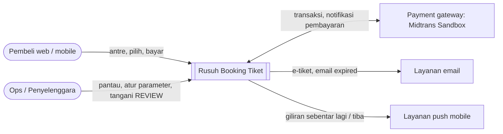
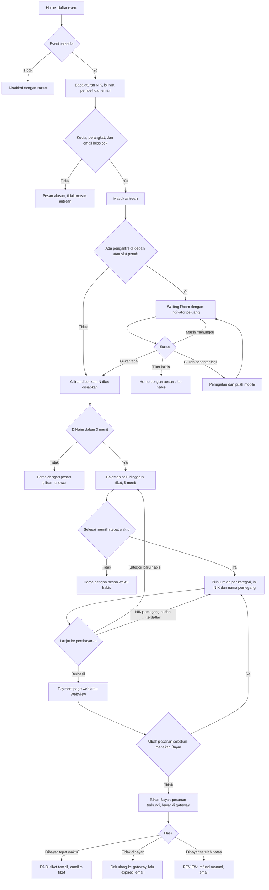

# Product Requirements Document (PRD) — Rusuh Booking Tiket

| Field | Value |
|-------|-------|
| **Product / Feature** | Rusuh Booking Tiket — platform penjualan tiket konser untuk *war tiket* |
| **Document ID** | PRD-RBT-001 |
| **Version** | 5.0 |
| **Date** | 2026-10-17 |
| **Status** | Draft (restrukturisasi format). Baseline requirement tetap PRD v4.6 Final Canonical; seluruh requirement `NOT_VERIFIED` sampai ada evidence |
| **Product Owner** | Pak Dinda (CEO), PT. Tiga Sekawan Angin Ribut (pemilik bisnis) |
| **Contributors** | Tim PT. Tiket Sampai Nonton Sentosa (BE-1, BE-2, WEB-1, WEB-2, MOB-1) |
| **Approvers** | Pak Dinda (CEO), Pak Jabon (CTO), Pak Rahman (CFO), PT. Tiga Sekawan Angin Ribut |
| **Classification** | Internal |
| **Client (skenario tender)** | PT. Tiga Sekawan Angin Ribut (Pak Dinda, CEO; Pak Jabon, CTO; Pak Rahman, CFO) |
| **Vendor (peserta tender)** | PT. Tiket Sampai Nonton Sentosa |
| **Related documents** | SRS-RBT-001, AD-RBT-001 (HLD), SDD-RBT-001, ADR-RBT, TP-RBT-001, Engineering Handbook; PRD v4.6 (sumber pemecahan, lihat Appendix C) |

> **Reference basis.** Tidak ada standar ISO khusus untuk PRD. Dokumen ini mengikuti praktik product management dan diselaraskan dengan konsep *business requirements* dan *stakeholder requirements* pada **ISO/IEC/IEEE 29148:2018**, prinsip riset pengguna pada **ISO 9241-210:2019**, serta klasifikasi kualitas **ISO/IEC 25010:2023**. Daftar standar dan URL ada di Appendix D.
>
> **Writing rule.** PRD ini menjelaskan masalah, hasil yang diharapkan, dan kebutuhan pengguna. Pilihan teknologi, arsitektur, API, data model, dan pengujian rinci ada di SRS, HLD, SDD, ADR, dan Test Plan (pemetaan di Appendix C). Nama teknologi hanya muncul bila merupakan constraint bisnis (§10).

## Change History

| Version | Date | Author | Summary of change |
|---------|------|--------|-------------------|
| 5.0 | 2026-10-17 | Tim PT. Tiket Sampai Nonton Sentosa | Restrukturisasi ke template PRD (ISO-aligned) sebagai bagian set dokumen RBT (PRD, SRS, HLD, SDD, ADR, Test Plan, Handbook). Isi teknis PRD v4.6 dipindahkan ke dokumen tersebut (Appendix C). **Tidak ada perubahan requirement, alur customer, maupun jaminan** |
| 4.6 | 2026-10-16 | Tim | Sikap CAP/PACELC per komponen; outbox hanya Booking dan Payment; idempotensi consumer tanpa tabel inbox |
| 4.5 | 2026-10-16 | Tim | Valkey sebagai in-memory store; prinsip SOLID; alasan best practice tech stack |
| 4.4 | 2026-10-15 | Tim | Definisi near-real-time; notifikasi giliran; ubah pesanan sebelum bayar; refresh, koneksi putus, tombol back; prinsip konfigurasi |
| 4.3 | 2026-10-15 | Tim | Jaminan "hingga N tiket" dirumuskan formal; cek NIK pemegang langsung; anti-calo per perangkat dan email |
| 4.2 | 2026-10-15 | Tim | 4 service; reservasi saat admission; indikator peluang jujur; guest checkout; NIK per tiket; model kapasitas |
| 4.1 | 2026-10-14 | Tim | Requirement 2026 H2, tim 5 orang, payment page WebView |

### Document Conventions

**Precedence** (bila terjadi pertentangan):
1. Keputusan grooming 14 Oktober 2026.
2. Wording dan prioritas requirement PDF *Evaluasi Expertise Solution Development 2026 H2*.
3. Keputusan tim 15–16 Oktober 2026 yang tercatat di PRD ini, termasuk asumsi (§10).
4. ADR yang disetujui setelah PRD.

**Status requirement:** `CONFIRMED` (requirement/grooming), `DERIVED` (wajib secara teknis), `ASSUMED` (asumsi tender, §10), `PROPOSED` (nilai awal yang dapat dituning), `NOT_VERIFIED`, `IMPLEMENTED`, `HUMAN_REVIEWED`, `VERIFIED`.

**Kode rujukan grooming:** KP = Key Point, D = Decision, AI = Action Item pada notulen 14 Oktober 2026.

---

## 1. Overview

### 1.1 Problem Statement

Pada penjualan konser populer, ratusan ribu hingga satu juta orang datang bersamaan untuk stok puluhan ribu tiket (rujukan histori klien 300 ribu pengantre; Coldplay 1 juta). Masalah yang dialami pembeli dan penyelenggara:

- **Pembeli di-PHP (diberi harapan palsu).** Pembeli menunggu lama di antrean atau sudah memilih tiket, lalu ditolak karena stok habis, kuota, atau konfirmasi pembayaran yang terlambat.
- **Antrean tidak adil.** Urutan dapat dilangkahi oleh klien yang lebih cepat atau oleh calo yang memakai banyak perangkat dan identitas.
- **Sistem tumbang saat puncak.** Lonjakan pengunjung menjatuhkan layanan inti sehingga tidak ada yang bisa membeli.
- **Calo memborong tiket.** Tanpa pembatasan identitas, satu orang dapat menguasai banyak tiket.

Biaya bila tidak diselesaikan: kehilangan penjualan, keluhan dan reputasi buruk, serta risiko pembayaran yang tidak menghasilkan tiket.

### 1.2 Background and Context

Dokumen ini menjadi dasar Proof of Concept (PoC) dan proposal tender untuk *Evaluasi Expertise Solution Development 2026 H2*. Requirement berasal dari PDF evaluasi (25 FR, 10 NFR, 8 BR, SCP-01) dan notulen grooming 14 Oktober 2026 (GR-01–GR-16). Tim terdiri dari 5 orang dan harus menyelesaikan PoC dalam 2 sprint (20 hari kerja), termasuk evidence, demo cloud, dan setup lokal yang dapat dijalankan assessor.

### 1.3 Proposed Solution

Rusuh Booking Tiket adalah platform penjualan tiket (web dan mobile) dengan satu janji kepada pembeli: **"Jangan PHP."** Janji ini diwujudkan dalam tiga jaminan:

1. **Di antrean, kami jujur.** Pengantre melihat posisi, perkiraan waktu, sisa tiket, dan indikator peluang yang jujur. Bila tiket tidak lagi cukup untuk posisinya, ia langsung diberi tahu. Bila tiket habis, waiting room ditutup dan semua orang diarahkan pulang dengan alasan yang jelas.
2. **Di halaman beli, tiketmu sudah disiapkan.** Giliran hanya diberikan bila tiket untuk pembeli tersebut sudah disiapkan. Pembeli yang masuk halaman beli pasti dapat memesan hingga N tiket (maksimal 3, kategori apa pun yang masih tersedia) asal memilih dan membayar tepat waktu. Pesanan masih bisa diubah sebelum menekan "Bayar". Refresh, koneksi putus, atau tombol back tidak menghilangkan tiket yang sudah disiapkan.
3. **Di pembayaran, uangmu aman.** Pesanan yang sudah dibayar tepat waktu tidak pernah dibatalkan hanya karena konfirmasi payment gateway terlambat. Pembayaran dicek ulang ke gateway sebelum tiket dilepas.

### 1.4 Interpretasi Requirement

Notulen grooming dibuat otomatis dan memuat beberapa kalimat yang saling bertentangan. Interpretasi berikut menjadi dasar seluruh dokumen.

| Kalimat sumber | Bertentangan dengan | Interpretasi yang dipakai |
|---|---|---|
| D-2: "menahan stok segera setelah pelanggan melakukan pembayaran" | KP-3, KP-4: "masuk halaman beli pasti dapat tiket" | Tiket disiapkan saat giliran tiba, lalu dikunci per kategori saat lanjut bayar. Kedua kalimat terpenuhi |
| D-3 / BR-01: "maks 3 tiket per NIK per acara" | KP-13 (arahan CTO): "setiap tiket NIK berbeda" | Dua peran NIK: **NIK pemegang** maks 1 tiket per event; **NIK pembeli** memesan maks 3 tiket per event. Kedua hitungan terpisah dan berlaku per event |
| KP-3: "hold saat masuk antrean" | Stok puluhan ribu vs pengantre hingga 1 juta | Menahan stok untuk semua pengantre tidak mungkin. Jaminan diberikan saat giliran tiba; sebelumnya pengantre diberi indikator peluang yang jujur |
| Kata "real time" pada requirement | Tidak ada angka latensi | **Near-real-time** dengan batas keterlambatan per jenis informasi (§9.2). Keabsahan aksi selalu diputuskan server, sehingga data yang telat beberapa detik tidak membatalkan jaminan atau mengubah urutan. Perlu konfirmasi panitia (OI-07) |

---

## 2. Goals and Non-Goals

### 2.1 Business Goals

| ID | Goal | Linked requirement |
|----|------|--------------------|
| G-01 | Pembeli yang sudah masuk halaman beli tidak pernah di-PHP: tiket yang dijanjikan selalu bisa dipesan dan pembayaran tepat waktu selalu menghasilkan tiket | GR-01, GR-09, NFR-02 |
| G-02 | Antrean adil: urutan FIFO tidak dapat dilangkahi, dan satu orang tidak dapat memborong tiket | NFR-05, GR-03, GR-04, GR-07 |
| G-03 | Pengantre selalu mendapat informasi yang jujur dan tepat waktu tentang posisi, peluang, dan sold out | FR-06–FR-09, GR-02 |
| G-04 | Layanan inti tetap berjalan saat 100 ribu–1 juta orang mengantre bersamaan | NFR-01, NFR-03, NFR-06, GR-11 |
| G-05 | Tidak pernah terjadi oversell maupun tiket atau efek samping ganda | NFR-04, BR-08, FR-25 |
| G-06 | Pengalaman yang sama di web dan mobile, termasuk payment page yang dipakai ulang di mobile | FR-24, SCP-01, NFR-08 |
| G-07 | Lulus assessment: seluruh requirement terpenuhi dengan evidence, demo dengan Midtrans Sandbox, setup lokal untuk assessor, serta proposal kapasitas dan biaya yang dapat dipertanggungjawabkan | Aturan assessment, GR-11, GR-13 |

### 2.2 Non-Goals

- Pembayaran uang nyata di production.
- Back-office pembuatan event (data event disediakan lewat seed/migration).
- Login/akun customer (guest checkout sesuai grooming; dapat ditambahkan di masa depan).
- Verifikasi NIK ke Dukcapil atau verifikasi wajah.
- Sistem gating/scan tiket di gerbang venue.
- Refund otomatis (refund kasus terlambat dilakukan manual lewat dashboard Midtrans).
- Program loyalti, voucher, resale, dan numbered seat map.
- Multi-region atau HA penuh pada PoC (tersedia pada arsitektur referensi production).
- Pembayaran kartu kredit.

**Klaim yang tidak dibuat:** exactly-once untuk email dan push (keduanya at-least-once), HA penuh di PoC, Sandbox sebagai SLA production, compliance PCI-DSS penuh, kapasitas Tier L sebelum diekstrapolasi dari bukti PoC, verifikasi identitas dari validasi struktur NIK, calo hilang sepenuhnya, kategori favorit dijamin, push notification pasti sampai, dan latensi sub-detik di waiting room.

---

## 3. Success Metrics

Baseline belum ada karena produk baru; target diukur pada PoC dan load test. Bukti dikumpulkan sesuai Test Plan.

| ID | Metric | Goal | Baseline | Target | Measurement method / source | Review date |
|----|--------|------|----------|--------|-----------------------------|-------------|
| M-01 | Oversell | G-05 | — | 0 | Laporan integrasi konkuren | Release gate D18 |
| M-02 | Customer yang sudah masuk tetapi tidak mendapat tiket padahal memilih dalam TTL | G-01 | — | 0 | Uji invariant reservasi, simulasi acak, uji paralel | D18 |
| M-03 | Customer yang sudah masuk lalu ditolak karena kuota NIK pembeli | G-01 | — | 0 | Uji kuota saat join dan saat reservasi | D18 |
| M-04 | Ubah pesanan gagal yang merusak pesanan lama | G-01 | — | 0 | Uji ubah pesanan, simulasi, uji paralel | D18 |
| M-05 | Reservasi hilang atau pesanan ganda akibat refresh, koneksi putus, atau tombol back | G-01 | — | 0 | Uji pemulihan sesi dan navigasi | D18 |
| M-06 | Booking dibayar tepat waktu tetapi dibatalkan | G-01 | — | 0 | Uji webhook terlambat dan gateway gangguan | D18 |
| M-07 | NIK pemegang tiket ganda per event | G-02 | — | 0 | Uji pemegang tiket konkuren | D18 |
| M-08 | Pelanggaran FIFO | G-02 | — | 0 | Replay audit antrean | D18 |
| M-09 | Tiket atau efek samping ganda | G-05 | — | 0 | Uji callback dan replay | D18 |
| M-10 | Keterlambatan informasi antrean untuk pengantre dekat | G-03 | — | ≤ 5 detik | Load test + sold-out drill | D17 |
| M-11 | Waktu notifikasi sold out ke seluruh pengantre | G-03 | — | ≤ 5 detik (dekat) | Sold-out drill | D17 |
| M-12 | Missed turn rate (giliran hangus) | G-03 | — | Dipantau; > 5% → tuning claim window | Metrik antrean | Setiap penjualan |
| M-13 | Beban origin untuk status antrean | G-04 | — | Konstan terhadap jumlah pengantre | Load test 5 ribu vs 50 ribu waiter | D17 |
| M-14 | p95 halaman utama dan status antrean | G-04 | — | < 1 detik | Load test | D17 |
| M-15 | Scale-out/in tanpa kehilangan sesi | G-04 | — | Sesi terjaga tanpa sticky session | Bukti autoscaling | D17 |
| M-16 | Gangguan layanan notifikasi | G-05 | — | Status pesanan tetap benar; email pulih kemudian | Uji outbox/DLQ | D15 |
| M-17 | Pembayaran dari aplikasi mobile (WebView) | G-06 | — | Sukses dan expired berjalan dari app | Laporan uji mobile | D18 |

**Guardrail metrics** (tidak boleh memburuk): jumlah kasus REVIEW (pembayaran setelah batas), keluhan "giliran terlewat", dan biaya per penjualan (request CDN dan WAF).

---

## 4. Stakeholders and Users

### 4.1 Stakeholders

| Stakeholder | Interest / concern | Influence | Involvement |
|-------------|--------------------|-----------|-------------|
| PT. Tiga Sekawan Angin Ribut: Pak Dinda (CEO), Pak Jabon (CTO), Pak Rahman (CFO) (klien tender, pemilik bisnis) | Penjualan lancar saat puncak, tanpa oversell dan keluhan, biaya wajar | High | Pemilik bisnis dan approver |
| Panitia / Assessor | Pemenuhan requirement, kualitas evidence, technical defense, setup lokal | High | Reviewer & penilai |
| CTO klien, Pak Jabon (grooming) | Anti-calo, satu tiket satu orang, keadilan antrean | High | Pemberi arahan (KP-13) |
| Tim delivery PT. Tiket Sampai Nonton Sentosa (BE-1, BE-2, WEB-1, WEB-2, MOB-1) | Scope realistis untuk 2 sprint, kontrak yang jelas | Medium | Pelaksana |
| Ops (penyelenggara) | Menangani kasus REVIEW dan refund manual, memantau penjualan | Medium | Pengguna internal |
| Penyedia payment gateway (Midtrans) | Integrasi sesuai ketentuan | Low | Dependensi eksternal |

### 4.2 User Classes / Personas

| Persona | Description | Goals | Pain points | Frequency of use | Proficiency |
|---------|-------------|-------|-------------|------------------|-------------|
| Pembeli (guest) | Orang yang mengantre dan memesan, tanpa akun, dengan NIK pembeli dan email | Mendapat tiket untuk dirinya dan hingga 2 orang lain dengan cepat dan pasti | Antrean tidak jelas, ditolak setelah menunggu, takut uang hilang | Sesekali (per konser) | Rendah–menengah; sering di HP dengan sinyal tidak stabil |
| Pemegang tiket | Orang yang datang ke konser; NIK-nya dicantumkan per tiket | Mendapat tiket atas namanya sendiri | NIK sudah dipakai orang lain | Sesekali | Tidak berinteraksi langsung kecuali menerima tiket |
| Pembeli mobile | Pembeli yang memakai aplikasi Android/iOS | Tidak ketinggalan giliran saat aplikasi di background | Notifikasi tidak sampai, tombol back membingungkan | Sesekali | Rendah–menengah |
| Ops / Penyelenggara | Staf yang memantau penjualan dan menangani pengecualian | Melihat antrean, konversi, expired secara langsung; mengatur parameter penjualan per event | Konfigurasi salah di tengah penjualan | Setiap penjualan | Menengah–tinggi |
| Assessor | Penilai yang menjalankan alur dan memeriksa evidence | Menjalankan seluruh alur secara lokal dan memeriksa bukti | Setup yang butuh akun cloud atau private registry | Sekali (penilaian) | Tinggi |

### 4.3 User Research Evidence

- PDF *Evaluasi Expertise Solution Development 2026 H2* (requirement klien; tidak di-commit ke repo public).
- Notulen *Grooming Requirement — Rusuh Booking Tiket*, 14 Oktober 2026 (KP, D, AI; tidak di-commit).
- Wireframe tim (Appendix E) dan diskusi tim 15–16 Oktober 2026.
- Riset pengguna langsung (wawancara, uji usability) **belum dilakukan**. Uji usability ringan disarankan pada Sprint 2 (lihat OI-09).

---

## 5. Scope

### 5.1 In Scope

| Capability | Release |
|------------|---------|
| Daftar dan detail event | PoC (Sprint 1) |
| Guest session: NIK pembeli + email, aturan pembelian ditampilkan sebelum antre | PoC (Sprint 1) |
| Waiting room FIFO dengan posisi, ETA, indikator peluang jujur, dan sold-out closure | PoC (Sprint 1) |
| Reservasi tiket saat giliran tiba ("Jangan PHP") | PoC (Sprint 1) |
| Halaman beli: hingga N tiket, ketersediaan kategori live, NIK dan nama pemegang per tiket dengan cek langsung | PoC (Sprint 1) |
| Pembayaran via payment gateway (VA, QRIS/GoPay) dengan TTL dan rekonsiliasi | PoC (Sprint 1–2) |
| Payment page reusable di web dan mobile (WebView) | PoC (Sprint 1–2) |
| E-tiket (email teks + halaman tiket) dan email expired / pembayaran terlambat | PoC (Sprint 1–2) |
| Ubah pesanan sebelum bayar; pemulihan setelah refresh, koneksi putus, dan tombol back | PoC (Sprint 2) |
| Peringatan dan push notification giliran | PoC (Sprint 2) |
| Aplikasi mobile (Android wajib; iOS bila platform dan akun tersedia) | PoC (Sprint 1–2) |
| Konfigurasi TTL dan batas per event dengan audit | PoC (Sprint 2) |
| Cancel oleh pembeli (SHOULD) | PoC (Sprint 2) |
| Proteksi edge, observability, autoscaling, setup lokal assessor | PoC (Sprint 2) |
| Model kapasitas 3 tier dan estimasi biaya untuk proposal | Proposal |

### 5.2 Out of Scope

Lihat §2.2 Non-Goals. Ringkasnya: uang nyata, back-office event, login, verifikasi Dukcapil, scan tiket di gerbang, refund otomatis, loyalti/voucher/resale/seat map, multi-region, kartu kredit.

### 5.3 Kapasitas yang Ditawarkan (GR-11)

| Parameter | Tier S | **Tier M (penawaran utama)** | Tier L |
|---|---:|---:|---:|
| Pengantre bersamaan | 100.000 | 300.000 | 1.000.000 |
| Stok per event (asumsi) | 20.000 | 50.000 | 80.000 |
| Perkiraan waktu sold out | ±20 menit | ±40 menit | ±45 menit |

Tier M dipilih sebagai penawaran utama karena sesuai histori klien. Tier L tersedia per event tanpa perubahan arsitektur. Model beban, sizing, dan estimasi biaya ada di AD-RBT-001 (HLD) §4.5 dan §4.7. Angka kapasitas hanya diklaim setelah diekstrapolasi dari bukti load test PoC.

---

## 6. Operational Concept and User Journeys

### 6.1 Context

Pembeli membuka web atau aplikasi mobile saat penjualan dibuka. Bila tidak ada antrean, ia langsung masuk halaman beli. Bila ada antrean, ia menunggu di waiting room hingga gilirannya tiba, lalu memilih tiket, mengisi NIK pemegang, dan membayar lewat payment gateway. Ops memantau penjualan dan menangani kasus pengecualian. Sistem berinteraksi dengan payment gateway (Midtrans Sandbox), layanan email, dan layanan push notification.



### 6.2 Key User Journeys

#### Journey J-01: Pembelian sampai tiket terbit



| Step | User action | System response | Notes / pain point addressed |
|------|-------------|-----------------|------------------------------|
| 1 | Membuka home | Daftar event dengan status: tersedia, belum dibuka (hitung mundur), habis, ditutup | Tidak ada klik sia-sia ke event yang tidak bisa dibeli |
| 2 | Menekan "Beli Tiket", membaca aturan, mengisi NIK pembeli dan email dua kali | Kuota, perangkat, dan email dicek sebelum antre | Tidak ada aturan baru yang muncul setelah masuk halaman beli |
| 3 | Menunggu di waiting room | Posisi, ETA, sisa tiket, zona peluang, kategori yang sudah habis | Pengantre tahu peluangnya, tidak di-PHP |
| 4 | Giliran tiba (otomatis) | Pindah ke halaman beli; push di mobile | Tidak perlu menekan apa pun bila halaman terbuka |
| 5 | Memilih tiket dan mengisi NIK pemegang | Hingga N tiket dijamin; NIK dicek langsung saat diketik | Gagal kategori tidak menghilangkan reservasi |
| 6 | Lanjut ke pembayaran, boleh mengubah pesanan sebelum "Bayar" | Tiket ditahan; TTL pembayaran berjalan | Koreksi tanpa kehilangan tiket |
| 7 | Membayar | Tiket terbit, tampil di layar, dikirim ke email | Pembayaran tepat waktu selalu menghasilkan tiket |

#### Journey J-02: Tiket habis saat masih mengantre

| Step | User action | System response | Notes |
|------|-------------|-----------------|-------|
| 1 | Menunggu di waiting room | Zona berubah ke "tidak cukup" bila sisa tiket tidak cukup untuk posisinya, dengan tombol "Keluar dari antrean" | Pengantre bisa memutuskan sendiri |
| 2 | — | Saat tiket habis, waiting room ditutup dan semua pengantre diarahkan ke home dengan pesan "Tiket habis" | ≤ 5 detik untuk pengantre dekat |

#### Journey J-03: Giliran terlewat

| Step | User action | System response | Notes |
|------|-------------|-----------------|-------|
| 1 | Meninggalkan perangkat | Peringatan "Giliran Anda sebentar lagi" + push mobile | Mengurangi giliran hangus |
| 2 | Tidak kembali dalam 3 menit setelah giliran tiba | Giliran hangus, tiket kembali ke antrean berikutnya | Tidak ada kesempatan kedua atau prioritas |
| 3 | Kembali ke aplikasi | Diarahkan ke home dengan pesan "Giliran Anda terlewat karena tidak aktif"; boleh antre ulang dari belakang bila kuota masih ada | Urutan pengantre lain tidak berubah |

#### Journey J-04: Konfirmasi pembayaran terlambat

| Step | User action | System response | Notes |
|------|-------------|-----------------|-------|
| 1 | Membayar mendekati batas waktu | Saat TTL habis, status "Kami sedang memastikan pembayaran Anda. Tiket tetap kami tahan." | Tiket tidak dilepas sebelum dicek ke gateway |
| 2 | — | Bila dibayar tepat waktu → PAID; bila belum dibayar → transaksi di gateway dibatalkan, lalu expired; bila gateway tidak dapat dihubungi → dicoba ulang dalam masa tenggang | Uang pembeli aman |
| 3 | Pembayaran masuk setelah batas | REVIEW, tiket tidak terbit, email informasi refund, kasus dibuka untuk Ops | Stok orang lain tidak diambil |

#### Journey J-05: Refresh, koneksi putus, atau tombol back

| Step | User action | System response | Notes |
|------|-------------|-----------------|-------|
| 1 | Refresh halaman beli | Reservasi, timer, dan pesanan dipulihkan dari server; NIK yang belum dikirim diketik ulang | NIK tidak disimpan di storage perangkat |
| 2 | Koneksi putus saat menekan tombol | Banner "Koneksi terputus. Pesanan Anda tetap aman di server hingga mm:ss"; dikirim ulang otomatis tanpa pesanan ganda | — |
| 3 | Menekan back setelah pesanan terkunci | Dialog "Pesanan Anda menunggu pembayaran hingga mm:ss" → Tetap di sini / Ke beranda. Ke beranda tidak membatalkan pesanan | Tidak kehilangan tiket karena salah tekan |

Wireframe ada di Appendix E.

---

## 7. Features and User Stories

Priority: **MoSCoW** (Must / Should / Could / Won't-this-release). Kolom **Source** merujuk ID requirement klien (FR/NFR/BR/SCP), grooming (GR), atau asumsi (AS). Kolom **Cap.** adalah kode capability dari PRD v4.6, dipertahankan untuk kontinuitas dengan kode dan test.

### 7.1 Feature: Akses Tamu dan Data Pembeli (FEAT-01)

**Description:** Pembeli dapat membeli tanpa akun. Identitas pembeli = NIK pembeli + email. Semua aturan pembelian ditampilkan sebelum antre.
**Goals served:** G-01, G-02

| ID | User story | Priority | Source | Cap. | Acceptance criteria (Given / When / Then) |
|----|-----------|----------|--------|------|-------------------------------------------|
| US-001 | Sebagai pembeli, saya ingin membeli tanpa membuat akun, cukup dengan NIK dan email, agar cepat masuk antrean. | Must | GR-05, FR-13 | GST-01 | **Given** event tersedia **When** saya menekan "Beli Tiket" **Then** saya mengisi NIK pembeli (16 digit, wajib) dan email (diketik dua kali), tanpa register/login, dan tanpa NIK saya tidak dapat melanjutkan |
| US-002 | Sebagai pembeli, saya ingin mengetahui semua aturan pembelian sebelum antre agar tidak ada kejutan setelah masuk halaman beli. | Must | GR-03, keputusan tim 15 Okt | GST-01 | **Given** form data pembeli **Then** tampil aturan: 1 NIK hanya untuk 1 tiket per event (pemegang), 1 NIK pembeli maks 3 tiket per event, siapkan NIK dan nama setiap pemegang, 1 perangkat dan 1 email = 1 antrean aktif; persetujuan penggunaan NIK wajib dicentang. **And** tidak ada aturan pembelian baru yang muncul setelah masuk halaman beli |
| US-003 | Sebagai pembeli, saya ingin langsung diberi tahu bila kuota NIK saya untuk event ini sudah habis agar tidak mengantre sia-sia. | Must | BR-02, FR-14 | QUE-01 | **Given** NIK pembeli saya sudah memesan 3 tiket di event ini **When** saya mencoba masuk antrean **Then** saya ditolak dengan pesan alasan dan tidak masuk antrean. **And** di event lain kuota saya dihitung dari nol |
| US-004 | Sebagai penyelenggara, saya ingin satu orang hanya memiliki satu antrean aktif per event agar calo tidak memborong antrean. | Must | GR-04, BR-07, AS-17 | QUE-01 | **Given** NIK pembeli, perangkat, atau email sudah memiliki antrean aktif di event ini **When** mencoba masuk antrean lagi **Then** ditolak dengan pesan yang jelas. **And** setelah antrean sebelumnya berakhir (selesai, keluar, hangus), boleh antre lagi dari belakang |

### 7.2 Feature: Daftar dan Detail Event (FEAT-02)

**Description:** Pembeli melihat event yang dijual online beserta status dan detailnya.
**Goals served:** G-03

| ID | User story | Priority | Source | Cap. | Acceptance criteria |
|----|-----------|----------|--------|------|---------------------|
| US-010 | Sebagai pembeli, saya ingin melihat semua event yang dijual online beserta statusnya agar tahu mana yang bisa dibeli. | Must | FR-01, FR-02, FR-03 | EVT-01 | **Given** home dibuka **Then** semua event tampil. Event dalam jendela penjualan yang masih memiliki stok dapat diklik; event belum dibuka tampil disabled dengan hitung mundur jam buka; event habis atau ditutup tampil disabled dengan label status. **And** mencoba masuk antrean event yang tidak tersedia ditolak server |
| US-011 | Sebagai pembeli, saya ingin melihat detail event, kategori tempat, harga, dan sisa tiket per kategori agar dapat memilih. | Must | FR-11, FR-12 | EVT-02 | **Given** detail event **Then** info event, venue, jadwal, kategori, dan harga tampil publik. **And** di halaman beli, sisa tiket per kategori diperbarui otomatis (≤ 2 detik) sebagai perkiraan ("sisa sekitar N"), kategori habis berlabel "Habis", dan keputusan akhir selalu di server |

### 7.3 Feature: Waiting Room yang Adil dan Jujur (FEAT-03)

**Description:** Antrean virtual FIFO yang menampilkan posisi, peluang, dan sold out secara jujur, dan memberi tahu saat giliran tiba.
**Goals served:** G-02, G-03, G-04

| ID | User story | Priority | Source | Cap. | Acceptance criteria |
|----|-----------|----------|--------|------|---------------------|
| US-020 | Sebagai pembeli, saya ingin langsung masuk halaman beli bila tidak ada antrean, dan diarahkan ke waiting room bila ada. | Must | FR-04, FR-05 | QUE-01 | **Given** tidak ada pengantre lebih awal dan slot aktif tersedia **When** saya masuk antrean **Then** saya langsung masuk halaman beli tanpa melihat waiting room. **Given** ada pengantre lebih awal atau slot penuh **Then** saya diarahkan ke waiting room |
| US-021 | Sebagai pengantre, saya ingin melihat posisi saya ("Anda antrian ke-n") yang diperbarui otomatis dan tetap konsisten saat refresh. | Must | FR-06, FR-07, FR-10, GR-06 | QUE-02 | **Given** saya di waiting room **Then** posisi tampil dan diperbarui otomatis saat transaksi di depan selesai, expired, atau batal, dengan keterangan "Diperbarui N detik lalu". **And** keterlambatan ≤ 5 detik untuk pengantre dekat (< 5.000), ≤ 12 detik menengah, ≤ 32 detik jauh. **And** refresh atau membuka ulang tidak mengubah posisi |
| US-022 | Sebagai pengantre, saya ingin melihat perkiraan waktu tunggu. | Could | FR-09 | QUE-02 | **Given** laju antrean stabil **Then** ETA tampil sebagai rentang. **Given** laju belum stabil **Then** ETA disembunyikan |
| US-023 | Sebagai pengantre, saya ingin tahu dengan jujur apakah sisa tiket cukup untuk posisi saya agar dapat memutuskan tetap menunggu atau keluar. | Must | NFR-02, GR-02 | QUE-02 | **Then** tampil salah satu zona: **Dijamin** ("Tiket tersedia untuk posisi Anda"), **Ada peluang** ("Tiket tersisa mungkin cukup"), **Tidak cukup** ("Tiket tersisa saat ini tidak cukup… Peluang hanya ada jika pembeli di depan batal atau kehabisan waktu" + tombol "Keluar dari antrean"). **And** kategori yang sudah habis ditampilkan sebagai informasi, bukan jaminan |
| US-024 | Sebagai pengantre, saya ingin segera diberi tahu dan diarahkan pulang bila tiket habis. | Must | GR-02 | QUE-04 | **Given** tiket event habis **Then** waiting room ditutup, antrean baru ditolak, dan semua pengantre diarahkan ke home dengan pesan "Tiket habis" dalam ≤ 5 detik (dekat) dan ≤ 30 detik (jauh) |
| US-025 | Sebagai pengantre, saya ingin diperingatkan saat giliran hampir tiba dan otomatis dipindahkan saat giliran tiba. | Must | FR-08, GR-08 | QUE-03, QUE-05 | **Given** posisi saya mendekati giliran **Then** tampil "Giliran Anda sebentar lagi. Tetap buka halaman ini." dan mobile menerima push sekali (bila diizinkan). **When** giliran tiba **Then** saya otomatis masuk halaman beli bila halaman terbuka, dan mobile menerima push "Giliran Anda tiba". **And** giliran berlaku 3 menit |
| US-026 | Sebagai pengantre yang terlambat kembali, saya ingin tahu alasan giliran saya hilang. | Must | GR-08, AS-24 | QUE-03 | **Given** giliran tidak diklaim dalam 3 menit **Then** tiket kembali ke pengantre berikutnya; saat saya kembali, saya diarahkan ke home dengan pesan "Giliran Anda terlewat karena tidak aktif". **And** tidak ada kesempatan kedua atau prioritas; saya boleh antre ulang dari belakang bila kuota masih ada |
| US-027 | Sebagai penyelenggara, saya ingin urutan antrean FIFO yang tidak dapat dilangkahi. | Must | NFR-05, GR-07 | QUE-01, QUE-05 | **Then** urutan ditentukan nomor antrean yang diterbitkan server beserta timestamp UTC. **And** klien yang memperbarui lebih sering tidak mendapat giliran lebih awal. **And** halaman beli tidak dapat diakses tanpa giliran yang sah |

### 7.4 Feature: Halaman Beli dan Jaminan "Jangan PHP" (FEAT-04)

**Description:** Pembeli yang masuk halaman beli dijamin dapat memesan hingga N tiket, dengan batas waktu yang jelas dan tahan terhadap refresh, koneksi putus, serta tombol back.
**Goals served:** G-01

| ID | User story | Priority | Source | Cap. | Acceptance criteria |
|----|-----------|----------|--------|------|---------------------|
| US-030 | Sebagai pembeli, saya ingin pasti dapat memesan tiket yang dijanjikan setelah masuk halaman beli. | Must | GR-01, NFR-02, FR-16 | ADM-01 | **Given** saya masuk halaman beli **Then** tampil "Tiket kamu sudah disiapkan. Kamu bisa memesan hingga N tiket dari kategori yang tersedia", dengan N = min(3, sisa kuota NIK pembeli, stok tersedia). **When** saya memilih ≤ N tiket dari kategori yang tersedia (boleh campuran) dalam TTL Booking **Then** pesanan pasti berhasil. **And** bila kategori incaran baru saja habis, campuran kategori lain pasti cukup dan reservasi saya tetap aman |
| US-031 | Sebagai pembeli, saya ingin melihat batas waktu pemilihan yang akurat dan diperingatkan sebelum habis. | Must | FR-17, FR-19, BR-03, GR-08 | SES-01 | **Given** saya masuk halaman beli **Then** hitung mundur 5 menit (configurable) dimulai, berdasarkan waktu server. **And** refresh tidak memperpanjang waktu. **And** 60 detik sebelum habis tampil peringatan "Masih di sana?" |
| US-032 | Sebagai pembeli, saya ingin tahu apa yang terjadi bila waktu pemilihan habis. | Must | FR-18, BR-04 | SES-02 | **Given** waktu habis dan saya belum lanjut bayar **Then** sesi berakhir, tiket kembali ke pengantre berikutnya, dan saya melihat "Waktu pemilihan habis" lalu diarahkan ke home dengan alasan. **Given** waktu habis dan saya sudah lanjut bayar **Then** pesanan terkunci dan tetap dapat dibayar sampai TTL Pembayaran |
| US-033 | Sebagai pembeli, saya ingin refresh, koneksi putus, atau tombol back tidak menghilangkan tiket atau membuat pesanan ganda. | Must | FR-19, FR-10, keputusan tim 15 Okt | SES-03 | **Given** saya me-refresh, membuka ulang aplikasi, atau menekan back **Then** layar ditentukan oleh status di server (memilih, bisa diubah, terkunci, selesai). **When** koneksi putus saat menekan tombol **Then** tampil banner koneksi terputus, isian tetap, dan pengiriman ulang tidak membuat pesanan atau kode bayar ganda. **And** "Ke beranda" tidak membatalkan pesanan; home menampilkan banner pesanan aktif |
| US-034 | Sebagai pembeli dengan sinyal lemah, saya ingin tombol yang saya tekan di detik terakhir tetap diproses. | Should | AS-23 | SES-01 | **Given** permintaan "Lanjut ke Pembayaran" atau ubah pesanan tiba ≤ 5 detik setelah TTL Booking habis **Then** permintaan diproses dan pesanan langsung terkunci. **And** aturan ini berlaku sama untuk semua orang |

### 7.5 Feature: NIK Pemegang, Kuota, dan Pesanan (FEAT-05)

**Description:** Satu tiket satu orang; kuota pembeli dibatasi; pesanan dapat diubah sebelum bayar.
**Goals served:** G-01, G-02, G-05

| ID | User story | Priority | Source | Cap. | Acceptance criteria |
|----|-----------|----------|--------|------|---------------------|
| US-040 | Sebagai pembeli, saya ingin mengisi NIK dan nama pemegang untuk setiap tiket dan langsung tahu bila NIK tidak bisa dipakai. | Must | FR-13, FR-15, GR-03, GR-14 | BKG-01 | **Given** saya memilih tiket **Then** form pemegang muncul per tiket. **When** satu kolom NIK selesai diisi **Then** struktur NIK dicek (16 digit, kode provinsi, tanggal lahir, nomor urut) dan keterdaftarannya dicek; NIK yang sudah memegang tiket di event yang sama ditandai "sudah memiliki tiket untuk event ini — gunakan NIK lain" tanpa membocorkan pemiliknya. **And** "Lanjut ke Pembayaran" aktif hanya bila semua NIK valid, berbeda satu sama lain, lolos cek, dan nama terisi |
| US-041 | Sebagai penyelenggara, saya ingin sistem menolak pesanan yang melebihi stok, batas 3 tiket, atau kuota NIK pembeli. | Must | FR-14, BR-01, BR-02 | BKG-01 | **Then** jumlah dibatasi min(3, sisa kuota NIK pembeli, tiket yang disiapkan). **And** kuota dihitung per event, lintas sesi dan perangkat, termasuk pesanan yang menunggu pembayaran. **And** kuota kembali bila pesanan expired atau dibatalkan |
| US-042 | Sebagai pembeli, saya ingin tiket saya ditahan saat lanjut ke pembayaran. | Must | FR-16, BR-08, NFR-04 | BKG-02 | **When** saya menekan "Lanjut ke Pembayaran" **Then** tiket per kategori ditahan untuk saya dan tidak dapat dibeli orang lain. **And** pesanan multi-kategori berhasil semua atau tidak sama sekali. **When** kategori habis di detik terakhir **Then** saya diberi tahu ketersediaan terbaru, sesi tetap aktif, dan saya dapat memilih kategori lain. **And** menekan tombol berulang tidak membuat pesanan ganda |
| US-043 | Sebagai pembeli, saya ingin mengubah pesanan sebelum membayar tanpa kehilangan tiket. | Must | FR-16, AS-21, AS-22 | BKG-04 | **Given** saya sudah lanjut ke pembayaran, belum menekan "Bayar Sekarang", dan TTL Booking masih aktif **Then** saya dapat mengubah jumlah (1–N), kategori, serta NIK dan nama pemegang. **And** perubahan gagal (kategori habis, NIK bentrok) tidak mengubah pesanan lama. **And** maks 3 perubahan berhasil per sesi. **And** TTL Pembayaran tidak di-reset. **And** setelah menekan "Bayar Sekarang" pesanan terkunci |
| US-044 | Sebagai pembeli, saya ingin dapat membatalkan pesanan atau keluar tanpa membeli. | Should | GR-16 | BKG-03 | **When** saya keluar dari halaman beli tanpa membeli **Then** tiket segera diberikan ke pengantre berikutnya. **When** saya membatalkan pesanan yang menunggu pembayaran **Then** transaksi di gateway dicek dan dibatalkan lebih dulu; bila ternyata sudah dibayar, pesanan diselesaikan sebagai PAID dan saya diberi tahu |

### 7.6 Feature: Pembayaran (FEAT-06)

**Description:** Pembayaran lewat payment gateway dengan batas waktu yang jelas, pengecekan ulang sebelum tiket dilepas, dan perlindungan saat gateway gangguan.
**Goals served:** G-01, G-05

| ID | User story | Priority | Source | Cap. | Acceptance criteria |
|----|-----------|----------|--------|------|---------------------|
| US-050 | Sebagai pembeli, saya ingin memilih metode pembayaran dan melihat batas waktu pembayaran. | Must | FR-20, FR-21, BR-05, GR-13 | PAY-01 | **Then** tampil metode aktif (Virtual Account dan QRIS/GoPay), total dari server, dan hitung mundur 10 menit (configurable) sejak hold pertama. **And** mengubah pesanan atau mengganti metode tidak me-reset waktu |
| US-051 | Sebagai pembeli, saya ingin tahu kapan pesanan saya tidak bisa diubah lagi. | Must | Keputusan tim 15 Okt | PAY-01 | **Then** dekat tombol tampil "Setelah menekan 'Bayar Sekarang', pesanan tidak bisa diubah lagi" dan hitung mundur kedua "Masih bisa ubah pesanan hingga mm:ss". **When** saya menekan "Bayar Sekarang" **Then** pesanan terkunci dan nominal yang ditagih = pesanan terakhir. **And** memilih metode saja belum mengunci |
| US-052 | Sebagai pembeli, saya ingin tiket terbit bila saya membayar tepat waktu walaupun konfirmasi gateway terlambat. | Must | FR-22, GR-09 | PAY-03 | **Given** pembayaran saya selesai sebelum batas waktu **Then** pesanan PAID dan tiket terbit, walaupun notifikasi gateway tiba setelah batas. **And** tepat waktu dinilai dari waktu settlement gateway |
| US-053 | Sebagai pembeli, saya ingin pesanan saya tidak dibatalkan sebelum pembayaran saya benar-benar dicek. | Must | FR-23, BR-06, GR-09, NFR-02 | PAY-04 | **Given** TTL Pembayaran habis **Then** tampil "Kami sedang memastikan pembayaran Anda. Tiket Anda tetap kami tahan." dan pembayaran dicek ke gateway. Sudah dibayar tepat waktu → PAID; belum dibayar → transaksi di gateway dibatalkan, pesanan expired, tiket dan kuota kembali, email expired dikirim; gateway tidak dapat dihubungi → dicoba ulang sampai masa tenggang 3 menit habis |
| US-054 | Sebagai Ops, saya ingin pembayaran yang masuk setelah batas ditangani tanpa mengambil tiket orang lain. | Must | AS-09 | PAY-04 | **Given** pembayaran masuk setelah pesanan expired **Then** pesanan berstatus REVIEW, tiket tidak terbit, pembeli menerima email "Pembayaran diterima setelah batas waktu; dana dikembalikan", dan kasus refund manual dibuka untuk Ops |
| US-055 | Sebagai penyelenggara, saya ingin notifikasi pembayaran ganda atau tidak berurutan tidak menghasilkan tiket atau efek ganda. | Must | FR-25 | PAY-02 | **Given** notifikasi gateway yang sama diterima berulang atau tidak berurutan **Then** status pesanan hanya bergerak maju sesuai aturan, dan tidak ada tiket, email, atau pelepasan stok ganda. **And** notifikasi dengan tanda tangan atau nominal yang tidak valid ditolak. **And** halaman kembali dari browser/WebView bukan bukti pembayaran |
| US-056 | Sebagai pembeli, saya ingin tidak kehilangan tiket karena gangguan payment gateway. | Should | GR-09 | PAY-06 | **Given** instruksi pembayaran gagal dibuat karena gateway gangguan dan saya belum pernah mendapat instruksi **Then** batas waktu pembayaran diperpanjang satu kali (maks +5 menit). **Given** hanya satu metode yang gangguan **Then** tampil "Metode X sedang gangguan, silakan pilih metode lain" |

### 7.7 Feature: Kanal Web dan Mobile (FEAT-07)

**Description:** Alur yang sama di web dan aplikasi mobile; payment page web dipakai ulang di mobile.
**Goals served:** G-06

| ID | User story | Priority | Source | Cap. | Acceptance criteria |
|----|-----------|----------|--------|------|---------------------|
| US-060 | Sebagai pembeli mobile, saya ingin membayar dari aplikasi dengan payment page yang sama seperti web. | Must | SCP-01, FR-24, NFR-08 | PAY-05, API-01 | **Then** aplikasi membuka payment page web di WebView dengan akses sekali pakai yang aman. **And** pembayaran e-wallet dapat membuka aplikasi e-wallet. **And** "Ubah pesanan" di WebView membuka halaman detail native dalam mode ubah. **And** status akhir selalu diambil dari server. **And** web dan mobile memakai kontrak API yang sama |
| US-061 | Sebagai pembeli mobile, saya ingin tombol back tidak membingungkan saat pesanan menunggu pembayaran. | Must | Keputusan tim 15 Okt | SES-03 | **Given** pesanan terkunci **When** saya menekan back (Android) atau swipe/back (iOS) **Then** tampil dialog "Pesanan Anda menunggu pembayaran hingga mm:ss" → Tetap di sini / Ke beranda; back tidak membuka halaman detail lama |

### 7.8 Feature: Tiket dan Notifikasi (FEAT-08)

**Description:** E-tiket teks dan email status pesanan.
**Goals served:** G-01, G-05

| ID | User story | Priority | Source | Cap. | Acceptance criteria |
|----|-----------|----------|--------|------|---------------------|
| US-070 | Sebagai pembeli, saya ingin menerima e-tiket di email dan melihatnya langsung di layar. | Must | FR-22, GR-10 | TKT-01 | **Given** pesanan PAID **Then** satu tiket per pemegang dengan kode unik terbit; email teks berisi kode tiket, nama pemegang, NIK tersamar (mis. `3174********0001`), event, kategori, dan tautan halaman tiket. **And** tiket tampil di halaman hasil dan dapat dibuka ulang dari tautan walaupun email tertunda |
| US-071 | Sebagai pembeli, saya ingin diberi tahu lewat email bila pesanan expired atau pembayaran terlambat. | Must | FR-23, NFR-10 | MSG-01 | **Then** email expired dan email pembayaran terlambat terkirim. **And** kegagalan pengiriman email tidak mengubah status pesanan dan dicoba ulang otomatis. **And** email bersifat at-least-once (kemungkinan terkirim dua kali dapat diterima) |

### 7.9 Feature: Pengaturan dan Pemantauan Penjualan (FEAT-09)

**Description:** Ops dapat mengatur parameter penjualan per event dengan aman dan memantau penjualan secara langsung.
**Goals served:** G-04, G-07

| ID | User story | Priority | Source | Cap. | Acceptance criteria |
|----|-----------|----------|--------|------|---------------------|
| US-080 | Sebagai Ops, saya ingin TTL dan batas penjualan dapat diatur per event dengan aman. | Must | GR-12, AS-26 | CFG-01 | **Then** semua TTL, jendela, batas, dan flag dapat dikonfigurasi dengan batas aman. **And** perubahan hanya berlaku untuk giliran/sesi baru, tidak memendekkan waktu orang yang sedang berjalan. **And** aturan pembentuk jaminan (batas tiket per order, kuota NIK pembeli, campuran kategori, satu antrean per perangkat/email) terkunci saat penjualan dibuka. **And** kombinasi tidak valid ditolak. **And** setiap perubahan tercatat (siapa, kapan, nilai lama → baru). **And** UI tidak menampilkan angka aturan yang di-hardcode |
| US-081 | Sebagai Ops, saya ingin memantau antrean, konversi, dan pesanan expired secara langsung. | Must | NFR-09 | — | **Then** dashboard menampilkan metrik antrean, konversi, expired, dan missed turn rate per event secara near-real-time |
| US-082 | Sebagai assessor, saya ingin menjalankan seluruh alur secara lokal tanpa akun cloud. | Must | Aturan assessment | — | **Then** seluruh alur dapat dijalankan dengan Docker Compose tanpa AWS dan tanpa private registry, dengan simulator pembayaran untuk mode offline |

---

## 8. Business Rules

### 8.1 Aturan

| ID | Rule | Source | Status | Related stories |
|----|------|--------|--------|-----------------|
| BR-01 | Maks 3 tiket per NIK pembeli per event. NIK wajib; fallback kuota per sesi tidak dipakai | PDF BR-01, FR-13, AS-03 | CONFIRMED | US-041 |
| BR-02 | Kuota NIK pembeli berlaku lintas sesi dan perangkat pada event yang sama, termasuk pesanan yang menunggu pembayaran; event lain dihitung terpisah | PDF BR-02 | CONFIRMED | US-003, US-041 |
| BR-03 | TTL Booking (5 menit) dimulai saat giliran diklaim | PDF BR-03 | CONFIRMED | US-031 |
| BR-04 | TTL Booking habis tanpa hold → sesi batal, tiket kembali, slot ke pengantre berikutnya. Sudah hold → pesanan terkunci, sisa unit dilepas, pesanan tetap dapat dibayar sampai TTL Pembayaran | PDF BR-04 | CONFIRMED | US-032 |
| BR-05 | TTL Pembayaran (10 menit) dihitung sejak hold pertama dan tidak di-reset oleh ubah pesanan atau ganti metode | PDF BR-05 | CONFIRMED | US-050 |
| BR-06 | TTL Pembayaran habis → dicek ulang ke gateway, lalu batal, stok dilepas, email expired, slot ke pengantre berikutnya | PDF BR-06, GR-09 | CONFIRMED | US-053 |
| BR-07 | Satu NIK pembeli hanya satu slot aktif per event | PDF BR-07, GR-04 | CONFIRMED | US-004 |
| BR-08 | Stok terbayar bersifat final; stok yang ditahan tidak dapat dibeli orang lain | PDF BR-08 | CONFIRMED | US-042 |
| BR-09 | NIK pemegang maks 1 tiket per event; setiap tiket dalam satu order memakai NIK berbeda | GR-03, KP-13, AS-02 | CONFIRMED | US-040 |
| BR-10 | Kuota NIK pembeli dan status NIK pemegang dihitung terpisah per event (menjadi pemegang tidak mengurangi kuota pembeli) | AS-16 | ASSUMED | US-041 |
| BR-11 | Satu perangkat dan satu email hanya boleh memiliki satu antrean aktif per event | AS-17 | ASSUMED | US-004 |
| BR-12 | Giliran berlaku 3 menit (claim window); giliran hangus tidak mendapat kesempatan kedua atau prioritas | AS-06, AS-24 | ASSUMED | US-025, US-026 |
| BR-13 | Pesanan dapat diubah hanya sebelum menekan "Bayar" dan selama TTL Booking; maks 3 perubahan berhasil per sesi; sisa unit tetap dipegang sampai pesanan terkunci | AS-21, AS-22 | ASSUMED | US-043 |
| BR-14 | Pembayaran dinilai tepat waktu berdasarkan waktu settlement gateway, bukan waktu notifikasi tiba | GR-09 | CONFIRMED | US-052 |
| BR-15 | Pembayaran yang masuk setelah pesanan expired → REVIEW, tiket tidak terbit, refund manual | AS-09 | ASSUMED | US-054 |
| BR-16 | Cek NIK pemegang dibatasi 10 NIK berbeda per sesi; cek ulang NIK yang sama tidak dihitung | AS-18 | ASSUMED | US-040 |
| BR-17 | Aturan pembentuk jaminan dikunci saat penjualan dibuka; perubahan TTL hanya berlaku untuk sesi baru | AS-26 | ASSUMED | US-080 |
| BR-18 | Permintaan yang tiba ≤ 5 detik setelah TTL Booking habis tetap diproses (masa tenggang submit) | AS-23 | ASSUMED | US-034 |
| BR-19 | Masa verifikasi pembayaran maks 3 menit setelah TTL Pembayaran; perpanjangan satu kali maks +5 menit bila gateway gangguan sebelum instruksi pembayaran terbit | AS-08 | ASSUMED | US-053, US-056 |
| BR-20 | Kategori favorit tidak dijamin; jaminan berlaku atas jumlah hingga N tiket dari kategori yang tersedia, campuran diperbolehkan | AS-10 | ASSUMED | US-030 |

### 8.2 Justifikasi Nilai TTL (GR-12)

| Parameter | Nilai | Alasan |
|---|---|---|
| Claim window | 3 menit | Menerima push, membuka kunci HP, dan membuka aplikasi butuh ±30–90 detik, ditambah peringatan sebelum giliran. Dituning dari missed turn rate (> 5% → naikkan) |
| TTL Booking | 5 menit | Mengisi hingga 3 NIK + nama pemegang butuh ±1–2 menit; 5 menit menutup p95 termasuk di mobile |
| TTL Pembayaran | 10 menit | Transfer VA via m-banking umumnya 2–5 menit; QRIS < 2 menit; 10 menit memberi ruang tanpa menahan stok terlalu lama |
| Masa tenggang submit | 5 detik | Menutup latensi jaringan seluler di detik terakhir; 0 untuk TTL tegas |
| Batas ubah pesanan | 3 kali | Cukup untuk koreksi; mencegah sesi dipakai untuk mengintip stok |
| Total waktu stok tertahan per giliran | ≤ 3 + 5 + 10 menit | Claim window + TTL Booking + TTL Pembayaran; ubah pesanan tidak menambah waktu |

Throughput penjualan ≈ kapasitas slot aktif × rata-rata tiket per order ÷ rata-rata durasi journey. Contoh: 5.000 slot × 2 tiket ÷ 7 menit ≈ 1.400 tiket/menit, sehingga 60.000 tiket terjual dalam ±45 menit.

---

## 9. Quality Expectations

### 9.1 Ekspektasi Kualitas per Karakteristik ISO/IEC 25010:2023

SRS akan mengubah ekspektasi ini menjadi requirement yang terukur.

| ID | Characteristic | Expectation | Source | Why it matters |
|----|----------------|-------------|--------|----------------|
| QE-01 | Functional suitability (correctness) | Tidak pernah oversell; FIFO tidak dapat dilangkahi; satu tiket satu NIK pemegang | NFR-04, NFR-05, BR-08 | Inti kepercayaan pembeli dan penyelenggara |
| QE-02 | Performance efficiency | p95 < 1 detik untuk halaman utama dan posisi antrean di bawah beban tinggi; beban server inti tidak bertambah dengan jumlah pengantre | NFR-06, NFR-01 | Pengalaman pembeli saat puncak |
| QE-03 | Reliability (availability, fault tolerance) | Layanan inti terlindungi saat puncak; kegagalan satu layanan tidak membatalkan transaksi; pembeli yang sudah dapat slot dijamin menyelesaikan journey | NFR-01, NFR-02, NFR-10 | "Jangan PHP" |
| QE-04 | Flexibility (scalability) | Menangani flash crowd 100 ribu–1 juta pengantre dengan autoscaling | NFR-03, GR-11 | Penawaran kapasitas tender |
| QE-05 | Security (confidentiality, integrity, authenticity) | Halaman beli dan payment page hanya dapat diakses dengan izin yang sah; data pembayaran ditangani sesuai standar gateway; NIK diperlakukan sebagai data pribadi (tidak dilog, disamarkan, dihapus setelah masa retensi) | NFR-07, GR-15 | Keamanan dan privasi pembeli |
| QE-06 | Compatibility (interoperability) | Satu API REST/JSON untuk web dan mobile | FR-24, NFR-08 | Dua kanal tanpa duplikasi logika |
| QE-07 | Maintainability (analysability) | Metrik antrean, konversi, dan expired tersedia near-real-time | NFR-09 | Ops dapat bereaksi saat penjualan |
| QE-08 | Interaction capability (usability, accessibility) | Responsif, navigasi keyboard, fokus terlihat, live region untuk posisi dan hitung mundur; timer berbasis teks; setiap redirect membawa alasan; setiap pesan gagal menyertakan jalan keluar | Aturan UX tim | Pembeli dalam tekanan waktu, sebagian di HP |

### 9.2 Batas Keterlambatan Informasi (Near-Real-Time)

| Informasi | Keterlambatan maksimum (target) |
|---|---|
| Posisi dan zona peluang, pengantre dekat (< 5.000) | ≤ 5 detik |
| Posisi, pengantre menengah / jauh | ≤ 12 / ≤ 32 detik |
| Giliran tiba (aplikasi atau tab terbuka) | ≤ 5 detik; push mobile sebagai pelengkap |
| Sold out | ≤ 5 detik (dekat), ≤ 30 detik (jauh) |
| Ketersediaan kategori di halaman beli | ≤ 2 detik (≤ 3 detik saat mode cadangan) |
| Status pembayaran setelah notifikasi gateway diterima | ≤ 3 detik |

Mekanisme pengiriman (polling CDN di waiting room, SSE di halaman beli) dan alasannya dicatat di AD-RBT-001 §4.7 dan ADR-003. Interval pembaruan dikendalikan server sehingga dapat diubah saat penjualan tanpa rilis aplikasi.

---

## 10. Constraints, Assumptions and Dependencies

### 10.1 Constraints

| Type | ID | Description | Impact if violated |
|------|----|-------------|--------------------|
| Business | CON-01 | Tim 5 orang (2 BE, 2 FE web, 1 FE mobile), 2 sprint / 4 minggu / 20 hari kerja | Scope harus diprioritaskan (MoSCoW) |
| Business | CON-02 | Payment gateway wajib Midtrans Sandbox (bukti aktual pada environment demo; simulator hanya untuk CI dan assessor offline) | GR-13 tidak terpenuhi |
| Business | CON-03 | Komponen teknologi mengikuti tech radar organisasi; komponen di luar daftar ADOPT harus dikonfirmasi (OI-02) | Diganti via ADR bila HOLD |
| Business | CON-04 | Biaya cloud PoC dibatasi kredit AWS US$200 | Cloud hanya dipakai di Sprint 2, dengan budget alert dan teardown |
| Assessment | CON-05 | Setup lokal untuk assessor: Docker Compose, tanpa AWS dan tanpa private registry | Assessor tidak dapat menjalankan alur |
| Assessment | CON-06 | Repository GitHub public (akun pribadi); PDF requirement, notulen, `.env`, dan state infrastruktur tidak di-commit; `.kiro/steering`, `specs/`, dan log AI wajib di-commit | Pelanggaran aturan assessment atau kebocoran data |
| Regulatory | CON-07 | NIK diperlakukan sebagai data pribadi (GR-15): tidak dilog dalam bentuk asli, ditampilkan tersamar, dihapus setelah masa retensi. Regulasi acuan perlu dikonfirmasi (OI-08) | Risiko privasi dan hukum |
| Product | CON-08 | Mobile: Android wajib; iOS bila platform dan akun Apple Developer tersedia (OI-03, OI-06) | Scope mobile berkurang |

### 10.2 Assumptions

Asumsi tender beserta dasar, dampak, dan parameter konfigurasinya (disalin utuh dari v4.6):

*Sumber: PRD v4.6 §20.1*

| ID | Asumsi | Dasar | Dampak bila salah | Mitigasi / Config |
|---|---|---|---|---|
| AS-01 | Stok direservasi saat admission, dikunci per kategori saat lanjut bayar | Grooming KP-3, KP-4; notulen D-2 bertentangan | Bila klien ingin hold per kategori sejak admission, UX pilih kategori berubah | Model alokasi mendukung reservasi per kategori bila diminta |
| AS-02 | NIK pemegang maks 1 tiket per event; NIK pembeli maks 3 tiket per event | KP-13 vs D-3 | Bila klien ingin 3 tiket per NIK pemegang, constraint unik diganti counter | `MAX_TICKETS_PER_ATTENDEE_NIK=1`, `MAX_TICKETS_PER_BUYER_NIK=3` |
| AS-03 | Fallback kuota per sesi (BR-01 kalimat kedua) tidak dipakai | FR-13 + grooming KP-5 | — | — |
| AS-04 | Guest checkout; email tanpa OTP | KP-7; biaya OTP pada skala 1 juta | Risiko salah email | Konfirmasi ganda, tiket tampil di layar dan via tautan |
| AS-05 | Waiting room selalu aktif selama penjualan; antrean "terjadi" bila ada pengantre di depan atau slot penuh | FR-04/05; grooming AI-3 belum dijawab | Bila klien ingin ambang aktivasi berbasis trafik, logika join berubah sedikit | `ACTIVE_SLOT_CAPACITY` per event |
| AS-06 | Claim window 3 menit + peringatan sebelum giliran + push mobile | GR-08; keputusan tim 15 Okt | Masih ada giliran hangus bagi yang meninggalkan perangkat | `claim_window_seconds` per event; dituning dari missed turn rate |
| AS-07 | TTL Booking 5 menit, TTL Pembayaran 10 menit | Requirement + KP-6 | Nilai ikut dinilai | `SELECTION_TTL_SECONDS`, `PAYMENT_TTL_SECONDS` |
| AS-08 | Masa tenggang verifikasi pembayaran 3 menit; perpanjangan satu kali maks 5 menit saat gateway gangguan | GR-09 | Stok tertahan sedikit lebih lama | `VERIFY_GRACE_SECONDS`, `OUTAGE_EXTENSION_SECONDS` |
| AS-09 | Pembayaran setelah batas → REVIEW + refund manual | Non-goal refund otomatis | Proses ops manual | Refund otomatis sebagai fase lanjut |
| AS-10 | Kategori favorit tidak dijamin; jaminan = hingga N tiket total dari kategori yang tersedia, campuran kategori diperbolehkan | GR-01; keputusan tim 15 Okt | Bila klien mewajibkan satu kategori per order, jaminan turun menjadi minimal 1 tiket | `allow_mixed_categories` per event (dikunci saat penjualan dibuka) |
| AS-11 | Validasi NIK hanya struktur, tanpa Dukcapil | KP-5, AI-4 | NIK palsu berformat benar lolos | Verifikasi Dukcapil sebagai opsi lanjutan |
| AS-12 | Profil beban sesuai §17.1 [v4.6 → HLD §4.7.1] | KP-15, KP-16, D-17 | Sizing berubah | Model beban berbasis rumus; tier dapat disesuaikan |
| AS-13 | Event data dari seed | PDF §11 [v4.6 → SDD §4.8] | — | — |
| AS-14 | E-tiket teks + kode | KP-12 | — | — |
| AS-15 | Cancel diimplementasikan sebagai SHOULD | D-7 | — | Dapat dimatikan via flag |
| AS-16 | Kuota pembeli dan status pemegang dihitung terpisah (pemegang tidak mengurangi kuota pembelinya) | Grooming CTO + BR-01; keputusan tim 15 Okt | Bila klien ingin lebih ketat, perlu counter gabungan | Opsi ketat tidak diimplementasikan di PoC; perubahan terbatas di Booking |
| AS-17 | Satu antrean aktif per perangkat dan per email per event | Anti-calo; keputusan tim 15 Okt | Keluarga yang berbagi perangkat harus antre bergantian | `one_active_per_visitor`, `one_active_per_email` di `queue.event_settings` |
| AS-18 | Cek NIK pemegang langsung dibatasi 10 kali per sesi | Privasi + anti-enumerasi | Customer yang salah ketik berkali-kali harus mengandalkan cek final saat hold | `max_attendee_checks_per_session` |
| AS-19 | Kapasitas kategori dan total event diubah dalam satu transaksi | Syarat jaminan | Seed yang tidak konsisten ditolak saat commit | Constraint trigger |
| AS-20 | "Real time" = near-real-time dengan batas keterlambatan (§5.25 [v4.6 → SRS §3.2.25]); waiting room polling CDN (bukan SSE/WebSocket), SSE hanya di halaman detail | Requirement tidak memberi angka; inti "jangan PHP dan adil" | Bila panitia meminta latensi < 1 detik di waiting room, perlu SSE/WebSocket dan biaya naik | Interval `poll_*` per event; SSE hanya di halaman detail (fallback polling), `SSE_ENABLED` |
| AS-21 | Ubah pesanan hanya sebelum menekan "Bayar" dan selama TTL Booking; maks 3 kali | Keputusan tim 15 Okt | Customer yang sudah membuat kode bayar tidak bisa mengubah | `selection_edit_enabled`, `max_selection_edits` |
| AS-22 | Sisa unit dipegang sampai pesanan terkunci | Jaminan N saat kembali ke detail | Unit kembali ke antrean sedikit lebih lambat (≤ TTL Booking) | Mati otomatis bila `selection_edit_enabled=false` |
| AS-23 | Masa tenggang submit 5 detik | Latensi seluler di detik terakhir | Stok tertahan ≤ 5 detik lebih lama | `selection_submit_grace_seconds` (0 = tegas) |
| AS-24 | Tidak ada kesempatan kedua/prioritas setelah giliran hangus | Keadilan bagi pengantre lain (keputusan tim 15 Okt) | Customer yang lalai harus antre ulang dari belakang | — |
| AS-25 | Push notification best effort; izin opsional | Platform mobile dapat menunda/menolak push | Sebagian customer hanya mendapat peringatan di aplikasi | `pre_turn_notify_enabled`; adapter log untuk lokal |
| AS-26 | Aturan pembentuk jaminan dikunci saat penjualan dibuka; TTL dapat diubah dan berlaku untuk sesi baru | Keadilan + jaminan | Kesalahan konfigurasi aturan harus diputuskan sebelum jam buka | Trigger `guard_event_rules`, audit |


### 10.3 Dependencies

| ID | Dependency | Owner | Risk |
|----|-----------|-------|------|
| DEP-01 | Midtrans Sandbox: ketersediaan metode (VA BCA/BNI/BRI, QRIS/GoPay) dan notifikasi pembayaran | BE-2 | Medium — metode tidak tersedia (OI-05) |
| DEP-02 | AWS (kredit US$200) untuk demo cloud dan load test | BE-1 | Medium — kredit habis |
| DEP-03 | Layanan push mobile (FCM) dan akun Apple Developer untuk iOS | BE-1, MOB-1 | Medium — status tech radar dan akun (OI-06) |
| DEP-04 | Domain publik untuk webhook dan demo | BE-1 | Low (OI-04) |
| DEP-05 | Jawaban panitia atas total tiket, jenis konser, dan interpretasi "real time" | Tech lead | Medium (OI-01, OI-07) |
| DEP-06 | Rate card dan model harga untuk proposal | Tim/manajemen | Medium (OI-10) |

---

## 11. Release Plan and Milestones

| Milestone | Scope (features / stories) | Target | Exit criteria |
|-----------|----------------------------|--------|---------------|
| M0 — Kontrak beku | Kontrak API publik dan internal, skema event, format token | D2 | Kontrak v1 dibekukan dan disetujui semua owner |
| M1 — Antrean lokal | FEAT-01, FEAT-02, sebagian FEAT-03 | D5 | Join → giliran berjalan lokal |
| M2 — Halaman beli | FEAT-03, FEAT-04, FEAT-05 (tanpa ubah pesanan) | D8 | Laporan race condition |
| M3 — Sprint 1 E2E web | FEAT-06 (payment aktual), FEAT-08, FEAT-07 (WebView awal) | D10 | Alur end-to-end web berjalan |
| M4 — Staging | Expiry, verifikasi, REVIEW, cancel; deploy cloud | D13 | Staging hidup; matriks Midtrans Sandbox lulus |
| M5 — Recovery | Dashboard, redrive pesan gagal, sold-out drill, perpanjangan saat gangguan | D15 | Bukti recovery |
| M6 — NFR & kapasitas | Load test, security scan, backup/restore, ubah pesanan, notifikasi giliran, FEAT-09 | D17 | Bukti NFR dan kapasitas |
| M7 — Release candidate | UAT fix | D18 | Release gates terpenuhi (lihat di bawah) |
| M8 — Evidence final | Demo, laporan uji, APK, angka proposal | D20 | Evidence final lengkap |

**Release gates (M7):**
- Semua MUST implemented, reviewed, dan verified.
- Tidak ada oversell, pelanggaran jaminan, NIK pemegang ganda, atau pelanggaran FIFO.
- Tidak ada ubah pesanan yang merusak pesanan lama, ubah setelah terkunci, atau hold ganda akibat retry.
- Matriks notifikasi Midtrans Sandbox aktual lulus (sukses, pending, expired, duplikat, out-of-order, signature salah, timeout, terlambat).
- Payment page lulus di web dan WebView Android.
- Akses langsung ke origin ditolak; setup lokal, autoscaling, backup/restore, dan recovery pesan lulus.
- Tidak ada temuan critical/high tanpa risk acceptance.

**Ownership:**

| Peran | Fokus produk |
|---|---|
| BE-1 | Antrean, notifikasi (email + push), platform bersama, infrastruktur, observability, load test |
| BE-2 | Event, stok, reservasi, pesanan, ubah pesanan, kuota, NIK pemegang, tiket, pembayaran |
| WEB-1 | Home, data pembeli, waiting room, halaman beli (termasuk mode ubah dan pemulihan) |
| WEB-2 | Payment page reusable, hasil dan tiket, aksesibilitas, QA lead |
| MOB-1 | Aplikasi mobile end-to-end, WebView payment, back handling, push |

**Rollout strategy:** demo cloud di Sprint 2 dengan scale-out terjadwal sebelum jam penjualan; fitur ubah pesanan, cancel, SSE, dan push dapat dimatikan per event lewat flag; evidence dikumpulkan sebelum klaim dibuat.

---

## 12. Risks

Likelihood dan impact belum dinilai di PRD v4.6; kolom diisi saat review risiko.

| ID | Risk | Likelihood | Impact | Mitigation | Owner |
|----|------|-----------|--------|-----------|-------|
| RISK-01 | Koordinasi 4 service oleh 2 BE dalam 20 hari | [L/M/H] | [L/M/H] | Kontrak dibekukan D2, contract test, platform bersama, cross-review | Tech lead |
| RISK-02 | Klaim kapasitas tidak terbukti | | | Ekstrapolasi hanya dari hasil load test PoC | BE-1 |
| RISK-03 | Calo memakai NIK sintetis | | | Validasi struktur + nama pemegang + satu antrean per perangkat/email + challenge; Dukcapil sebagai opsi | BE-1, BE-2 |
| RISK-04 | Push notification tidak sampai (izin ditolak, OS menunda) | | | Best effort; peringatan di aplikasi; claim window 3 menit; missed turn rate dipantau | MOB-1 |
| RISK-05 | Konfigurasi salah di tengah penjualan | | | Validasi silang, aturan jaminan dikunci, snapshot per sesi, audit | BE-2 |
| RISK-06 | Kompleksitas fitur ubah pesanan | | | Harness pengujian acak; fitur dapat dimatikan per event | BE-2 |
| RISK-07 | WebView: deeplink e-wallet dan cookie | | | Allowlist; uji Android dulu | MOB-1, WEB-2 |
| RISK-08 | Webhook butuh URL publik | | | Tunnel untuk dev; domain + sertifikat untuk staging | BE-1 |
| RISK-09 | Kredit AWS habis | | | Budget alert; cloud hanya Sprint 2; teardown | BE-1 |
| RISK-10 | Secret bocor di repository public | | | Push protection, OIDC, review | Semua |
| RISK-11 | Defect dari kode yang dibantu AI | | | Task kecil, test, human review, evidence | Semua |
| RISK-12 | Interpretasi "real time" ditolak panitia | | | Konfirmasi OI-07; desain mendukung interval lebih pendek dengan biaya lebih tinggi | Tech lead |

Risiko teknis (bottleneck panggilan sinkron, kehilangan data antrean in-memory, hot row stok, keterlambatan event slot bebas) dicatat di AD-RBT-001 (HLD) §7.

---

## 13. Open Questions

| # | Question | Owner | Due | Default bila tidak ada jawaban | Decision |
|---|----------|-------|-----|-------------------------------|----------|
| OI-01 | Total tiket dan jenis konser yang akan ditambahkan ke soal (AI-11, AI-12) | Panitia | [Tanggal] | Tier §5.3 | |
| OI-02 | Status tech radar untuk komponen di luar daftar ADOPT | Tech lead | [Tanggal] | Dipakai sambil dikonfirmasi; diganti via ADR bila HOLD | |
| OI-03 | Platform mobile final | MOB-1 | [Tanggal] | React Native TS, Android wajib | |
| OI-04 | Domain demo | BE-1 | [Tanggal] | Domain murah + Route 53 | |
| OI-05 | Ketersediaan metode di Midtrans Sandbox | BE-2 | [Tanggal] | VA BCA/BNI/BRI + QRIS/GoPay | |
| OI-06 | Status tech radar FCM dan akun Apple Developer | BE-1, MOB-1 | [Tanggal] | Push Android via FCM; iOS hanya peringatan di aplikasi | |
| OI-07 | Konfirmasi panitia atas interpretasi "real time" (AS-20) | Tech lead | [Tanggal] | Near-real-time sesuai §9.2 | |
| OI-08 | Regulasi data pribadi yang menjadi acuan perlakuan NIK (CON-07) | Tech lead | [Tanggal] | Perlakuan PII sesuai GR-15 | |
| OI-09 | Perlu uji usability ringan dengan pengguna nyata di Sprint 2? | Product Owner | [Tanggal] | Tidak; diganti review heuristik | |
| OI-10 | Rate card, model harga (build fixed price + operasi per event + maintenance), margin dan kontingensi untuk proposal | Tim/manajemen | [Tanggal] | — | |

---

## 14. Approval

| Role | Name | Decision | Date |
|------|------|----------|------|
| CEO (pemilik bisnis) | Pak Dinda, PT. Tiga Sekawan Angin Ribut | | |
| CTO | Pak Jabon, PT. Tiga Sekawan Angin Ribut | | |
| CFO | Pak Rahman, PT. Tiga Sekawan Angin Ribut | | |
| Penyusun | Tim PT. Tiket Sampai Nonton Sentosa | | |

---

## Appendix A — Traceability to User Stories and Tests

Semua baris berstatus `NOT_VERIFIED`. Pemetaan source requirement → requirement SRS ada di SRS-RBT-001 §5; katalog test case ada di TP-RBT-001 Annex A.

| Source requirement | User story / item | Cap. (v4.6) | Test case(s) |
|--------------------|-------------------|-------------|--------------|
| FR-01, FR-02, FR-03 | US-010 | EVT-01 | TC-EVT-01, TC-EVT-02, TC-EVT-03 |
| FR-04, FR-05 | US-020 | QUE-01 | TC-QUE-01, TC-QUE-02 |
| FR-06 | US-021 | QUE-02 | TC-QUE-03 |
| FR-07 | US-021 | QUE-02, QUE-05 | TC-QUE-04, TC-QUE-15 |
| FR-08 | US-025 | QUE-03, QUE-05 | TC-QUE-05, TC-QUE-13 |
| FR-09 | US-022 | QUE-02 | TC-QUE-06 |
| FR-10 | US-021, US-033 | QUE-01, SES-03 | TC-QUE-07, TC-SES-05 |
| FR-11 | US-011 | EVT-02 | TC-EVT-04 |
| FR-12 | US-011 | EVT-02 | TC-EVT-05 |
| FR-13 | US-001, US-040 | BKG-01 | TC-GST-02, TC-BKG-08 |
| FR-14 | US-003, US-041 | BKG-01 | TC-BKG-01 |
| FR-15 | US-040 | BKG-01 | TC-BKG-02, TC-BKG-08, TC-BKG-09 |
| FR-16 | US-030, US-042, US-043 | ADM-01, BKG-02, BKG-04 | TC-ADM-01, TC-BKG-04, TC-EDT-01, TC-EDT-04 |
| FR-17 | US-031 | SES-01 | TC-SES-01 |
| FR-18 | US-032 | SES-02 | TC-SES-04 |
| FR-19 | US-031, US-033 | SES-01, SES-03 | TC-SES-03, TC-SES-05..07 |
| FR-20 | US-050 | PAY-01 | TC-PAY-01 |
| FR-21 | US-050 | PAY-01 | TC-PAY-02, TC-EDT-01 |
| FR-22 | US-052, US-070 | PAY-03 | TC-PAY-03 |
| FR-23 | US-053, US-071 | PAY-04 | TC-PAY-04 |
| FR-24 | US-060 | API-01 | TC-API-01 |
| FR-25 | US-055 | PAY-02 | TC-PAY-05 |
| SCP-01 | US-060 | PAY-05 | TC-MOB-02 |
| NFR-01 | QE-02, QE-03 | — | TC-PERF-01 |
| NFR-02 | US-030, US-053, QE-03 | ADM-01, PAY-04 | TC-ADM-02, TC-PAY-06 |
| NFR-03 | QE-04 | — | TC-ASG-01 |
| NFR-04 | US-042, QE-01 | BKG-02 | TC-BKG-07 |
| NFR-05 | US-027, QE-01 | QUE-01, QUE-05 | TC-QUE-08, TC-QUE-14 |
| NFR-06 | QE-02 | — | TC-PERF-03 |
| NFR-07 | QE-05 | — | TC-SEC-01 |
| NFR-08 | US-060, QE-06 | API-01 | TC-API-02 |
| NFR-09 | US-081, QE-07 | — | TC-OBS-01 |
| NFR-10 | US-071, QE-03 | MSG-01 | TC-MSG-01 |
| BR-01 | US-041 | BKG-01 | TC-BKG-01 |
| BR-02 | US-003, US-041 | BKG-01 | TC-BKG-01, TC-BKG-10 |
| BR-03 | US-031 | SES-01 | TC-SES-01 |
| BR-04 | US-032 | SES-02 | TC-SES-04 |
| BR-05 | US-050 | PAY-01 | TC-PAY-02 |
| BR-06 | US-053 | PAY-04 | TC-PAY-04 |
| BR-07 | US-004 | QUE-01 | TC-QUE-07 |
| BR-08 | US-042 | BKG-02 | TC-BKG-07 |
| GR-01 | US-030, US-043 | ADM-01, BKG-04 | TC-ADM-02, TC-ADM-04, TC-ADM-05, TC-BKG-12, TC-EDT-01, TC-EDT-02 |
| GR-02 | US-024 | QUE-04 | TC-PERF-05 |
| GR-03 | US-040 | BKG-01 | TC-BKG-02, TC-BKG-11 |
| GR-04 | US-004 | QUE-01 | TC-GST-03, TC-GST-04, TC-GST-05 |
| GR-05 | US-001 | GST-01 | TC-GST-01 |
| GR-06 | US-021 | QUE-02, QUE-03 | TC-QUE-04 |
| GR-07 | US-027 | QUE-01 | TC-QUE-08 |
| GR-08 | US-025, US-026, US-031 | SES-02, QUE-03, QUE-05 | TC-QUE-09, TC-QUE-13, TC-SES-02 |
| GR-09 | US-052, US-053, US-056 | PAY-04, PAY-06 | TC-PAY-06, TC-PAY-08 |
| GR-10 | US-070 | TKT-01 | TC-TKT-02 |
| GR-11 | §5.3, QE-04 | — | TC-PERF-01..05 |
| GR-12 | US-080, §8.2 | SES-01, CFG-01 | TC-SES-01, TC-CFG-01..04 |
| GR-13 | US-050, CON-02 | PAY-01 | TC-PAY-01 |
| GR-14 | US-040 | BKG-01 | TC-BKG-08 |
| GR-15 | QE-05, CON-07 | — | TC-SEC-03 |
| GR-16 | US-044 | BKG-03 | TC-PAY-09 |

User story yang bersumber dari keputusan tim atau asumsi (bukan ID klien):

| Source | User story | Cap. (v4.6) | Test case(s) |
|--------|------------|-------------|--------------|
| Keputusan tim 15 Okt (aturan sebelum antre) | US-002 | GST-01 | [ditetapkan di Test Plan] |
| NFR-02, GR-02 (indikator peluang) | US-023 | QUE-02 | TC-QUE-10, TC-QUE-11 |
| AS-23 (masa tenggang submit) | US-034 | SES-01 | TC-SES-08 |
| Keputusan tim 15 Okt (kunci saat Bayar) | US-051 | PAY-01, BKG-04 | TC-EDT-04 |
| AS-09 (REVIEW) | US-054 | PAY-04 | TC-PAY-07 |
| Keputusan tim 15 Okt (back mobile) | US-061 | SES-03 | TC-NAV-01..03 |
| Aturan assessment (setup lokal) | US-082 | — | [ditetapkan di Test Plan] |

## Appendix B — Glossary

| Term | Definition |
|------|-----------|
| Waiting Room | Antrean virtual sebelum akses ke halaman beli |
| Nomor antrean | Nomor urut yang diterbitkan server per event saat pembeli masuk antrean (dasar FIFO) |
| Slot aktif | Pembeli yang sedang berada di halaman beli atau pembayaran |
| Admission / giliran | Momen giliran tiba: tiket berhasil disiapkan untuk pembeli |
| Reservasi (alokasi) | N tiket tingkat event yang disiapkan untuk satu pembeli, belum terikat kategori |
| Jaminan "Jangan PHP" | Pembeli yang masuk halaman beli pasti dapat memesan hingga N tiket dari kategori yang tersedia, asal memilih dan membayar dalam TTL |
| Claim window | Batas waktu membuka halaman beli setelah giliran tiba (3 menit) |
| Hold | Tiket per kategori yang ditahan saat "Lanjut ke Pembayaran" |
| Ubah pesanan | Kembali ke halaman beli dari halaman bayar untuk mengubah jumlah, kategori, atau pemegang sebelum menekan "Bayar" |
| Pesanan terkunci | Pesanan tidak dapat diubah lagi: pembeli menekan "Bayar", TTL Booking habis, atau pesanan berakhir |
| Masa tenggang submit | Kelonggaran 5 detik bagi permintaan yang tiba tepat setelah TTL Booking habis |
| TTL Booking | Batas waktu memilih tiket, 5 menit sejak giliran diklaim |
| TTL Pembayaran | Batas waktu membayar, 10 menit sejak hold pertama; tidak di-reset |
| NIK pembeli | NIK pembeli yang mengantre; dasar satu slot aktif dan kuota 3 tiket per event |
| NIK pemegang | NIK per tiket; unik per event ("satu tiket, satu orang") |
| Near-real-time | Informasi diperbarui otomatis dengan batas keterlambatan yang ditetapkan dan diukur (§9.2) |
| Memverifikasi (VERIFYING) | Status sementara saat pembayaran dicek ulang ke gateway; tiket tetap ditahan |
| REVIEW | Pembayaran diterima setelah batas waktu; tiket tidak terbit, refund manual |
| Missed turn rate | Persentase giliran yang hangus karena tidak diklaim |

## Appendix C — Pemetaan Isi PRD v4.6 ke Set Dokumen

PRD v4.6 memuat isi beberapa jenis dokumen sekaligus. Isinya dipecah tanpa ada yang dihilangkan:

| Dokumen | Isi dari v4.6 |
|---|---|
| PRD-RBT-001 (dokumen ini) | §1–§3, §4 (sebagai sumber user story), §5 (level produk), §6, §17.1, §20, §21.1–§21.2, §22 (produk/proyek), §23 (ringkas) |
| SRS-RBT-001 | §3.3, §4.1–§4.5, §5 (ditulis ulang sebagai requirement "shall"), §12.1, §12.2, §12.4, §14.1, Lampiran A.1 dan A.6 |
| AD-RBT-001 (HLD) | §3.2, §7.1–§7.2, §8, §9.1–§9.4, §9.6–§9.7, §10, §12.3, §13, §14.2–§14.5, §15, §16.1, §16.3, §17.1–§17.6, §18.1–§18.3, §22 (teknis), Lampiran O |
| SDD-RBT-001 | §7.4, §9.5, §9.8, §11, §16.2, Lampiran A.2–A.5, A.7, B, C, D, E, F, J, M, N |
| ADR-RBT | §1.4, §5.25 (alasan), §7.3, §9.7–§9.8 (keputusan), Lampiran L |
| TP-RBT-001 (Test Plan) | §17.7, §19, §24, Lampiran I, P |
| Engineering Handbook | §18.4, §18.5, §21.3, Lampiran G, H, K |
| 00-README-RBT | Ringkasan perubahan v4.1–v4.6, §25, Final Canonical Release Statement; tabel konversi per section |

Tabel konversi lengkap per section (v4.6 § → dokumen § baru) ada di 00-README-RBT §4.

## Appendix D — Referensi Standar

Halaman iso.org dan IEEE adalah halaman katalog (judul, edisi, status). Teks lengkap standar berbayar. Status di bawah dicek pada 17 Oktober 2026.

| Standar | Judul | Dipakai untuk | Status per Oktober 2026 | URL |
|---|---|---|---|---|
| ISO/IEC/IEEE 29148:2018 | Systems and software engineering — Life cycle processes — Requirements engineering | Konsep business/stakeholder requirements di PRD; struktur SRS | Masih berlaku, tetapi berstatus "to be revised"; akan digantikan ISO/IEC/IEEE DIS 29148 | https://www.iso.org/standard/72089.html |
| ISO/IEC 25010:2023 | Systems and software Quality Requirements and Evaluation (SQuaRE) — Product quality model | Kategori ekspektasi kualitas (§9.1) | Berlaku | https://www.iso.org/standard/78176.html |
| ISO 9241-210:2019 | Ergonomics of human-system interaction — Human-centred design for interactive systems | Persona, riset pengguna, journey | Berlaku | https://www.iso.org/standard/77520.html |
| ISO/IEC/IEEE 15289:2019 | Systems and software engineering — Content of life-cycle information items (documentation) | Metadata dokumen dan set dokumen | Masih berlaku, berstatus "to be revised"; edisi baru (CD) sedang disusun | https://www.iso.org/standard/74909.html |
| ISO/IEC/IEEE 12207:2017 | Systems and software engineering — Software life cycle processes | Konteks proses | Berlaku | https://committee.iso.org/standard/63712.html |
| ISO/IEC/IEEE 42010:2022 | Software, systems and enterprise — Architecture description | HLD (dokumen berikutnya) | Berlaku | https://www.iso.org/standard/74393.html |
| ISO/IEC/IEEE 29119-3:2021 | Software and systems engineering — Software testing — Part 3: Test documentation | Test Plan (dokumen berikutnya) | Berlaku | https://www.iso.org/standard/79429.html |
| IEEE 1016-2009 | Standard for Information Technology — Systems Design — Software Design Descriptions | SDD (dokumen berikutnya) | **Inactive-Reserved** (tidak direvisi dalam 10 tahun); masih lazim dipakai sebagai acuan struktur | https://standards.ieee.org/ieee/1016/1478/ |
| WCAG 2.2 (W3C) | Web Content Accessibility Guidelines | Aksesibilitas (QE-08) | Recommendation | https://www.w3.org/TR/WCAG22/ |
| OWASP ASVS | Application Security Verification Standard | Verifikasi keamanan (QE-05) | Aktif | https://owasp.org/www-project-application-security-verification-standard/ |

**Catatan klaim:** PRD ini "disusun dengan mengacu pada" standar di atas, bukan "conform to". Bila dibutuhkan klaim kepatuhan formal, cek ulang edisi dan klausul pada teks standar resmi, terutama 29148 yang sedang direvisi.

## Appendix E — Wireframes dan Aturan UX

### Home Page

*Sumber: PRD v4.6 §6.2*

```text
+----------------------------------------------------------------------------+
| Rusuh Booking Tiket                                                        |
+----------------------------------------------------------------------------+
| Konser A — Jakarta | 25 Des 2026 · GBK         [TERSEDIA]   [Beli Tiket]   |
| Konser B — Bandung | 10 Jan 2027 · Saparua     [HABIS]      [Tidak Tersedia]|
| Konser C — Surabaya| Penjualan dibuka 20 Okt 10:00 WIB      [Buka 02:14:09]|
+----------------------------------------------------------------------------+
| (banner bila diarahkan kembali) "Tiket Konser B sudah habis. Maaf ya."     |
+----------------------------------------------------------------------------+
```

### Data Pembeli (sebelum antre)

*Sumber: PRD v4.6 §6.3*

```text
+------------------------------------------------------------+
| Konser A — Jakarta                                         |
| NIK pembeli      [________________]  (16 digit, wajib)     |
| Email            [______________________]                  |
| Ulangi email     [______________________]                  |
| Aturan pembelian:                                          |
|  • 1 NIK hanya untuk 1 tiket per event (pemegang tiket)    |
|  • 1 NIK pembeli dapat memesan maks 3 tiket per event      |
|  • Siapkan NIK dan nama setiap pemegang tiket              |
|  • 1 perangkat dan 1 email = 1 antrean aktif               |
| [x] Saya setuju NIK digunakan untuk pembatasan pembelian   |
|     tiket sesuai kebijakan privasi                         |
|                                     [Masuk Antrean]        |
+------------------------------------------------------------+
```

### Waiting Room

*Sumber: PRD v4.6 §6.4*

```text
+--------------------------------------------------------------+
| Ruang Tunggu | Konser A                                      |
| Anda antrian ke-1.248          Diperbarui 2 detik lalu       |
| Perkiraan waktu tunggu: 3–5 menit                            |
| Tiket tersisa: 2.310                                         |
| [■■■■■■■□□□]  ● Tiket tersedia untuk posisi Anda             |
| ⓘ Kategori VIP sudah habis. Festival dan Tribune tersedia.   |
| ⓘ Giliran Anda sebentar lagi. Tetap buka halaman ini.        |
| Anda akan otomatis masuk saat giliran tiba. Giliran berlaku  |
| 3 menit; di HP kami kirim notifikasi bila Anda mengizinkan.  |
|                                   [Keluar dari antrean]      |
+--------------------------------------------------------------+
```

- Banner "giliran sebentar lagi" hanya muncul saat posisi ≤ `preTurnNotifyPosition`.
- Angka "3 menit" dan interval diambil dari server, bukan di-hardcode.

### Detail Ticket

*Sumber: PRD v4.6 §6.5*

```text
+----------------------------------------------------------------------------+
| Konser A — Jakarta              Selesaikan pemilihan sebelum  04:48        |
| Tiket kamu sudah disiapkan. Kamu bisa memesan hingga 3 tiket dari          |
| kategori yang tersedia. Sesi berakhir otomatis saat waktu habis.           |
| NIK pembeli: 3174********0001 (terkunci)                                   |
|----------------------------------------------------------------------------|
| VIP       Rp1.500.000  Sisa 12       [-] 1 [+]                             |
| Festival  Rp  850.000  Sisa 240      [-] 1 [+]                             |
| Tribune   Rp  500.000  Habis         [-] 0 [+] (nonaktif)                  |
| Dipilih 2 dari maks 3                                                      |
|----------------------------------------------------------------------------|
| Pemegang tiket 1 (VIP):      NIK [3174015508900002] ✓  Nama [Sari Dewi]   |
| Pemegang tiket 2 (Festival): NIK [3174011508900003] ✗ sudah memiliki tiket |
|                              untuk event ini — gunakan NIK lain           |
| 1 NIK = 1 tiket per event                                                  |
| Total Rp2.350.000                [Batal]      [Lanjut ke Pembayaran] (off) |
+----------------------------------------------------------------------------+
```

- Isian pemegang muncul sejumlah tiket yang dipilih, berurutan sesuai kategori.
- Stepper `+` nonaktif bila total sudah N atau kategori habis; `Sisa` diperbarui lewat SSE (fallback polling 3 detik).
- Ikon ✓/✗ dari cek struktur (klien) dan cek keterdaftaran (server, saat kolom selesai diisi).
- Hitung mundur adalah batas keras dari server, bukan timer idle.
- **Mode ubah** (dibuka dari halaman bayar): judul "Ubah pesanan", pesanan terakhir terisi dari server (NIK tersamar), tombol utama "Simpan & lanjut bayar" dan tombol kedua "Kembali tanpa mengubah". Bila penyimpanan gagal (kategori habis, NIK bentrok), pesan menegaskan "Pesanan sebelumnya tetap aman".

### Payment Page (web dan WebView)

*Sumber: PRD v4.6 §6.6*

```text
+----------------------------------------------------------------------------+
| Pembayaran | Order RB-00912                        Bayar sebelum 09:42     |
| Masih bisa ubah pesanan hingga 03:10                   [Ubah pesanan]      |
| 2 tiket: VIP (Sari Dewi), Festival (Budi Santoso)                          |
|----------------------------------------------------------------------------|
| Metode: ( ) VA BCA  ( ) VA BNI  ( ) VA BRI  ( ) QRIS/GoPay                 |
| Total Bayar Rp2.350.000                           [Bayar Sekarang]         |
| ⓘ Setelah menekan "Bayar Sekarang", pesanan tidak bisa diubah lagi.        |
|----------------------------------------------------------------------------|
| Setelah dibayar: nomor VA / QR + instruksi + status                        |
| State: READY / CREATING / AWAITING_PAYMENT / VERIFYING / PAID / EXPIRED    |
+----------------------------------------------------------------------------+
```

- Dua hitung mundur: utama "Bayar sebelum" (`paymentExpiresAt`) dan sekunder "Masih bisa ubah pesanan hingga" (`editableUntil`). Baris sekunder dan tombol "Ubah pesanan" hilang saat pesanan terkunci.
- Di WebView, "Ubah pesanan" mengirim bridge `EDIT_ORDER`; app menutup WebView dan membuka detail native dalam mode ubah.

### Result

*Sumber: PRD v4.6 §6.7*

```text
PAID      : "Pembayaran Berhasil" — daftar tiket (kode, nama, NIK tersamar) — e-tiket dikirim ke email
VERIFYING : "Kami sedang memastikan pembayaran Anda. Tiket tetap kami tahan."
EXPIRED   : "Waktu pembayaran habis. Booking dibatalkan." — [Kembali ke Home]
REVIEW    : "Pembayaran diterima setelah batas waktu. Dana akan dikembalikan." — kontak bantuan
```

### UX Rules

*Sumber: PRD v4.6 §6.8*

- Setiap redirect ke home membawa alasan (`?reason=SOLD_OUT|TURN_MISSED|SESSION_EXPIRED|SESSION_EXPIRED_OFFLINE|SALE_CLOSED`) yang ditampilkan sebagai banner.
- Responsive, keyboard navigation, focus terlihat, live region untuk posisi dan countdown.
- Timer berbasis teks, bukan warna saja.
- UI tidak menentukan stok atau status pembayaran.
- Full NIK, token, signature, dan payload provider tidak ditampilkan.
- Mobile memakai komponen native untuk semua layar kecuali payment page.
- Tidak ada aturan pembelian yang baru muncul setelah customer masuk halaman beli; semua aturan (kuota, NIK pemegang, satu antrean per perangkat/email) ditampilkan sebelum antre.
- Pesan kegagalan di halaman beli selalu menyertakan jalan keluar (pilih kategori lain, ganti NIK) dan mengingatkan bahwa tiket tetap aman sampai waktu habis.
- Angka aturan (TTL, batas tiket, jendela klaim) selalu dari server; tidak ada angka aturan yang di-hardcode di UI.
- Tombol back, refresh, dan koneksi putus tidak pernah menghasilkan layar yang menjanjikan sesuatu yang ditolak server (§5.24 [v4.6 → SRS §3.2.24]).

### Pesanan Aktif, Koneksi Terputus, dan Dialog Back

*Sumber: PRD v4.6 §6.9*

```text
+----------------------------------------------------------------------------+
| Home | Banner pesanan aktif                                                |
| Anda punya pesanan menunggu pembayaran — Konser A, 2 tiket                 |
| Bayar sebelum 07:15                 [Lanjutkan]  [Batalkan pesanan]        |
+----------------------------------------------------------------------------+

+----------------------------------------------------------------------------+
| Detail Ticket | Banner koneksi terputus                                    |
| ! Koneksi terputus. Pesanan Anda tetap aman di server hingga 03:42.        |
| Menghubungkan ulang… (isian tetap tersimpan, tombol dikunci)               |
+----------------------------------------------------------------------------+

+----------------------------------------------------------------------------+
| Dialog back saat pesanan terkunci (Android / iOS / web)                    |
| Pesanan Anda menunggu pembayaran hingga 08:30.                             |
| Keluar dari halaman ini tidak membatalkan pesanan.                         |
|                                     [Tetap di sini]  [Ke beranda]          |
+----------------------------------------------------------------------------+
```


---


## Appendix F — Ownership dan Rencana Dua Sprint (rinci)

### Ownership

*Sumber: PRD v4.6 §21.1*

| Peran | Fokus |
|---|---|
| **BE-1** | Queue Service (join, Lua, promotor, Status Document + `poll`/`preTurnNotifyPosition`, zona peluang, klaim, event `queue.turn.*`), Notification Service (email + push FCM), platform libs (middleware, token, outbox, consumer ack/retry/DLQ, NIK validator, validator konfigurasi), Terraform/edge/CI, observability, k6 |
| **BE-2** | Booking Service (event, supply, alokasi, sesi + pemulihan, hold, ubah pesanan, kunci pesanan, sweeper TTL, kuota, NIK pemegang, expiry + resolve, cancel, tiket, konfigurasi + audit), Payment Service (Midtrans, webhook, resolve, page token, `payment-lock`), DDL dan locking |
| **WEB-1** | Home (banner pesanan aktif), form data pembeli, Waiting Room (polling dari server, zona peluang, peringatan giliran, redirect beralasan), Detail Ticket (form NIK pemegang, ketersediaan live, countdown, mode ubah, pemulihan form, banner koneksi, route guard back) |
| **WEB-2** | Payment page reusable (web + embedded + bridge, dua countdown, tombol "Ubah pesanan", kunci saat Bayar), hasil dan tiket, aksesibilitas, Katalon, QA lead Zephyr |
| **MOB-1** | Mobile app: event, data pembeli, waiting room, detail (+ mode ubah), WebView payment (+ bridge `EDIT_ORDER`), penanganan back Android/iOS, push notification, pemulihan sesi saat app dibuka ulang, hasil/tiket, deep link; Appium |

Kontrak lintas owner dibekukan D2: OpenAPI public + internal, JSON Schema event, format token.

### Two-Sprint Plan

*Sumber: PRD v4.6 §21.2*

| Hari | BE-1 | BE-2 | WEB-1 | WEB-2 | MOB-1 | Exit evidence |
|---|---|---|---|---|---|---|
| D1–D2 | Monorepo, CI, Compose, platform libs skeleton, kontrak Queue | DDL booking/payment, lock design, kontrak Booking/Payment | Setup Next.js, mock Apidog | Shell payment page + embedded | Setup RN, mock Apidog | Kontrak v1 frozen |
| D3–D5 | Join + Lua + visitor token + NIK validator | Event, supply, alokasi batch, sesi | Home, form pembeli | Komponen bersama, countdown | Home, form pembeli | Join → admission lokal |
| D6–D8 | Promotor, klaim, Status Document, zona peluang | Hold + idempotency + NIK pemegang + race test | Waiting Room + Detail | Payment page (mock) | Waiting Room + Detail | Race report |
| D9–D10 | Outbox + consumer lib, Notification | Midtrans charge, webhook, settlement consumer | Integrasi E2E | Integrasi payment aktual | WebView payment | **Sprint 1 E2E web** |
| D11–D13 | Terraform 2 ASG + edge, deploy staging | Expiry + resolve + VERIFYING + REVIEW, cancel | Banner alasan redirect, error states | Hasil + tiket, bridge | Hasil/tiket, deep link | Staging hidup; matriks Sandbox |
| D14–D15 | Dashboard, DLQ redrive, sold-out drill | Perpanjangan saat gangguan, rekonsiliasi | Aksesibilitas | Katalon | Appium | Bukti recovery |
| D16–D17 | k6 (status datar, join, ASG), security scan, backup/restore | Bug fix concurrency, cross-review Queue | E2E fix | E2E fix | iOS bila dipilih | Bukti NFR + kapasitas |
| D18 | UAT fix | UAT fix | UAT fix | UAT fix | UAT fix | Release candidate |
| D19–D20 | Release, evidence, angka proposal | Evidence payment/concurrency | Demo | Laporan Zephyr | APK demo | Evidence final |

**Tambahan v4.4 (perkiraan ±5–7 SP total, masuk kontrak API sebelum dibekukan):** BE-2 ubah pesanan + kunci + pemulihan sesi + snapshot konfigurasi (±3 SP); BE-1 `poll` server-driven, event giliran, push FCM (±2 SP); WEB-1/WEB-2 mode ubah, route guard, banner koneksi/pesanan aktif (±1–2 SP); MOB-1 back handling, bridge `EDIT_ORDER`, push (±1–2 SP). SSE detail (±2–3 SP): endpoint stream di Booking (BE-2), pembaca SSE dengan fallback di web (WEB) dan mobile (MOB-1). Endpoint dan field baru wajib ada di OpenAPI sebelum contract freeze.
