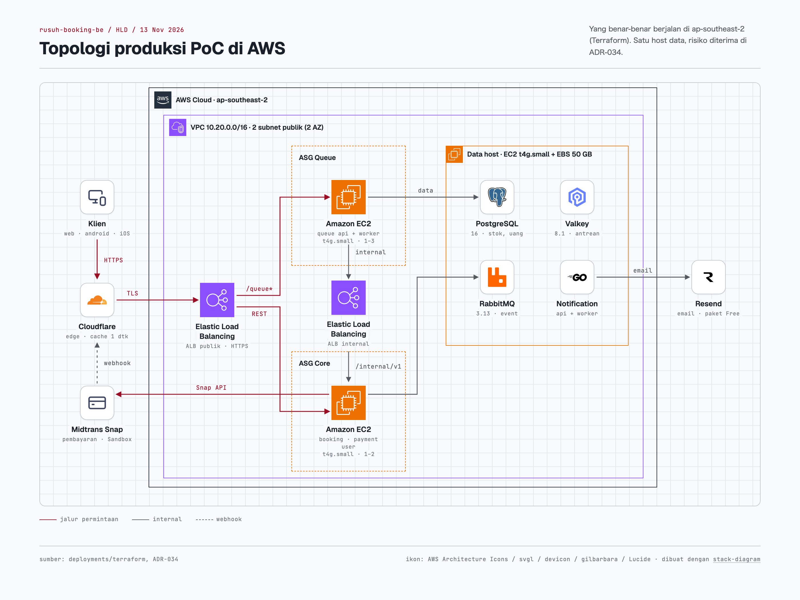
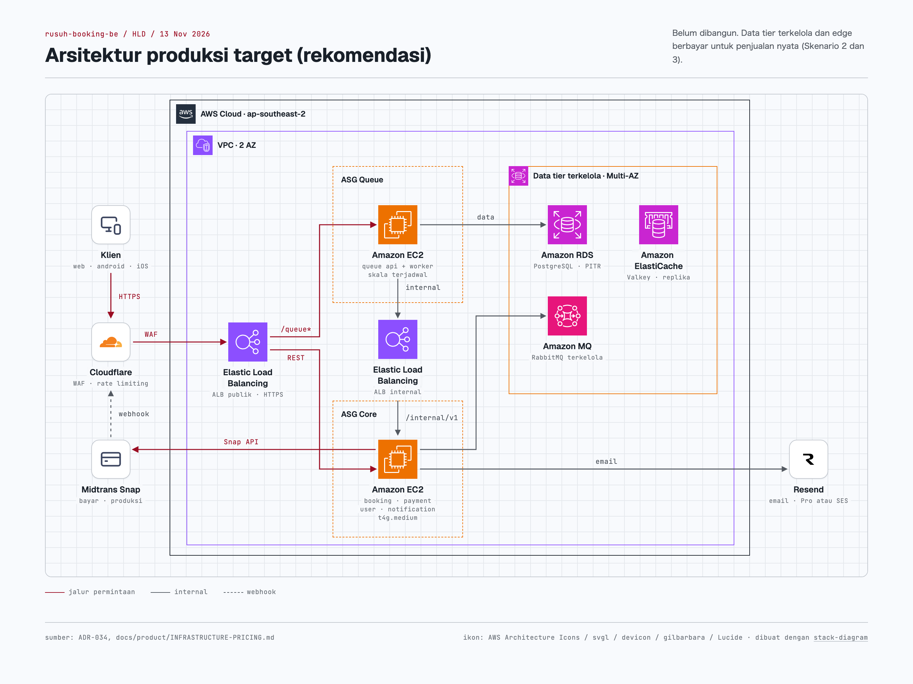
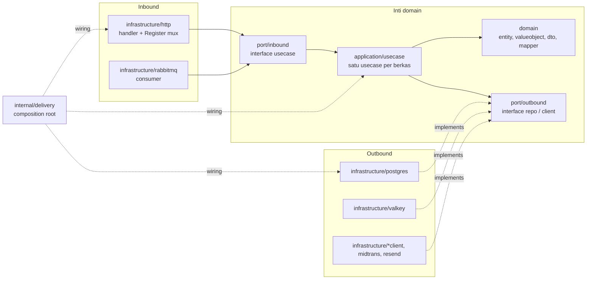
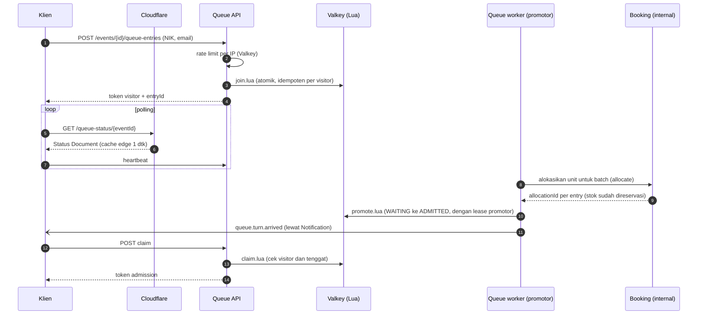
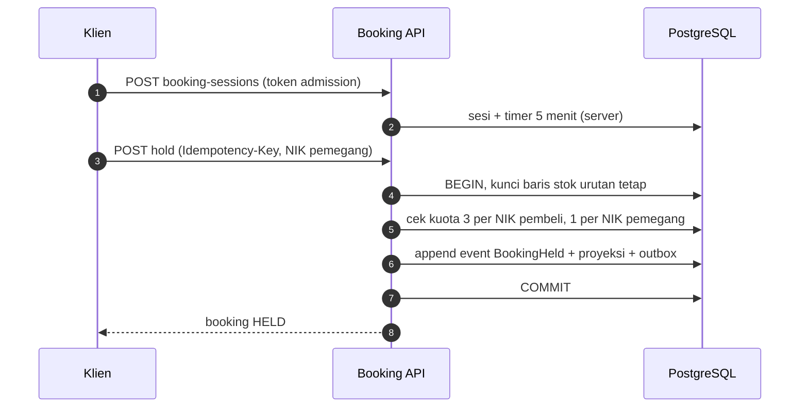
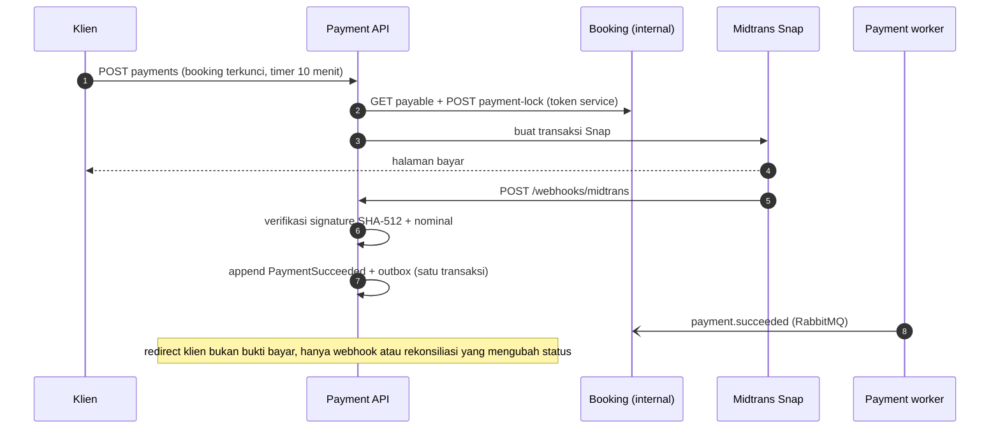
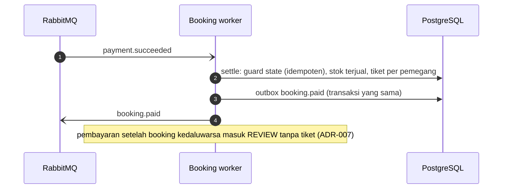
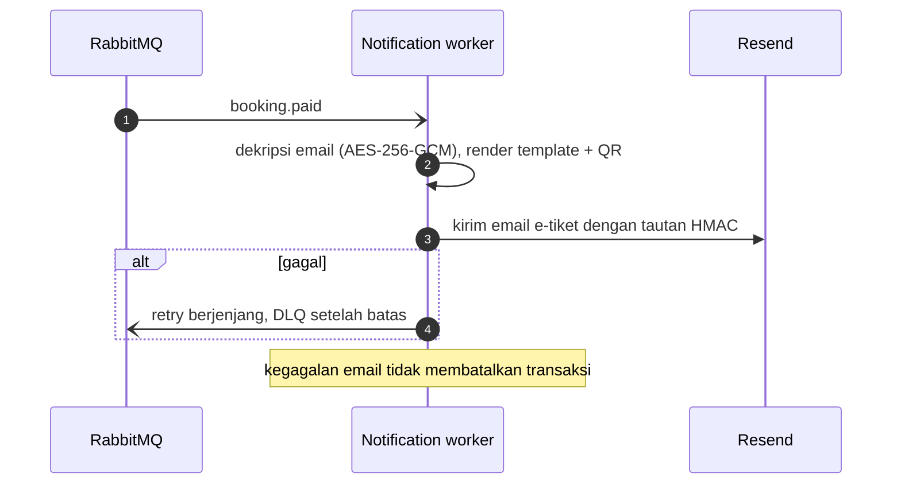

# Arsitektur Produksi: HLD dan LLD

> Bagian dari dokumentasi produk Rusuh Booking Tiket. Kembali ke [README](../../README.md).
> Disusun 13 November 2026 dari Terraform (`deployments/terraform`), Compose dev (`deployments/dev`), dan kode `services/` pada commit `99fd2b2`.

Dokumen ini membedakan tiga hal dengan tegas:

| Istilah | Arti |
|---|---|
| **Topologi produksi saat ini (PoC)** | Yang benar-benar dibangun Terraform dan berjalan di AWS `ap-southeast-2` |
| **Arsitektur logis** | Pembagian tanggung jawab antar service, sama di semua lingkungan |
| **Arsitektur produksi target** | Rekomendasi untuk penjualan nyata; **belum dibangun** (ADR-034, [INFRASTRUCTURE-PRICING.md](INFRASTRUCTURE-PRICING.md)) |

---

## 1. HLD: topologi produksi saat ini (DEPLOYED, PoC)

Komponen pendukung yang tidak digambar: SSM Parameter Store (env per service), ECR (image), CloudWatch (log, alarm, budget), dan S3 (backup dan gambar event). ALB juga meneruskan `/api/v1/push-subscriptions*` ke Notification di host data.

### 1.1 Peran tiap komponen

| Komponen | Konfigurasi nyata | Peran | Sumber |
|---|---|---|---|
| Cloudflare | Proxy di depan `api.rusuhbooking.my.id` dan `dev.rusuhbooking.my.id`; Cache Rule `cache-queue-status` TTL 1 detik; 4 Response Header Transform Rule CORS dibatasi per host | Menyerap polling Status Document antrean; TLS di edge; DDoS dasar paket Free | ADR-034; panduan infra §4.1 |
| ALB publik | `drop_invalid_header_fields`, idle 60 dtk, listener 80 → 443, sertifikat ACM; dengan `behind_cloudflare = true` hanya menerima IP Cloudflare | Routing per path ke service; health check `/health` | `modules/compute/main.tf`, `modules/network/main.tf` |
| ALB internal | Tidak terekspos internet, hanya dari security group aplikasi | Panggilan Queue/Payment ke Booking (`/internal/v1/*`, tetap wajib token service) | `modules/compute/main.tf` |
| ASG queue | `t4g.small` (Graviton arm64), min 1, desired 1, max 3, target tracking CPU 60% | Waiting room: join, status, heartbeat, claim, promotor | `variables.tf` `queue_asg` |
| ASG core | `t4g.small`, min 1, desired 1, max 2, target tracking CPU 60% | Booking, Payment, User | `variables.tf` `core_asg` |
| Data host | Satu EC2 `t4g.small`, IMDSv2 wajib, root 20 GB terenkripsi, volume data EBS gp3 50 GB terpisah, snapshot harian DLM (simpan 7) | PostgreSQL, Valkey, RabbitMQ, Notification | `modules/data_host/main.tf` |
| SSM Parameter Store | `/rusuh-prod/<svc>.env` (SecureString) | Konfigurasi dan secret per service; divalidasi `check-ssm-env.sh` sebelum rilis | `deployments/terraform/README.md` |
| ECR | Satu repository per service, lifecycle policy | Image arm64 yang disalin dari GHCR saat deploy | `modules/ecr`, job `deployment-prod` |
| CloudWatch | Log group aplikasi (retensi 30 hari), metrik EMF (7 hari), alarm 5xx dan unhealthy host, dashboard bisnis, SNS email, AWS Budgets 50/100/150 USD | Observabilitas dan kendali biaya | `modules/observability/main.tf` |
| S3 | Bucket backup (SSE AES256, versioning, kedaluwarsa 90 hari, hanya TLS) dan bucket gambar event | Cadangan dan media | `modules/storage/main.tf` |
| Akses admin | Tanpa SSH; akses lewat SSM Session Manager (`aws-admin-tunnel.sh`) | Mengurangi permukaan serangan | `modules/network/main.tf` |

### 1.2 Routing path di ALB (aktual)

| Service | Port | Path publik |
|---|---|---|
| Queue | 8081 | `/api/v1/queue*`, `/api/v1/queue-status/*`, `/api/v1/events/*/queue-entries`, `/api/v1/queue-entries/*` |
| Booking | 8082 | `/api/v1/events`, `/api/v1/events/*`, `/api/v1/bookings*`, `/api/v1/booking-sessions*`, `/api/v1/me/bookings*` |
| Payment | 8083 | `/api/v1/payments*`, `/api/v1/payment-page-sessions`, `/api/v1/webhooks/midtrans` |
| Notification | 8084 | `/api/v1/push-subscriptions*` (berjalan di data host) |
| User | 8085 | `/api/v1/auth/*`, `/api/v1/me*` |

### 1.3 Lingkungan dev (DEPLOYED)

Satu VPS dengan Docker Compose (`deployments/dev/docker-compose.dev.yaml`) dan Caddy sebagai reverse proxy, di belakang Cloudflare (`https://dev.rusuhbooking.my.id`). Stack observabilitas Prometheus, Loki, Alloy, dan Grafana self-host. Deploy lewat job `deployment-dev` (SSH, `deploy.sh`: pull image, migrasi, `up -d`, smoke test).

### 1.4 Batasan topologi saat ini

Satu host data adalah titik kegagalan tunggal (OPS-001, RPO hingga 24 jam dari snapshot harian). Satu region. Email paket Free (100 per hari, OPS-002). Midtrans masih Sandbox. Risiko ini diterima tertulis di ADR-034 dengan pemicu migrasi: penjualan berbayar nyata, lebih dari 100 transaksi per hari, ada SLA tertulis, atau lebih dari 100 email per hari.

---

## 2. Arsitektur produksi target (PLANNED / RECOMMENDED)

Belum dibangun. Rincian, alasan, dan harga per skenario: [INFRASTRUCTURE-PRICING.md](INFRASTRUCTURE-PRICING.md). Ukuran instance untuk skala 100 ribu sampai 1 juta pengantre harus ditetapkan dari uji beban di infrastruktur target, bukan dari angka lokal.

---

## 3. LLD: implementasi di kode (IMPLEMENTED)

### 3.1 Pola arsitektur per service

Setiap service adalah proyek Go terpisah dengan **Hexagonal Architecture** (ports and adapters). Lapisan ditegakkan otomatis oleh `depguard` di `.golangci.yml`, dan import lintas service dicegah oleh direktori `internal/` Go.

| Service | Usecase | Adapter keluar | Migrasi | Catatan |
|---|---:|---|---:|---|
| Queue | 10 | Valkey (10 skrip Lua), Postgres, RabbitMQ, booking client | 5 | `services/queue` |
| Booking | 33 | Postgres (event sourcing), Valkey, RabbitMQ, payment client, S3/lokal | 12 | `services/booking` |
| Payment | 8 | Postgres (event sourcing), Midtrans, booking client | 6 | `services/payment` |
| Notification | 10 | Postgres, RabbitMQ, Resend, SMTP, FCM, QR code, template | 2 | `services/notification` |
| User | 5 | Postgres, Valkey, RabbitMQ | 3 | `services/user` |

Pustaka bersama `pkg/` (tanpa logika bisnis): `httpx` (middleware, CORS, header keamanan, rate limit), `token` (EdDSA), `crypto` (AES-256-GCM, HMAC), `outbox`, `eventstore`, `rabbitmq` (publisher confirm, retry berjenjang, DLQ), `migrate` (advisory lock), `resilience`, `revocation`, `telemetry` (Prometheus), `queueshard`, `nik`, `apperror`, `logger`, `postgres`, `valkey`, `contract`.

Setiap binary memakai Cobra dengan verb `api`, `worker`, `migrate up|down|status`, dan `healthcheck`. Satu image per service, satu verb per container.

### 3.2 Pola transaksi dan event

| Pola | Implementasi | Lokasi |
|---|---|---|
| Event sourcing | Hanya agregat Booking dan Payment; append event, proyeksi read model, perubahan stok, dan outbox dalam satu transaksi; `ErrConcurrency` memicu baca ulang | `pkg/eventstore` |
| Transactional outbox | Event stok atau uang ditulis di transaksi yang sama, relay membaca `FOR UPDATE SKIP LOCKED`, `messageId` = ID baris sehingga konsumen idempoten | `pkg/outbox/relay.go` |
| Konsumen idempoten | Guard state dan `ON CONFLICT DO NOTHING`, tanpa tabel inbox; diuji dengan kiriman ganda | consumer tiap service |
| Retry dan DLQ | Antrean retry dengan TTL berjenjang (`RABBITMQ_RETRY_DELAYS`), DLQ setelah `RABBITMQ_MAX_RETRIES` (default 3) | `pkg/rabbitmq/consumer.go` |
| Unit of work | Transaksi stok dengan urutan kunci tetap untuk mencegah deadlock | `port/outbound/unit_of_work.go` (Booking) |
| Atomisitas antrean | Skrip Lua Valkey: `join`, `promote`, `claim`, `heartbeat`, `liveness`, `rate_limit`, dan lainnya; indeks liveness di-shard | `services/queue/assets/lua`, `pkg/queueshard` |

Kontrak event (JSON Schema 2020-12, `docs/contracts/events`): `queue.turn.soon`, `queue.turn.arrived`, `booking.paid`, `booking.expired`, `booking.review`, `booking.sold_out`, `booking.quota.exhausted`, `booking.journey.ended`, `payment.succeeded`, `payment.failed`, `otp.requested`.

### 3.3 Autentikasi dan otorisasi

| Token | Penerbit | Dipakai untuk | Scope |
|---|---|---|---|
| Visitor | Queue | Identitas pengantre anonim | `visitor` |
| Admission | Queue | Masuk halaman detail dan beli, hanya terbit lewat antrean (NFR-07) | `admission` |
| Buyer (akses + refresh) | User, OTP email | Akun opsional; refresh dirotasi, pemakaian ulang mencabut semua sesi | `buyer` |
| Service | Tiap service | Panggilan `/internal/v1/*` antar service | `service` |
| Admin | Buyer dengan email di `ADMIN_EMAILS` | `/internal/v1/admin/*` (buat event, upload gambar, konfigurasi) | `buyer` + allowlist |

Semua token ditandatangani EdDSA (Ed25519, `pkg/token`); setiap verifier hanya menerima scope miliknya. Webhook Midtrans diverifikasi dengan `signature_key` SHA-512 (`services/payment/internal/payment/infrastructure/midtrans/signature.go`).

### 3.4 Penanganan error, log, dan metrik

- Format error seragam `{"meta":{"code","message"}}` lewat `pkg/apperror`; error domain bertipe dipetakan di adapter HTTP.
- Log terstruktur `slog` dengan request ID; NIK, email, dan token tidak pernah ditulis ke log.
- Metrik Prometheus (`pkg/telemetry`) dengan label terbatas (service, route, status, event_id); ID pembeli tidak pernah jadi label. Di AWS dikirim lewat CloudWatch Agent (EMF).
- Health check tunggal `GET /health` (200 UP, 503 DOWN) dipakai ALB dan HEALTHCHECK container.

---

## 4. Diagram sekuens alur kritis

### 4.1 Waiting room sampai admission

Alokasi terjadi **sebelum** pengantre diizinkan masuk. Inilah dasar janji "Jangan PHP": siapa pun yang masuk halaman beli sudah punya stok yang dipesankan untuknya.

### 4.2 Booking dan reservasi stok

### 4.3 Pembayaran Midtrans dan webhook

### 4.4 Penerbitan tiket

### 4.5 Pengiriman notifikasi

