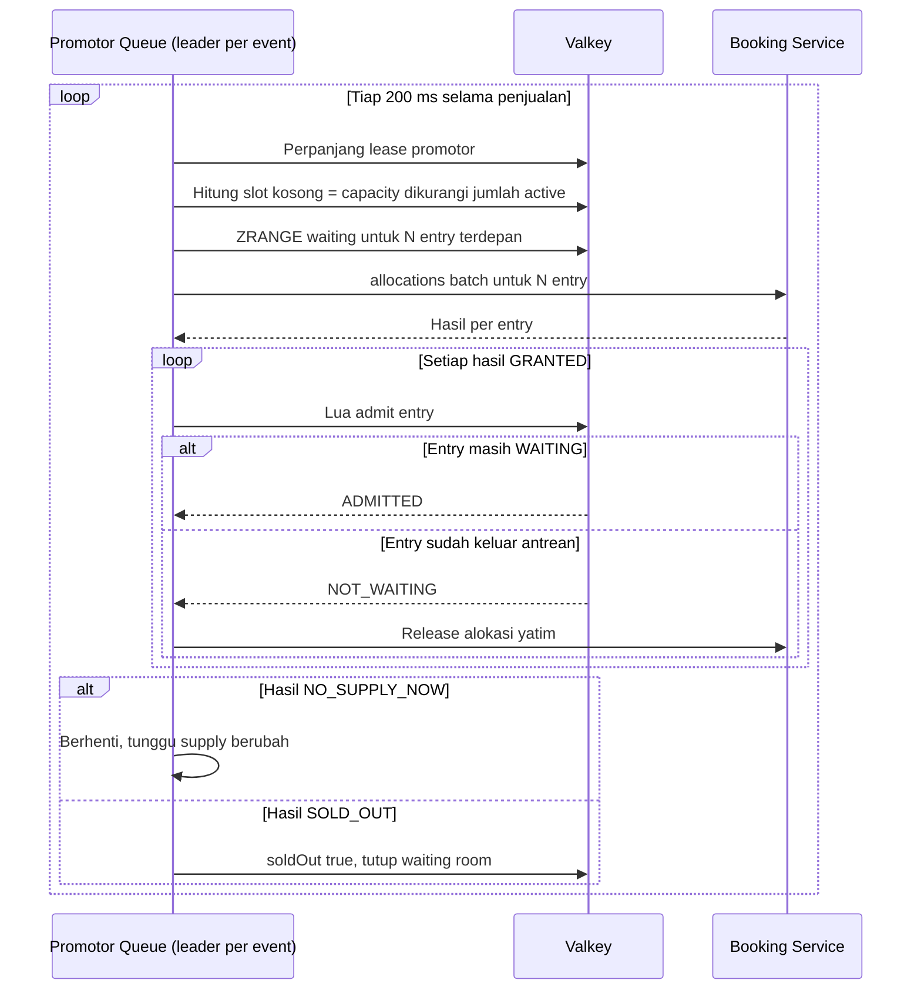
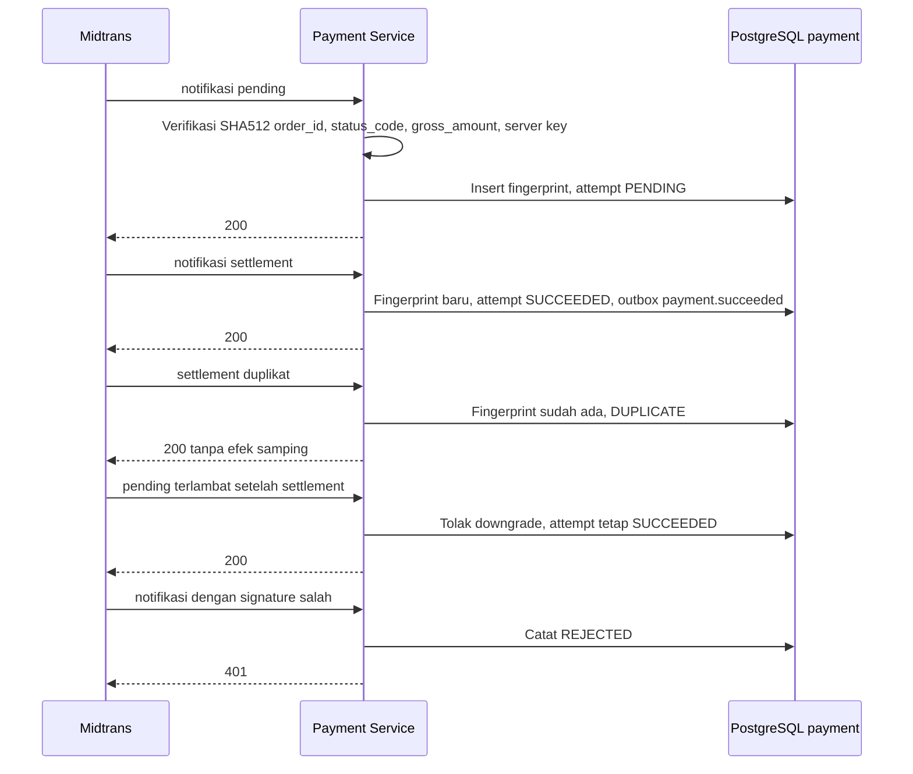
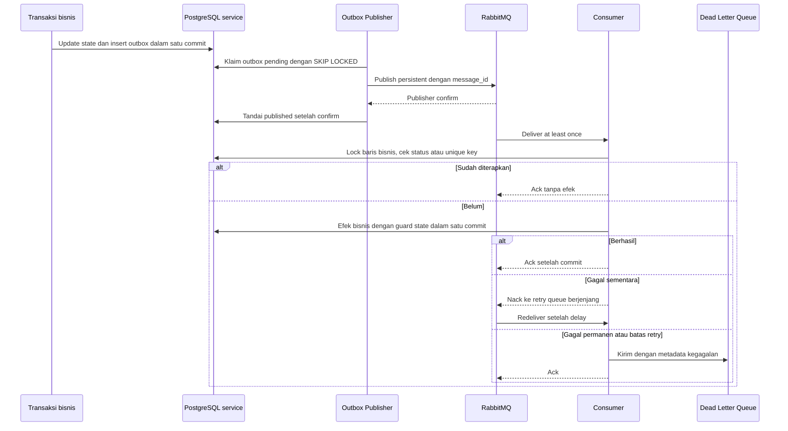
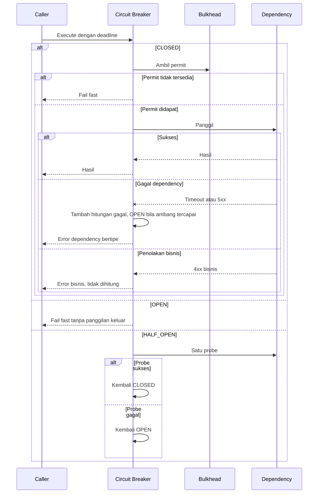
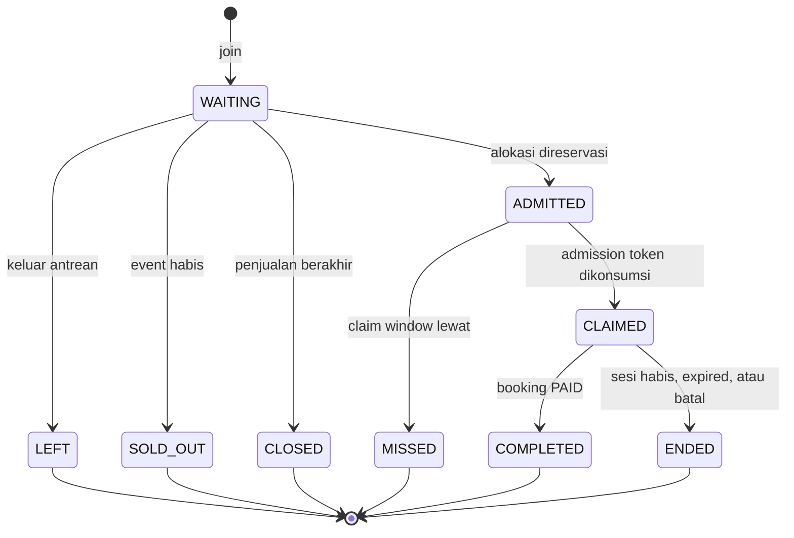
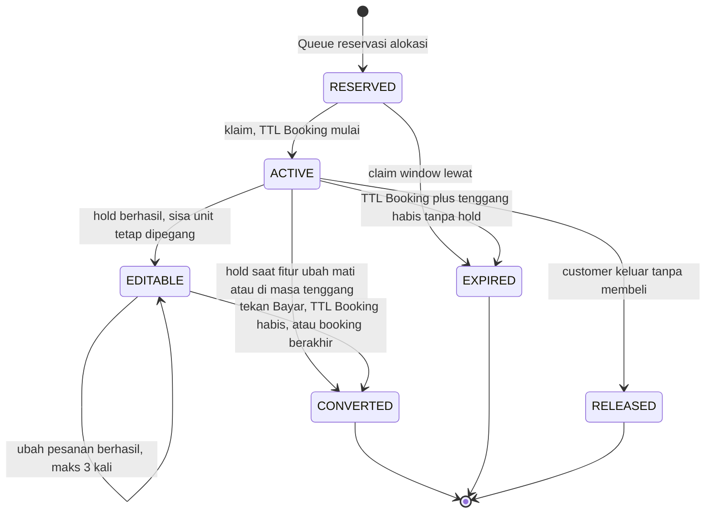
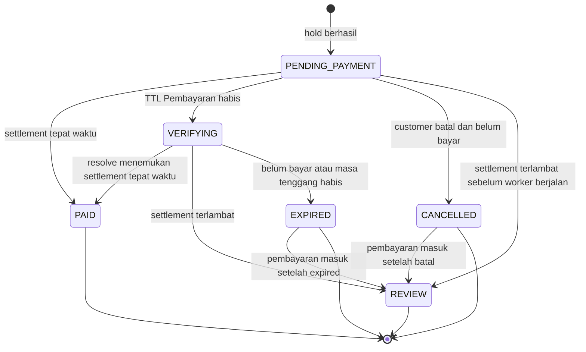
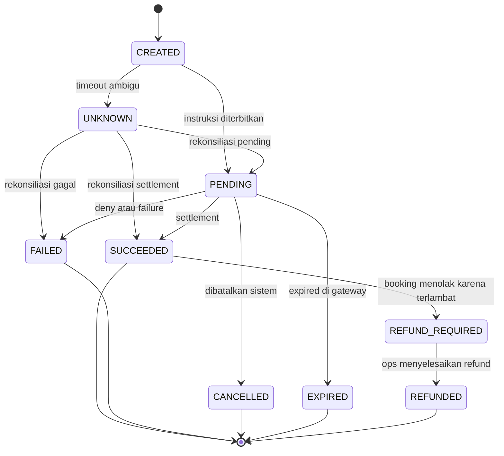

# Software Design Description (SDD) — Low-Level Design — Rusuh Booking Tiket

| Field | Value |
|-------|-------|
| **System** | Rusuh Booking Tiket |
| **Design subjects** | CMP-QUEUE, CMP-BOOKING, CMP-PAYMENT, CMP-NOTIF, CMP-PLATFORM (web dan mobile dirinci di kontrak dan wireframe) |
| **Document ID** | SDD-RBT-001 |
| **Version** | 1.2 |
| **Date** | 2026-10-18 |
| **Status** | Draft. Desain baseline = PRD v4.6 Final Canonical; implementasi `NOT_VERIFIED` |
| **Issuing organization** | Tim Rusuh Booking Tiket |
| **Author(s)** | Tim PT. Tiket Sampai Nonton Sentosa (BE-1, BE-2) |
| **Reviewers / Approvers** | Pak Dinda (CEO), Pak Jabon (CTO), Pak Rahman (CFO), PT. Tiga Sekawan Angin Ribut |
| **Classification** | Internal |
| **Source documents** | SRS-RBT-001, AD-RBT-001 (HLD), ADR-RBT |

> **Reference basis.** Struktur dokumen disusun dengan mengacu pada **IEEE 1016-2009** (Software Design Descriptions): identifikasi, design stakeholder dan concern, design viewpoint, design view, design element, design rationale, dan design language. IEEE 1016-2009 berstatus *Inactive-Reserved* di IEEE SA, tetapi masih lazim dipakai sebagai acuan struktur. Notasi diagram mengikuti **UML** (ISO/IEC 19505; edisi OMG terbaru UML 2.5.1) lewat Mermaid untuk sequence, state, dan class.
>
> **Kutipan v4.6.** Hampir seluruh isi teknis disalin apa adanya dari v4.6 (lampiran A–E, J, M, N dan §9.5, §9.8, §11, §16.2). Struktur proyek (§4.1, §4.3) dan prinsip desain kode (§4.5.1) ditulis ulang mengikuti standar proyek organisasi. Path di dalam kutipan sudah disesuaikan dengan struktur baru. Rujukan § atau Lampiran di dalamnya diberi penanda `[v4.6 → dokumen §x]`.
>
> **Catatan notasi.** Beberapa diagram v4.6 memakai Mermaid *flowchart* untuk alur (activity-like) dan struktur. Diagram tersebut bukan diagram UML formal; bila dibutuhkan notasi UML penuh, gambar ulang dengan PlantUML (component/activity).

## Change History

| Version | Date | Author | Summary of change |
|---------|------|--------|-------------------|
| 1.0 | 2026-10-17 | Tim PT. Tiket Sampai Nonton Sentosa | Dipecah dari PRD v4.6 §7.4, §9.5, §9.8, §11, §16.2, Lampiran A–F, J, M, N |
| 1.1 | 2026-10-17 | Tim PT. Tiket Sampai Nonton Sentosa | Struktur proyek, aturan dependency, dan prinsip desain kode disesuaikan dengan standar proyek organisasi (ADR-016); menggantikan Lampiran F v4.6 |
| 1.2 | 2026-10-18 | Tim PT. Tiket Sampai Nonton Sentosa | §4.1.3 hanya repository backend; web dan mobile di repository terpisah (ADR-017); deskripsi pipeline |

---

## 1. Introduction

### 1.1 Purpose

SDD ini menjelaskan desain rinci setiap service backend dan library bersama: struktur modul, kontrak antarmuka, data fisik, interaksi dan locking, state machine, algoritme, konfigurasi, dan observability. Pembaca: implementer, reviewer, tester, dan maintainer.

### 1.2 Scope

Mencakup Queue, Booking, Payment, Notification Service, dan `pkg/`. Arsitektur lintas service ada di HLD; requirement ada di SRS; alasan keputusan ada di ADR.

### 1.3 Context and Allocation

| Komponen | Requirement yang dialokasikan (SRS §3.2) | Owner |
|----------|------------------------------------------|-------|
| CMP-QUEUE | §3.2.1, 3.2.4, 3.2.5, 3.2.6, 3.2.10, 3.2.25, 3.2.26 | BE-1 |
| CMP-BOOKING | §3.2.2, 3.2.3, 3.2.7–3.2.9, 3.2.11–3.2.13, 3.2.16, 3.2.17, 3.2.20, 3.2.23, 3.2.24, 3.2.26 | BE-2 |
| CMP-PAYMENT | §3.2.13–3.2.19 | BE-2 |
| CMP-NOTIF | §3.2.6 (push), 3.2.20 (email), 3.2.21, 3.2.25 | BE-1 |
| CMP-PLATFORM | §3.2.11 (validator NIK), 3.2.22 (middleware), 3.2.26 (validator konfigurasi) | BE-1 (+ review BE-2) |

Alokasi lengkap per requirement ada di HLD §6.2.

### 1.4 Design Languages

| Language | Used for |
|----------|----------|
| UML via Mermaid (`sequenceDiagram`, `stateDiagram-v2`) | Interaction dan state dynamics |
| OpenAPI 3.1 (`docs/contracts/openapi/*.yaml`) | Kontrak HTTP publik dan internal |
| JSON Schema | Payload event |
| SQL DDL (PostgreSQL 16) | Data fisik |
| Lua (Valkey) | Operasi atomik antrean |
| Go | Contoh port, unit of work, algoritme |

### 1.5 Glossary and References

Istilah ada di SRS-RBT-001 §1.4 dan PRD-RBT-001 Appendix B. Keputusan ada di ADR-RBT.

---

## 2. Design Stakeholders and Concerns

| Stakeholder | Design concerns | Addressed by viewpoint |
|-------------|-----------------|------------------------|
| Implementer (BE) | Struktur modul, kontrak, transaksi, locking, algoritme | Composition, Interface, Interaction, Algorithm |
| Implementer (WEB, MOB) | Kontrak API, pembagian tanggung jawab backend vs klien, payment page | Interface |
| Tester | Perilaku, state, race condition, error | Interaction, State dynamics, Interface |
| Maintainer | Dependency, pola, rationale, kepatuhan standar proyek | Composition, Dependency, Patterns use, §10 |
| Ops | Konfigurasi, metrik, retry/DLQ | Resource (§6), §7 |
| Security | Validasi input, data pribadi, token | Interface, Information, §8 |

---

## 3. Selected Design Viewpoints

| Viewpoint (IEEE 1016) | Selected | View section | Justification if omitted |
|-----------------------|----------|--------------|--------------------------|
| Context | ✓ | §1.3 (rujukan ke HLD) | |
| Composition | ✓ | §4.1 | |
| Logical | ☐ | — | Model domain dicerminkan oleh ERD (HLD §4.3), DDL (§4.4), dan state machine (§4.8); class model ada di kode |
| Dependency | ✓ | §4.3 | |
| Information | ✓ | §4.4 | |
| Patterns use | ✓ | §4.5 | |
| Interface | ✓ | §4.6 | |
| Interaction | ✓ | §4.7 | |
| State dynamics | ✓ | §4.8 | |
| Algorithm | ✓ | §4.9 | |
| Resource | ✓ | §4.10, §6 | |
| Structure | ☐ | — | Tercakup Composition dan Information |

---

## 4. Design Views

### 4.1 Composition View

Struktur proyek **wajib mengikuti standar proyek organisasi** (ADR-016): setiap service adalah proyek Go mandiri dengan satu domain hexagon di `internal/<domain>/`, port dipisah `inbound`/`outbound`, domain dipecah `entity`/`valueobject`/`dto`/`mapper`, usecase di `application/usecase`, adapter di `infrastructure`, composition root di `internal/delivery`, konfigurasi di `internal/config`, dan mock hasil generate di `_mock/`. Struktur ini menggantikan Lampiran F PRD v4.6.

#### 4.1.1 Struktur per Service

Contoh lengkap untuk Booking Service. Queue, Payment, dan Notification memakai pola yang sama (§4.1.2).

```text
services/booking/
├── cmd/                                   # Entry point
│   └── main.go                            # --mode=api (HTTP + consumer) | --mode=worker (expiry, outbox, rekonsiliasi)
├── internal/
│   ├── booking/                           # Booking domain (self-contained hexagon)
│   │   ├── port/
│   │   │   ├── inbound/                   # Driving ports: IEventUsecase, IAllocationUsecase, ISessionUsecase,
│   │   │   │                              #   IBookingUsecase (hold, edit, lock, cancel), ISettlementUsecase,
│   │   │   │                              #   IExpiryUsecase, ITicketUsecase, IConfigUsecase, IPaymentEventHandler
│   │   │   └── outbound/                  # Driven ports: IUnitOfWork, IBookingTx, IEventRepository,
│   │   │                                  #   IConfigRepository, IIdempotencyRepository, IPaymentClient,
│   │   │                                  #   IAvailabilityCache, IClock
│   │   ├── domain/
│   │   │   ├── entity/                    # Event, Category, Supply, Admission, Booking, BookingItem, Ticket,
│   │   │   │                              #   BuyerQuota; status/state constants; error codes
│   │   │   ├── valueobject/               # Money (minor unit), NIKHash, MaskedNIK, Version, LockReason, Phase
│   │   │   ├── dto/                       # Request/Response DTOs (consolidated)
│   │   │   └── mapper/                    # Pure data transformation (DTO ↔ entity)
│   │   ├── application/
│   │   │   └── usecase/                   # list_events, reserve_allocations, start_session, create_booking,
│   │   │                                  #   replace_items, lock_for_payment, apply_settlement, expire_bookings,
│   │   │                                  #   expire_admissions, cancel, issue_tickets
│   │   └── infrastructure/
│   │       ├── http/                      # HTTP handlers (net/http): public, internal, SSE
│   │       ├── postgres/                  # IUnitOfWork/IBookingTx + repositories (sqlc)
│   │       ├── paymentclient/             # IPaymentClient (internal API Payment)
│   │       ├── rabbitmq/                  # Consumer payment.*; outbox relay
│   │       └── valkey/                    # IAvailabilityCache (ringkasan ketersediaan SSE)
│   ├── shared/                            # Cross-domain reusable types
│   │   └── entity/                        # Generic ValidationError, MapValidationErrors
│   ├── config/                            # Application configuration
│   │   ├── config.go
│   │   └── load.go
│   └── delivery/                          # Composition root (DI wiring)
│       ├── server.go                      # Mode api
│       └── worker.go                      # Mode worker
├── _mock/                                 # Generated mocks for testing (mockgen)
│   ├── booking/port/
│   │   ├── inbound/                       # Usecase mocks (package mock_inbound)
│   │   └── outbound/                      # Repository + client mocks (package mock_outbound)
│   └── pkg/                               # Mocks untuk interface dari pkg/
├── assets/                                # Static config files (JSON): default konfigurasi event, pesan error
├── deployments/                           # Deployment configurations
│   ├── Dockerfile
│   └── migrations/                        # Schema booking (DDL §4.4)
├── docs/                                  # Dokumentasi service (README, catatan desain lokal)
└── go.mod
```

#### 4.1.2 Pemetaan per Service

| Lokasi standar | Queue | Booking | Payment | Notification |
|---|---|---|---|---|
| `cmd/main.go` | API + promotor + status publisher + consumer | `--mode=api` / `--mode=worker` | `--mode=api` (HTTP, webhook, consumer) / `--mode=worker` (rekonsiliasi UNKNOWN, outbox relay) | Consumer + HTTP push-subscriptions |
| `internal/<domain>/` | `queue/` | `booking/` | `payment/` | `notification/` |
| `port/inbound/` | `IJoinUsecase`, `IClaimUsecase`, `IPositionUsecase`, `ILeaveUsecase`, `IPromoteUsecase`, `IStatusPublisherUsecase`, `IBookingEventHandler` | lihat §4.1.1 | `IPaymentPageUsecase`, `IPageTokenUsecase`, `IAttemptUsecase`, `IWebhookUsecase`, `IResolveUsecase`, `IReconcileUsecase`, `IBookingEventHandler` | `INotificationEventHandler`, `IPushSubscriptionUsecase` |
| `port/outbound/` | `IQueueStore`, `IRateLimiter`, `IStatusCache`, `IAllocationReserver`, `ISupplyReader`, `IEntryAuditWriter`, `IEventSettingsRepository`, `ITurnEventPublisher` | lihat §4.1.1 | `IUnitOfWork`, `IPaymentRepository`, `IPaymentGateway`, `IBookingClient` | `IDeliveryRepository`, `IPushSubscriptionRepository`, `IMailer`, `IPushSender` |
| `domain/entity/` | Entry, StatusDocument, EventSettings | lihat §4.1.1 | Attempt, Callback, RefundCase, status constants | Delivery, PushSubscription |
| `domain/valueobject/` | Seq, EntryID, VisitorID, BuyerNIKHash, ChanceZone | lihat §4.1.1 | OrderID, Money, PaymentMethod | NotificationType, DeliveryStatus |
| `application/usecase/` | join, claim, position, leave, promote, publish_status, on_journey_ended, on_quota_exhausted, on_sold_out | lihat §4.1.1 | page_view, page_token, create_attempt, process_webhook, resolve, reconcile, on_booking_review | send_email, send_push, register_push |
| `infrastructure/` | `http/`, `valkey/` (+ `scripts/{join,admit,leave,release_slot}.lua`), `bookingclient/`, `rabbitmq/`, `postgres/` | lihat §4.1.1 | `http/`, `midtrans/`, `simulator/`, `bookingclient/`, `postgres/`, `rabbitmq/` | `http/`, `rabbitmq/`, `smtp/`, `fcm/`, `logpush/`, `postgres/` |
| `assets/` | Default `event_settings` | Default konfigurasi event | Pemetaan metode/status Midtrans | `templates/{eticket,expired,review}.txt.tmpl` |
| `deployments/` | Dockerfile, migrations schema `queue` | Dockerfile, migrations schema `booking` | Dockerfile, migrations schema `payment` | Dockerfile, migrations schema `notification` |

#### 4.1.3 Struktur Repository `rusuh-booking-be` (monorepo backend)

```text
.
├── services/                              # Satu proyek per service, masing-masing mengikuti §4.1.1
│   ├── queue/
│   ├── booking/
│   ├── payment/
│   └── notification/
├── pkg/                                   # Shared utilities (module sendiri), tanpa logika bisnis
│   ├── apperror/                          # Application error types + error envelope
│   ├── httpx/                             # Server, middleware, request ID, rate limit, CORS, client IP
│   ├── dotenv/                            # Environment configuration
│   ├── token/                             # JWT EdDSA, key loading
│   ├── crypto/                            # HMAC-SHA256, AES-256-GCM
│   ├── nik/                               # Validasi struktur NIK
│   ├── outbox/                            # Outbox store + relay
│   ├── consumer/                          # Manual ack, retry berjenjang, DLQ
│   ├── broker/                            # RabbitMQ connection + topology
│   ├── db/                                # PostgreSQL pool + transaction helper
│   ├── resilience/                        # Breaker, bulkhead, timeout
│   ├── telemetry/                         # Logging, metrics, tracing
│   ├── clock/                             # Clock abstraction
│   └── go.mod
├── deployments/                           # Deployment configurations (lintas service)
│   ├── compose/                           # postgres-init.sql, keys/ (lokal)
│   ├── edge/nginx.conf
│   ├── observability/{prometheus.yml,grafana/,otel-collector.yaml}
│   └── terraform/{modules/{network,edge,alb,asg,stateful,iam-oidc,budget},environments/staging}
├── docs/                                  # Documentation
│   ├── contracts/{openapi/{public.yaml,internal-booking.yaml,internal-payment.yaml},events/*.schema.json}
│   └── {prd,adr,evidence,ai-log}/
├── tests/{features/*.feature,k6/*.js,apidog/,contract/}   # Test lintas service
├── tools/{migrate,seed}/                  # Utilitas dev: migrasi semua service (deployments/migrations), seed data
├── .kiro/steering/{product.md,tech.md,structure.md,code-principles.md,security-privacy.md,invariants.md,testing-review.md}
├── specs/{queue-service,booking-service,payment-service,notification-service,platform}/
├── .github/{CODEOWNERS,pull_request_template.md,dependabot.yml,workflows/}   # CI/CD (deviasi, lihat §4.1.4)
├── .golangci.yml                          # depguard: larangan import lintas services/*
├── docker-compose.yaml                    # Entry point assessor (memakai deployments/)
├── Makefile                               # up, seed, smoke, mock, test, lint
├── go.work                                # Workspace: services/* + pkg
└── README.md
```

Web (Next.js, termasuk `/pay/{bookingId}`) dan mobile (React Native) berada di repository terpisah `rusuh-booking-web` dan `rusuh-booking-mobile` dalam organisasi `tiket-sampai-nonton` (ADR-017). Keduanya merujuk kontrak di `docs/contracts/` repository ini dengan ref yang dikunci.

#### 4.1.4 Kesesuaian dengan Standar dan Deviasi

| Elemen standar | Status | Catatan |
|---|---|---|
| `cmd/main.go` sebagai entry point | Sesuai | Service dengan worker memakai satu entry point dengan `--mode` (api/worker), bukan direktori `cmd` tambahan |
| `internal/<domain>/port/{inbound,outbound}` | Sesuai | Nama interface berawalan `I` |
| `internal/<domain>/domain/{entity,valueobject,dto,mapper}` | Sesuai | DTO terkonsolidasi; mapper fungsi murni |
| `internal/<domain>/application/usecase` | Sesuai | Satu usecase per file |
| `internal/<domain>/infrastructure/*` | Sesuai | Satu subfolder per teknologi adapter |
| `internal/shared/entity`, `internal/config`, `internal/delivery/server.go` | Sesuai | `delivery/worker.go` ditambahkan untuk mode worker |
| `pkg/` utilitas bersama | Sesuai (dipindah ke root) | Dipakai bersama 4 service sebagai module sendiri lewat `go.work`, agar tidak disalin 4 kali |
| `_mock/` hasil generate | Sesuai | `mockgen` dari interface di `port/` dan `pkg/` (`make mock`) |
| `assets/`, `deployments/`, `docs/`, `go.mod` | Sesuai | Migration SQL dan Dockerfile di `deployments/` per service |
| `.gitlab-ci.yml` | **Deviasi** | Assessment mewajibkan repository GitHub public; CI memakai GitHub Actions (`.github/workflows/`). Stage pipeline sama dengan standar (code-quality → verify-code-quality → case-coverage → code-rank → build → package → scan-package → publish → deployment-dev → deployment-prod) dan dapat diterjemahkan ke `.gitlab-ci.yml` bila repo dipindah ke GitLab |
| Root monorepo (`services/`, `tests/`, `tools/`, `.kiro/`, `specs/`, `docker-compose.yaml`, `Makefile`, `go.work`) | Tambahan | Standar mendefinisikan satu proyek service; RBT memuat 4 service, 2 klien, dan artefak wajib assessment |

#### 4.1.5 Jalur Evolusi

*Sumber: PRD v4.6 Lampiran F.2*

| Tahap | Perubahan | Kode yang berubah |
|---|---|---|
| PoC | 4 service, satu cluster PostgreSQL (schema per service), satu Valkey, satu RabbitMQ | — |
| Production Tier M | Schema dipindah ke instance RDS terpisah bila beban perlu | Connection string saja |
| Production Tier L | Queue Service per event shard (event besar di node Valkey khusus) | Konfigurasi routing event ke Valkey |
| Opsional | Catalog Service terpisah (read model event), Identity Service bila login dibutuhkan | Service baru + kontrak baru; Booking tidak berubah |

---


### 4.2 Logical View

Tidak dipilih (lihat §3).

### 4.3 Dependency View

#### 4.3.1 Aturan Dependency

| Dari | Boleh bergantung pada | Tidak boleh |
|---|---|---|
| `domain/entity`, `domain/valueobject` | Standard library, `internal/shared/entity` | Paket lain apa pun, termasuk `pkg/` dan framework |
| `domain/dto`, `domain/mapper` | `domain/entity`, `domain/valueobject` | `port`, `application`, `infrastructure` |
| `port/inbound`, `port/outbound` | `domain/*` | `application`, `infrastructure` |
| `application/usecase` | `port/*`, `domain/*`, `pkg/` utilitas murni (`apperror`, `clock`) | `infrastructure`, driver DB/broker/HTTP client |
| `infrastructure/*` | `port/*` (mengimplementasikan outbound, memanggil inbound), `domain/*`, `pkg/` | `application/usecase` secara langsung |
| `delivery/` | Semua lapisan service (satu-satunya tempat wiring) dan `config/` | — |
| `pkg/` | Standard library dan library pihak ketiga | `services/*`, aturan bisnis |
| `services/<a>` | `pkg/` | `services/<b>`: komunikasi hanya lewat HTTP internal (`docs/contracts/openapi`) atau event (`docs/contracts/events`) |

Penegakan: kode service berada di `internal/` sehingga compiler Go menolak import dari service lain; `depguard` di `.golangci.yml` menegakkan aturan lapisan di dalam service; contract test memverifikasi kontrak antar-service.

#### 4.3.2 Aturan Tambahan

- Setiap service punya `go.mod`, migration, image, pipeline, dan CODEOWNERS sendiri; `go.work` di root menyatukan `services/*` dan `pkg` untuk tooling lokal. Setiap `services/<x>` dapat dipindah ke repository sendiri beserta salinan `pkg/`.
- Mock di `_mock/` hanya dihasilkan `mockgen` dari interface `port/inbound`, `port/outbound`, dan interface di `pkg/`; tidak diedit manual. Package mock: `mock_inbound`, `mock_outbound`, dan `mock_<pkg>`.
- Handler HTTP tidak pernah mengembalikan entity; selalu DTO lewat `domain/mapper`.

Dependency antar-service dan perilaku saat dependency gagal ada di HLD §4.7 (dependency policy).

### 4.4 Information View

*Sumber: PRD v4.6 Lampiran B*

**Target:** PostgreSQL 16. Migration setiap service dijalankan oleh role milik service tersebut, di schema miliknya. Bagian `000_roles_and_schemas` dijalankan sekali oleh admin DB.

**Status uji v4.6 (16 Oktober 2026):** DDL di bawah diterapkan pada PostgreSQL 16 kosong tanpa error (**23 tabel**; `consumer_inbox` ×4 dan `booking.audit_log` dihapus). Harness Lampiran P [v4.6 → TestPlan Annex B] dimuat ulang tanpa error; uji kirim ganda `payment.succeeded` (settlement diterapkan dua kali) menghasilkan satu kali perubahan counter dan invariant tetap lulus.

**Status uji v4.4 (riwayat):** DDL di bawah diterapkan pada PostgreSQL 16.15 kosong tanpa error (28 tabel; constraint trigger konsistensi kapasitas; trigger penguncian aturan dan audit konfigurasi). Uji T1–T22, simulasi acak 60 event, dan uji 60 pembeli paralel dirangkum di Lampiran C.7 [v4.6 → SDD §4.7.1].

**Status uji v4.3 (riwayat):** DDL di bawah diterapkan pada PostgreSQL 16.15 kosong tanpa error (25 tabel, 1 constraint trigger). Uji jaminan v4.3 (T1–T9, simulasi acak, uji paralel) kini menjadi bagian dari C.7.

**Status uji v4.2:** DDL diterapkan pada PostgreSQL 16.15 kosong tanpa error (25 tabel). Skenario uji constraint lulus: over-allocation supply ditolak, admission aktif kedua per NIK pembeli ditolak, NIK pemegang ganda per event ditolak (transaksi rollback utuh), kuota pembeli > 3 ditolak, oversell kategori ditolak, tiket ganda per item ditolak, NIK pemegang yang dilepas dapat dipakai lagi. Uji konkurensi: 50 transaksi paralel memperebutkan 10 unit → tepat 10 alokasi berhasil. Hasil ini bukti desain DDL, bukan pengganti integration test di repository.

```sql
-- 000_roles_and_schemas (dijalankan sekali oleh admin DB)
CREATE EXTENSION IF NOT EXISTS pgcrypto;

CREATE SCHEMA IF NOT EXISTS queue;
CREATE SCHEMA IF NOT EXISTS booking;
CREATE SCHEMA IF NOT EXISTS payment;
CREATE SCHEMA IF NOT EXISTS notification;

DO $$
BEGIN
  IF NOT EXISTS (SELECT 1 FROM pg_roles WHERE rolname = 'svc_queue') THEN CREATE ROLE svc_queue LOGIN; END IF;
  IF NOT EXISTS (SELECT 1 FROM pg_roles WHERE rolname = 'svc_booking') THEN CREATE ROLE svc_booking LOGIN; END IF;
  IF NOT EXISTS (SELECT 1 FROM pg_roles WHERE rolname = 'svc_payment') THEN CREATE ROLE svc_payment LOGIN; END IF;
  IF NOT EXISTS (SELECT 1 FROM pg_roles WHERE rolname = 'svc_notification') THEN CREATE ROLE svc_notification LOGIN; END IF;
END $$;

REVOKE ALL ON SCHEMA queue, booking, payment, notification FROM PUBLIC;
GRANT USAGE, CREATE ON SCHEMA queue TO svc_queue;
GRANT USAGE, CREATE ON SCHEMA booking TO svc_booking;
GRANT USAGE, CREATE ON SCHEMA payment TO svc_payment;
GRANT USAGE, CREATE ON SCHEMA notification TO svc_notification;

-- ===================================================================
-- Booking Service (dijalankan sebagai svc_booking)
-- ===================================================================
BEGIN;
SET LOCAL search_path = booking;

CREATE TABLE events (
    id uuid PRIMARY KEY DEFAULT gen_random_uuid(),
    slug text NOT NULL UNIQUE,
    name text NOT NULL,
    venue text NOT NULL,
    timezone text NOT NULL DEFAULT 'Asia/Jakarta',
    starts_at timestamptz NOT NULL,
    sales_starts_at timestamptz NOT NULL,
    sales_ends_at timestamptz NOT NULL,
    status text NOT NULL CHECK (status IN ('DRAFT','NOT_STARTED','AVAILABLE','SOLD_OUT','CLOSED')),
    max_tickets_per_order integer NOT NULL DEFAULT 3 CHECK (max_tickets_per_order BETWEEN 1 AND 3),
    max_tickets_per_buyer_nik integer NOT NULL DEFAULT 3 CHECK (max_tickets_per_buyer_nik BETWEEN 1 AND 3),
    selection_ttl_seconds integer NOT NULL DEFAULT 300 CHECK (selection_ttl_seconds BETWEEN 60 AND 1800),
    payment_ttl_seconds integer NOT NULL DEFAULT 600 CHECK (payment_ttl_seconds BETWEEN 120 AND 3600),
    claim_window_seconds integer NOT NULL DEFAULT 180 CHECK (claim_window_seconds BETWEEN 60 AND 600),
    max_attendee_checks_per_session integer NOT NULL DEFAULT 10 CHECK (max_attendee_checks_per_session BETWEEN 3 AND 50),
    -- v4.4: aturan pembentuk jaminan (dikunci saat penjualan dibuka)
    allow_mixed_categories boolean NOT NULL DEFAULT true,
    -- v4.4: ubah pesanan sebelum bayar + masa tenggang submit
    selection_edit_enabled boolean NOT NULL DEFAULT true,
    max_selection_edits integer NOT NULL DEFAULT 3 CHECK (max_selection_edits BETWEEN 0 AND 10),
    selection_submit_grace_seconds integer NOT NULL DEFAULT 5 CHECK (selection_submit_grace_seconds BETWEEN 0 AND 30),
    selection_warning_seconds integer NOT NULL DEFAULT 60 CHECK (selection_warning_seconds BETWEEN 0 AND 300),
    rules_locked_at timestamptz,          -- diisi otomatis saat status menjadi AVAILABLE
    created_at timestamptz NOT NULL DEFAULT now(),
    updated_at timestamptz NOT NULL DEFAULT now(),
    CHECK (sales_ends_at > sales_starts_at),
    -- validasi silang di dalam satu tabel (validasi lintas service: Lampiran J.3)
    CHECK (max_tickets_per_order <= max_tickets_per_buyer_nik),
    CHECK (selection_submit_grace_seconds < selection_ttl_seconds),
    CHECK (selection_warning_seconds < selection_ttl_seconds),
    CHECK (payment_ttl_seconds >= selection_ttl_seconds)
);

-- v4.4: aturan pembentuk jaminan dan keadilan tidak boleh berubah setelah penjualan dibuka.
-- TTL dan jendela boleh berubah; nilai lama tetap berlaku untuk sesi yang sudah berjalan (snapshot di admissions).
CREATE FUNCTION guard_event_rules() RETURNS trigger LANGUAGE plpgsql AS $fn$
BEGIN
    IF NEW.status = 'AVAILABLE' AND OLD.rules_locked_at IS NULL THEN
        NEW.rules_locked_at := now();
    END IF;
    IF OLD.rules_locked_at IS NOT NULL AND (
         NEW.max_tickets_per_order IS DISTINCT FROM OLD.max_tickets_per_order OR
         NEW.max_tickets_per_buyer_nik IS DISTINCT FROM OLD.max_tickets_per_buyer_nik OR
         NEW.allow_mixed_categories IS DISTINCT FROM OLD.allow_mixed_categories OR
         NEW.rules_locked_at IS DISTINCT FROM OLD.rules_locked_at) THEN
        RAISE EXCEPTION 'EVENT_RULES_LOCKED event=%', OLD.id USING ERRCODE = 'check_violation';
    END IF;
    NEW.updated_at := now();
    RETURN NEW;
END;
$fn$;
CREATE TRIGGER trg_guard_event_rules BEFORE UPDATE ON events
    FOR EACH ROW EXECUTE FUNCTION guard_event_rules();
CREATE FUNCTION lock_rules_on_insert() RETURNS trigger LANGUAGE plpgsql AS $fn$
BEGIN
    IF NEW.status = 'AVAILABLE' AND NEW.rules_locked_at IS NULL THEN NEW.rules_locked_at := now(); END IF;
    RETURN NEW;
END;
$fn$;
CREATE TRIGGER trg_lock_rules_on_insert BEFORE INSERT ON events
    FOR EACH ROW EXECUTE FUNCTION lock_rules_on_insert();

-- v4.4: setiap perubahan konfigurasi event tercatat (siapa, kapan, nilai lama → baru).
CREATE TABLE config_audit (
    id bigserial PRIMARY KEY,
    event_id uuid NOT NULL,
    changed_by text NOT NULL DEFAULT current_setting('app.actor', true),
    changed_at timestamptz NOT NULL DEFAULT now(),
    field text NOT NULL,
    old_value jsonb,
    new_value jsonb
);
CREATE FUNCTION audit_event_config() RETURNS trigger LANGUAGE plpgsql AS $fn$
BEGIN
    INSERT INTO booking.config_audit(event_id, changed_by, field, old_value, new_value)
    SELECT NEW.id, COALESCE(current_setting('app.actor', true), 'unknown'), o.key, o.value, n.value
      FROM jsonb_each(to_jsonb(OLD)) o JOIN jsonb_each(to_jsonb(NEW)) n USING (key)
     WHERE o.value IS DISTINCT FROM n.value AND o.key NOT IN ('updated_at');
    RETURN NULL;
END;
$fn$;
CREATE TRIGGER trg_audit_event_config AFTER UPDATE ON events
    FOR EACH ROW EXECUTE FUNCTION audit_event_config();
CREATE INDEX idx_events_status_sales ON events(status, sales_starts_at);

CREATE TABLE ticket_categories (
    id uuid PRIMARY KEY DEFAULT gen_random_uuid(),
    event_id uuid NOT NULL REFERENCES events(id) ON DELETE RESTRICT,
    code text NOT NULL,
    name text NOT NULL,
    price_minor bigint NOT NULL CHECK (price_minor >= 0),
    currency char(3) NOT NULL DEFAULT 'IDR',
    display_order integer NOT NULL DEFAULT 0,
    UNIQUE (event_id, code),
    UNIQUE (event_id, id)
);

CREATE TABLE category_inventories (
    category_id uuid PRIMARY KEY,
    event_id uuid NOT NULL,
    capacity integer NOT NULL CHECK (capacity >= 0),
    held_quantity integer NOT NULL DEFAULT 0 CHECK (held_quantity >= 0),
    sold_quantity integer NOT NULL DEFAULT 0 CHECK (sold_quantity >= 0),
    updated_at timestamptz NOT NULL DEFAULT now(),
    FOREIGN KEY (event_id, category_id) REFERENCES ticket_categories(event_id, id) ON DELETE RESTRICT,
    UNIQUE (event_id, category_id),
    CHECK (held_quantity + sold_quantity <= capacity)
);

-- Supply tingkat event: dasar jaminan "masuk pasti dapat tiket".
CREATE TABLE event_supply (
    event_id uuid PRIMARY KEY REFERENCES events(id) ON DELETE RESTRICT,
    total_capacity integer NOT NULL CHECK (total_capacity >= 0),
    allocated_units integer NOT NULL DEFAULT 0 CHECK (allocated_units >= 0),
    held_units integer NOT NULL DEFAULT 0 CHECK (held_units >= 0),
    sold_units integer NOT NULL DEFAULT 0 CHECK (sold_units >= 0),
    version bigint NOT NULL DEFAULT 0,
    updated_at timestamptz NOT NULL DEFAULT now(),
    CHECK (allocated_units + held_units + sold_units <= total_capacity)
);

-- Jaminan "masuk pasti bisa beli" butuh: total stok event = jumlah kapasitas kategori.
-- Diperiksa saat COMMIT (deferred) agar seed kategori + supply bisa dibuat dalam satu transaksi.
CREATE FUNCTION check_supply_matches_categories() RETURNS trigger
LANGUAGE plpgsql AS $fn$
DECLARE
    v_event uuid := COALESCE(NEW.event_id, OLD.event_id);
    v_total integer;
    v_sum integer;
BEGIN
    SELECT total_capacity INTO v_total FROM booking.event_supply WHERE event_id = v_event;
    IF NOT FOUND THEN
        RETURN NULL;  -- event belum punya supply → belum bisa dijual
    END IF;
    SELECT COALESCE(sum(capacity), 0) INTO v_sum FROM booking.category_inventories WHERE event_id = v_event;
    IF v_sum <> v_total THEN
        RAISE EXCEPTION 'SUPPLY_CATEGORY_MISMATCH event=% total=% sum_categories=%', v_event, v_total, v_sum
            USING ERRCODE = 'check_violation';
    END IF;
    RETURN NULL;
END;
$fn$;

CREATE CONSTRAINT TRIGGER trg_supply_matches_categories_supply
    AFTER INSERT OR UPDATE OF total_capacity ON event_supply
    DEFERRABLE INITIALLY DEFERRED FOR EACH ROW EXECUTE FUNCTION check_supply_matches_categories();
CREATE CONSTRAINT TRIGGER trg_supply_matches_categories_category
    AFTER INSERT OR UPDATE OF capacity OR DELETE ON category_inventories
    DEFERRABLE INITIALLY DEFERRED FOR EACH ROW EXECUTE FUNCTION check_supply_matches_categories();

-- Admission = alokasi (reservasi saat giliran tiba) + selection session.
CREATE TABLE admissions (
    id uuid PRIMARY KEY DEFAULT gen_random_uuid(),
    event_id uuid NOT NULL REFERENCES events(id) ON DELETE RESTRICT,
    queue_entry_id uuid NOT NULL UNIQUE,
    queue_seq bigint NOT NULL CHECK (queue_seq > 0),
    visitor_id uuid NOT NULL,
    buyer_nik_hash bytea NOT NULL,
    buyer_email text NOT NULL,
    buyer_nik_masked text,                -- mis. 3174********0001, untuk tampilan "NIK pembeli" di halaman beli
    units integer NOT NULL CHECK (units BETWEEN 1 AND 3),
    -- RESERVED: giliran tiba, belum diklaim | ACTIVE: memilih, belum ada hold |
    -- EDITABLE: hold ada, belum menekan "Bayar", TTL detail masih aktif (sisa unit tetap dipegang) |
    -- CONVERTED: pesanan terkunci (lihat lock_reason) | EXPIRED / RELEASED: berakhir tanpa pesanan
    status text NOT NULL CHECK (status IN ('RESERVED','ACTIVE','EDITABLE','CONVERTED','EXPIRED','RELEASED')),
    admission_jti uuid UNIQUE,
    attendee_checks integer NOT NULL DEFAULT 0 CHECK (attendee_checks >= 0),
    edit_count integer NOT NULL DEFAULT 0 CHECK (edit_count >= 0),
    -- snapshot konfigurasi saat giliran diberikan: perubahan konfigurasi tidak memengaruhi sesi berjalan
    cfg_selection_ttl_seconds integer NOT NULL,
    cfg_payment_ttl_seconds integer NOT NULL,
    cfg_submit_grace_seconds integer NOT NULL,
    cfg_edit_enabled boolean NOT NULL,
    cfg_max_edits integer NOT NULL,
    cfg_allow_mixed_categories boolean NOT NULL,
    reserved_at timestamptz NOT NULL DEFAULT now(),
    claimed_at timestamptz,
    expires_at timestamptz NOT NULL,      -- RESERVED: batas klaim; ACTIVE/EDITABLE: batas pilih/ubah (TTL detail)
    locked_at timestamptz,
    lock_reason text CHECK (lock_reason IN ('PAYMENT_STARTED','SELECTION_EXPIRED','EDIT_DISABLED','BOOKING_ENDED')),
    ended_at timestamptz,
    end_reason text CHECK (end_reason IN ('UNCLAIMED','SESSION_EXPIRED','LEFT_WITHOUT_BUYING','CONVERTED')),
    CHECK (expires_at > reserved_at),
    CHECK ((status IN ('RESERVED','ACTIVE','EDITABLE')) = (ended_at IS NULL)),
    CHECK ((status = 'CONVERTED') = (lock_reason IS NOT NULL)),
    CHECK (edit_count <= cfg_max_edits)
);
CREATE INDEX idx_admissions_due ON admissions(status, expires_at) WHERE status IN ('RESERVED','ACTIVE','EDITABLE');
CREATE UNIQUE INDEX uq_admission_active_buyer
    ON admissions(event_id, buyer_nik_hash) WHERE status IN ('RESERVED','ACTIVE','EDITABLE');
-- Anti-calo: satu perangkat (visitor) hanya punya satu giliran aktif per event.
CREATE UNIQUE INDEX uq_admission_active_visitor
    ON admissions(event_id, visitor_id) WHERE status IN ('RESERVED','ACTIVE','EDITABLE');

-- v4.4: NIK pemegang yang sudah dicek dalam satu sesi; cek ulang NIK yang sama tidak dihitung ke batas.
CREATE TABLE attendee_checks (
    admission_id uuid NOT NULL REFERENCES admissions(id) ON DELETE CASCADE,
    attendee_nik_hash bytea NOT NULL,
    checked_at timestamptz NOT NULL DEFAULT now(),
    PRIMARY KEY (admission_id, attendee_nik_hash)
);

CREATE TABLE buyer_quotas (
    event_id uuid NOT NULL REFERENCES events(id) ON DELETE RESTRICT,
    buyer_nik_hash bytea NOT NULL,
    held_quantity integer NOT NULL DEFAULT 0 CHECK (held_quantity >= 0),
    paid_quantity integer NOT NULL DEFAULT 0 CHECK (paid_quantity >= 0),
    max_quantity integer NOT NULL DEFAULT 3 CHECK (max_quantity BETWEEN 1 AND 3),
    updated_at timestamptz NOT NULL DEFAULT now(),
    PRIMARY KEY (event_id, buyer_nik_hash),
    CHECK (held_quantity + paid_quantity <= max_quantity)
);

CREATE TABLE bookings (
    id uuid PRIMARY KEY DEFAULT gen_random_uuid(),
    public_ref text NOT NULL UNIQUE,
    event_id uuid NOT NULL REFERENCES events(id) ON DELETE RESTRICT,
    admission_id uuid NOT NULL UNIQUE REFERENCES admissions(id) ON DELETE RESTRICT,
    visitor_id uuid NOT NULL,
    buyer_nik_hash bytea NOT NULL,
    buyer_email text NOT NULL,
    status text NOT NULL CHECK (status IN ('PENDING_PAYMENT','VERIFYING','PAID','EXPIRED','CANCELLED','REVIEW')),
    currency char(3) NOT NULL DEFAULT 'IDR',
    amount_minor bigint NOT NULL CHECK (amount_minor >= 0),
    item_quantity integer NOT NULL CHECK (item_quantity BETWEEN 1 AND 3),
    created_at timestamptz NOT NULL DEFAULT now(),
    payment_expires_at timestamptz NOT NULL,   -- dihitung sejak hold pertama; tidak di-reset oleh ubah pesanan
    version integer NOT NULL DEFAULT 1,         -- naik setiap ubah pesanan; dikirim ke Payment saat kunci
    payment_started_at timestamptz,             -- v4.4: diisi saat menekan "Bayar" (pesanan terkunci)
    deadline_extended_at timestamptz,
    verification_until timestamptz,
    settlement_time timestamptz,
    paid_at timestamptz,
    ended_at timestamptz,
    updated_at timestamptz NOT NULL DEFAULT now(),
    CHECK (payment_expires_at > created_at),
    CHECK ((status <> 'PAID') OR (paid_at IS NOT NULL AND settlement_time IS NOT NULL)),
    CHECK ((status <> 'VERIFYING') OR verification_until IS NOT NULL)
);
CREATE INDEX idx_bookings_due ON bookings(status, payment_expires_at) WHERE status IN ('PENDING_PAYMENT','VERIFYING');
CREATE INDEX idx_bookings_visitor ON bookings(visitor_id, created_at DESC);

-- Satu baris per tiket (satu pemegang per tiket).
CREATE TABLE booking_items (
    id uuid PRIMARY KEY DEFAULT gen_random_uuid(),
    booking_id uuid NOT NULL REFERENCES bookings(id) ON DELETE RESTRICT,
    event_id uuid NOT NULL,
    category_id uuid NOT NULL,
    unit_price_minor bigint NOT NULL CHECK (unit_price_minor >= 0),
    attendee_nik_hash bytea NOT NULL,
    attendee_nik_enc bytea,
    attendee_nik_masked text NOT NULL,
    attendee_name text NOT NULL CHECK (length(attendee_name) BETWEEN 2 AND 100),
    -- REPLACED (v4.4): item lama yang digantikan saat ubah pesanan; disimpan untuk audit
    item_status text NOT NULL CHECK (item_status IN ('HELD','PAID','RELEASED','REPLACED')),
    created_at timestamptz NOT NULL DEFAULT now(),
    FOREIGN KEY (event_id, category_id) REFERENCES category_inventories(event_id, category_id) ON DELETE RESTRICT
);
CREATE UNIQUE INDEX uq_booking_item_nik_active
    ON booking_items(booking_id, attendee_nik_hash) WHERE item_status IN ('HELD','PAID');
CREATE INDEX idx_booking_items_booking ON booking_items(booking_id);
-- "Satu tiket, satu orang": NIK pemegang hanya boleh satu tiket aktif per event.
CREATE UNIQUE INDEX uq_attendee_nik_per_event
    ON booking_items(event_id, attendee_nik_hash) WHERE item_status IN ('HELD','PAID');

CREATE TABLE tickets (
    id uuid PRIMARY KEY DEFAULT gen_random_uuid(),
    booking_id uuid NOT NULL REFERENCES bookings(id) ON DELETE RESTRICT,
    booking_item_id uuid NOT NULL UNIQUE REFERENCES booking_items(id) ON DELETE RESTRICT,
    public_code text NOT NULL UNIQUE,
    issued_at timestamptz NOT NULL DEFAULT now()
);
CREATE INDEX idx_tickets_booking ON tickets(booking_id);

CREATE TABLE idempotency_records (
    scope text NOT NULL,
    owner_id uuid NOT NULL,
    idempotency_key text NOT NULL,
    request_hash bytea NOT NULL,
    state text NOT NULL CHECK (state IN ('IN_PROGRESS','COMPLETED')),
    response_status integer,
    response_body jsonb,
    created_at timestamptz NOT NULL DEFAULT now(),
    expires_at timestamptz NOT NULL,
    PRIMARY KEY (scope, owner_id, idempotency_key)
);
CREATE INDEX idx_booking_idem_expiry ON idempotency_records(expires_at);

CREATE TABLE outbox_events (
    id uuid PRIMARY KEY DEFAULT gen_random_uuid(),
    routing_key text NOT NULL,
    aggregate_id uuid NOT NULL,
    schema_version integer NOT NULL DEFAULT 1,
    payload jsonb NOT NULL,
    occurred_at timestamptz NOT NULL DEFAULT now(),
    available_at timestamptz NOT NULL DEFAULT now(),
    published_at timestamptz,
    publish_attempts integer NOT NULL DEFAULT 0,
    last_error text
);
CREATE INDEX idx_booking_outbox_pending ON outbox_events(available_at) WHERE published_at IS NULL;

-- v4.6: tanpa consumer_inbox dan audit_log; consumer idempoten lewat guard state (§9.8).

COMMIT;

-- ===================================================================
-- Payment Service (dijalankan sebagai svc_payment)
-- ===================================================================
BEGIN;
SET LOCAL search_path = payment;

CREATE TABLE payment_attempts (
    id uuid PRIMARY KEY DEFAULT gen_random_uuid(),
    booking_id uuid NOT NULL,
    attempt_no integer NOT NULL CHECK (attempt_no > 0),
    method text NOT NULL CHECK (method IN ('VA_BCA','VA_BNI','VA_BRI','VA_PERMATA','QRIS','GOPAY')),
    provider text NOT NULL CHECK (provider IN ('MIDTRANS','SIMULATOR')),
    provider_order_id text NOT NULL UNIQUE,
    provider_transaction_id text,
    status text NOT NULL CHECK (status IN
      ('CREATED','PENDING','UNKNOWN','SUCCEEDED','FAILED','CANCELLED','EXPIRED','REFUND_REQUIRED','REFUNDED')),
    amount_minor bigint NOT NULL CHECK (amount_minor >= 0),
    currency char(3) NOT NULL DEFAULT 'IDR',
    expires_at timestamptz NOT NULL,
    instruction jsonb,
    settlement_time timestamptz,
    last_provider_status text,
    created_at timestamptz NOT NULL DEFAULT now(),
    updated_at timestamptz NOT NULL DEFAULT now(),
    UNIQUE (booking_id, attempt_no),
    CHECK ((status NOT IN ('SUCCEEDED','REFUND_REQUIRED','REFUNDED')) OR settlement_time IS NOT NULL)
);
CREATE INDEX idx_attempts_booking ON payment_attempts(booking_id, attempt_no DESC);
CREATE UNIQUE INDEX uq_attempt_provider_tx ON payment_attempts(provider, provider_transaction_id)
    WHERE provider_transaction_id IS NOT NULL;
-- Paling banyak satu attempt yang sedang menunggu pembayaran per booking.
CREATE UNIQUE INDEX uq_attempt_open_per_booking ON payment_attempts(booking_id)
    WHERE status IN ('CREATED','PENDING','UNKNOWN');

CREATE TABLE payment_callbacks (
    id uuid PRIMARY KEY DEFAULT gen_random_uuid(),
    provider text NOT NULL,
    fingerprint bytea NOT NULL,
    provider_order_id text NOT NULL,
    normalized_status text NOT NULL,
    signature_valid boolean NOT NULL,
    amount_minor bigint,
    payload_digest bytea NOT NULL,
    received_at timestamptz NOT NULL DEFAULT now(),
    processing_result text NOT NULL DEFAULT 'RECEIVED'
      CHECK (processing_result IN ('RECEIVED','PROCESSED','DUPLICATE','REJECTED','ERROR')),
    UNIQUE (provider, fingerprint)
);
CREATE INDEX idx_callbacks_order ON payment_callbacks(provider_order_id, received_at DESC);

CREATE TABLE payment_page_tokens (
    token_hash bytea PRIMARY KEY,
    booking_id uuid NOT NULL,
    visitor_id uuid NOT NULL,
    expires_at timestamptz NOT NULL,
    used_at timestamptz,
    created_at timestamptz NOT NULL DEFAULT now(),
    CHECK (expires_at > created_at)
);

CREATE TABLE refund_cases (
    id uuid PRIMARY KEY DEFAULT gen_random_uuid(),
    attempt_id uuid NOT NULL UNIQUE REFERENCES payment_attempts(id) ON DELETE RESTRICT,
    booking_id uuid NOT NULL,
    reason text NOT NULL CHECK (reason IN ('LATE_SETTLEMENT','SETTLED_AFTER_CANCEL','DUPLICATE_PAYMENT')),
    status text NOT NULL CHECK (status IN ('OPEN','REFUNDED','CLOSED')),
    amount_minor bigint NOT NULL,
    opened_at timestamptz NOT NULL DEFAULT now(),
    resolved_at timestamptz,
    resolved_by text,
    note text
);

CREATE TABLE idempotency_records (
    scope text NOT NULL,
    owner_id uuid NOT NULL,
    idempotency_key text NOT NULL,
    request_hash bytea NOT NULL,
    state text NOT NULL CHECK (state IN ('IN_PROGRESS','COMPLETED')),
    response_status integer,
    response_body jsonb,
    created_at timestamptz NOT NULL DEFAULT now(),
    expires_at timestamptz NOT NULL,
    PRIMARY KEY (scope, owner_id, idempotency_key)
);

CREATE TABLE outbox_events (
    id uuid PRIMARY KEY DEFAULT gen_random_uuid(),
    routing_key text NOT NULL,
    aggregate_id uuid NOT NULL,
    schema_version integer NOT NULL DEFAULT 1,
    payload jsonb NOT NULL,
    occurred_at timestamptz NOT NULL DEFAULT now(),
    available_at timestamptz NOT NULL DEFAULT now(),
    published_at timestamptz,
    publish_attempts integer NOT NULL DEFAULT 0,
    last_error text
);
CREATE INDEX idx_payment_outbox_pending ON outbox_events(available_at) WHERE published_at IS NULL;

-- v4.6: tanpa consumer_inbox; booking.review idempoten lewat refund_cases.attempt_id UNIQUE (§9.8).

COMMIT;

-- ===================================================================
-- Queue Service (dijalankan sebagai svc_queue). State hidup di Valkey.
-- ===================================================================
BEGIN;
SET LOCAL search_path = queue;

CREATE TABLE event_settings (
    event_id uuid PRIMARY KEY,
    active_slot_capacity integer NOT NULL DEFAULT 500 CHECK (active_slot_capacity BETWEEN 1 AND 100000),
    near_front_multiplier integer NOT NULL DEFAULT 2 CHECK (near_front_multiplier BETWEEN 1 AND 10),
    status_publish_interval_ms integer NOT NULL DEFAULT 1000 CHECK (status_publish_interval_ms BETWEEN 250 AND 5000),
    -- v4.4: interval polling dikendalikan server lewat Status Document (klien hanya punya cadangan)
    poll_far_ms integer NOT NULL DEFAULT 30000 CHECK (poll_far_ms BETWEEN 5000 AND 60000),
    poll_mid_ms integer NOT NULL DEFAULT 10000 CHECK (poll_mid_ms BETWEEN 2000 AND 30000),
    poll_near_ms integer NOT NULL DEFAULT 3000 CHECK (poll_near_ms BETWEEN 1000 AND 5000),
    one_active_per_visitor boolean NOT NULL DEFAULT true,
    one_active_per_email boolean NOT NULL DEFAULT true,
    category_limited_threshold_pct integer NOT NULL DEFAULT 5 CHECK (category_limited_threshold_pct BETWEEN 1 AND 50),
    pre_turn_notify_enabled boolean NOT NULL DEFAULT true,   -- peringatan "giliran sebentar lagi" + push
    updated_at timestamptz NOT NULL DEFAULT now(),
    CHECK (poll_near_ms <= poll_mid_ms AND poll_mid_ms <= poll_far_ms),
    CHECK (status_publish_interval_ms <= poll_near_ms)
);

-- Append-only, ditulis asinkron (batch) untuk audit FIFO dan pemulihan.
CREATE TABLE entry_audit (
    id bigserial PRIMARY KEY,
    event_id uuid NOT NULL,
    entry_id uuid NOT NULL,
    seq bigint NOT NULL,
    buyer_nik_hash bytea NOT NULL,
    action text NOT NULL CHECK (action IN
      ('JOINED','ADMITTED','CLAIMED','MISSED','LEFT','COMPLETED','ENDED','SOLD_OUT','CLOSED','REJECTED')),
    occurred_at timestamptz NOT NULL,
    metadata jsonb NOT NULL DEFAULT '{}'::jsonb
);
CREATE INDEX idx_entry_audit_event_seq ON entry_audit(event_id, seq);
CREATE INDEX idx_entry_audit_entry ON entry_audit(entry_id, occurred_at);

-- v4.6: tanpa consumer_inbox; consumer idempoten lewat Lua end_entry, SADD, dan HSET (§9.8).

COMMIT;

-- ===================================================================
-- Notification Service (dijalankan sebagai svc_notification)
-- ===================================================================
BEGIN;
SET LOCAL search_path = notification;

-- v4.6: tanpa consumer_inbox; deliveries UNIQUE (source_message_id, notification_type) adalah dedup sekaligus status kirim (§9.8).
CREATE TABLE deliveries (
    id uuid PRIMARY KEY DEFAULT gen_random_uuid(),
    source_message_id uuid NOT NULL,
    -- v4.4: TURN_SOON / TURN_ARRIVED dikirim lewat push (mobile); jenis lain lewat email
    notification_type text NOT NULL CHECK (notification_type IN
      ('BOOKING_PAID','BOOKING_EXPIRED','BOOKING_REVIEW','TURN_SOON','TURN_ARRIVED')),
    channel text NOT NULL DEFAULT 'EMAIL' CHECK (channel IN ('EMAIL','PUSH')),
    booking_id uuid,
    queue_entry_id uuid,
    recipient_hash bytea NOT NULL,
    status text NOT NULL CHECK (status IN ('PENDING','SENDING','SENT','RETRY','DEAD')),
    attempts integer NOT NULL DEFAULT 0 CHECK (attempts >= 0),
    provider_message_id text,
    last_error text,
    next_attempt_at timestamptz NOT NULL DEFAULT now(),
    sent_at timestamptz,
    created_at timestamptz NOT NULL DEFAULT now(),
    -- push yang tiba setelah giliran lewat tidak berguna: dibuang, bukan di-retry
    expires_at timestamptz,
    UNIQUE (source_message_id, notification_type),
    CHECK ((booking_id IS NOT NULL) OR (queue_entry_id IS NOT NULL)),
    CHECK ((channel = 'PUSH') = (notification_type IN ('TURN_SOON','TURN_ARRIVED')))
);
CREATE INDEX idx_deliveries_retry ON deliveries(status, next_attempt_at);

-- v4.4: token push perangkat mobile, didaftarkan saat join antrean (izin notifikasi opsional).
CREATE TABLE push_subscriptions (
    visitor_id uuid NOT NULL,
    event_id uuid NOT NULL,
    platform text NOT NULL CHECK (platform IN ('ANDROID','IOS')),
    push_token_enc bytea NOT NULL,          -- dienkripsi; token bukan data publik
    created_at timestamptz NOT NULL DEFAULT now(),
    expires_at timestamptz NOT NULL,        -- dihapus setelah penjualan berakhir
    PRIMARY KEY (visitor_id, event_id)
);

COMMIT;
```

#### Catatan Desain

*Sumber: PRD v4.6 Lampiran B.1*

- `event_supply` adalah dasar jaminan GR-01. Counter-nya selalu diubah dalam transaksi yang sama dengan `admissions`, `bookings`, dan `category_inventories`.
- `booking_items` adalah satu baris per tiket karena setiap tiket punya NIK pemegang sendiri. Bila klien kelak mengizinkan lebih dari satu tiket per NIK pemegang, partial unique index diganti tabel counter `attendee_quotas` (AS-02).
- `admissions` menggabungkan alokasi dan selection session agar satu baris menjadi sumber kebenaran untuk siklus giliran. `attendee_checks` menghitung cek NIK pemegang per sesi; `buyer_nik_masked` dipakai untuk tampilan NIK pembeli di halaman beli.
- `check_supply_matches_categories` (constraint trigger, dicek saat commit) memastikan `event_supply.total_capacity` sama dengan jumlah kapasitas kategori — syarat matematis jaminan §5.9 [v4.6 → SRS §3.2.9]. Seed dan perubahan kapasitas dilakukan dalam satu transaksi.
- `uq_admission_active_visitor` memastikan satu perangkat hanya memegang satu giliran aktif per event (anti-calo), melengkapi pengecekan di Queue.
- v4.4: status `EDITABLE` pada `admissions` menandai pesanan yang masih bisa diubah; sisa unitnya tetap dihitung di `allocated_units`. Kolom `cfg_*` adalah snapshot konfigurasi saat giliran diberikan. `lock_reason` menjelaskan kenapa pesanan terkunci.
- v4.4: `attendee_checks` (tabel) mencatat NIK yang sudah dicek per sesi agar cek ulang tidak dihitung; kolom `admissions.attendee_checks` tetap menjadi counter batas.
- v4.4: `guard_event_rules` mengunci aturan pembentuk jaminan saat event menjadi `AVAILABLE`; `audit_event_config` menulis setiap perubahan ke `config_audit` dengan aktor dari `SET app.actor`.
- v4.4: `booking_items.item_status = 'REPLACED'` menyimpan item lama dari ubah pesanan untuk audit; keunikan NIK per booking memakai partial index hanya untuk item aktif.
- v4.4: `notification.push_subscriptions` dan kanal `PUSH` di `deliveries` untuk notifikasi giliran; push memiliki `expires_at` sehingga tidak dikirim setelah claim deadline.
- `CHECK` tidak dapat memvalidasi agregat lintas baris; worker rekonsiliasi membandingkan counter dengan agregat aktual dan membuat alert.
- v4.6: tidak ada tabel inbox. Idempotensi consumer berasal dari guard state, Lua, dan unique key bisnis (§9.8 [v4.6 → SDD §4.5.2]). Riwayat perubahan tercatat di `outbox_events`, item `REPLACED`, dan `config_audit`, sehingga `audit_log` umum tidak diperlukan.
- Semua query memakai parameter binding; nilai `status` tidak dibentuk dari input bebas.

#### Isolation dan Batas Transaksi

*Sumber: PRD v4.6 Lampiran B.2*

`READ COMMITTED` + row lock eksplisit + constraint untuk hot path. `lock_timeout` 2 detik, `statement_timeout` 5 detik. Tidak ada panggilan Valkey, RabbitMQ, Payment Service, Midtrans, atau SMTP saat transaksi stok terbuka. Error transient (40001, 40P01, lock timeout) di-retry terbatas dengan jitter atas seluruh transaksi.

---


Peran dan model key Valkey ada di HLD §4.3.

### 4.5 Patterns Use View

#### 4.5.1 Prinsip Desain Kode (SOLID dalam Go, sesuai standar proyek)

Struktur setiap service mengikuti hexagon standar (§4.1): `domain` berisi aturan bisnis murni, `port` berisi kontrak, `application/usecase` mengorkestrasi, `infrastructure` berisi adapter (HTTP, PostgreSQL, Valkey, RabbitMQ, Midtrans, SMTP, FCM), dan `delivery` merangkai semuanya.

| Prinsip | Penerapan | Contoh |
|---|---|---|
| **S** — Single Responsibility | Satu usecase per file di `application/usecase`; handler di `infrastructure/http` hanya validasi dan mapping lewat `domain/mapper` | `create_booking.go`, `apply_settlement.go`, `expire_bookings.go` |
| **O** — Open/Closed | Perilaku baru lewat adapter baru di `infrastructure/`, bukan mengubah usecase | `infrastructure/midtrans` dan `infrastructure/simulator` untuk `IPaymentGateway`; `infrastructure/fcm` dan `infrastructure/logpush` untuk `IPushSender` |
| **L** — Liskov Substitution | Setiap implementasi outbound port lulus contract test yang sama | Simulator payment lulus test yang sama dengan Midtrans (hasil diberi label SIMULATED) |
| **I** — Interface Segregation | Interface kecil di `port/outbound`, sebatas kebutuhan usecase | Queue hanya mengenal `IAllocationReserver` dan `ISupplyReader`, bukan seluruh client Booking |
| **D** — Dependency Inversion | Usecase bergantung pada interface `port`; implementasi disuntikkan di `internal/delivery/server.go` | `IQueueStore`, `IRateLimiter`, `IStatusCache`, `IPaymentGateway`, `IMailer` |

**Aturan wajib:**

1. **Transaksi stok memakai unit of work.** Hold, ubah pesanan, kunci pesanan, settlement, dan expiry mengunci banyak tabel dalam **satu transaksi** dengan urutan lock tetap (§4.7). Repository terikat transaksi, bukan satu repository per tabel yang masing-masing membuka transaksi sendiri.

```go
// services/booking/internal/booking/port/outbound/unit_of_work.go
package outbound

type IBookingTx interface {
    LockAdmission(ctx context.Context, id uuid.UUID) (entity.Admission, error)
    LockSupply(ctx context.Context, eventID uuid.UUID) (entity.Supply, error)
    LockBuyerQuota(ctx context.Context, eventID uuid.UUID, buyer valueobject.NIKHash) (entity.BuyerQuota, error)
    LockCategories(ctx context.Context, eventID uuid.UUID) ([]entity.CategoryInventory, error) // urut category_id
    InsertItems(ctx context.Context, items []entity.BookingItem) error
    AppendOutbox(ctx context.Context, e outbox.Event) error
}

type IUnitOfWork interface {
    WithinTx(ctx context.Context, fn func(tx IBookingTx) error) error
}
```

```go
// services/booking/internal/booking/port/inbound/booking_usecase.go
package inbound

type IBookingUsecase interface {
    Hold(ctx context.Context, req dto.HoldRequest) (dto.BookingResponse, error)
    ReplaceItems(ctx context.Context, req dto.ReplaceItemsRequest) (dto.BookingResponse, error)
    LockForPayment(ctx context.Context, bookingID uuid.UUID) (dto.PaymentLockResponse, error)
    Cancel(ctx context.Context, bookingID uuid.UUID) (dto.BookingResponse, error)
}
```

2. **Accept interfaces, return structs.** Konstruktor usecase dan adapter mengembalikan tipe konkret; interface hanya didefinisikan di `port/` (atau `pkg/` untuk utilitas). Tidak membuat interface di luar `port/` untuk setiap struct.
3. **Domain bebas framework.** `domain/entity` dan `domain/valueobject` hanya memakai standard library dan dapat diuji tanpa database.
4. **Logika di Lua hanya untuk atomisitas antrean** (join, admit, end entry), disimpan di `infrastructure/valkey/scripts/`. Aturan bisnis lain tetap di Go.
5. **Batas antar-service ditegakkan mesin**: kode di `internal/` tidak dapat diimpor service lain; `depguard` menegakkan aturan lapisan (§4.3); komunikasi hanya lewat kontrak di `docs/contracts/`.
6. **Consumer wajib idempoten tanpa tabel inbox.** Setiap handler event menulis efeknya dengan guard state (`UPDATE … WHERE status = …`), operasi Lua yang idempoten, atau `INSERT … ON CONFLICT DO NOTHING` pada unique key bisnis (§4.5.2). Setiap consumer punya test kirim ganda.
7. **Outbox hanya untuk perubahan stok atau uang.** `AppendOutbox` dipanggil di dalam unit of work yang sama dengan perubahan state; event yang tidak punya consumer tidak dibuat.
8. **Error bertipe** di `domain/entity` (`ErrCategoryUnavailable`, `ErrBookingLocked`, …) dipetakan ke `errorCode` di `infrastructure/http` memakai `pkg/apperror`, sehingga envelope error stabil.
9. **Unit test usecase memakai mock dari `_mock/`**; integration test adapter memakai PostgreSQL, Valkey, dan RabbitMQ nyata.

Aturan ini ditulis di `.kiro/steering/code-principles.md` dan `.kiro/steering/structure.md`, dan diperiksa saat code review.

*Diadaptasi dari PRD v4.6 §7.4 sesuai standar proyek (ADR-016).*

#### 4.5.2 Outbox dan Idempotensi Consumer

*Sumber: PRD v4.6 §9.8*

**Prinsip event-driven:** asinkron hanya untuk efek samping lintas service yang tidak boleh menahan transaksi (bebaskan slot, email, push, buka kasus refund). Sinkron hanya di dua titik yang butuh jawaban saat itu juga (§9.2 [v4.6 → HLD §4.2.1]). Event tanpa consumer tidak dibuat.

**Outbox hanya di Booking dan Payment.** Keduanya mengubah stok atau uang. Tanpa outbox, crash di antara commit dan publish menimbulkan *dual write* yang merugikan customer, misalnya Payment sudah mencatat `SUCCEEDED` tetapi `payment.succeeded` tidak pernah terkirim, sehingga customer sudah membayar tanpa tiket. Rekonsiliasi hanya mendeteksi; outbox mencegah.

| Producer | Cara publish | Alasan |
|---|---|---|
| Booking | Transactional outbox (`booking.outbox_events`) | Event membawa akibat slot antrean, tiket, dan email |
| Payment | Transactional outbox (`payment.outbox_events`) | `payment.succeeded` membawa akibat uang |
| Queue | Publish langsung dengan publisher confirm, tanpa outbox | `queue.turn.*` hanya push yang memang best effort; giliran tetap berjalan sesuai jendela klaim walau push hilang |
| Notification | Tidak mem-publish | Consumer saja |

**Consumer idempoten tanpa tabel inbox.** RabbitMQ mengirim at-least-once, dan outbox dapat mem-publish dua kali (crash setelah confirm sebelum `published_at` tersimpan). Keamanan terhadap pesan ganda datang dari data bisnis itu sendiri:

| Consumer | Event | Mekanisme idempotensi |
|---|---|---|
| Booking | `payment.succeeded` | Guard state: settlement hanya dari `PENDING_PAYMENT`/`VERIFYING` (baris booking dikunci); pesan kedua menemukan `PAID`/`REVIEW` → no-op, ack. Tiket unik per item |
| Booking | `payment.failed` | Informasi saja; tidak mengubah state |
| Payment | `booking.review` | `refund_cases.attempt_id UNIQUE` → `INSERT … ON CONFLICT DO NOTHING` |
| Queue | `booking.journey.ended` | Lua `end_entry` idempoten (entry yang sudah berakhir → no-op); baris audit ganda tidak mengubah pemulihan (yang dipakai aksi terakhir per entry) |
| Queue | `booking.quota.exhausted` | `SADD` (set) |
| Queue | `booking.sold_out` | `HSET soldOut 1` |
| Notification | `booking.paid`, `booking.expired`, `booking.review`, `queue.turn.*` | `deliveries UNIQUE (source_message_id, notification_type)` → `ON CONFLICT DO NOTHING`; status delivery (`PENDING`→`SENT`) mencegah kirim ulang setelah sukses tercatat |

Konsekuensi yang diterima dan dinyatakan jujur: email dan push bersifat at-least-once (§24.3 [v4.6 → TestPlan Annex C]).

**Tabel pendukung yang dipertahankan (8)** — setiap tabel menjaga satu jaminan:

| Tabel | Service | Jaminan yang dijaga |
|---|---|---|
| `outbox_events` | Booking, Payment | Event uang/tiket tidak hilang (anti dual write) |
| `idempotency_records` | Booking, Payment | Klik ulang / koneksi putus tidak membuat hold ganda atau VA dobel |
| `config_audit` | Booking | Bukti siapa mengubah konfigurasi apa (trigger, tanpa kode aplikasi) |
| `entry_audit` | Queue | Satu-satunya jalur pemulihan FIFO bila Valkey hilang; bukti antrean adil |
| `payment_callbacks` | Payment | Jejak dan dedup webhook untuk urusan uang |
| `deliveries` | Notification | Dedup notifikasi sekaligus status kirim (bukan tabel tambahan) |

**Dihapus di v4.6:** `consumer_inbox` (4 service) karena idempotensi sudah dijamin data bisnis; `booking.audit_log` karena riwayat perubahan sudah tercatat di `outbox_events`, item `REPLACED`, `config_audit`, dan log terstruktur.

---


### 4.6 Interface View

#### 4.6.1 Kontrak API

Pembagian tanggung jawab backend vs klien, invarian backend, endpoint publik, Status Document, error envelope, dan error code ada di SRS-RBT-001 §3.1.4. Bagian ini memuat contoh kontrak per service.

*Sumber: PRD v4.6 Lampiran A*

Semua request/response JSON UTF-8, `Content-Type: application/json`, waktu ISO 8601 UTC, uang integer minor unit (IDR). Kontrak normatif ada di `docs/contracts/openapi/public.yaml` dan `docs/contracts/openapi/internal-*.yaml`; bagian ini adalah ringkasan untuk review.

##### Queue Service

*Sumber: PRD v4.6 Lampiran A.2*

###### Join

`POST /api/v1/events/{eventId}/queue-entries`

```json
{
  "buyerNik": "3174011508900001",
  "email": "pembeli@example.test",
  "emailConfirmation": "pembeli@example.test",
  "consentNik": true
}
```

Response `201` (menunggu):

```json
{
  "meta": { "code": 201, "message": "Anda masuk antrean" },
  "data": {
    "entryId": "6f1c…",
    "seq": 183245,
    "status": "WAITING",
    "queueToken": "eyJhbGciOiJFZERTQSIs…",
    "statusUrl": "/api/v1/queue-status/8f0c…",
    "joinedAt": "2026-12-25T03:00:00.412Z",
    "serverTime": "2026-12-25T03:00:00.415Z"
  }
}
```

Response `201` dengan `status: "ADMITTED"` dan `claimDeadline` bila admission instan (FR-05). Cookie `rb_visitor` (HttpOnly) diset untuk web; mobile menerima `visitorToken` di body.

###### Posisi eksak

`GET /api/v1/queue-entries/me?eventId=…` → `{ entryId, seq, status, exactPosition, zone, claimDeadline, reason }`. Rate limit per visitor 1 request/2 detik.

###### Klaim

`POST /api/v1/queue-entries/{entryId}/claim` → `{ admissionToken, bookingUrl }` (TTL 60 detik).

Status entry yang mungkin di respons: `WAITING`, `ADMITTED`, `CLAIMED`, `MISSED`, `LEFT`, `SOLD_OUT`, `CLOSED`, `COMPLETED`, `ENDED`. Untuk status akhir, respons memuat `reason` dan `redirect: "/"`.

##### Booking Service

*Sumber: PRD v4.6 Lampiran A.3*

###### Membuat sesi

`POST /api/v1/booking-sessions` dengan `{ "admissionToken": "…" }` →

```json
{
  "data": {
    "sessionId": "a1b2…",
    "eventId": "8f0c…",
    "reservedUnits": 3,
    "maxSelectable": 3,
    "buyerNikMasked": "3174********0001",
    "allowMixedCategories": true,
    "expiresAt": "2026-12-25T03:07:10Z",
    "serverTime": "2026-12-25T03:02:10Z",
    "categories": [
      { "categoryId": "c1…", "code": "VIP", "name": "VIP", "priceMinor": 1500000, "available": 12 },
      { "categoryId": "c2…", "code": "FES", "name": "Festival", "priceMinor": 850000, "available": 240 },
      { "categoryId": "c3…", "code": "TRB", "name": "Tribune", "priceMinor": 500000, "available": 0 }
    ]
  }
}
```

Respons juga memuat `submitGraceSeconds`, `selectionWarningSeconds`, `editEnabled`, dan `maxEdits` dari snapshot sesi, sehingga UI tidak meng-hardcode angka aturan.

`maxSelectable = min(reservedUnits, sisa kuota NIK pembeli)`. Karena reservasi sudah memperhitungkan kuota, nilainya sama dengan `reservedUnits` kecuali ada perubahan kuota yang sangat jarang (mis. booking lain milik NIK yang sama baru PAID).

###### Memulihkan sesi (refresh, koneksi putus, back, aplikasi dibuka ulang)

`GET /api/v1/booking-sessions/current?eventId=…` (visitor token) →

```json
{
  "data": {
    "sessionId": "a1b2…",
    "phase": "EDITABLE",
    "reservedUnits": 3,
    "expiresAt": "2026-12-25T03:07:10Z",
    "serverTime": "2026-12-25T03:04:02Z",
    "booking": {
      "bookingId": "b1…",
      "version": 2,
      "status": "PENDING_PAYMENT",
      "items": [
        { "itemId": "i1…", "categoryId": "c1…", "attendeeNikMasked": "3174********0002", "attendeeName": "Sari Dewi" }
      ],
      "amountMinor": 1500000,
      "paymentExpiresAt": "2026-12-25T03:13:40Z",
      "canEdit": true,
      "editableUntil": "2026-12-25T03:07:10Z",
      "editsRemaining": 2,
      "lockReason": null
    },
    "categories": [ { "categoryId": "c1…", "code": "VIP", "available": 11 } ]
  }
}
```

`phase` ∈ `SELECTING`, `EDITABLE`, `LOCKED`, `ENDED` (dengan `reason`). Tidak di-cache; rate limit per visitor 1 request/detik.

###### Cek NIK pemegang (saat diketik)

`POST /api/v1/booking-sessions/{id}/attendee-checks` dengan `{ "nik": "3174015508900002" }` →

```json
{ "data": { "result": "AVAILABLE", "checksRemaining": 7 } }
```

`result` ∈ `AVAILABLE`, `ALREADY_REGISTERED` (pesan: "NIK ini sudah memiliki tiket untuk event ini"), `CHECK_LIMIT_REACHED` (klien tetap dapat lanjut; cek final terjadi saat hold). NIK dengan struktur salah → `422 NIK_INVALID` tanpa mengurangi jatah cek. Hanya untuk sesi `ACTIVE`/`EDITABLE` milik visitor; tidak di-cache. Jatah dihitung per NIK berbeda: cek ulang NIK yang sama tidak mengurangi `checksRemaining`. NIK yang ada di pesanan sendiri dijawab `AVAILABLE`.

###### Hold / booking

`POST /api/v1/bookings` dengan header `Idempotency-Key`:

```json
{
  "sessionId": "a1b2…",
  "items": [
    { "categoryId": "c1…", "attendee": { "nik": "3174011508900001", "fullName": "Budi Santoso" } },
    { "categoryId": "c2…", "attendee": { "nik": "3174015508900002", "fullName": "Sari Dewi" } }
  ]
}
```

Response `201`:

```json
{
  "data": {
    "bookingId": "b1…",
    "publicRef": "RB-00912",
    "status": "PENDING_PAYMENT",
    "amountMinor": 2350000,
    "currency": "IDR",
    "paymentExpiresAt": "2026-12-25T03:13:40Z",
    "serverTime": "2026-12-25T03:03:40Z",
    "paymentPageUrl": "/pay/b1…",
    "version": 1,
    "canEdit": true,
    "editableUntil": "2026-12-25T03:07:10Z",
    "editsRemaining": 3
  }
}
```

###### Ubah pesanan (sebelum "Bayar")

`PUT /api/v1/bookings/{id}/items` dengan header `Idempotency-Key`:

```json
{
  "version": 1,
  "items": [
    { "categoryId": "c1…", "attendee": { "keepFromItemId": "i1…" } },
    { "categoryId": "c2…", "attendee": { "nik": "3174015508900002", "fullName": "Sari Dewi" } },
    { "categoryId": "c2…", "attendee": { "nik": "3174016508900004", "fullName": "Rina Putri" } }
  ]
}
```

`keepFromItemId` mempertahankan pemegang dari item lama tanpa mengirim ulang NIK (klien hanya memegang NIK tersamar setelah refresh). Response `200` berbentuk sama dengan hold, dengan `version` baru dan `paymentExpiresAt` yang **tidak berubah**. Error: `409 BOOKING_LOCKED`, `409 BOOKING_VERSION_CONFLICT`, `409 EDIT_LIMIT_REACHED`, `409 CATEGORY_UNAVAILABLE`, `409 ATTENDEE_NIK_ALREADY_REGISTERED`, `422 QUANTITY_EXCEEDS_LIMIT`; pada semua error pesanan lama tetap utuh.

###### Status booking

`GET /api/v1/bookings/{id}` → `status` ∈ `PENDING_PAYMENT`, `VERIFYING`, `PAID`, `EXPIRED`, `CANCELLED`, `REVIEW`, beserta `paymentExpiresAt`, `serverTime`, `version`, `canEdit`, `editableUntil`, `lockReason`, dan `tickets` bila PAID.

##### Payment Service

*Sumber: PRD v4.6 Lampiran A.4*

`GET /api/v1/payments/{bookingId}/page` → `{ methods[], amountMinor, paymentExpiresAt, serverTime, currentAttempt, canEdit, editableUntil }`.

`POST /api/v1/payments/{bookingId}/attempts` dengan `Idempotency-Key` dan `{ "method": "VA_BCA" }` → Payment memanggil `payment-lock` lebih dulu, lalu → `{ attemptNo, status, bookingVersion, instruction: { type: "VA", bank: "BCA", vaNumber: "…" } }`. Setelah attempt pertama, `canEdit` selalu `false`.

##### Internal API

*Sumber: PRD v4.6 Lampiran A.5*

| Endpoint | Request | Response |
|---|---|---|
| `POST /internal/v1/allocations:batch` (Booking) | `{ eventId, entries: [{ queueEntryId, seq, visitorId, buyerNikHash, buyerNikMasked, buyerEmail }] }` | `{ results: [{ queueEntryId, outcome: GRANTED, allocationId, units, claimDeadline } \| { queueEntryId, outcome: NO_SUPPLY_NOW \| SOLD_OUT \| BUYER_QUOTA_EXHAUSTED \| ALREADY_ACTIVE }] }` |
| `POST /internal/v1/allocations/{id}:release` (Booking) | `{ reason: QUEUE_ENTRY_GONE }` | `{ released: true }` |
| `GET /internal/v1/events/{id}/supply` (Booking) | — | `{ free, allocated, held, sold, total, maxPerOrder, saleState, soldOut, version, categories: [{ code, name, capacity, available }] }` |
| `GET /internal/v1/bookings/{id}/payable` (Booking) | — | `{ bookingId, status, amountMinor, paymentExpiresAt, visitorId, buyerEmail, version, canEdit }` |
| `POST /internal/v1/bookings/{id}/payment-lock` (Booking) | `{ attemptKey }` | `{ outcome: OK \| BOOKING_NOT_PAYABLE \| PAYMENT_EXPIRED, version, amountMinor, paymentExpiresAt }` (idempoten) |
| `POST /internal/v1/bookings/{id}/deadline-extension` (Booking) | `{ reason: PROVIDER_UNAVAILABLE, seconds }` | `{ paymentExpiresAt, extended }` |
| `POST /internal/v1/payments/{bookingId}/resolve` (Payment) | `{ mode: CHECK \| CHECK_AND_CANCEL }` | `{ outcome: SUCCEEDED \| NOT_PAID \| NO_ATTEMPT \| UNKNOWN, settlementTime, attemptId }` |

Semua internal API memakai header `Authorization: Bearer <service token>` dan `X-Request-Id`.

##### Notification Service (push)

*Sumber: PRD v4.6 Lampiran A.7*

`POST /api/v1/push-subscriptions` (visitor token, mobile) dengan `{ "eventId": "8f0c…", "platform": "ANDROID", "pushToken": "…" }` → `204`. Dipanggil setelah join bila customer mengizinkan notifikasi; token disimpan terenkripsi dan dihapus saat penjualan berakhir. `DELETE /api/v1/push-subscriptions/{eventId}` → `204`.

Payload push tidak memuat data pribadi: `{ "type": "TURN_SOON" | "TURN_ARRIVED", "eventId", "claimDeadline" }`. Tap pada notifikasi membuka waiting room; aplikasi lalu memanggil Status Document dan klaim seperti biasa.

---


#### 4.6.2 Messaging

*Sumber: PRD v4.6 Lampiran E*

##### Event Envelope

```json
{
  "messageId": "b3f7d9e2-7d45-4d0f-a6d7-12f8a6c2d112",
  "eventType": "booking.paid",
  "schemaVersion": 1,
  "occurredAt": "2026-12-25T03:05:12Z",
  "producer": "booking-service",
  "aggregateId": "bd5f8c9d-2d4e-4d2a-8d0c-0e8f0a6c1a10",
  "correlationId": "01JREQEXAMPLE",
  "payload": {}
}
```

Envelope tidak memuat NIK plaintext, secret, atau token. Email penerima hanya ada di event yang ditujukan ke Notification Service.

##### Katalog Event dan Routing

Exchange `rusuh.events` (topic, durable). Routing key berversi.

| Routing key | Payload utama | Queue consumer |
|---|---|---|
| `booking.journey.ended.v1` | eventId, queueEntryId, outcome | `queue.journey-ended` |
| `booking.quota.exhausted.v1` | eventId, buyerNikHash | `queue.quota-exhausted` |
| `booking.sold_out.v1` | eventId | `queue.sold-out` |
| `booking.paid.v1` | bookingId, publicRef, buyerEmail, event, tickets[kode, nama, NIK tersamar, kategori], ticketLinkToken | `notification.booking-paid` |
| `booking.expired.v1` | bookingId, publicRef, buyerEmail, reason | `notification.booking-expired` |
| `booking.review.v1` | bookingId, attemptHint, buyerEmail, amountMinor | `notification.booking-review`, `payment.booking-review` |
| `payment.succeeded.v1` | bookingId, attemptId, settlementTime, amountMinor, method | `booking.payment-succeeded` |
| `payment.failed.v1` | bookingId, attemptId, reason | `booking.payment-failed` |
| `queue.turn.soon.v1` | eventId, queueEntryId, visitorId | `notification.turn-soon` |
| `queue.turn.arrived.v1` | eventId, queueEntryId, visitorId, claimDeadline | `notification.turn-arrived` |

JSON Schema setiap payload ada di `docs/contracts/events/*.schema.json` dan divalidasi di CI dan saat publish.

##### Topologi Retry per Consumer Queue

| Queue | Retry | DLQ |
|---|---|---|
| `<consumer>` | → `<consumer>.retry.5s` → `.retry.30s` → `.retry.2m` (TTL + dead-letter kembali ke queue utama) | `<consumer>.dlq` setelah 4 percobaan |

`x-death`, kategori kegagalan, jumlah percobaan, dan correlation ID disimpan. Redrive DLQ adalah operasi internal teraudit.

##### Retry Ownership

| Operasi | Pemilik retry | Kebijakan |
|---|---|---|
| Klien → service publik | Klien | Retry terbatas untuk error transient, Idempotency-Key sama |
| Queue → Booking (alokasi) | Promotor | Retry di tick berikutnya; idempoten per queueEntryId |
| Booking → Payment (resolve) | Expiry worker | Jadwal ulang sampai `verification_until` |
| Payment → Midtrans charge | Payment | Tidak membuat order baru setelah timeout ambigu; rekonsiliasi order yang sama |
| Midtrans → webhook | Provider | 2xx setelah callback tersimpan durable |
| Outbox → RabbitMQ (Booking, Payment) | Publisher | Backoff + jitter; tetap pending sampai confirm |
| Queue → RabbitMQ (`queue.turn.*`) | Queue | Publish langsung dengan confirm; gagal → dicatat dan dilewati (push best effort) |
| RabbitMQ → consumer | Broker + consumer | Manual ack, retry berjenjang, consumer idempoten (§9.8 [v4.6 → SDD §4.5.2]), DLQ |
| Notification → SMTP | Notification | Timeout, klasifikasi transient/permanen |

##### Konfigurasi Circuit Breaker Awal (PROPOSED)

| Parameter | Queue→Booking | Booking→Payment | Midtrans charge | Midtrans status | SMTP |
|---|---:|---:|---:|---:|---:|
| Timeout | 500 ms | 3 s | 3 s | 2 s | 3 s |
| Ambang gagal beruntun | 5 | 5 | 5 | 5 | 5 |
| Cooldown OPEN | 5 s | 10 s | 20 s | 15 s | 30 s |
| Probe half-open | 1 | 1 | 1 | 1 | 1 |
| Bulkhead (concurrent) | 50 | 20 | 20 | 10 | 10 |
| Retry | via tick promotor | via jadwal worker | 0 blind create | maks 2 | maks 3 |

Breaker bersifat lokal per instance; metrik agregat tersedia di Grafana.

---


#### 4.6.3 Payment Page dan Integrasi Midtrans

*Sumber: PRD v4.6 Lampiran N*

Semua detail API Midtrans di bawah adalah baseline desain dan **wajib diverifikasi terhadap dokumentasi resmi Midtrans** sebelum implementasi (OI-05).

##### Pemetaan Metode Pembayaran

| Metode (UI) | `method` | Midtrans (Core API) | Instruksi yang ditampilkan |
|---|---|---|---|
| Virtual Account BCA | `VA_BCA` | `bank_transfer`, bank `bca` | Nomor VA + langkah bayar |
| Virtual Account BNI | `VA_BNI` | `bank_transfer`, bank `bni` | Nomor VA |
| Virtual Account BRI | `VA_BRI` | `bank_transfer`, bank `bri` | Nomor VA |
| Virtual Account Permata | `VA_PERMATA` | `permata` / `bank_transfer` | Nomor VA |
| QRIS | `QRIS` | `qris` | Gambar QR |
| GoPay | `GOPAY` | `gopay` | Deeplink (mobile) atau QR (web) |

Metode aktif dikonfigurasi di Payment Service (`PAYMENT_METHODS_ENABLED`). Fallback: Snap dengan `enabled_payments` berisi satu metode bila Core API untuk metode tertentu tidak tersedia di Sandbox.

##### Aturan Transaksi

- `order_id` = `RB-{publicRef}-{attemptNo}`; deterministik dan unik.
- `gross_amount` = `amountMinor` dari Booking (`/internal/v1/bookings/{id}/payable`), IDR tanpa desimal.
- `custom_expiry` diset sehingga expiry di gateway **tidak melewati** `paymentExpiresAt` booking.
- Ganti metode: attempt baru; attempt lama dibatalkan di gateway (`cancel`/`expire`). Settlement dari attempt mana pun yang tepat waktu diterapkan Booking tepat satu kali.
- `settlement_time` dari notifikasi/status Midtrans dikonversi ke UTC dengan zona waktu yang dinyatakan Midtrans (diverifikasi saat implementasi).
- Signature HTTP notification: `SHA512(order_id + status_code + gross_amount + ServerKey)`, dibandingkan constant-time.

##### Pemetaan Status

| Status Midtrans | Attempt | Dampak ke Booking |
|---|---|---|
| `pending` | `PENDING` | Tetap menunggu |
| `settlement` | `SUCCEEDED` (+ `settlement_time`) | `payment.succeeded` → PAID bila tepat waktu, REVIEW bila terlambat |
| `capture` + `fraud_status=accept` | `SUCCEEDED` | Hanya bila kartu diaktifkan (di luar baseline) |
| `expire` | `EXPIRED` | Tidak mengubah booking PAID |
| `cancel`, `deny`, `failure` | `CANCELLED` / `FAILED` | Booking tetap menunggu sampai TTL (customer dapat ganti metode) |
| `refund`, `partial_refund`, `chargeback` | dicatat | Alert ops; di luar MVP |

##### Resolve (dipanggil Booking)

| Mode | Langkah | Hasil |
|---|---|---|
| `CHECK` | Ambil status attempt terbuka/terakhir dari Midtrans | `SUCCEEDED` / `NOT_PAID` / `NO_ATTEMPT` / `UNKNOWN` |
| `CHECK_AND_CANCEL` | `CHECK`; bila belum dibayar → `cancel` (atau `expire`) di Midtrans → `CHECK` ulang | `SUCCEEDED` bila ternyata terbayar di sela proses; `NOT_PAID` bila pembatalan terkonfirmasi; `UNKNOWN` bila gateway tidak menjawab |

##### Alur Web

1. Setelah hold, web membuka `/pay/{bookingId}`; otorisasi memakai visitor token (cookie).
2. Halaman memanggil `GET /api/v1/payments/{bookingId}/page` (no-store).
3. Customer memilih metode lalu menekan "Bayar Sekarang" → `POST /api/v1/payments/{bookingId}/attempts` dengan `Idempotency-Key`. Payment memanggil `payment-lock` ke Booking lebih dulu; transaksi Midtrans dibuat dengan nominal versi terkunci. Sebelum langkah ini, tombol "Ubah pesanan" membuka detail dalam mode ubah.
4. Halaman menampilkan instruksi dan countdown, lalu polling `GET /api/v1/bookings/{bookingId}` tiap 3 detik (jitter).
5. `PAID` → hasil + tiket. `VERIFYING` → "Memastikan pembayaran". `EXPIRED`/`REVIEW` → halaman penjelasan + Kembali ke Home.

##### Alur Mobile (WebView)

1. App memanggil `POST /api/v1/payments/{bookingId}/page-tokens` dengan visitor token → `{ token, expiresAt }` (±60 detik).
2. App membuka `https://<domain>/pay/{bookingId}?ppt=<token>&embedded=1`.
3. Halaman memanggil `POST /api/v1/payment-page-sessions`; Payment Service mengklaim token sekali pakai dan menyetel cookie `pp_session` (HttpOnly, Secure, SameSite=Lax, umur ≤ `paymentExpiresAt`) yang hanya berlaku untuk booking itu.
4. Halaman menghapus `ppt` dari URL (`history.replaceState`); header `Referrer-Policy: no-referrer`, `Cache-Control: no-store`.
5. Alur web langkah 2–5 dijalankan dalam mode embedded.
6. Hasil dikirim ke app lewat bridge:

```ts
// web/lib/bridge.ts
type BridgeEvent =
  | { type: "PAYMENT_PENDING"; bookingId: string }
  | { type: "PAYMENT_VERIFYING"; bookingId: string }
  | { type: "PAYMENT_SUCCESS"; bookingId: string }
  | { type: "PAYMENT_EXPIRED"; bookingId: string }
  | { type: "EDIT_ORDER"; bookingId: string }   // v4.4: tutup WebView, buka detail native mode ubah
  | { type: "CLOSE"; bookingId: string };

export function notifyApp(event: BridgeEvent): void {
  const rn = (window as unknown as { ReactNativeWebView?: { postMessage(m: string): void } }).ReactNativeWebView;
  if (rn) rn.postMessage(JSON.stringify(event));
}
```

7. App **selalu** memanggil `GET /api/v1/bookings/{bookingId}` sebelum menampilkan hasil.

##### Aturan WebView

| Aturan | Implementasi |
|---|---|
| Origin allowlist | Hanya domain aplikasi dimuat di WebView; selain itu dibuka eksternal |
| Deeplink e-wallet | `onShouldStartLoadWithRequest`: scheme allowlist (`gojek://`, `shopeeid://`, `intent://`) → `Linking.openURL`, return `false` |
| Bridge | `onMessage` hanya dari domain aplikasi; payload divalidasi skema |
| Cookie | Diset server di domain yang sama; tidak ada token di JS bridge |
| Keamanan | File access, universal file access, mixed content dimatikan; debugging WebView hanya di build debug |
| Back / tutup | Pesanan bisa diubah → tutup WebView dan buka detail native mode ubah. Terkunci → dialog "Pesanan Anda menunggu pembayaran hingga mm:ss" (Tetap di sini / Ke beranda). Event back tidak diteruskan ke riwayat WebView. Menutup WebView tidak membatalkan booking |
| Navigasi native | Saat terkunci, stack diganti [Home, Bayar] (`navigation.reset`); iOS: `gestureEnabled: false` di layar bayar; Android: `BackHandler`/`beforeRemove` |
| Kembali dari e-wallet | App resume → GET booking |
| Deep link hasil | `rusuh://payment-result?bookingId=…` atau App Link bila domain siap |

##### Skenario Uji Sandbox

Bayar sukses sebelum 10 menit; biarkan expired (resolve membatalkan); kirim ulang notifikasi dari dashboard (duplikat); signature salah (Apidog); ganti metode; webhook ditahan sementara (tunnel dimatikan) lalu dihidupkan setelah deadline untuk membuktikan penilaian berdasarkan `settlement_time`; Payment Service dimatikan saat TTL habis untuk membuktikan VERIFYING. Evidence: TC-PAY-01..10, TC-MOB-02.

---


### 4.7 Interaction View

#### Lock Order (Booking Service)

*Sumber: PRD v4.6 §9.5*

Semua transaksi Booking yang menyentuh stok mengikuti urutan:

1. klaim idempotency untuk request HTTP (`INSERT ... ON CONFLICT`); consumer event langsung ke langkah 2 dan memakai guard state (§9.8 [v4.6 → SDD §4.5.2]);
2. `admissions` (FOR UPDATE);
3. `bookings` (FOR UPDATE, bila sudah ada);
4. `event_supply` (FOR UPDATE);
5. `buyer_quotas` (FOR UPDATE);
6. `category_inventories` urut `category_id ASC` (FOR UPDATE);
   (hold, ubah pesanan, kunci pesanan, settlement, expiry, dan sweeper TTL memakai urutan yang sama, sehingga ubah pesanan dan "Bayar" yang bersamaan selalu terserialisasi);
7. insert/update `booking_items`, `tickets`, `outbox_events`;
8. commit; panggilan eksternal hanya di luar transaksi.

Detail di Lampiran C [v4.6 → SDD §4.7.1].


#### 4.7.1 Locking dan Race Resolution (Booking Service)

*Sumber: PRD v4.6 Lampiran C*

##### Urutan Lock Global

*Sumber: PRD v4.6 Lampiran C.1*

1. Klaim idempotency (request HTTP): `INSERT … ON CONFLICT DO NOTHING`, lalu baca dan verifikasi. Consumer event mulai dari langkah 2 dan memvalidasi status setelah lock (§9.8 [v4.6 → SDD §4.5.2]).
2. `admissions` FOR UPDATE.
3. `bookings` FOR UPDATE (bila sudah ada).
4. `event_supply` FOR UPDATE.
5. `buyer_quotas` FOR UPDATE (insert `ON CONFLICT DO NOTHING` bila belum ada).
6. `category_inventories` FOR UPDATE urut `category_id ASC`.
7. Insert/update `booking_items`, `tickets`, `outbox_events`.
8. Commit, lalu side effect eksternal.

Jalur settlement, expiry, dan `payment-lock` yang dimulai dari booking membaca `admission_id` tanpa lock lebih dulu, lalu mengunci admission → booking sesuai urutan, kemudian memvalidasi ulang status. Karena ubah pesanan dan `payment-lock` sama-sama mengunci admission lebih dulu, keduanya tidak pernah berjalan bersamaan untuk pesanan yang sama.

##### Reservasi Alokasi (dipanggil Queue)

*Sumber: PRD v4.6 Lampiran C.2*

```sql
-- per entry dalam batch, satu transaksi pendek
BEGIN;
SELECT total_capacity - allocated_units - held_units - sold_units AS free
  FROM booking.event_supply WHERE event_id = $1 FOR UPDATE;
SELECT held_quantity + paid_quantity AS used, max_quantity
  FROM booking.buyer_quotas WHERE event_id = $1 AND buyer_nik_hash = $2 FOR UPDATE;
-- units = min(events.max_tickets_per_order, max_quantity - used, free)
-- bila sisa kuota = 0 → BUYER_QUOTA_EXHAUSTED; bila free = 0 → NO_SUPPLY_NOW / SOLD_OUT
-- admission aktif lain untuk NIK pembeli atau visitor yang sama → ALREADY_ACTIVE (dijaga unique index)
INSERT INTO booking.admissions (..., units, status, expires_at)
VALUES (..., $units, 'RESERVED', now() + claim_window);   -- unique per queue_entry_id → idempoten
UPDATE booking.event_supply SET allocated_units = allocated_units + $units, version = version + 1
 WHERE event_id = $1;
COMMIT;
```

Bila `free = 0` tetapi `allocated + held > 0`, hasilnya `NO_SUPPLY_NOW` (pengantre tetap menunggu). Bila `free + allocated + held = 0`, event ditandai `SOLD_OUT` dan `booking.sold_out` diterbitkan.

##### Hold

*Sumber: PRD v4.6 Lampiran C.3*

```sql
BEGIN;
SET LOCAL lock_timeout = '2s';
SET LOCAL statement_timeout = '5s';
-- 1. klaim idempotency (scope 'create_booking', owner visitor, key)
-- 2. SELECT … FROM booking.admissions WHERE id = $s AND status = 'ACTIVE'
--      AND clock_timestamp() <= expires_at + cfg_submit_grace_seconds FOR UPDATE
-- 3. SELECT … FROM booking.event_supply WHERE event_id = $e FOR UPDATE
-- 4. SELECT … FROM booking.buyer_quotas … FOR UPDATE
-- 5. SELECT … FROM booking.category_inventories WHERE category_id = ANY($cats) ORDER BY category_id FOR UPDATE
-- 6. validasi: n ≤ admission.units, n ≤ sisa kuota, per kategori held + sold + n_c ≤ capacity
-- 7. INSERT bookings, INSERT booking_items (unique NIK pemegang → 23505 → rollback → 409)
-- 8. UPDATE category_inventories SET held_quantity = held_quantity + n_c
-- 9. UPDATE event_supply SET allocated_units = allocated_units - n, held_units = held_units + n
-- 10. UPDATE buyer_quotas SET held_quantity = held_quantity + n
-- 11. UPDATE admissions SET status = 'EDITABLE'   -- sisa (units − n) tetap teralokasi untuk sesi ini
--     bila cfg_edit_enabled = false atau hold diterima di masa tenggang → langsung kunci (C.9)
-- 12. tanpa event: hold tidak punya consumer lintas service (§9.8)
COMMIT;
```

Unit alokasi yang tidak dibeli (`admission.units − n`) tetap dipegang selama pesanan masih bisa diubah dan kembali ke stok bebas saat pesanan terkunci (C.9, C.10). Item boleh berasal dari kategori berbeda; kegagalan kategori atau NIK pemegang tidak mengubah apa pun (rollback/subtransaksi), sehingga sesi dan reservasi tetap utuh.

##### Settlement vs Expiry vs Cancel

*Sumber: PRD v4.6 Lampiran C.4*

| Kondisi saat lock diperoleh | Settlement (`payment.succeeded`) | Expiry worker | Cancel customer |
|---|---|---|---|
| `PENDING_PAYMENT`, sebelum deadline | PAID bila `settlement_time ≤ deadline` | Tidak dipilih (belum jatuh tempo) | Resolve dulu; bila belum bayar → CANCELLED |
| `PENDING_PAYMENT`, lewat deadline | `settlement_time ≤ deadline` (webhook telat, bayar tepat waktu) → PAID. `settlement_time > deadline` → dalam transaksi yang sama: lepas hold dan kuota, status REVIEW, terbitkan `booking.journey.ended` (EXPIRED) dan `booking.review` | Ubah ke VERIFYING, lalu resolve | Ditolak: waktu pembayaran sudah habis |
| `VERIFYING` | PAID bila tepat waktu; bila terlambat → REVIEW + lepas hold (sama seperti baris di atas) | Lanjut sesuai hasil resolve atau masa tenggang | Ditolak |
| `EXPIRED` / `CANCELLED` | REVIEW, tanpa tiket, terbitkan `booking.review` | No-op | No-op |
| `PAID` | Duplikat → no-op | No-op | Ditolak |

Expiry hanya melepas stok setelah resolve mengembalikan `NOT_PAID` / `NO_ATTEMPT`, atau setelah `verification_until` lewat. Karena expiry gateway disamakan dengan deadline booking dan transaksi dibatalkan sebelum release, jalur REVIEW hanya terjadi pada celah sempit (pembayaran di detik pembatalan) atau gangguan berkepanjangan.

##### Admission Tidak Diklaim / Sesi Habis / Keluar Tanpa Membeli

*Sumber: PRD v4.6 Lampiran C.5*

```sql
BEGIN;
SELECT … FROM booking.admissions
 WHERE status IN ('RESERVED','ACTIVE') AND expires_at <= clock_timestamp()
 ORDER BY expires_at FOR UPDATE SKIP LOCKED LIMIT 200;
-- per baris:
UPDATE booking.admissions SET status = 'EXPIRED', ended_at = now(),
       end_reason = CASE WHEN status = 'RESERVED' THEN 'UNCLAIMED' ELSE 'SESSION_EXPIRED' END
 WHERE id = $id;
UPDATE booking.event_supply SET allocated_units = allocated_units - $units WHERE event_id = $e;
INSERT INTO booking.outbox_events (routing_key, aggregate_id, payload)
VALUES ('booking.journey.ended.v1', $id, '{"outcome":"UNCLAIMED|SESSION_EXPIRED", "queueEntryId": "…"}');
COMMIT;
```

v4.4: sesi `ACTIVE` dinilai dengan `expires_at + cfg_submit_grace_seconds`; sesi `EDITABLE` tidak diakhiri melainkan dikunci (C.10).

##### Cek NIK Pemegang (saat diketik)

*Sumber: PRD v4.6 Lampiran C.6*

```sql
BEGIN;
SELECT … FROM booking.admissions
 WHERE id = $session AND visitor_id = $visitor AND status IN ('ACTIVE','EDITABLE')
   AND expires_at > clock_timestamp() FOR UPDATE;            -- tidak ada → SESSION_EXPIRED
-- NIK yang sama dicek ulang dalam sesi ini (mis. setelah refresh) tidak dihitung
SELECT EXISTS (SELECT 1 FROM booking.attendee_checks WHERE admission_id = $session AND attendee_nik_hash = $nik_hmac);
-- bila belum pernah: attendee_checks ≥ batas → ATTENDEE_CHECK_LIMIT_REACHED; selain itu
INSERT INTO booking.attendee_checks (admission_id, attendee_nik_hash) VALUES ($session, $nik_hmac);
UPDATE booking.admissions SET attendee_checks = attendee_checks + 1 WHERE id = $session;
-- NIK yang ada di pesanan sendiri (mode ubah) dianggap tersedia
SELECT EXISTS (SELECT 1 FROM booking.booking_items
                WHERE event_id = $event AND attendee_nik_hash = $nik_hmac
                  AND item_status IN ('HELD','PAID')
                  AND booking_id IS DISTINCT FROM $own_pending_booking);   -- partial unique index
COMMIT;
```

Cek ini tidak mengunci NIK. Dua customer yang mengetik NIK pemegang sama di detik yang sama sama-sama melihat `AVAILABLE`; yang pertama hold menang, yang kedua mendapat `409 ATTENDEE_NIK_ALREADY_REGISTERED` dengan reservasi tetap utuh.

##### Bukti Jaminan (uji desain v4.4)

*Sumber: PRD v4.6 Lampiran C.7*

Diuji pada PostgreSQL 16.15 dengan harness acuan (Lampiran P [v4.6 → TestPlan Annex B]) yang mengikuti langkah C.2–C.10:

| Uji | Skenario | Hasil |
|---|---|---|
| T1 | Stok 7, maks 3: reservasi berurutan | 3, 3, 1, lalu `NO_SUPPLY_NOW` |
| T2 | Kategori incaran habis diambil customer lain | `CATEGORY_UNAVAILABLE`, sesi tetap aktif; campuran kategori lain berhasil |
| T3 | NIK pemegang sudah memegang tiket | Cek langsung `ALREADY_REGISTERED`; hold ditolak, alokasi utuh; ganti NIK berhasil |
| T4 | Pengantre terakhir dengan sisa 1 | Hold berhasil |
| T5 | Kuota pembeli 3/3 di event yang sama; pemegang ingin tiket kedua | Join/reservasi ditolak kuota; tiket kedua untuk pemegang ditolak; pemegang tetap bisa menjadi pembeli |
| T6 | Pembeli dan pemegang yang sama di event lain | Diizinkan (aturan per event) |
| T7 | Perangkat sama dengan NIK pembeli lain | `ALREADY_ACTIVE`; unique index menolak insert langsung |
| T8 | Cek NIK pemegang ke-11 (NIK berbeda) dalam satu sesi; cek ulang NIK yang sama | `CHECK_LIMIT_REACHED`; cek ulang tetap dijawab dan tidak dihitung |
| T9 | Kapasitas kategori diubah tanpa supply | Ditolak saat commit; perubahan keduanya dalam satu transaksi diterima |
| T10 | Hold 2 dari jatah 3, lalu ubah ke 3 tiket campuran | Sisa 1 unit tetap dipegang; ubah berhasil; nominal dihitung ulang; `version` naik; TTL Pembayaran tidak berubah |
| T11 | Ubah pesanan ke kategori yang habis / NIK yang dipegang orang lain | Ditolak; **pesanan lama utuh**; percobaan gagal tidak dihitung; kategori milik sendiri tetap bisa dipilih ulang |
| T12 | Cek NIK di mode ubah | NIK pesanan sendiri `AVAILABLE`; NIK orang lain `ALREADY_REGISTERED`; NIK yang dilepas langsung bebas |
| T13 | Ubah ke-4 | `EDIT_LIMIT_REACHED`; turun jumlah tetap menahan sisa unit untuk pembeli itu |
| T14 | Tekan "Bayar" | Pesanan terkunci (`PAYMENT_STARTED`), sisa unit dilepas, `version` + nominal dikembalikan, idempoten; ubah sesudahnya `BOOKING_LOCKED` |
| T15 | TTL Booking habis di mode ubah | Terkunci (`SELECTION_EXPIRED`), sisa unit dilepas, pesanan tetap bisa dibayar |
| T16 | Submit terlambat 2 detik vs 10 detik (tenggang 5) | 2 detik diterima lalu langsung terkunci; 10 detik ditolak, unit kembali |
| T17 | Kirim ulang "Lanjut ke Pembayaran" | Tidak ada hold ganda |
| T18 | TTL dan fitur ubah diubah saat penjualan | Sesi lama memakai snapshot; giliran baru memakai nilai baru |
| T19 | Ubah aturan jaminan setelah dibuka; kombinasi tidak valid | Ditolak; perubahan TTL tercatat di audit dengan aktor |
| T20 | Mode satu kategori per order | Campuran ditolak `MIXED_CATEGORIES_NOT_ALLOWED`; satu kategori berhasil |
| T21 | Pembayaran untuk pesanan yang belum terkunci | Ditolak oleh desain (tidak ada nominal pasti) |
| T22 | Booking berakhir saat masih bisa diubah | Alokasi bersih |
| Simulasi v4.4 | 60 event acak, 30.000 langkah acak (reservasi, klaim, hold dengan kategori incaran acak, **ubah pesanan**, **"Bayar"**, TTL habis dan masa tenggang, bayar, expire, keluar); invariant dicek setiap langkah | 820 hold, 220 pindah kategori, 30 bentrok NIK, **336 ubah berhasil**, 68 ubah gagal dengan pesanan lama utuh, 8 kena batas ubah, 253 kunci "Bayar" (253/253 ubah sesudahnya ditolak), 103 kunci karena TTL, 39 submit di masa tenggang; **0 pelanggaran jaminan**, 0 pelanggaran invariant. Dijalankan ulang pada kode yang diekstrak dari dokumen ini: angka berbeda karena UUID acak, tetap 0 pelanggaran |
| Paralel v4.4 | 60 pembeli bersamaan memperebutkan 30 tiket; setiap yang masuk hold acak, lalu bersamaan **mengubah pesanan ke jumlah penuh** dan menekan "Bayar" | 10 admitted, **10/10 hold, 10/10 ubah ke 3 tiket, 10/10 terkunci**, 30/30 tiket ter-hold, 0 oversell, invariant lulus |
| Riwayat v4.3 | Simulasi 40 event / 16.000 langkah; 40 pembeli paralel untuk 10 tiket | 0 pelanggaran jaminan; 8/8 hold berhasil |

Hasil ini bukti desain, bukan pengganti integration test Go di repository (TC-ADM-02/04/05, TC-BKG-02/07/09–12, TC-EDT-01..06, TC-SES-06..08, TC-CFG-01..04).

##### Ubah Pesanan

*Sumber: PRD v4.6 Lampiran C.8*

```sql
BEGIN;
SET LOCAL lock_timeout = '2s';
-- 1. klaim idempotency (scope 'replace_items', owner visitor, key)
-- 2. admissions FOR UPDATE: status = 'EDITABLE', clock_timestamp() <= expires_at + cfg_submit_grace_seconds,
--    edit_count < cfg_max_edits                         (CONVERTED → BOOKING_LOCKED)
-- 3. bookings FOR UPDATE: status = 'PENDING_PAYMENT', payment_started_at IS NULL, version = $expected
--                                                       (beda → BOOKING_VERSION_CONFLICT)
-- 4. event_supply, buyer_quotas, category_inventories (urut category_id) FOR UPDATE
-- 5. SAVEPOINT replace_items;
--    kembalikan held_quantity item lama per kategori; item lama → 'REPLACED'
--    validasi + INSERT item baru 'HELD' (unique NIK → 23505); tambah held_quantity per kategori
--    gagal → ROLLBACK TO SAVEPOINT replace_items → 409; pesanan lama utuh
-- 6. event_supply: allocated += n_lama − n_baru, held += n_baru − n_lama
-- 7. buyer_quotas.held += n_baru − n_lama
-- 8. bookings: item_quantity, amount_minor (dari harga kategori), version + 1; payment_expires_at TIDAK berubah
-- 9. admissions.edit_count + 1 (item lama 'REPLACED' menjadi jejak audit)
COMMIT;
```

Karena item lama dilepas dan item baru dipasang di dalam satu transaksi yang memegang kunci semua kategori event, tidak ada customer lain yang dapat mengambil kategori milik pembeli di tengah perubahan. Jaminan tetap berlaku: n_baru ≤ unit reservasi, dan stok fisik bebas ≥ alokasi (C.7).

##### Kunci Pesanan ("Bayar")

*Sumber: PRD v4.6 Lampiran C.9*

```sql
BEGIN;
-- dipanggil Payment: POST /internal/v1/bookings/{id}/payment-lock, sebelum membuat transaksi di gateway
-- 1. admissions FOR UPDATE, 2. bookings FOR UPDATE
-- 3. booking harus PENDING_PAYMENT dan clock_timestamp() < payment_expires_at
UPDATE booking.bookings SET payment_started_at = COALESCE(payment_started_at, now()) WHERE id = $b;
-- 4. bila admission EDITABLE:
UPDATE booking.event_supply SET allocated_units = allocated_units - ($units - $item_quantity) WHERE event_id = $e;
UPDATE booking.admissions SET status = 'CONVERTED', lock_reason = 'PAYMENT_STARTED',
       locked_at = now(), ended_at = now(), end_reason = 'CONVERTED' WHERE id = $a;
-- 5. kembalikan version + amount_minor + payment_expires_at; Payment menagih nominal versi ini
COMMIT;
```

Idempoten: panggilan ulang mengembalikan versi yang sama. Ubah pesanan yang kalah balapan dengan kunci mendapat `BOOKING_LOCKED`; kunci yang kalah balapan dengan ubah pesanan mengunci versi terbaru.

##### Sweeper TTL

*Sumber: PRD v4.6 Lampiran C.10*

| Status | Kondisi | Aksi |
|---|---|---|
| `RESERVED` | `now > expires_at` (claim window) | `EXPIRED` (`UNCLAIMED`), alokasi kembali, `booking.journey.ended` |
| `ACTIVE` | `now > expires_at + cfg_submit_grace_seconds` | `EXPIRED` (`SESSION_EXPIRED`), alokasi kembali, `booking.journey.ended` |
| `EDITABLE` | `now > expires_at + cfg_submit_grace_seconds` | `CONVERTED` (`SELECTION_EXPIRED`), sisa unit kembali; booking tetap `PENDING_PAYMENT` sampai TTL Pembayaran |

Sweeper memakai `FOR UPDATE SKIP LOCKED LIMIT 200` dan urutan lock §9.5 [v4.6 → SDD §4.7].

---


#### 4.7.2 Diagram Detail

*Sumber: PRD v4.6 Lampiran D*

##### Promotor: Batch Admission dan Pelepasan Alokasi Yatim



Lease promotor (`SET NX PX`) memastikan hanya satu instance mempromosikan per event; bila instance mati, instance lain mengambil alih setelah lease habis. Urutan admission selalu mengikuti skor `seq` di sorted set.

##### Webhook: Duplikat, Out-of-Order, dan Signature



##### Transactional Outbox, Consumer Idempoten, Retry, DLQ



Publisher confirm menjamin broker menerima publish, bukan email terkirim. Crash setelah confirm sebelum `published_at` tersimpan dapat menghasilkan publish ganda; consumer aman karena idempoten lewat guard state, Lua, dan unique key bisnis (§9.8 [v4.6 → SDD §4.5.2]), tanpa tabel inbox. Diagram ini berlaku untuk producer Booking dan Payment; Queue mem-publish langsung dengan publisher confirm.

##### Circuit Breaker



---


### 4.8 State Dynamics View

*Sumber: PRD v4.6 §11*

#### Queue Entry



#### Admission (Allocation + Selection Session)



`CONVERTED` = pesanan terkunci; `lock_reason` ∈ `PAYMENT_STARTED`, `SELECTION_EXPIRED`, `BOOKING_ENDED`, `EDIT_DISABLED`. Slot aktif di Queue tetap terpakai sampai booking berakhir (PAID/EXPIRED/CANCELLED).

#### Booking



#### Payment Attempt



#### Legal Transition Rules

- Semua state monotonic; PAID dan SUCCEEDED tidak pernah turun.
- Expiry, settlement, dan cancel memakai urutan lock dan state guard yang sama di Booking.
- Transisi ilegal dicatat dan menjadi no-op atau 409.
- Redirect, WebView return, dan bridge event tidak mengubah state.

---


### 4.9 Algorithm View

*Sumber: PRD v4.6 Lampiran M*

#### Script Lua Join dan Akhir Entry

**Diuji ulang pada Valkey 8.1.4 (16 Oktober 2026, v4.5)** dengan client `valkey-go` v1.0.67, di **standalone dan cluster mode 3 node**: join baru, NIK yang sama (mengembalikan entry lama), perangkat sama dengan NIK lain (`VISITOR_ALREADY_IN_QUEUE`), email sama (`EMAIL_ALREADY_IN_QUEUE`), entry berakhir lalu perangkat yang sama join lagi (berhasil), admit entry yang sudah keluar (`NOT_WAITING`), admit menaikkan `servingSeq`, NIK dengan kuota habis, join setelah sold out, dan join saat penjualan ditutup — 13/13 lulus di kedua mode. 10.000 join paralel pada satu event menghasilkan seq unik 1–10.000 tanpa celah. Script tidak diubah dari versi Redis 7 (v4.3); `redis.call` didukung Valkey. Harness uji disimpan di `tests/design/valkey/`.

```lua
-- join.lua — atomik per event (semua key memakai hash tag {e:<eventId>})
-- KEYS[1]=q:{e}:seq  KEYS[2]=q:{e}:waiting  KEYS[3]=q:{e}:nik:<buyerNikHash>
-- KEYS[4]=q:{e}:quota_exhausted  KEYS[5]=q:{e}:meta  KEYS[6]=q:{e}:entry:<newEntryId>
-- KEYS[7]=q:{e}:visitor:<visitorId>  KEYS[8]=q:{e}:email:<emailHash>
-- ARGV[1]=newEntryId ARGV[2]=visitorId ARGV[3]=buyerNikHash ARGV[4]=emailEnc
-- ARGV[5]=nowMs (UTC, dari jam server Valkey bila kosong) ARGV[6]=ttlSeconds
local saleState = redis.call('HGET', KEYS[5], 'saleState')
if saleState ~= 'OPEN' then return {'SALE_NOT_OPEN'} end
if redis.call('HGET', KEYS[5], 'soldOut') == '1' then return {'SOLD_OUT'} end
if redis.call('SISMEMBER', KEYS[4], ARGV[3]) == 1 then return {'BUYER_QUOTA_EXHAUSTED'} end

-- Idempoten: NIK pembeli yang sama mendapat entry lama (service menolak bila visitor berbeda)
local existing = redis.call('GET', KEYS[3])
if existing then return {'EXISTING', existing} end
-- Anti-calo: satu perangkat dan satu email hanya boleh punya satu antrean aktif per event
local byVisitor = redis.call('GET', KEYS[7])
if byVisitor then return {'VISITOR_ALREADY_IN_QUEUE', byVisitor} end
local byEmail = redis.call('GET', KEYS[8])
if byEmail then return {'EMAIL_ALREADY_IN_QUEUE', byEmail} end

local nowMs = ARGV[5]
if nowMs == '' then
  local t = redis.call('TIME')
  nowMs = tostring(tonumber(t[1]) * 1000 + math.floor(tonumber(t[2]) / 1000))
end
local seq = redis.call('INCR', KEYS[1])
local ttl = tonumber(ARGV[6])
redis.call('HSET', KEYS[6],
  'seq', seq, 'visitorId', ARGV[2], 'buyerNikHash', ARGV[3], 'emailEnc', ARGV[4],
  'status', 'WAITING', 'joinedAtMs', nowMs)
redis.call('EXPIRE', KEYS[6], ttl)
redis.call('ZADD', KEYS[2], seq, ARGV[1])
redis.call('SET', KEYS[3], ARGV[1], 'EX', ttl)
redis.call('SET', KEYS[7], ARGV[1], 'EX', ttl)
redis.call('SET', KEYS[8], ARGV[1], 'EX', ttl)
local rank = redis.call('ZRANK', KEYS[2], ARGV[1])
return {'JOINED', ARGV[1], tostring(seq), tostring(rank), nowMs}
```

```lua
-- end_entry.lua — dipanggil saat entry berakhir (keluar, giliran hangus, booking selesai/expired)
-- KEYS[1]=q:{e}:waiting KEYS[2]=q:{e}:active KEYS[3]=q:{e}:entry:<entryId>
-- KEYS[4]=q:{e}:nik:<buyerNikHash> KEYS[5]=q:{e}:visitor:<visitorId> KEYS[6]=q:{e}:email:<emailHash>
-- ARGV[1]=entryId ARGV[2]=finalStatus
if redis.call('EXISTS', KEYS[3]) == 0 then return {'NOT_FOUND'} end
redis.call('ZREM', KEYS[1], ARGV[1])
redis.call('ZREM', KEYS[2], ARGV[1])
redis.call('HSET', KEYS[3], 'status', ARGV[2])
-- hapus penanda aktif hanya bila masih menunjuk entry ini
for i = 4, 6 do
  if redis.call('GET', KEYS[i]) == ARGV[1] then redis.call('DEL', KEYS[i]) end
end
return {'ENDED'}
```

#### Script Lua Admit

```lua
-- admit.lua — dipanggil promotor setelah Booking berhasil mereservasi alokasi
-- KEYS[1]=q:{e}:waiting KEYS[2]=q:{e}:active KEYS[3]=q:{e}:meta KEYS[4]=q:{e}:entry:<entryId>
-- ARGV[1]=entryId ARGV[2]=seq ARGV[3]=allocationId ARGV[4]=claimDeadlineMs ARGV[5]=nowMs
local score = redis.call('ZSCORE', KEYS[1], ARGV[1])
if (not score) or (tonumber(score) ~= tonumber(ARGV[2])) then
  return {'NOT_WAITING'}   -- entry sudah keluar; promotor wajib melepas alokasi
end
redis.call('ZREM', KEYS[1], ARGV[1])
redis.call('HSET', KEYS[4], 'status', 'ADMITTED', 'allocationId', ARGV[3],
  'admittedAtMs', ARGV[5], 'claimDeadlineMs', ARGV[4])
redis.call('ZADD', KEYS[2], tonumber(ARGV[4]), ARGV[1])
local serving = tonumber(redis.call('HGET', KEYS[3], 'servingSeq') or '0')
if tonumber(ARGV[2]) > serving then redis.call('HSET', KEYS[3], 'servingSeq', ARGV[2]) end
return {'ADMITTED'}
```

#### Publisher Status Document (pseudocode Go)

```go
func (p *Publisher) Tick(ctx context.Context, eventID string) error {
    supply, err := p.booking.Supply(ctx, eventID)            // cache 1 s, stale-if-error 30 s
    if err != nil { return p.publishStale(ctx, eventID) }

    // guaranteed = ceil(free / maxPerOrder), possible = free + allocated + held (Lampiran M.6)
    guaranteedRank, possibleRank := zone.Ranks(supply.Free, supply.Allocated, supply.Held, supply.MaxPerOrder)

    doc := StatusDocument{
        SaleState:          supply.SaleState,
        ServingSeq:         p.store.ServingSeq(ctx, eventID),
        GuaranteedUntilSeq: p.store.SeqAtRank(ctx, eventID, guaranteedRank), // ZRANGE waiting k-1 k-1; nil bila waiting < k
        PossibleUntilSeq:   p.store.SeqAtRank(ctx, eventID, possibleRank),
        SoldOut:            supply.Free+supply.Allocated+supply.Held == 0,
        RemainingTickets:   supply.Free + supply.Allocated + supply.Held,
        AdmissionRatePerMin: p.metrics.AdmissionRate(eventID),
        RemovedBuckets:     p.store.RemovedBuckets(ctx, eventID, maxBuckets200),
        NextPollAfterMs:    adaptivePoll(supply),             // dipendekkan saat stok tipis
        Poll:               settings.PollPolicy(),            // dari queue.event_settings (Lampiran J.2)
        PreTurnNotifyPosition: settings.PreTurnPosition(),    // nil bila pre_turn_notify_enabled = false
        Categories:         categoryStates(supply.Categories, limitedPct), // informasi, bukan jaminan
        UpdatedAt:          p.clock.Now().UTC(),
    }
    if err := p.store.PutStatus(ctx, eventID, doc); err != nil { // GET /queue-status hanya membaca key ini
        return err
    }
    // Entry yang baru masuk posisi dekat ditandai sekali (HSETNX notifiedSoonAtMs) lalu diumumkan ke Notification.
    return p.notifyTurnSoon(ctx, eventID, settings.PreTurnPosition()) // publish langsung + confirm → queue.turn.soon.v1 (best effort, §9.8)
}
```

`SeqAtRank` dengan `rank ≤ 0` mengembalikan `servingSeq` (tidak ada yang dijamin). Bila jumlah pengantre lebih kecil dari `rank`, nilainya `null` yang berarti semua pengantre saat ini berada di zona tersebut.

#### Perhitungan Posisi di Klien

Diuji dengan TypeScript strict + Node 22 (posisi terkoreksi, zona, ETA, interval polling dari server dan cadangan, peringatan giliran, umur data, jitter, giliran tiba, sold out, banner kategori habis).

```ts
// web/lib/queue-position.ts — dipakai Web dan Mobile (React Native)
export interface RemovedBuckets { size: number; fromSeq: number; counts: number[] }
export interface StatusDocument {
  saleState: 'NOT_STARTED' | 'OPEN' | 'CLOSED';
  servingSeq: number;
  guaranteedUntilSeq: number | null;
  possibleUntilSeq: number | null;
  soldOut: boolean;
  remainingTickets: number;
  admissionRatePerMin: number;
  removedBuckets?: RemovedBuckets;
  nextPollAfterMs?: number;
  /** v4.4: kebijakan polling dikendalikan server (konfigurasi per event); klien hanya punya cadangan. */
  poll?: PollPolicy;
  /** v4.4: posisi ≤ nilai ini menampilkan peringatan "giliran sebentar lagi" (null = nonaktif). */
  preTurnNotifyPosition?: number | null;
  /** Informasi saja: kategori dapat habis kapan pun dan tidak termasuk jaminan. */
  categories?: CategoryState[];
  updatedAt: string;
}
export interface PollPolicy { farMs: number; midMs: number; nearMs: number; farAbove: number; midAbove: number }
/** Cadangan bila Status Document lama/tanpa `poll` (nilai sama dengan default server). */
export const FALLBACK_POLL: PollPolicy = { farMs: 30_000, midMs: 10_000, nearMs: 3_000, farAbove: 50_000, midAbove: 5_000 };
export interface CategoryState { code: string; name: string; state: 'AVAILABLE' | 'LIMITED' | 'SOLD_OUT' }
export type Zone = 'GUARANTEED' | 'POSSIBLE' | 'INSUFFICIENT';
export type QueueView =
  | { kind: 'SOLD_OUT' }
  | { kind: 'CLOSED' }
  | { kind: 'YOUR_TURN' }
  | { kind: 'WAITING'; position: number; zone: Zone; etaMin: number | null; pollMs: number; turnSoon: boolean };

export function computeView(seq: number, doc: StatusDocument): QueueView {
  if (doc.soldOut) return { kind: 'SOLD_OUT' };
  if (doc.saleState !== 'OPEN') return { kind: 'CLOSED' };
  if (seq <= doc.servingSeq) return { kind: 'YOUR_TURN' };

  // Koreksi entry yang sudah keluar di antara servingSeq dan seq saya.
  // Pembulatan ke bawah membuat posisi menjadi batas atas: posisi asli tidak pernah lebih buruk.
  let removedAhead = 0;
  const b = doc.removedBuckets;
  if (b) {
    b.counts.forEach((count, i) => {
      const lo = b.fromSeq + i * b.size;
      const hi = lo + b.size;
      if (hi <= doc.servingSeq || lo >= seq) return;
      const overlap = Math.min(hi, seq) - Math.max(lo, doc.servingSeq + 1);
      removedAhead += Math.floor((count * Math.max(0, overlap)) / b.size);
    });
  }
  const position = Math.max(1, seq - doc.servingSeq - removedAhead);

  const zone: Zone =
    doc.guaranteedUntilSeq !== null && seq <= doc.guaranteedUntilSeq ? 'GUARANTEED'
    : doc.possibleUntilSeq === null || seq <= doc.possibleUntilSeq ? 'POSSIBLE'
    : 'INSUFFICIENT';

  const etaMin = doc.admissionRatePerMin > 0 ? position / doc.admissionRatePerMin : null;
  const p = doc.poll ?? FALLBACK_POLL;
  const basePoll = position > p.farAbove ? p.farMs : position > p.midAbove ? p.midMs : p.nearMs;
  const pollMs = Math.min(basePoll, doc.nextPollAfterMs ?? basePoll);
  const turnSoon = doc.preTurnNotifyPosition != null && position <= doc.preTurnNotifyPosition;
  return { kind: 'WAITING', position, zone, etaMin, pollMs, turnSoon };
}

/** Umur data untuk label "diperbarui N detik lalu" (jujur soal kesegaran data). */
export function freshnessSeconds(doc: StatusDocument, serverNowMs: number): number {
  return Math.max(0, Math.round((serverNowMs - Date.parse(doc.updatedAt)) / 1000));
}

/** Jeda polling dengan jitter ±20% agar jutaan klien tidak serempak. */
export function withJitter(ms: number, rnd: () => number = Math.random): number {
  return Math.round(ms * (0.8 + 0.4 * rnd()));
}

/** Nama kategori yang sudah habis, untuk banner di waiting room ("Kategori VIP sudah habis"). */
export function soldOutCategories(doc: StatusDocument): string[] {
  if (doc.soldOut) return [];
  return (doc.categories ?? []).filter((c) => c.state === 'SOLD_OUT').map((c) => c.name);
}
```

#### Validasi Struktur NIK (Go)

Diuji dengan `go test` (Go 1.24): laki-laki, perempuan (tanggal +40), 30 Februari, nomor urut 0000, provinsi tidak dikenal, kab/kota 00, panjang salah, karakter non-digit, dan tahun dua digit yang menunjuk abad sebelumnya.

```go
// Package nik memvalidasi struktur NIK (Nomor Induk Kependudukan) secara internal.
// Validasi struktur tidak membuktikan bahwa NIK terdaftar atau dimiliki pengguna.
package nik

import (
	"errors"
	"time"
)

var (
	ErrLength   = errors.New("NIK_INVALID_LENGTH")
	ErrDigits   = errors.New("NIK_INVALID_CHARACTERS")
	ErrProvince = errors.New("NIK_INVALID_REGION")
	ErrBirth    = errors.New("NIK_INVALID_BIRTH_DATE")
	ErrSerial   = errors.New("NIK_INVALID_SERIAL")
)

// Kode provinsi yang berlaku (Kemendagri). Daftar dikelola sebagai data, bukan logika.
var provinces = map[int]bool{
	11: true, 12: true, 13: true, 14: true, 15: true, 16: true, 17: true, 18: true, 19: true, 21: true,
	31: true, 32: true, 33: true, 34: true, 35: true, 36: true,
	51: true, 52: true, 53: true,
	61: true, 62: true, 63: true, 64: true, 65: true,
	71: true, 72: true, 73: true, 74: true, 75: true, 76: true,
	81: true, 82: true,
	91: true, 92: true, 93: true, 94: true, 95: true, 96: true, 97: true,
}

func num(s string) int {
	n := 0
	for _, c := range s {
		n = n*10 + int(c-'0')
	}
	return n
}

// Validate memeriksa: 16 digit, kode provinsi, kode kab/kota dan kecamatan bukan 00,
// tanggal lahir DDMMYY valid (DD+40 untuk perempuan), dan nomor urut bukan 0000.
func Validate(s string, now time.Time) error {
	if len(s) != 16 {
		return ErrLength
	}
	for _, c := range s {
		if c < '0' || c > '9' {
			return ErrDigits
		}
	}
	if !provinces[num(s[0:2])] || num(s[2:4]) == 0 || num(s[4:6]) == 0 {
		return ErrProvince
	}
	day, month, yy := num(s[6:8]), num(s[8:10]), num(s[10:12])
	if day > 40 {
		day -= 40
	}
	year := 2000 + yy
	if year > now.Year() {
		year -= 100
	}
	d := time.Date(year, time.Month(month), day, 0, 0, 0, 0, time.UTC)
	if month < 1 || month > 12 || day < 1 || d.Day() != day || d.After(now) {
		return ErrBirth
	}
	if num(s[12:16]) == 0 {
		return ErrSerial
	}
	return nil
}
```

#### Batas Zona Peluang (Go)

Diuji dengan `go test` (Go 1.24): kasus sisa 7/2/0, maks 1 per order, sold out, dan perbandingan dengan alokasi berurutan untuk stok 0–50 dan maks 1–3.

```go
// Package zone menghitung batas zona indikator peluang untuk Status Document.
package zone

// Ranks mengembalikan jumlah pengantre terdepan yang PASTI mendapat reservasi
// (masing-masing minimal 1 tiket, maksimal maxPerOrder) dan batas atas jumlah
// pengantre yang MUNGKIN masih dilayani bila alokasi/hold di depan kembali.
// Reservasi diberikan berurutan sebesar min(maxPerOrder, sisa kuota, stok bebas),
// sehingga pengantre ke-k pasti kebagian bila free - maxPerOrder*(k-1) >= 1,
// yaitu k <= ceil(free / maxPerOrder).
func Ranks(free, allocated, held, maxPerOrder int) (guaranteed, possible int) {
	if maxPerOrder < 1 {
		maxPerOrder = 1
	}
	if free > 0 {
		guaranteed = (free + maxPerOrder - 1) / maxPerOrder
	}
	possible = free + allocated + held
	return guaranteed, possible
}
```

```go
package zone

import "testing"

func TestRanks(t *testing.T) {
	cases := []struct{ free, alloc, held, max, g, p int }{
		{7, 0, 0, 3, 3, 7},    // 3,3,1 → tiga orang pasti dapat (v4.2: floor = 2, terlalu pesimis)
		{2, 0, 0, 3, 1, 2},    // sisa 2 → orang terdepan pasti dapat 2 (v4.2: 0)
		{0, 4, 2, 3, 0, 6},    // stok bebas habis, masih ada yang mungkin kembali
		{9, 0, 0, 3, 3, 9},
		{10, 3, 0, 1, 10, 13}, // maks 1 tiket per order
		{0, 0, 0, 3, 0, 0},    // sold out
	}
	for _, c := range cases {
		g, p := Ranks(c.free, c.alloc, c.held, c.max)
		if g != c.g || p != c.p {
			t.Errorf("Ranks(%d,%d,%d,%d) = %d,%d; want %d,%d", c.free, c.alloc, c.held, c.max, g, p, c.g, c.p)
		}
	}
}

// Simulasi: zona "pasti" tidak boleh menjanjikan lebih dari yang benar-benar dialokasikan.
func TestGuaranteeMatchesSequentialAllocation(t *testing.T) {
	for free := 0; free <= 50; free++ {
		for max := 1; max <= 3; max++ {
			g, _ := Ranks(free, 0, 0, max)
			left, served := free, 0
			for left > 0 { // tiap pengantre mengambil min(max, left)
				take := max
				if left < take {
					take = left
				}
				left -= take
				served++
			}
			if g != served {
				t.Fatalf("free=%d max=%d: guaranteed=%d tapi alokasi berurutan melayani %d", free, max, g, served)
			}
		}
	}
}
```

---


### 4.10 Resource View

Batas resource (pool koneksi DB, timeout, batas koneksi SSE, breaker) dikonfigurasi lewat env per service (§6, J.3) dan Lampiran E.5 (§4.6.2). Sizing per tier ada di HLD §4.5.

---

## 5. Error Handling

Error envelope dan katalog error code ada di SRS-RBT-001 §3.1.4. Prinsip desain:

- Error bertipe di domain (`ErrCategoryUnavailable`, `ErrBookingLocked`, …) dipetakan ke `errorCode` di adapter HTTP (§4.5, aturan 8).
- Penolakan bisnis bukan kegagalan dependency dan tidak membuka breaker.
- Retry hanya untuk operasi idempoten atau dapat direkonsiliasi; satu lapisan memiliki retry untuk satu operasi (HLD §4.7).
- `503 DEPENDENCY_UNAVAILABLE` dan `429 RATE_LIMITED` membawa `Retry-After`; klien mengulang dengan Idempotency-Key yang sama.

---

## 6. Configuration

*Sumber: PRD v4.6 Lampiran J*

Semua nilai di bawah configurable. Kolom "Saat penjualan" menjelaskan apakah nilai boleh diubah setelah event `AVAILABLE`; nilai yang boleh diubah hanya berlaku untuk giliran/sesi/booking **baru** (snapshot, §5.26 [v4.6 → SRS §3.2.26]).

#### Per Event — Booking (`booking.events`)

| Parameter | Default | Batas aman | Saat penjualan | Keterangan |
|---|---|---|---|---|
| `claim_window_seconds` | 180 | 60–600 | Boleh (giliran baru) | Jendela klaim (AS-06) |
| `selection_ttl_seconds` | 300 | 60–1800 | Boleh (sesi baru) | TTL Booking = batas pilih dan ubah (BR-03) |
| `selection_warning_seconds` | 60 | 0–300, < TTL Booking | Boleh | Peringatan "Masih di sana?" |
| `selection_submit_grace_seconds` | 5 | 0–30, < TTL Booking | Boleh (sesi baru) | Masa tenggang submit (AS-23) |
| `payment_ttl_seconds` | 600 | 120–3600, ≥ TTL Booking | Boleh (booking baru) | TTL Pembayaran (BR-05); expiry Midtrans diturunkan dari sini |
| `selection_edit_enabled` | true | — | Boleh (sesi baru) | Ubah pesanan sebelum "Bayar" (AS-21) |
| `max_selection_edits` | 3 | 0–10 | Boleh (sesi baru) | Batas ubah pesanan |
| `max_attendee_checks_per_session` | 10 | 3–50 | Boleh | Cek NIK pemegang, NIK berbeda (AS-18) |
| `max_tickets_per_order` | 3 | 1–3, ≤ kuota pembeli | **Dikunci** | FR-13 |
| `max_tickets_per_buyer_nik` | 3 | 1–3 | **Dikunci** | BR-01/02 (per event) |
| `allow_mixed_categories` | true | — | **Dikunci** | AS-10 |

#### Per Event — Queue (`queue.event_settings`)

| Parameter | Default | Batas aman | Saat penjualan | Keterangan |
|---|---|---|---|---|
| `active_slot_capacity` | 500 | 1–100.000 | Boleh | Throughput penjualan (§5.7 [v4.6 → SRS §3.2.7]) |
| `near_front_multiplier` | 2 | 1–10 | Boleh | Ambang posisi eksak dan `preTurnNotifyPosition` |
| `status_publish_interval_ms` | 1000 | 250–5000, ≤ `poll_near_ms` | Boleh | Frekuensi Status Document |
| `poll_far_ms` / `poll_mid_ms` / `poll_near_ms` | 30000 / 10000 / 3000 | near 1000–5000; near ≤ mid ≤ far | Boleh (siklus polling berikutnya) | Dikirim di Status Document (`poll`) |
| `pre_turn_notify_enabled` | true | — | Boleh | Peringatan + push giliran (AS-25) |
| `category_limited_threshold_pct` | 5 | 1–50 | Boleh | Status `LIMITED` |
| `one_active_per_visitor` / `one_active_per_email` | true | — | **Dikunci** (validator Queue) | Anti-calo (AS-17) |

#### Per Service — env (perubahan lewat deploy)

| Parameter | Lokasi | Default | Batas aman | Keterangan |
|---|---|---|---|---|
| `ADMISSION_TOKEN_TTL_SECONDS` | Queue | 60 | 30–120, < claim window | Token sekali pakai |
| `PAYMENT_PAGE_TOKEN_TTL_SECONDS` | Payment | 60 | 30–120 | Token WebView |
| `VERIFY_GRACE_SECONDS` | Booking | 180 | 60–600 | Masa tenggang resolve (AS-08) |
| `OUTAGE_EXTENSION_SECONDS` | Booking | 300 | 0–600 | Perpanjangan sekali saat gateway gangguan |
| `MAX_TICKETS_PER_ATTENDEE_NIK` | Booking | 1 | 1 | AS-02 (nilai > 1 butuh migrasi ke tabel counter) |
| `SSE_ENABLED` | Booking | true | — | Mematikan SSE (klien otomatis polling) |
| `SSE_AVAILABILITY_INTERVAL_MS` | Booking | 1000 | 500–5000 | Frekuensi ringkasan ketersediaan |
| `SSE_HEARTBEAT_SECONDS` | Booking | 20 | 10–45, < batas idle ALB | Menjaga koneksi tetap hidup |
| `SSE_MAX_CONNECTIONS_PER_INSTANCE` | Booking | 5000 | 100–20.000 | Di atas batas dijawab 503 → fallback polling |
| `PAYMENT_METHODS_ENABLED` | Payment | `VA_BCA,VA_BNI,VA_BRI,QRIS,GOPAY` | — | Metode aktif |
| `CANCEL_ENABLED` | Booking | true | — | GR-16 |
| `PUSH_PROVIDER` | Notification | `fcm` (cloud), `log` (lokal/CI) | — | AS-25 |
| `PII_RETENTION_DAYS_AFTER_EVENT` | Booking | 30 | 7–90 | Penghapusan ciphertext NIK |

Tidak ada parameter terpisah untuk expiry transaksi Midtrans: nilainya diturunkan dari `paymentExpiresAt` booking (prinsip satu sumber kebenaran).

#### Klien (cadangan saja)

| Parameter | Default | Keterangan |
|---|---|---|
| `FALLBACK_POLL` | 30000 / 10000 / 3000 ms, ambang 50.000 / 5.000 | Dipakai hanya bila Status Document tidak memuat `poll` |
| Backoff retry jaringan | 1, 2, 4, maks 8 detik, jitter ±20% | Untuk tombol dengan `Idempotency-Key` (§5.24 [v4.6 → SRS §3.2.24]) |
| Jitter polling | ±20% | Mencegah jutaan klien serempak |

#### Validasi Silang (gagal sejak awal)

| Aturan | Ditegakkan di |
|---|---|
| `max_tickets_per_order ≤ max_tickets_per_buyer_nik` | CHECK `booking.events` |
| `selection_submit_grace_seconds < selection_ttl_seconds`, `selection_warning_seconds < selection_ttl_seconds` | CHECK `booking.events` |
| `payment_ttl_seconds ≥ selection_ttl_seconds` | CHECK `booking.events` |
| `poll_near_ms ≤ poll_mid_ms ≤ poll_far_ms`, `status_publish_interval_ms ≤ poll_near_ms` | CHECK `queue.event_settings` |
| `ADMISSION_TOKEN_TTL_SECONDS < claim_window_seconds` | Validator Queue saat start dan saat event disimpan |
| `poll_near_ms × 4 ≤ claim_window_seconds × 1000` (klien dekat sempat melihat giliran beberapa kali dalam jendela klaim) | Validator Queue |
| Aturan pembentuk jaminan tidak berubah setelah `rules_locked_at` | Trigger `guard_event_rules` (Booking), validator (Queue) |
| `total_capacity = Σ capacity kategori` | Constraint trigger (dicek saat commit) |

Service menolak start bila konfigurasi env tidak valid; perubahan per event yang tidak valid ditolak saat disimpan dan dicatat.

---


---

## 7. Observability

*Sumber: PRD v4.6 §16.2*

| Service | Metrik utama |
|---|---|
| Queue | jumlah pengantre, laju join, laju admission, claim rate, missed turn rate, waktu tunggu p50/p95, servingSeq, zona peluang (jumlah per zona), waktu sold-out ke notifikasi, umur Status Document, peringatan giliran terkirim |
| Booking | slot aktif, alokasi/hold/sold per event, konversi admitted → hold → paid, expiry rate (sesi dan pembayaran), VERIFYING count, REVIEW count, penolakan NIK pemegang, lock wait, ubah pesanan (berhasil/gagal/batas), alasan kunci, submit di masa tenggang, pemulihan sesi |
| Payment | attempt per metode, sukses/gagal/unknown, latensi gateway, breaker state, callback duplikat, refund cases |
| Notification | delivery sent/retry/dead, umur DLQ, push terkirim/dibuang, latensi push |
| Semua | HTTP RED per route, outbox lag (Booking, Payment), pesan duplikat yang di-no-op per consumer, pool DB |

Identifier berkardinalitas tinggi (NIK, booking ID, entry ID) tidak menjadi label metrik.


Stack observability dan rekonsiliasi ada di HLD §4.7. Logging, metrics, dan tracing ada di Engineering Handbook G.4.

---

## 8. Security Design

Token, kontrol keamanan, threat model, dan anti-calo ada di HLD §4.6. Retensi data pribadi ada di SRS §3.4. Kontrol OWASP ada di Engineering Handbook G.3. Desain yang menyentuh kode:

| Concern | Design measure | Requirement |
|---------|----------------|-------------|
| NIK | HMAC-SHA256 untuk lookup, AES-256-GCM untuk tampilan tersamar, redaction di logger | SRS-F-11-10, SRS-Q-SEC-03 |
| Input | Strict JSON, body limit, parameterized SQL, allowlist validation | SRS-Q-SEC-07 |
| Token | JWT EdDSA, `jti` untuk token sekali pakai, binding visitor | SRS-Q-SEC-05 |
| Webhook | Verifikasi signature, order, amount, transisi legal | SRS-F-15-01 |
| Middleware | `pkg/httpx` (HLD Appendix B, O.5) | SRS-F-22-02 |

---

## 9. Testing Approach for this Design

Strategi, katalog test, release blocker, dan harness acuan jaminan ada di TP-RBT-001. Desain ini mewajibkan: unit test untuk setiap baris transisi state (§4.8), integration test dengan PostgreSQL/Valkey/RabbitMQ nyata, contract test untuk setiap port dan event, uji kirim ganda per consumer (TC-MSG-03), serta uji partisi (TC-CAP-01..03).

---

## 10. Design Rationale

Lihat ADR-RBT. Pemetaan utama: struktur service → ADR-001; reservasi → ADR-002; outbox dan idempotensi → ADR-010; CAP/PACELC → ADR-009; Valkey vs PostgreSQL → ADR-008; ubah pesanan → ADR-006; konfigurasi → ADR-013.

---

## 11. Traceability

| SRS (§3.2) | Design view utama di SDD |
|------------|--------------------------|
| 3.2.1 Guest session | §4.6.1 (A.2 Join), §4.9 (M.5 validasi NIK) |
| 3.2.4–3.2.6 Antrean, status, admission | §4.6.1 (A.2), §4.7.2 (D.1 promotor), §4.8 (Queue Entry), §4.9 (M.1–M.4, M.6) |
| 3.2.7–3.2.9 Sesi, timeout, jaminan | §4.6.1 (A.3), §4.7.1 (C.2, C.5, C.7, C.10), §4.8 (Admission) |
| 3.2.10 Sold-out | §4.6.2 (E.2), §4.9 (M.3) |
| 3.2.11 NIK, kuota | §4.4 (DDL), §4.7.1 (C.6), §4.9 (M.5) |
| 3.2.12 Hold | §4.6.1 (A.3), §4.7 (lock order), §4.7.1 (C.3) |
| 3.2.13–3.2.19 Cancel dan pembayaran | §4.6.1 (A.4, A.5), §4.6.3 (N), §4.7.1 (C.4), §4.7.2 (D.2, D.4), §4.8 (Booking, Payment Attempt) |
| 3.2.20–3.2.21 Tiket, notifikasi | §4.5 (outbox, idempotensi), §4.6.1 (A.7), §4.6.2 (E), §4.7.2 (D.3) |
| 3.2.23 Ubah pesanan | §4.6.1 (A.3 ubah pesanan), §4.7.1 (C.8, C.9) |
| 3.2.24 Refresh, koneksi, back | §4.6.1 (A.3 memulihkan sesi) |
| 3.2.25 Near-real-time | §4.9 (M.3, M.4) |
| 3.2.26 Konfigurasi | §6 |
| SRS-Q-REL-02..04 | §4.5 (§9.8), §4.7.2 (D.3, D.4) |

## Appendix A — SDD Review Checklist

| Check | ✓ |
|-------|---|
| Every allocated SRS requirement maps to ≥1 design view (§11) | ☐ |
| Every selected viewpoint has a view; omissions justified (§3) | ☐ |
| Every provided interface has a machine-readable contract (`docs/contracts/`) | ☐ |
| State transition rules cover every state × event (§4.8) | ☐ |
| Error cases defined for every operation (SRS §3.1.4) | ☐ |
| Design decisions have rationale or ADR (§10) | ☐ |
| Notation used consistently (UML where claimed) | ☐ |
