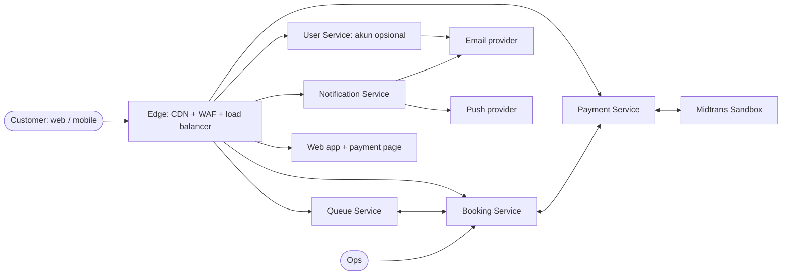

# Software Requirements Specification (SRS) — Rusuh Booking Tiket

| Field | Value |
|-------|-------|
| **System / Software** | Rusuh Booking Tiket (Queue, Booking, Payment, Notification, User Service; Web; Mobile) |
| **Document ID** | SRS-RBT-001 |
| **Version** | 1.1 |
| **Date** | 2026-10-19 |
| **Status** | Draft. Baseline requirement = PRD v4.6 Final Canonical; seluruh requirement `NOT_VERIFIED` |
| **Author(s)** | Tim PT. Tiket Sampai Nonton Sentosa |
| **Approvers** | Pak Dinda (CEO), Pak Jabon (CTO), Pak Rahman (CFO), PT. Tiga Sekawan Angin Ribut |
| **Classification** | Internal |
| **Source documents** | PRD-RBT-001 v5.2; PRD v4.6 (sumber pemecahan); keputusan tim bersama BE-2 19 Okt 2026 (`Perbedaan-Desain-BE-Kita-vs-BE2.xlsx`) |

> **Reference basis.** Disusun dengan mengacu pada isi *Software Requirements Specification* pada **ISO/IEC/IEEE 29148:2018**, dengan quality requirement diklasifikasikan menurut **ISO/IEC 25010:2023**. Tailoring dicatat di Appendix C.
>
> **Writing rules.** Setiap requirement memakai "shall" (wajib) atau "should" (SHOULD dari sumber), menyatakan satu hal, dan dapat diverifikasi. Pilihan teknologi dan desain internal dicatat di HLD, SDD, dan ADR; SRS hanya menyebut teknologi bila menjadi constraint (§3.5). Nilai yang ditandai PROPOSED adalah nilai awal yang dapat dituning lewat konfigurasi.
>
> **Kutipan v4.6.** Bagian bertanda *Sumber: PRD v4.6 …* disalin apa adanya dari v4.6. Rujukan § atau Lampiran di dalamnya diberi penanda `[v4.6 → dokumen §x]` yang menunjukkan lokasi barunya.

## Change History

| Version | Date | Author | Summary of change | Baseline |
|---------|------|--------|-------------------|----------|
| 1.0 | 2026-10-17 | Tim PT. Tiket Sampai Nonton Sentosa | Dipecah dari PRD v4.6 §3–§5, §12, §14, §16; capability §5.x ditulis ulang sebagai requirement "shall" | PRD v4.6 |
| 1.1 | 2026-10-19 | Tim PT. Tiket Sampai Nonton Sentosa | Keputusan bersama BE-2: akun opsional dengan login OTP (§3.2.27, SRS-F-01-08 direvisi), event sourcing Booking dan Payment (SRS-C-09, SRS-D-10..12), circuit breaker menjadi MUST (§3.2.19), keamanan akun (SRS-Q-SEC-10..12), alert email (SRS-F-90-06), kontrak OpenAPI satu file per service | PRD v4.6 + D-03, D-04, D-19, D-21, D-40, D-41 |

---

## 1. Introduction

### 1.1 Purpose

SRS ini menetapkan requirement perangkat lunak Rusuh Booking Tiket secara terukur dan dapat diverifikasi, sebagai dasar desain (HLD, SDD), implementasi, dan pengujian (Test Plan). Pembaca: BE-1, BE-2, WEB-1, WEB-2, MOB-1, QA, reviewer, dan assessor.

### 1.2 Scope

Perangkat lunak terdiri dari lima service backend: empat sesuai aktor requirement (Queue, Booking, Payment, Notification) dan User Service untuk akun opsional (ADR-020), aplikasi web (termasuk payment page reusable), dan aplikasi mobile. Perangkat lunak menyediakan daftar event, guest session, waiting room FIFO, reservasi tiket saat giliran, pemilihan dan hold tiket dengan NIK pemegang, pembayaran lewat Midtrans Sandbox, e-tiket, dan notifikasi. Tujuan bisnis ada di PRD-RBT-001 §2 (G-01–G-07); di luar scope ada di PRD §2.2.

### 1.3 Product Overview

#### 1.3.1 Product Perspective



Antarmuka yang dirinci di §3.1: user interface (web, mobile, payment page WebView), software interface (Midtrans, email, push), dan communications interface (REST/JSON publik, status antrean yang di-cache CDN, SSE halaman detail). Mode operasi, rekonsiliasi, dan dukungan operasional dirinci di §3.7.

#### 1.3.2 Product Functions

Guest session dan data pembeli (§3.2.1); daftar dan detail event (§3.2.2–3.2.3); antrean, status, indikator peluang, admission, sold-out, near-real-time, notifikasi giliran (§3.2.4–3.2.6, §3.2.10, §3.2.25); sesi pemilihan, TTL, timeout, jaminan reservasi (§3.2.7–3.2.9); NIK, kuota, hold, cancel, ubah pesanan, pemulihan sesi (§3.2.11–3.2.13, §3.2.23–3.2.24); pembayaran (§3.2.14–3.2.19); tiket dan notifikasi (§3.2.20–3.2.21); API bersama (§3.2.22); konfigurasi (§3.2.26); akun opsional dengan login OTP (§3.2.27).

#### 1.3.3 User Characteristics

| User class | Description | Expertise | Frequency | Special needs |
|------------|-------------|-----------|-----------|---------------|
| Customer (pembeli guest) | Mengantre dan memesan dengan NIK pembeli + email | Rendah–menengah | Sesekali | Sering di HP dengan sinyal tidak stabil; butuh pesan yang jelas dan aksesibilitas |
| Customer terdaftar (opsional) | Login dengan OTP email; NIK, email, dan nama tersimpan untuk mengisi form; melihat riwayat pesanan | Rendah–menengah | Berulang | Login tidak boleh menjadi syarat membeli |
| Customer mobile | Sama, lewat aplikasi Android/iOS | Rendah–menengah | Sesekali | Aplikasi dapat berada di background saat giliran tiba |
| Ops | Menangani REVIEW, refund manual, konfigurasi per event, DLQ | Menengah–tinggi | Setiap penjualan | Akses internal saja |
| Assessor | Menjalankan alur lokal dan memeriksa evidence | Tinggi | Sekali | Tanpa akun AWS / private registry |

#### 1.3.4 Limitations

- Validasi NIK hanya struktur; tidak membuktikan kepemilikan identitas (tanpa Dukcapil).
- Pembayaran memakai Midtrans Sandbox; bukan uang nyata dan bukan SLA production.
- Email dan push bersifat at-least-once; push bersifat best effort.
- PoC tidak menyediakan HA penuh atau multi-region.
- NIK diperlakukan sebagai data pribadi (§3.6).

### 1.4 Definitions, Acronyms and Abbreviations

| Term | Definition |
|------|-----------|
| shall | Wajib (MUST pada sumber) |
| should | Disarankan (SHOULD pada sumber) |
| PROPOSED | Nilai awal yang dapat dituning lewat konfigurasi |
| Idempotency-Key | Kunci unik per penekanan tombol yang membuat request ulang tidak menghasilkan efek ganda |
| Visitor token / Queue token / Admission token | Token bertanda tangan untuk identitas pengunjung, nomor antrean, dan izin masuk halaman beli (lihat HLD Security view) |

#### Key Terms

*Sumber: PRD v4.6 §3.3*

| Istilah | Definisi |
|---|---|
| Waiting Room | Antrean virtual sebelum akses ke halaman beli |
| Queue Sequence | Nomor urut antrean yang monoton per event, diberikan server saat join (FIFO) |
| Queue Token | Token bertanda tangan milik pengantre, berisi `eventId`, `entryId`, `seq`, `visitorId` |
| Status Document | Dokumen JSON kecil per event yang di-cache CDN: `servingSeq`, ambang peluang, `soldOut` |
| Active Slot | Customer yang sedang berada di halaman beli atau pembayaran |
| Admission | Momen giliran tiba: alokasi stok berhasil direservasi untuk customer |
| Allocation (Reservasi) | Unit stok tingkat event (N = min(3, sisa kuota pembeli, stok bebas)) yang disiapkan untuk satu customer yang di-admit; belum terikat kategori |
| Jaminan Admission | Janji bahwa customer yang masuk halaman beli pasti dapat memesan hingga N tiket dari kategori yang tersedia, asal memilih dan membayar dalam TTL (§5.9 [v4.6 → SRS §3.2.9]) |
| Cek NIK Pemegang | Pengecekan langsung saat NIK pemegang diketik apakah NIK sudah memegang tiket di event yang sama (§5.11 [v4.6 → SRS §3.2.11]) |
| Claim Window | Batas waktu customer membuka halaman beli setelah giliran tiba (PROPOSED 3 menit) |
| Near-real-time | Informasi diperbarui otomatis dengan batas keterlambatan yang ditetapkan dan diukur (§5.25 [v4.6 → SRS §3.2.25]) |
| Ubah Pesanan | Kembali ke halaman detail dari halaman bayar untuk mengubah jumlah, kategori, atau pemegang sebelum menekan "Bayar" (§5.23 [v4.6 → SRS §3.2.23]) |
| Pesanan Terkunci | Pesanan tidak dapat diubah lagi: customer menekan "Bayar", TTL Booking habis, atau booking berakhir |
| Masa Tenggang Submit | Kelonggaran beberapa detik (default 5) bagi request "Lanjut ke Pembayaran"/ubah pesanan yang tiba tepat setelah TTL Booking habis |
| Selection Session | Sesi di Detail Ticket Page setelah klaim; TTL Booking 5 menit |
| Hold | Konversi alokasi menjadi stok per kategori saat "Lanjut ke Pembayaran"; sisa unit tetap dipegang sampai pesanan terkunci |
| TTL Booking | 5 menit sejak akses diberikan (configurable) |
| TTL Pembayaran | 10 menit sejak booking dibuat / hold pertama (configurable); tidak di-reset oleh ubah pesanan |
| NIK Pembeli | NIK customer yang mengantre; dasar 1 slot aktif dan kuota pembeli |
| NIK Pemegang | NIK per tiket; unik per event ("satu tiket, satu orang") |
| Verifying | Status sementara saat pembayaran sedang dicek ulang ke gateway; stok tetap ditahan |
| Review | Pembayaran diterima setelah batas waktu; tiket tidak terbit, refund manual |

---


### 1.5 References

| ID | Document | Version |
|----|----------|---------|
| REF-01 | PRD-RBT-001 | 5.1 |
| REF-02 | AD-RBT-001 (HLD) | 1.2 |
| REF-03 | SDD-RBT-001 | 1.2 |
| REF-04 | ADR-RBT (ADR-001 … ADR-022) | 1.2 |
| REF-05 | TP-RBT-001 (Test Plan) | 1.1 |
| REF-06 | ISO/IEC/IEEE 29148:2018 | — |
| REF-07 | ISO/IEC 25010:2023 | — |
| REF-08 | PDF *Evaluasi Expertise Solution Development 2026 H2*; notulen grooming 14 Oktober 2026 | — |

---

## 2. Assumptions, Dependencies and Apportioning

### 2.1 Assumptions and Dependencies

Assumption register lengkap (AS-01–AS-26) dan dependency (DEP-01–DEP-06) ada di PRD-RBT-001 §10. Asumsi yang langsung memengaruhi requirement dicantumkan di kolom *Source* tiap requirement. Isu terbuka khusus SRS:

| ID | Isu | Dampak | Default |
|----|-----|--------|---------|
| SRS-OI-01 | Target availability bulanan (%) tidak ditetapkan di sumber | SRS-Q-REL belum memiliki angka availability | Diukur dan dilaporkan; target ditetapkan bersama klien |
| SRS-OI-02 | Konfirmasi interpretasi "real time" (PRD OI-07) | §3.2.25 | Near-real-time sesuai §3.2.25 |

### 2.2 Apportioning of Requirements

| Requirement | Prioritas / rilis |
|-------------|-------------------|
| §3.2.13 Cancel, SRS-F-01-09 pemindahan antrean via email | SHOULD — Sprint 2 bila waktu cukup |
| §3.2.19 Perlindungan degradasi dan circuit breaker | MUST sejak v1.1 (D-40); `pkg/resilience` tersedia di boilerplate |
| SRS-F-05-10 ETA | COULD |
| iOS (push dan WebView) | Bila platform dan akun Apple Developer tersedia (PRD OI-03, OI-06) |
| SSE di halaman bayar | Di luar scope PoC |

---

## 3. Specific Requirements

### 3.0 Requirement Format

Requirement fungsional ditulis dalam tabel dengan kolom: **ID**, **Requirement**, **Source** (ID sumber: FR/NFR/BR/SCP/GR/AS atau keputusan tim), **Pri** (M = Must, S = Should, C = Could), **Ver** (metode verifikasi: T = Test, I = Inspection, A = Analysis, D = Demonstration), dan **Test** (ID test case dari Test Plan). Status semua requirement: `NOT_VERIFIED`. Format ID: `SRS-F-<nomor subbagian 3.2>-<urut>`. Setiap subbagian mencantumkan komponen HLD yang menerima alokasi (**Alloc**).

Pola kalimat yang dipakai (EARS): *ubiquitous* (The system shall …), *event-driven* (When …, the system shall …), *state-driven* (While …), *unwanted behaviour* (If …, then …).

### 3.1 External Interfaces

#### 3.1.1 User Interfaces

| ID | Requirement | Source | Pri | Ver | Test |
|----|-------------|--------|-----|-----|------|
| SRS-IF-01 | The web client shall be responsive, support keyboard navigation with visible focus, and announce queue position and countdowns through live regions. | Aturan UX v4.6 §6.8 | M | I | [TP] |
| SRS-IF-02 | Timers shall be presented as text and shall not rely on color alone. | Aturan UX | M | I | [TP] |
| SRS-IF-03 | The mobile app shall use native screens for every page except the payment page, which shall be the web payment page shown in a WebView. | SCP-01 | M | D | TC-MOB-01, TC-MOB-02 |
| SRS-IF-04 | Every redirect to home shall carry a reason (`SOLD_OUT`, `TURN_MISSED`, `SESSION_EXPIRED`, `SESSION_EXPIRED_OFFLINE`, `SALE_CLOSED`) that is shown as a banner. | GR-08, GR-02 | M | T | TC-QUE-09, TC-SES-04 |
| SRS-IF-05 | The UI shall not display full NIK, tokens, signatures, or provider payloads. | GR-15 | M | I | TC-SEC-03 |
| SRS-IF-06 | The UI shall not decide stock or payment status; it shall display server values only. | NFR-04, NFR-07 | M | I | TC-MOB-03 |
| SRS-IF-07 | Screens shall follow the wireframes in PRD-RBT-001 Appendix E. | PRD | M | I | [TP] |

#### 3.1.2 Hardware Interfaces

Tidak ada antarmuka hardware khusus. Scan tiket di gerbang berada di luar scope.

#### 3.1.3 Software Interfaces

| ID | External system | Purpose | Requirement | Pri | Ver | Test |
|----|-----------------|---------|-------------|-----|-----|------|
| SRS-IF-20 | Midtrans Sandbox (Core API) | Charge, status, cancel, notifikasi pembayaran | The Payment Service shall create charges, query status, and cancel transactions at Midtrans Sandbox, and shall accept Midtrans HTTP notifications only after verifying signature, order, and amount. | M | T | TC-PAY-01, TC-PAY-05 |
| SRS-IF-21 | Midtrans Sandbox | Expiry transaksi | The transaction expiry sent to the gateway shall equal the booking's `paymentExpiresAt`. | M | T | TC-PAY-02 |
| SRS-IF-22 | Penyedia email (SMTP) | E-tiket, expired, pembayaran terlambat | The Notification Service shall send email through SMTP (Mailpit locally, SES sandbox on demo). | M | T | TC-TKT-02 |
| SRS-IF-23 | Penyedia push (FCM; iOS via APNs) | Notifikasi giliran | The Notification Service shall send turn notifications through the push provider and shall use a log adapter in local and CI environments. | M | D | TC-QUE-13 |
| SRS-IF-24 | Payment simulator | Uji offline | A payment simulator shall be available only when `APP_ENV` is `ci` or `local-offline`, and results produced by it shall be labelled SIMULATED. | M | I | [TP] |

#### 3.1.4 Communications Interfaces

| ID | Requirement | Source | Pri | Ver | Test |
|----|-------------|--------|-----|-----|------|
| SRS-IF-30 | All public endpoints shall be REST/JSON under `/api/v1`, described by OpenAPI 3.1 contracts (one file per service in `docs/contracts/openapi/`) used by web and mobile. | FR-24, NFR-08, D-19 | M | T | TC-API-01, TC-API-02 |
| SRS-IF-31 | Requests and responses shall use JSON UTF-8, ISO 8601 UTC timestamps, and integer minor-unit amounts (IDR). | NFR-08 | M | I | TC-API-02 |
| SRS-IF-32 | All traffic over public networks shall use TLS. | NFR-07 | M | I | [TP] |
| SRS-IF-33 | Errors shall use the stable envelope and error codes below and shall not expose SQL, stack traces, secrets, or provider payloads. | NFR-07 | M | T | TC-API-02 |
| SRS-IF-34 | Internal APIs (`/internal/v1/*`) shall not be reachable through the public load balancer and shall require a short-lived service token. | NFR-07 | M | T | TC-SEC-02 |

##### Pembagian Tanggung Jawab Backend vs Client

*Sumber: PRD v4.6 Lampiran A.1*

| Area | Backend (authoritative) | Client (presentasi) |
|---|---|---|
| Antrean | Sequence, status entry, admission, Status Document, zona peluang | Hitung posisi dari Status Document, polling adaptif, klaim otomatis |
| Waktu | `expiresAt`, `paymentExpiresAt`, `editableUntil`, `serverTime` | Countdown dari selisih `serverTime` |
| Pesanan | `phase`, `canEdit`, `version`, kunci saat "Bayar" | Mode ubah, route guard back, pemulihan setelah refresh/koneksi putus |
| Konfigurasi | Semua TTL, batas, interval polling (snapshot per sesi) | Menampilkan nilai dari server; cadangan hanya bila field tidak ada |
| Stok | Alokasi, hold, sold, ketersediaan kategori | Menonaktifkan stepper sesuai data server |
| NIK | Validasi struktur, HMAC, unik per event, kuota, cek pemegang langsung | Validasi struktur saat diketik, memanggil cek pemegang saat kolom selesai diisi, menonaktifkan tombol lanjut bila belum valid |
| Pembayaran | Amount, order ID, status, settlement | Menampilkan instruksi; tidak pernah menyatakan sukses sendiri |

###### Invarian backend yang tidak boleh dilanggar

1. Tidak ada admission tanpa alokasi yang tercatat di Booking.
2. `allocated + held + sold ≤ total_capacity` per event; `held + sold ≤ capacity` per kategori.
3. NIK pemegang hanya satu item `HELD`/`PAID` per event.
4. Kuota NIK pembeli `held + paid ≤ 3` per event.
5. Satu admission aktif per NIK pembeli dan per perangkat per event; satu entry aktif per NIK pembeli, perangkat, dan email di Queue.
6. Booking hanya menjadi PAID bila `settlement_time ≤ payment_expires_at`.
7. Stok tidak dilepas dari booking yang pembayarannya belum dipastikan (resolve wajib dicoba).
8. Status monotonic; satu tiket per item.
9. `total_capacity` event = jumlah kapasitas kategori; hold hanya boleh mengambil ≤ unit reservasi sesi itu.
10. Ubah pesanan bersifat atomik: gagal → pesanan lama tidak berubah; tidak ada ubah setelah pesanan terkunci.
11. Payment tidak membuat transaksi di gateway sebelum `payment-lock` berhasil; nominal yang ditagih = nominal versi terkunci.
12. TTL Pembayaran tidak pernah di-reset oleh ubah pesanan; perubahan konfigurasi tidak memengaruhi sesi yang sudah berjalan.

##### Public Endpoints

*Sumber: PRD v4.6 §12.1*

Semua di bawah `/api/v1`. Kontrak normatif: satu file OpenAPI per service di `docs/contracts/openapi/` (`queue.yaml`, `booking.yaml`, `payment.yaml`, `notification.yaml`, `user.yaml`; D-19).

| Service | Method | Path | Fungsi | Guard |
|---|---|---|---|---|
| Queue | POST | `/events/{eventId}/queue-entries` | Join (NIK pembeli, email) | WAF challenge, rate limit, idempoten |
| Queue | GET | `/queue-status/{eventId}` | Status Document | Publik, cache CDN 1 detik |
| Queue | GET | `/queue-entries/me?eventId=` | Posisi eksak dan status entry | Visitor token, rate limit |
| Queue | POST | `/queue-entries/{entryId}/claim` | Ambil admission token | Queue token + visitor token |
| Queue | DELETE | `/queue-entries/{entryId}` | Keluar antrean (SHOULD) | Pemilik |
| Booking | GET | `/events` | Daftar event | Publik, cache 2 detik |
| Booking | GET | `/events/{eventId}` | Detail event dan kategori | Publik, cache 2 detik |
| Booking | POST | `/booking-sessions` | Buat/pulihkan sesi dari admission token | Admission token sekali pakai |
| Booking | GET | `/booking-sessions/current?eventId=` | Pulihkan sesi/pesanan (refresh, koneksi putus, back, app dibuka ulang) | Visitor token |
| Booking | GET | `/booking-sessions/{id}` | Sisa waktu dan ketersediaan live | Pemilik |
| Booking | GET | `/booking-sessions/{id}/stream` | SSE ketersediaan kategori dan sisa waktu (fallback: GET di atas) | Pemilik; `Accept: text/event-stream`; tanpa cache CDN |
| Booking | POST | `/booking-sessions/{id}/attendee-checks` | Cek NIK pemegang saat diketik | Pemilik, sesi aktif/mode ubah, maks 10 NIK berbeda per sesi |
| Booking | POST | `/booking-sessions/{id}/cancel` | Keluar tanpa membeli | Pemilik |
| Booking | POST | `/bookings` | Hold (NIK pemegang per tiket) | Pemilik + Idempotency-Key |
| Booking | PUT | `/bookings/{id}/items` | Ubah pesanan sebelum "Bayar" (penggantian atomik) | Pemilik + Idempotency-Key + `version`; hanya bila `canEdit` |
| Booking | GET | `/bookings/{id}` | Status booking | Pemilik atau ticket link token |
| Booking | POST | `/bookings/{id}/cancel` | Batal sebelum bayar (SHOULD) | Pemilik |
| Booking | GET | `/bookings/{id}/tickets` | Tiket | PAID + pemilik atau ticket link token |
| Payment | GET | `/payments/{bookingId}/page` | View model payment page | Pemilik (visitor token atau cookie payment page) |
| Payment | POST | `/payments/{bookingId}/page-tokens` | Token WebView | Pemilik, booking menunggu pembayaran |
| Payment | POST | `/payment-page-sessions` | Tukar token → cookie | Token sekali pakai |
| Payment | POST | `/payments/{bookingId}/attempts` | Buat/rekonsiliasi attempt dengan `method` | Pemilik + Idempotency-Key |
| Payment | GET | `/payments/{bookingId}/status` | Status attempt dan instruksi | Pemilik |
| Payment | POST | `/webhooks/midtrans` | Callback gateway | Signature |
| Notification | POST | `/push-subscriptions` | Daftarkan token push perangkat untuk event | Visitor token, mobile |
| Notification | DELETE | `/push-subscriptions/{eventId}` | Hapus token push | Visitor token |
| Payment | POST | `/local-simulator/payments/{id}/scenario` | Simulasi | Hanya `APP_ENV=ci` atau `local-offline` |

Contoh request/response dan error code lengkap di Lampiran A [v4.6 → SDD §4.6.1].

##### Status Document

*Sumber: PRD v4.6 §12.2*

```json
{
  "eventId": "8f0c…",
  "saleState": "OPEN",
  "servingSeq": 182340,
  "guaranteedUntilSeq": 183100,
  "possibleUntilSeq": 196500,
  "soldOut": false,
  "remainingTickets": 2310,
  "admissionRatePerMin": 640,
  "removedBuckets": { "size": 10000, "fromSeq": 180000, "counts": [412, 37, 5] },
  "nextPollAfterMs": 10000,
  "poll": { "farMs": 30000, "midMs": 10000, "nearMs": 3000, "farAbove": 50000, "midAbove": 5000 },
  "preTurnNotifyPosition": 1000,
  "categories": [
    { "code": "VIP", "name": "VIP", "state": "SOLD_OUT" },
    { "code": "FES", "name": "Festival", "state": "LIMITED" },
    { "code": "TRB", "name": "Tribune", "state": "AVAILABLE" }
  ],
  "updatedAt": "2026-12-25T03:00:01.200Z"
}
```

Header: `Cache-Control: public, max-age=1, stale-while-revalidate=2`. Tidak berisi data pribadi apa pun. `poll` dan `preTurnNotifyPosition` berasal dari `queue.event_settings` (Lampiran J.2 [v4.6 → SDD §6]). `categories` hanya informasi (ambang `LIMITED` PROPOSED ≤ 5% kapasitas kategori); jaminan customer dihitung dari stok tingkat event.

##### Error Envelope

*Sumber: PRD v4.6 §12.4*

```json
{
  "meta": { "code": 409, "message": "NIK pemegang sudah terdaftar untuk event ini", "requestId": "01JREQ", "errorCode": "ATTENDEE_NIK_ALREADY_REGISTERED" },
  "data": null
}
```

Status: 400, 401/403, 404, 409, 410, 422, 429, 503. Tidak membocorkan SQL, stack trace, secret, atau payload provider.

---

##### Error Codes

*Sumber: PRD v4.6 Lampiran A.6*

| HTTP | `errorCode` | Service | Arti | Aksi klien |
|---|---|---|---|---|
| 400 | `VALIDATION_ERROR` | Semua | Field tidak valid | Perbaiki input |
| 422 | `NIK_INVALID` | Queue, Booking | Struktur NIK tidak valid | Perbaiki NIK |
| 422 | `EMAIL_MISMATCH` | Queue | Konfirmasi email berbeda | Perbaiki email |
| 409 | `NIK_ALREADY_IN_QUEUE` | Queue | NIK pembeli sudah mengantre di perangkat lain | Lanjutkan di perangkat tersebut |
| 409 | `VISITOR_ALREADY_IN_QUEUE` | Queue | Perangkat ini sudah punya antrean aktif di event ini | Selesaikan/keluar dari antrean tersebut |
| 409 | `EMAIL_ALREADY_IN_QUEUE` | Queue | Email ini sudah dipakai antrean aktif di event ini | Gunakan antrean yang ada |
| 409 | `BUYER_QUOTA_EXHAUSTED` | Queue, Booking | Kuota 3 tiket NIK pembeli habis | Tidak dapat membeli lagi |
| 409 | `EVENT_NOT_ON_SALE` | Queue | Di luar jendela penjualan | Tunggu jam buka |
| 410 | `EVENT_SOLD_OUT` | Queue, Booking | Tiket habis | Kembali ke home |
| 410 | `TURN_MISSED` | Queue, Booking | Claim window lewat | Kembali ke home / antre ulang |
| 410 | `SESSION_EXPIRED` | Booking | TTL Booking habis | Kembali ke home |
| 403 | `ADMISSION_TOKEN_INVALID` | Booking | Token salah/dipakai ulang | Kembali ke antrean |
| 409 | `ATTENDEE_NIK_DUPLICATE_IN_ORDER` | Booking | NIK pemegang sama dalam satu order | Gunakan NIK berbeda |
| 409 | `ATTENDEE_NIK_ALREADY_REGISTERED` | Booking | NIK pemegang sudah terdaftar di event ini | Gunakan NIK lain (reservasi tetap aman) |
| 429 | `ATTENDEE_CHECK_LIMIT_REACHED` | Booking | Jatah cek NIK per sesi habis | Lanjut; cek final saat hold |
| 409 | `CATEGORY_UNAVAILABLE` | Booking | Kategori habis saat diproses | Pilih kategori lain (respons berisi ketersediaan) |
| 409 | `BOOKING_LOCKED` | Booking | Pesanan sudah terkunci (pembayaran dimulai atau batas ubah lewat) | Kembali ke halaman bayar |
| 409 | `BOOKING_VERSION_CONFLICT` | Booking | Pesanan sudah diubah di tab/perangkat lain | Muat ulang pesanan |
| 409 | `EDIT_LIMIT_REACHED` | Booking | Batas ubah pesanan tercapai | Lanjut bayar pesanan saat ini |
| 422 | `MIXED_CATEGORIES_NOT_ALLOWED` | Booking | Event mewajibkan satu kategori per order | Pilih satu kategori |
| 409 | `EVENT_RULES_LOCKED` | Booking (admin) | Aturan pembentuk jaminan tidak dapat diubah setelah penjualan dibuka | — |
| 422 | `QUANTITY_EXCEEDS_LIMIT` | Booking | Melebihi alokasi/kuota | Kurangi jumlah |
| 409 | `IDEMPOTENCY_KEY_REUSED` | Booking, Payment | Key sama, payload beda | Gunakan key baru |
| 409 | `BOOKING_NOT_PAYABLE` | Payment | Booking bukan menunggu pembayaran | Muat ulang status |
| 422 | `PAYMENT_METHOD_UNAVAILABLE` | Payment | Metode tidak aktif | Pilih metode lain |
| 503 | `PAYMENT_PROVIDER_UNAVAILABLE` | Payment | Gateway gangguan | Pilih metode lain / tunggu |
| 403 | `PAYMENT_PAGE_TOKEN_INVALID` | Payment | Token WebView salah/kedaluwarsa | Minta token baru |
| 401 | `WEBHOOK_SIGNATURE_INVALID` | Payment | Signature salah | — |
| 429 | `RATE_LIMITED` | Semua | Terlalu banyak request | Retry-After |
| 503 | `DEPENDENCY_UNAVAILABLE` | Semua | Dependency sementara tidak tersedia | Retry dengan key sama |


##### Endpoint Tambahan v1.5

| Service | Method | Path | Fungsi | Guard |
|---|---|---|---|---|
| User | POST | `/auth/otp/request` | Kirim kode OTP 6 digit ke email | Rate limit per email dan IP, cooldown |
| User | POST | `/auth/otp/verify` | Tukar kode dengan access + refresh token; akun dibuat saat login pertama | Maks 5 percobaan per kode |
| User | POST | `/auth/refresh` | Rotasi refresh token | Refresh token; reuse mencabut semua sesi |
| User | POST | `/auth/logout` | Cabut sesi | Refresh token (idempoten) |
| User | GET, PATCH | `/me` | Profil: nama, NIK tersimpan (terenkripsi, ditampilkan tersamar) | Access token |
| Booking | GET | `/me/bookings` | Riwayat pesanan pembeli yang login | Access token |
| Semua | GET | `/health` | Health check ALB dan container (200 UP / 503 DOWN) | Tanpa auth; tidak lewat CDN |

Envelope respons sukses: `{"meta": {"code", "requestId"}, "data": …}`; envelope error seperti di atas dengan `meta.errorCode` dan `meta.details`.

Kontrak per endpoint (contoh request/response) ada di SDD-RBT-001 Interface view; kontrak normatif di `docs/contracts/openapi/{queue,booking,payment,notification,user}.yaml` dan `internal-{booking,payment}.yaml`.

### 3.2 Functions

#### 3.2.1 Guest Session (GST-01)

**Alloc:** CMP-QUEUE, CMP-WEB, CMP-MOBILE

| ID | Requirement | Source | Pri | Ver | Test |
|----|-------------|--------|-----|-----|------|
| SRS-F-01-01 | When a customer starts a purchase, the system shall require a buyer NIK and an email typed twice, and shall not require registration or login; a logged-in customer may have both fields pre-filled from the account (§3.2.27). | GR-05, FR-13, D-03 | M | T | TC-GST-01, TC-GST-02 |
| SRS-F-01-02 | If the two email entries differ, then the system shall reject the join with `422 EMAIL_MISMATCH`. | GR-05 | M | T | TC-GST-01 |
| SRS-F-01-03 | Before the customer joins the queue, the client shall display the purchase rules (1 NIK pemegang = 1 tiket per event; NIK pembeli maks 3 tiket per event; siapkan NIK dan nama setiap pemegang; 1 perangkat dan 1 email = 1 antrean aktif) and shall require consent to NIK usage. | GR-03, keputusan tim 15 Okt | M | D | [TP] |
| SRS-F-01-04 | The system shall not introduce any purchase rule after the customer enters the buying page. | Keputusan tim 15 Okt | M | I | [TP] |
| SRS-F-01-05 | When the join succeeds, the Queue Service shall issue a signed visitor token, valid until the sale ends, that identifies the visitor, the hashed buyer NIK, and the email. | GR-05 | M | T | TC-GST-01 |
| SRS-F-01-06 | The web client shall keep the visitor token in an HttpOnly, Secure, SameSite=Lax cookie; the mobile app shall keep it in secure storage. | NFR-07 | M | I | [TP] |
| SRS-F-01-07 | The Queue Service shall not store the plain NIK; it shall store only a keyed hash (HMAC-SHA256) whose key is shared with the Booking Service. | GR-15 | M | I | TC-GST-01, TC-SEC-03 |
| SRS-F-01-08 | Guest checkout shall not verify the email by OTP; OTP is used only for the optional account login (§3.2.27). | AS-04, D-03 | M | I | TC-GST-01 |
| SRS-F-01-09 | If a buyer NIK already has an active entry on another device, then the join shall be rejected with `409 NIK_ALREADY_IN_QUEUE` and a clear message. | GR-04 | M | T | TC-GST-03 |
| SRS-F-01-10 | The system should allow a customer to move a queue entry to another device through an email link. | v4.6 §5.1 (SHOULD) | S | T | [TP] |

#### 3.2.2 Event List (EVT-01)

**Alloc:** CMP-BOOKING, CMP-WEB, CMP-MOBILE

| ID | Requirement | Source | Pri | Ver | Test |
|----|-------------|--------|-----|-----|------|
| SRS-F-02-01 | The system shall list every event sold online with status `NOT_STARTED` (disabled, showing opening time and countdown), `AVAILABLE`, `SOLD_OUT`, or `CLOSED`. | FR-01, FR-03 | M | T | TC-EVT-01, TC-EVT-03 |
| SRS-F-02-02 | An event shall be clickable only while `AVAILABLE`, i.e., inside its sales window and with potential stock in any category. | FR-02 | M | T | TC-EVT-02 |
| SRS-F-02-03 | If a join is requested for an event that is not `AVAILABLE`, then the server shall reject it (`409 EVENT_NOT_ON_SALE` or `410 EVENT_SOLD_OUT`). | FR-03 | M | T | TC-EVT-03 |
| SRS-F-02-04 | The event list response shall be cacheable at the CDN for at most 2 seconds. | NFR-06 | M | I | TC-PERF-03 |

#### 3.2.3 Event Detail (EVT-02)

**Alloc:** CMP-BOOKING, CMP-WEB, CMP-MOBILE

| ID | Requirement | Source | Pri | Ver | Test |
|----|-------------|--------|-----|-----|------|
| SRS-F-03-01 | The system shall display event information, venue, schedule, categories, and prices publicly. | FR-11 | M | T | TC-EVT-04 |
| SRS-F-03-02 | On the buying page, availability per category shall be computed as capacity − held − sold and shall update live as specified in §3.2.25. | FR-12 | M | T | TC-EVT-05, TC-SSE-01 |
| SRS-F-03-03 | Event-level reservations (not yet bound to a category) shall not reduce the per-category availability shown. | FR-12 (interpretasi) | M | T | TC-EVT-05 |
| SRS-F-03-04 | Availability shall be shown as an approximation ("sisa sekitar N"); the final decision shall always be made by the server at hold. | FR-12 | M | T | TC-SSE-03 |
| SRS-F-03-05 | A category with no availability shall remain visible with the label "Habis". | FR-12 | M | T | TC-EVT-05 |

#### 3.2.4 Queue Join and Direct Admission (QUE-01)

**Alloc:** CMP-QUEUE, CMP-BOOKING, CMP-EDGE

| ID | Requirement | Source | Pri | Ver | Test |
|----|-------------|--------|-----|-----|------|
| SRS-F-04-01 | The Queue Service shall accept a join only while `salesStartsAt` ≤ now < `salesEndsAt`; before opening, the client shall show a countdown on the button. | FR-04 | M | T | TC-EVT-03 |
| SRS-F-04-02 | Join shall be idempotent per (event, buyer NIK, visitor). | FR-10 | M | T | TC-QUE-07 |
| SRS-F-04-03 | A buyer NIK shall have at most one active entry per event. | GR-04, BR-07 | M | T | TC-GST-03 |
| SRS-F-04-04 | The Queue Service shall assign each entry a monotonically increasing sequence number per event, generated atomically, and shall record the join time in UTC. | GR-07, NFR-05 | M | T | TC-QUE-08 |
| SRS-F-04-05 | If the buyer NIK quota for the event is exhausted, then the join shall be rejected with `409 BUYER_QUOTA_EXHAUSTED`. | BR-02, FR-14 | M | T | TC-BKG-01 |
| SRS-F-04-06 | A device (visitor) and an email shall each have at most one active entry per event (`409 VISITOR_ALREADY_IN_QUEUE`, `409 EMAIL_ALREADY_IN_QUEUE`); after the entry ends, a new join shall be placed at the back. | AS-17 | M | T | TC-GST-04, TC-GST-05 |
| SRS-F-04-07 | When there is no earlier waiter, an active slot is free, and the allocation succeeds, the customer shall be admitted directly in the join response. | FR-05 | M | T | TC-QUE-02 |
| SRS-F-04-08 | When an earlier waiter exists or the active slots are full, the entry shall be `WAITING` and the customer shall be directed to the waiting room. | FR-04 | M | T | TC-QUE-01 |
| SRS-F-04-09 | The join endpoint shall be protected by an edge challenge, a rate-based rule, and a per-IP rate limit in the Queue Service. | NFR-01 | M | I | [TP] |
| SRS-F-04-10 | The queue position shall persist across refresh and multiple tabs: the queue token shall be kept in cookie/secure storage and the entry shall be held server-side per buyer NIK. | FR-10 | M | T | TC-QUE-07 |

#### 3.2.5 Queue Status and Honest Indicator (QUE-02)

**Alloc:** CMP-QUEUE, CMP-WEB, CMP-MOBILE, CMP-EDGE

| ID | Requirement | Source | Pri | Ver | Test |
|----|-------------|--------|-----|-----|------|
| SRS-F-05-01 | The Queue Service shall publish one Status Document per event (fields in §3.1.4) that contains no personal data and is cacheable for 1 second. | FR-06, NFR-01 | M | T | TC-QUE-03 |
| SRS-F-05-02 | The client shall display "Anda antrian ke-n" where n = `seq − servingSeq − removedAhead`; n shall be an upper bound of the true position. | FR-06 | M | T | TC-QUE-03 |
| SRS-F-05-03 | When n ≤ the near threshold (PROPOSED 2 × active slot capacity), the client shall use the exact-position endpoint. | FR-06 | M | T | TC-QUE-03 |
| SRS-F-05-04 | The polling interval shall be adaptive and controlled by the server through the `poll` field (defaults: n > 50.000 → 30 s; 5.000–50.000 → 10 s; < 5.000 → 3 s), with ±20% jitter; client values shall be fallbacks only. | FR-07 | M | T | TC-QUE-15 |
| SRS-F-05-05 | The waiting room shall show "Diperbarui N detik lalu" derived from `updatedAt`. | FR-07 | M | T | TC-QUE-04 |
| SRS-F-05-06 | When a journey ahead ends (PAID, EXPIRED, CANCELLED, session expired, unclaimed), the position shall decrease and the freed slot shall go to the next entry in order. | GR-06, FR-07 | M | T | TC-QUE-04 |
| SRS-F-05-07 | The waiting room shall show the chance zone: **Dijamin** when `seq ≤ guaranteedUntilSeq`; **Ada peluang** when `guaranteedUntilSeq < seq ≤ possibleUntilSeq`; **Tidak cukup** when `seq > possibleUntilSeq`; **Habis** when `soldOut = true`. | NFR-02, GR-02 | M | T | TC-QUE-10 |
| SRS-F-05-08 | Each zone shall show its message as specified in PRD-RBT-001 US-023; the "Tidak cukup" zone shall offer a "Keluar dari antrean" button. | NFR-02 | M | T | TC-QUE-10 |
| SRS-F-05-09 | The server shall compute the zone boundaries as `guaranteed = ceil(free stock / max per order)` front-most entries and `possible = free stock + allocated + held`, so that 1–2 remaining tickets are still promised to the front-most entry. | GR-01 | M | T | TC-QUE-10, TC-QUE-11 |
| SRS-F-05-10 | The client could show an ETA = n / admission rate as a range, hidden while the rate is unstable. | FR-09 | C | T | TC-QUE-06 |
| SRS-F-05-11 | The Status Document shall carry per-category state (`AVAILABLE`, `LIMITED` [PROPOSED ≤ 5% of capacity], `SOLD_OUT`), and the waiting room shall show a banner for sold-out categories as information only. | Keputusan tim 15 Okt | M | T | TC-QUE-12 |

#### 3.2.6 Admission and Claim (QUE-03)

**Alloc:** CMP-QUEUE, CMP-BOOKING, CMP-NOTIF

| ID | Requirement | Source | Pri | Ver | Test |
|----|-------------|--------|-----|-----|------|
| SRS-F-06-01 | A single promoter per event shall fill free active slots with the front-most entries in sequence order. | NFR-05 | M | T | TC-QUE-05, TC-QUE-08 |
| SRS-F-06-02 | An entry shall be admitted only when the Booking Service has reserved an allocation for it. | GR-01 | M | T | TC-ADM-01 |
| SRS-F-06-03 | An admitted entry shall have a claim window (PROPOSED 3 minutes, configurable). | AS-06 | M | T | TC-QUE-09 |
| SRS-F-06-04 | While the client is open, it shall claim automatically, receive a single-use admission token (TTL 60 s), and move to the Detail Ticket Page. | FR-08 | M | T | TC-QUE-05, TC-SEC-01 |
| SRS-F-06-05 | When the entry is admitted, the mobile app shall receive the push "Giliran Anda tiba" (best effort). | GR-08 | M | D | TC-QUE-13 |
| SRS-F-06-06 | If the claim window passes, then the allocation shall be returned, the slot given to the next entry, and the returning customer redirected home with "Giliran Anda terlewat karena tidak aktif" (`TURN_MISSED`). | GR-08 | M | T | TC-QUE-09 |
| SRS-F-06-07 | A missed turn shall receive no second chance or priority; the customer may rejoin at the back if quota remains. | AS-24 | M | T | TC-QUE-09 |
| SRS-F-06-08 | A slot shall be freed only when the journey ends: PAID, EXPIRED, CANCELLED, session expired, or unclaimed. | GR-06 | M | T | TC-QUE-04 |

#### 3.2.7 Selection Session and TTL (SES-01)

**Alloc:** CMP-BOOKING, CMP-WEB, CMP-MOBILE

| ID | Requirement | Source | Pri | Ver | Test |
|----|-------------|--------|-----|-----|------|
| SRS-F-07-01 | When the admission token is consumed, the Booking Service shall create a selection session and start the TTL Booking (default 5 minutes, configurable). | BR-03, FR-17 | M | T | TC-SES-01 |
| SRS-F-07-02 | The API shall return `expiresAt` and `serverTime`; a refresh shall not extend the TTL; the client timer shall be presentation only. | FR-19 | M | T | TC-SES-01, TC-SES-03 |
| SRS-F-07-03 | `selection_warning_seconds` (default 60) before expiry, the client shall show the warning "Masih di sana?". | GR-08, FR-18 | M | T | TC-SES-02 |
| SRS-F-07-04 | When the first hold succeeds, the TTL Pembayaran shall start; the TTL Booking shall remain the deadline for editing the order. | BR-05 | M | T | TC-PAY-02 |
| SRS-F-07-05 | A "Lanjut ke Pembayaran" or edit request arriving within `selection_submit_grace_seconds` (default 5) after the TTL Booking expires shall be processed and the resulting order locked immediately; later requests shall be rejected. | AS-23 | M | T | TC-SES-08 |
| SRS-F-07-06 | The default TTL values and their justification shall follow PRD-RBT-001 §8.2. | GR-12 | M | I | TC-CFG-01 |

#### 3.2.8 Selection Timeout (SES-02)

**Alloc:** CMP-BOOKING, CMP-QUEUE, CMP-WEB, CMP-MOBILE

| ID | Requirement | Source | Pri | Ver | Test |
|----|-------------|--------|-----|-----|------|
| SRS-F-08-01 | If the TTL Booking expires without a hold, then the session shall end, the allocation return to the pool, the slot be promoted, and the customer see "Waktu pemilihan habis" before being redirected home with reason `SESSION_EXPIRED`. | FR-18, BR-04 | M | T | TC-SES-04 |
| SRS-F-08-02 | If the TTL Booking expires while the order is still editable, then the order shall be locked with `SELECTION_EXPIRED`, the remaining units released, and the last order remain payable until the TTL Pembayaran. | BR-04 | M | T | TC-EDT-05 |
| SRS-F-08-03 | After a selection timeout, the customer may rejoin at the back if quota remains. | BR-04 | M | T | TC-SES-04 |

#### 3.2.9 Reservation Guarantee "Jangan PHP" (ADM-01)

**Alloc:** CMP-BOOKING, CMP-QUEUE

| ID | Requirement | Source | Pri | Ver | Test |
|----|-------------|--------|-----|-----|------|
| SRS-F-09-01 | At admission, the Booking Service shall reserve N = min(`max_tickets_per_order`, remaining buyer-NIK quota, free stock) units at event level. | GR-01 | M | T | TC-ADM-01, TC-ADM-04 |
| SRS-F-09-02 | The buying page shall show "Kamu bisa memesan hingga N tiket" and the live availability per category; the total of the steppers shall be limited to N. | GR-01 | M | T | TC-ADM-02 |
| SRS-F-09-03 | When an admitted customer selects ≤ N tickets from available categories (mixed if `allow_mixed_categories`) within the TTL Booking, the hold shall succeed. | GR-01, NFR-02 | M | T | TC-ADM-02, TC-ADM-05 |
| SRS-F-09-04 | Unused units (N − selected) shall stay reserved while the order is editable and return to free stock when the order is locked; when editing is disabled for the event, they shall return at hold. | AS-22 | M | T | TC-ADM-03, TC-EDT-01 |
| SRS-F-09-05 | Admission shall be withheld while free stock = 0 but allocations or holds may still return; the event shall be declared sold out when free stock = 0 and nothing can return. | GR-02 | M | T | TC-ADM-01, TC-PERF-05 |
| SRS-F-09-06 | The data store shall enforce per event `allocated + held + sold ≤ total_capacity` and `total_capacity = Σ category capacity` (checked at commit), per category `held + sold ≤ capacity`, and that a hold takes at most the session's own reserved units. | NFR-04, BR-08 | M | T | TC-BKG-07, TC-BKG-12 |
| SRS-F-09-07 | If a category becomes unavailable during the customer's selection, then the reservation shall remain intact and the page shall say "VIP baru saja habis. Pilih kategori lain — tiket kamu tetap aman sampai waktu habis." | GR-01 | M | T | TC-ADM-05 |
| SRS-F-09-08 | The guarantee scope (included / excluded) shall be as stated in PRD-RBT-001 BR-20 and US-030. | GR-01 | M | I | — |

#### 3.2.10 Sold-Out Closure (QUE-04)

**Alloc:** CMP-BOOKING, CMP-QUEUE

| ID | Requirement | Source | Pri | Ver | Test |
|----|-------------|--------|-----|-----|------|
| SRS-F-10-01 | When free stock + allocated + held = 0, the Booking Service shall mark the event `SOLD_OUT`, and the Queue Service shall close the waiting room, reject new joins with `410 EVENT_SOLD_OUT`, and publish `soldOut = true`. | GR-02 | M | T | TC-PERF-05 |
| SRS-F-10-02 | All waiters shall be informed within ≤ 5 s (near) and ≤ 30 s (far) and redirected home with "Tiket habis". | GR-02 | M | T | TC-PERF-05 |
| SRS-F-10-03 | The Status Document shall shorten `nextPollAfterMs` automatically when stock is low. | GR-02 | M | T | TC-QUE-15 |

#### 3.2.11 NIK, Quota, and Attendee Identity (BKG-01)

**Alloc:** CMP-BOOKING, CMP-PLATFORM, CMP-WEB, CMP-MOBILE

| ID | Requirement | Source | Pri | Ver | Test |
|----|-------------|--------|-----|-----|------|
| SRS-F-11-01 | The system shall validate NIK structure: 16 numeric digits; a 2-digit province code within the valid range; digits 7–12 a valid calendar date (day 41–71 for women); last 4 digits not `0000`. Invalid input shall be rejected with `422 NIK_INVALID`. | GR-14, FR-15 | M | T | TC-BKG-08, TC-GST-02 |
| SRS-F-11-02 | A buyer NIK shall order at most 3 tickets per event (held + paid), across sessions and devices, checked at join and at reservation. | BR-01, BR-02 | M | T | TC-BKG-01 |
| SRS-F-11-03 | An attendee NIK shall hold at most 1 ticket (`HELD`/`PAID`) per event, and attendee NIKs within one order shall be distinct (`409 ATTENDEE_NIK_DUPLICATE_IN_ORDER`). | GR-03 | M | T | TC-BKG-02, TC-BKG-03 |
| SRS-F-11-04 | Buyer quota and attendee status shall be counted separately and per event; being an attendee shall not reduce the person's buyer quota. | AS-16, BR-01 | M | T | TC-BKG-10, TC-BKG-11 |
| SRS-F-11-05 | When a booking becomes EXPIRED or CANCELLED, the buyer quota shall be returned and the released attendee NIKs shall become reusable. | BR-06 | M | T | TC-PAY-04, TC-PAY-09 |
| SRS-F-11-06 | When an attendee NIK field is completed, the client shall call the live attendee check; the check shall be allowed only for an active session (selecting or edit mode), limited to `max_attendee_checks_per_session` (default 10) distinct NIKs; re-checking the same NIK shall not count; a NIK already in the customer's own order shall be reported as available. Results: `AVAILABLE`, `ALREADY_REGISTERED`, `CHECK_LIMIT_REACHED` (`429 ATTENDEE_CHECK_LIMIT_REACHED`). | AS-18 | M | T | TC-BKG-09 |
| SRS-F-11-07 | The live check shall not lock the NIK; the final check shall be atomic at hold, and a failure shall leave the session and reservation intact. | GR-03 | M | T | TC-BKG-02 |
| SRS-F-11-08 | "Lanjut ke Pembayaran" shall be enabled only when every attendee NIK is structurally valid, distinct, has passed the check, and every attendee name is filled. | FR-13 | M | T | TC-BKG-09 |
| SRS-F-11-09 | If an attendee NIK is already registered for the event, then the hold shall be rejected with `409 ATTENDEE_NIK_ALREADY_REGISTERED` without revealing the owner. | GR-15 | M | T | TC-BKG-02 |
| SRS-F-11-10 | Plain NIK shall never be logged; lookups shall use HMAC-SHA256; attendee NIK shall be stored encrypted (AES-256-GCM) for masked display and deleted after the retention period. | GR-15 | M | I | TC-SEC-03 |

#### 3.2.12 Atomic Hold (BKG-02)

**Alloc:** CMP-BOOKING

| ID | Requirement | Source | Pri | Ver | Test |
|----|-------------|--------|-----|-----|------|
| SRS-F-12-01 | A hold shall be atomic: all items across categories succeed together or none does. | FR-16, NFR-04 | M | T | TC-BKG-04 |
| SRS-F-12-02 | An order may mix categories up to N tickets. | GR-01, AS-10 | M | T | TC-ADM-05 |
| SRS-F-12-03 | If a category runs out at the last second, then the hold shall be rejected with `409 CATEGORY_UNAVAILABLE` and the latest availability, while the session and allocation remain active. | FR-16 | M | T | TC-BKG-05, TC-ADM-05 |
| SRS-F-12-04 | A retry with the same Idempotency-Key shall return the same booking; the same key with a different payload shall be rejected with `409 IDEMPOTENCY_KEY_REUSED`. | FR-16 | M | T | TC-BKG-06 |
| SRS-F-12-05 | A session shall create at most one booking; a second hold for the same session shall return the existing booking. | FR-16 | M | T | TC-BKG-06 |
| SRS-F-12-06 | After the hold, the admission shall be `EDITABLE` until the order is locked (§3.2.23). | AS-21 | M | T | TC-EDT-01 |
| SRS-F-12-07 | No hold shall violate the stock constraints under concurrent requests. | NFR-04, BR-08 | M | T | TC-BKG-07, TC-PERF-04 |

#### 3.2.13 Cancel (BKG-03, SHOULD)

**Alloc:** CMP-BOOKING, CMP-PAYMENT, CMP-QUEUE

| ID | Requirement | Source | Pri | Ver | Test |
|----|-------------|--------|-----|-----|------|
| SRS-F-13-01 | When the customer leaves the buying page without buying, the allocation should return and the slot should be promoted immediately. | GR-16 | S | T | TC-PAY-09 |
| SRS-F-13-02 | When the customer cancels a booking awaiting payment, the Booking Service should ask the Payment Service to check and cancel the gateway transaction first; if it is already paid, the booking should become PAID and the customer be informed; otherwise CANCELLED and the slot freed. | GR-16 | S | T | TC-PAY-09 |
| SRS-F-13-03 | A waiting customer should be able to leave the queue. | GR-16 | S | T | [TP] |

#### 3.2.14 Payment Creation and Method Selection (PAY-01)

**Alloc:** CMP-PAYMENT, CMP-BOOKING, CMP-WEB

| ID | Requirement | Source | Pri | Ver | Test |
|----|-------------|--------|-----|-----|------|
| SRS-F-14-01 | The payment page shall show the active methods, the total, and a countdown to the server's `paymentExpiresAt`. | FR-20, FR-21 | M | T | TC-PAY-01 |
| SRS-F-14-02 | Baseline methods shall be Virtual Account (banks available in Sandbox) and QRIS/GoPay; credit card shall be excluded. | FR-20, GR-13 | M | T | TC-PAY-01 |
| SRS-F-14-03 | The amount shall come from the Booking Service (price snapshot), never from the client. | NFR-07 | M | T | TC-PAY-01 |
| SRS-F-14-04 | When the customer presses "Bayar Sekarang", the Payment Service shall call `payment-lock` before creating a gateway transaction; the Booking Service shall lock the order, release remaining units, and return `version` and the amount to charge. Selecting a method alone shall not lock. The page shall state "Setelah ini pesanan tidak bisa diubah". | Keputusan tim 15 Okt | M | T | TC-EDT-04 |
| SRS-F-14-05 | The order ID shall be deterministic per attempt; an ambiguous timeout shall be reconciled rather than creating a new order. | FR-25 | M | T | TC-PAY-05 |
| SRS-F-14-06 | Changing method shall be allowed: a new attempt is created, the old attempt is cancelled at the gateway, and the TTL is not reset. | FR-21 | M | T | TC-PAY-10 |
| SRS-F-14-07 | The TTL Pembayaran shall be 10 minutes (configurable) from the first hold and shall not be reset by edits or method changes. | FR-21, BR-05 | M | T | TC-PAY-02, TC-EDT-01 |

#### 3.2.15 Webhook (PAY-02)

**Alloc:** CMP-PAYMENT

| ID | Requirement | Source | Pri | Ver | Test |
|----|-------------|--------|-----|-----|------|
| SRS-F-15-01 | The Payment Service shall verify signature, known order, amount, environment, and legal transition for every notification; an invalid signature shall be rejected with `401 WEBHOOK_SIGNATURE_INVALID`. | FR-25 | M | T | TC-PAY-05 |
| SRS-F-15-02 | Duplicate notifications shall be deduplicated without discarding legitimate status progress, and out-of-order notifications shall not move a status backwards. | FR-25 | M | T | TC-PAY-05 |
| SRS-F-15-03 | Browser/WebView return URLs and bridge events shall not be treated as proof of payment and shall not change state. | FR-25 | M | T | TC-MOB-03 |

#### 3.2.16 Timely Success (PAY-03)

**Alloc:** CMP-PAYMENT, CMP-BOOKING

| ID | Requirement | Source | Pri | Ver | Test |
|----|-------------|--------|-----|-----|------|
| SRS-F-16-01 | The Payment Service shall record `SUCCEEDED` with the gateway `settlement_time` and publish `payment.succeeded`. | FR-22 | M | T | TC-PAY-03 |
| SRS-F-16-02 | When a booking is `PENDING_PAYMENT`/`VERIFYING` and `settlement_time ≤ paymentExpiresAt`, the Booking Service shall, in one transaction, set PAID, convert hold to sold, move quota from held to paid, issue tickets, and emit `booking.paid`. | FR-22, BR-08 | M | T | TC-PAY-03, TC-PAY-06 |
| SRS-F-16-03 | Timeliness shall be judged by the settlement time, not by when the notification arrives. | GR-09 | M | T | TC-PAY-06 |

#### 3.2.17 Expiry with Reconciliation (PAY-04)

**Alloc:** CMP-BOOKING, CMP-PAYMENT, CMP-NOTIF, CMP-QUEUE

| ID | Requirement | Source | Pri | Ver | Test |
|----|-------------|--------|-----|-----|------|
| SRS-F-17-01 | When the TTL Pembayaran expires, the Booking Service shall set `VERIFYING` (stock stays held) and request `resolve(CHECK_AND_CANCEL)`. | FR-23, GR-09 | M | T | TC-PAY-04 |
| SRS-F-17-02 | If the payment settled on time, the booking shall become PAID; if unpaid, the gateway transaction shall be cancelled first, then the booking EXPIRED, stock and quota released, the slot given to the next entry, and an expired email sent. | FR-23, BR-06 | M | T | TC-PAY-04 |
| SRS-F-17-03 | If the status cannot be determined (gateway or Payment Service unavailable), the booking shall stay `VERIFYING` with retries until the verify grace (PROPOSED 3 minutes) ends, then become EXPIRED. | AS-08 | M | T | TC-PAY-08 |
| SRS-F-17-04 | While `VERIFYING`, the customer shall see "Kami sedang memastikan pembayaran Anda. Tiket Anda tetap kami tahan." | GR-09 | M | T | TC-PAY-08 |
| SRS-F-17-05 | If a payment arrives after EXPIRED or CANCELLED, then the booking shall become `REVIEW`, no ticket shall be issued, no other customer's stock shall be taken, an email ("Pembayaran diterima setelah batas waktu; dana dikembalikan dalam X hari kerja") shall be sent, and a refund case shall be opened for Ops (manual refund via the Midtrans dashboard). | AS-09 | M | T | TC-PAY-07 |

#### 3.2.18 Reusable Payment Page — Web and Mobile WebView (PAY-05)

**Alloc:** CMP-WEB, CMP-PAYMENT, CMP-MOBILE

| ID | Requirement | Source | Pri | Ver | Test |
|----|-------------|--------|-----|-----|------|
| SRS-F-18-01 | There shall be one payment page implementation at `/pay/{bookingId}`, opened directly by web and in a WebView by mobile. | SCP-01 | M | T | TC-MOB-02 |
| SRS-F-18-02 | Mobile shall request a single-use payment page token (TTL ≈ 60 s), open `/pay/{bookingId}?ppt=<token>&embedded=1`; the page shall exchange the token for an HttpOnly cookie and remove the token from the URL. | NFR-07 | M | T | TC-SEC-01, TC-MOB-02 |
| SRS-F-18-03 | The page shall emit bridge events `PAYMENT_PENDING`, `PAYMENT_SUCCESS`, `PAYMENT_EXPIRED`, `PAYMENT_VERIFYING`, `EDIT_ORDER`, `CLOSE`; on `EDIT_ORDER` the app shall close the WebView and open the native detail page in edit mode; the app shall always call `GET /bookings/{id}` as the source of truth. | SCP-01 | M | T | TC-MOB-03, TC-NAV-02 |
| SRS-F-18-04 | E-wallet deeplinks shall be handled by the WebView with a scheme allowlist. | SCP-01 | M | T | TC-MOB-02 |

#### 3.2.19 Degradation Protection and Circuit Breaker (PAY-06)

**Alloc:** CMP-PAYMENT, CMP-BOOKING

| ID | Requirement | Source | Pri | Ver | Test |
|----|-------------|--------|-----|-----|------|
| SRS-F-19-01 | If creating payment instructions fails because the gateway is down (breaker open) and the booking never received instructions, the Booking Service shall extend `paymentExpiresAt` once (PROPOSED max +5 minutes). | GR-09, AS-08, D-40 | M | T | TC-PAY-08 |
| SRS-F-19-02 | If only one method is disrupted, the payment page shall show "Metode X sedang gangguan, silakan pilih metode lain". | GR-09, D-40 | M | T | TC-PAY-08 |
| SRS-F-19-03 | Every synchronous call to another service or external provider (Queue→Booking, Booking→Payment, Payment→Midtrans, Notification→SMTP, User→SMTP) shall pass through a circuit breaker with a timeout and a bulkhead using the initial values in SDD-RBT-001 §4.6.2; while the breaker is open the caller shall fail fast with a defined fallback. | NFR-10, D-40 | M | T | TC-RES-01, TC-RES-02 |

#### 3.2.20 Ticket (TKT-01)

**Alloc:** CMP-BOOKING, CMP-NOTIF, CMP-WEB, CMP-MOBILE

| ID | Requirement | Source | Pri | Ver | Test |
|----|-------------|--------|-----|-----|------|
| SRS-F-20-01 | Tickets shall be issued only for PAID bookings: one ticket per attendee item with a unique code. | FR-22 | M | T | TC-PAY-03, TC-TKT-01 |
| SRS-F-20-02 | The e-ticket shall be a text email containing ticket code, attendee name, masked NIK (e.g., `3174********0001`), event, category, and a link to the ticket page (signed token). | GR-10 | M | T | TC-TKT-02 |
| SRS-F-20-03 | Tickets shall also be shown on the payment result page and be re-openable through the link even if the email is delayed. | GR-10 | M | T | TC-TKT-01 |

#### 3.2.21 Notification (MSG-01)

**Alloc:** CMP-NOTIF

| ID | Requirement | Source | Pri | Ver | Test |
|----|-------------|--------|-----|-----|------|
| SRS-F-21-01 | The Notification Service shall send email for `booking.paid`, `booking.expired`, `booking.review` and mobile push for `queue.turn.soon`, `queue.turn.arrived`. | FR-22, FR-23, GR-08 | M | T | TC-PAY-03, TC-QUE-13 |
| SRS-F-21-02 | Each (source message, notification type) shall be delivered at most once by deduplication; failures shall be retried in tiers, then sent to a DLQ with audited redrive; at-least-once email delivery is accepted. | NFR-10 | M | T | TC-MSG-02, TC-MSG-03 |
| SRS-F-21-03 | An SMTP failure shall not change the booking status. | NFR-10 | M | T | TC-MSG-01 |

#### 3.2.22 Shared API — Web and Mobile (API-01)

**Alloc:** CMP-QUEUE, CMP-BOOKING, CMP-PAYMENT, CMP-NOTIF, CMP-PLATFORM

| ID | Requirement | Source | Pri | Ver | Test |
|----|-------------|--------|-----|-----|------|
| SRS-F-22-01 | Web and mobile shall use the same public API contract (§3.1.4). | FR-24, NFR-08 | M | T | TC-API-01 |
| SRS-F-22-02 | Web shall authenticate with the HttpOnly cookie and mobile with `Authorization: Bearer <visitorToken>`; both shall be verified by the same middleware. | FR-24 | M | T | TC-API-01 |
| SRS-F-22-03 | Contract changes within `v1` shall be additive; breaking changes shall require `v2`. | NFR-08 | M | I | TC-API-02 |

#### 3.2.23 Edit Order Before Payment (BKG-04)

**Alloc:** CMP-BOOKING, CMP-PAYMENT, CMP-WEB, CMP-MOBILE

| ID | Requirement | Source | Pri | Ver | Test |
|----|-------------|--------|-----|-----|------|
| SRS-F-23-01 | After the hold, the customer shall be able to edit the order until pressing "Bayar Sekarang" and while the TTL Booking is active; selecting a method shall not lock the order. | AS-21 | M | T | TC-EDT-01 |
| SRS-F-23-02 | Editable items shall be quantity (1–N), category, and attendee NIK and name. | AS-21 | M | T | TC-EDT-01 |
| SRS-F-23-03 | The remaining reserved units shall stay held while the order is editable, so increasing back to N always succeeds from available categories. | AS-22, GR-01 | M | T | TC-EDT-01 |
| SRS-F-23-04 | An edit shall be an atomic replacement (`PUT /bookings/{id}/items`): the previous hold stays intact until the new order is saved; if the edit fails (category unavailable, NIK conflict), the previous order shall be unchanged; categories the customer already holds shall not be lost during replacement. | GR-01 | M | T | TC-EDT-02 |
| SRS-F-23-05 | The TTL Pembayaran shall not be reset by an edit; the edit deadline shall be the TTL Booking. | BR-05 | M | T | TC-EDT-01 |
| SRS-F-23-06 | The server shall recalculate the amount, and the order `version` shall increase on every edit. | FR-16 | M | T | TC-EDT-01 |
| SRS-F-23-07 | At most `max_selection_edits` (default 3) successful edits shall be allowed per session; failed attempts shall not count; exceeding the limit shall return `409 EDIT_LIMIT_REACHED`. | AS-21 | M | T | TC-EDT-03 |
| SRS-F-23-08 | Edits shall carry `version`; if another tab/device already edited, the server shall return `409 BOOKING_VERSION_CONFLICT`; if payment already started, `409 BOOKING_LOCKED`. | AS-21 | M | T | TC-EDT-06 |
| SRS-F-23-09 | Unchanged attendee NIKs shall be retained from the previous order (the client sees masked values only); released NIKs shall become free immediately; new NIKs shall be checked by the same rules. | GR-03 | M | T | TC-EDT-01 |
| SRS-F-23-10 | The order shall be locked when: the customer presses "Bayar Sekarang" (`PAYMENT_STARTED`, remaining units released, amount charged = locked version); the TTL Booking plus grace expires (`SELECTION_EXPIRED`, remaining units released, last order payable); the booking ends (`BOOKING_ENDED`, all units return); editing is disabled for the event (`EDIT_DISABLED`, locked at hold). | AS-21 | M | T | TC-EDT-04, TC-EDT-05 |
| SRS-F-23-11 | After the order is locked, the detail page shall not open for that order; changing payment method and cancelling (SHOULD) shall remain available. | AS-21 | M | T | TC-NAV-01 |

#### 3.2.24 Refresh, Connection Loss, and Back Button (SES-03)

**Alloc:** CMP-BOOKING, CMP-WEB, CMP-MOBILE

| ID | Requirement | Source | Pri | Ver | Test |
|----|-------------|--------|-----|-----|------|
| SRS-F-24-01 | Sessions and orders shall be stored server-side; whenever the detail or payment page opens by any path (refresh, back, typed URL, another tab, app reopened), the client shall call `GET /booking-sessions/current?eventId=` and render the screen for `phase`: `SELECTING` → Detail Ticket; `EDITABLE` → payment page with "Ubah pesanan"; `LOCKED` → payment page only; `ENDED` → result or home with reason. | FR-19 | M | T | TC-SES-05, TC-NAV-03 |
| SRS-F-24-02 | After a refresh on the detail page, reservation and timer shall come from the server; category, quantity, and attendee names not yet submitted shall come from per-tab `sessionStorage`; attendee NIKs not yet submitted shall be re-typed and shall never be stored in browser storage; re-checking the same NIK shall not consume the check quota; in edit mode the whole order shall come from the server with masked NIKs. | FR-19, GR-15 | M | T | TC-SES-05 |
| SRS-F-24-03 | On mobile, unsent input shall be kept in app memory; if the OS kills the process, only server data shall be restored. | FR-19 | M | T | TC-NAV-03 |
| SRS-F-24-04 | When a button ("Lanjut ke Pembayaran", "Simpan perubahan", "Bayar") is pressed, the client shall create one Idempotency-Key and reuse it for all retries of that press. | FR-16 | M | T | TC-SES-06 |
| SRS-F-24-05 | If the request fails due to the network, then the input shall be kept, the button locked, and the banner "Koneksi terputus. Pesanan Anda tetap aman di server hingga mm:ss. Menghubungkan ulang…" shown, with the countdown continuing from the last `serverTime` offset. | FR-19 | M | T | TC-SES-06 |
| SRS-F-24-06 | The client shall retry with backoff 1, 2, 4, max 8 seconds, ±20% jitter. | FR-19 | M | T | TC-SES-06 |
| SRS-F-24-07 | When the connection returns, the client shall first call `GET /booking-sessions/current`: if the hold is recorded, go to the payment page; if not and still within TTL + grace, resend with the same key; if the TTL passed, show "Waktu pemilihan habis saat koneksi terputus" and go home (`SESSION_EXPIRED_OFFLINE`). | FR-19 | M | T | TC-SES-06, TC-SES-07 |
| SRS-F-24-08 | Back behaviour shall be: web — route guard opens the detail page in edit mode while editable, and `router.replace` to the payment page with "Pesanan sudah dikunci karena pembayaran telah dimulai" when locked; Android — while editable, close the WebView and open native edit mode; when locked, intercept back and show "Pesanan Anda menunggu pembayaran hingga mm:ss" with **Tetap di sini** / **Ke beranda**, without navigating WebView history; iOS — same as Android, with swipe-back disabled on the payment page. | Keputusan tim 15 Okt | M | T | TC-NAV-01, TC-NAV-02 |
| SRS-F-24-09 | When the order is locked, the mobile navigation stack shall become [Home, Bayar] so back cannot reach the detail page. | Keputusan tim 15 Okt | M | T | TC-NAV-02 |
| SRS-F-24-10 | The web client shall re-validate status on `pageshow` with `persisted = true` (back-forward cache). | Keputusan tim 15 Okt | M | T | TC-NAV-01 |
| SRS-F-24-11 | The web client shall not use a history trap. | Keputusan tim 15 Okt | M | I | TC-NAV-01 |
| SRS-F-24-12 | The server shall reject `PUT /bookings/{id}/items` with `409 BOOKING_LOCKED` when the order is locked, whatever the UI state. | AS-21 | M | T | TC-EDT-04 |
| SRS-F-24-13 | Going home shall not cancel the order; home shall show "Anda punya pesanan menunggu pembayaran — Lanjutkan (mm:ss)" and, when `CANCEL_ENABLED`, "Batalkan pesanan". | Keputusan tim 15 Okt | M | T | TC-NAV-03 |

#### 3.2.25 Near-Real-Time and Turn Notification (QUE-05)

**Alloc:** CMP-QUEUE, CMP-BOOKING, CMP-NOTIF, CMP-WEB, CMP-MOBILE, CMP-EDGE

| ID | Requirement | Source | Pri | Ver | Test |
|----|-------------|--------|-----|-----|------|
| SRS-F-25-01 | Information shall be refreshed within these maximum delays: position/zone near (< 5.000) ≤ 5 s; mid ≤ 12 s; far ≤ 32 s; turn arrival (app/tab open) ≤ 5 s; sold out ≤ 5 s near / ≤ 30 s far; category availability on the buying page ≤ 2 s (≤ 3 s in fallback); payment status ≤ 3 s after the notification is received. | FR-07, AS-20 | M | T | TC-QUE-04, TC-PERF-05, TC-SSE-01 |
| SRS-F-25-02 | Claim order shall be decided only by the sequence number; polling more often shall give no advantage. | NFR-05 | M | T | TC-QUE-14 |
| SRS-F-25-03 | The buying page shall receive category availability through an SSE stream that sends `availability` only on change and at most once per `SSE_AVAILABILITY_INTERVAL_MS` (default 1000), a `session` event with remaining time, and heartbeats every `SSE_HEARTBEAT_SECONDS`. | FR-12 | M | T | TC-SSE-01 |
| SRS-F-25-04 | If the SSE connection fails, is rejected, or is silent for 3 × the heartbeat interval, then the client shall poll `GET /booking-sessions/{id}` every 3 s and retry SSE with backoff 2, 4, 8, 16 s (max 30) plus jitter; data older than 10 s shall show "diperbarui N detik lalu". | FR-12 | M | T | TC-SSE-02 |
| SRS-F-25-05 | SSE figures shall be informational; holds shall always be validated by the server. | NFR-04 | M | T | TC-SSE-03 |
| SRS-F-25-06 | The SSE endpoint shall not be cached by the CDN; connections per instance shall be capped (`SSE_MAX_CONNECTIONS_PER_INSTANCE`) with `503` above the cap; one connection per session (a new one closes the old). | NFR-01 | M | T | TC-SSE-02 |
| SRS-F-25-07 | When a session ends or is cancelled, the stream shall close with a `closed` event carrying the reason. | FR-18 | M | T | TC-SSE-03 |
| SRS-F-25-08 | Payment status shall be polled every 3 s; SSE on the payment page is out of PoC scope. | FR-22 | M | I | — |
| SRS-F-25-09 | Polling intervals shall be configurable per event through the Status Document `poll` field without an app release; clients shall use fallbacks when absent and always add ±20% jitter. | GR-12 | M | T | TC-QUE-15 |
| SRS-F-25-10 | When the position ≤ `preTurnNotifyPosition`, the client shall show "Giliran Anda sebentar lagi. Tetap buka halaman ini." and mobile shall receive push `TURN_SOON` once. | GR-08 | M | T | TC-QUE-13 |
| SRS-F-25-11 | When the turn arrives, the client shall move automatically and change the tab title (optional sound if allowed); mobile shall receive push `TURN_ARRIVED` ("Giliran Anda tiba, buka dalam 3 menit"). | FR-08 | M | T | TC-QUE-13 |
| SRS-F-25-12 | Push shall be best effort: permission is optional and requested at join; without permission, the in-app warning shall still appear; a push that would arrive after the claim deadline shall be discarded. | AS-25 | M | T | TC-QUE-13 |
| SRS-F-25-13 | The missed turn rate shall be monitored per event; when > 5%, the claim window shall be raised for the next sale. | PRD M-12 | M | A | TC-OBS-01 |

#### 3.2.26 Configuration (CFG-01)

**Alloc:** CMP-BOOKING, CMP-QUEUE, CMP-PLATFORM

| ID | Requirement | Source | Pri | Ver | Test |
|----|-------------|--------|-----|-----|------|
| SRS-F-26-01 | Every TTL, window, limit, and flag shall be configurable within safe bounds (reference list in SDD-RBT-001 §6). | GR-12 | M | I | TC-CFG-03 |
| SRS-F-26-02 | TTL and feature values shall be snapshotted into the admission when the turn is granted; changes shall apply only to new turns/sessions and never shorten running ones. | GR-12 | M | T | TC-CFG-01 |
| SRS-F-26-03 | Guarantee-forming rules (max tickets per order, buyer quota, mixed categories, one queue per device/email) shall be locked when the sale opens; later changes shall be rejected with `409 EVENT_RULES_LOCKED`. | AS-26 | M | T | TC-CFG-02 |
| SRS-F-26-04 | Invalid combinations shall be rejected early by data constraints, a validator at service start, or on save. | GR-12 | M | T | TC-CFG-03 |
| SRS-F-26-05 | Related values shall derive from one parent value (e.g., gateway expiry from `paymentExpiresAt`). | GR-12 | M | I | TC-PAY-02 |
| SRS-F-26-06 | Client configuration (polling interval, ticket limit, TTL) shall be delivered by the server; client env values shall be fallbacks only; the UI shall not hard-code rule numbers. | GR-12 | M | I | TC-QUE-15 |
| SRS-F-26-07 | Every change shall be recorded (who, when, old → new), and an internal endpoint shall show the effective configuration per event. | GR-12 | M | T | TC-CFG-04 |
| SRS-F-26-08 | Per-event changes shall be made through migration/seed or an internal admin endpoint (back-office is out of scope). | PDF §11 | M | I | — |

#### 3.2.27 Optional Account and OTP Login (USR-01)

**Alloc:** CMP-USER, CMP-QUEUE, CMP-BOOKING, CMP-WEB, CMP-MOBILE

| ID | Requirement | Source | Pri | Ver | Test |
|----|-------------|--------|-----|-----|------|
| SRS-F-27-01 | The system shall allow a customer to buy as a guest or, optionally, to log in; logging in shall never be required to join the queue or to buy. | D-03 | M | T | TC-USR-01 |
| SRS-F-27-02 | When a customer requests a login code, the User Service shall send a 6-digit one-time code to the email and shall respond identically whether or not the email has an account. | D-03, D-21 | M | T | TC-USR-02 |
| SRS-F-27-03 | A login code shall expire after `OTP_TTL` (PROPOSED 5 minutes), shall be usable once, and shall be locked after `OTP_MAX_ATTEMPTS` (PROPOSED 5) wrong attempts. | D-21 | M | T | TC-USR-03 |
| SRS-F-27-04 | Code requests shall be limited by a resend cooldown (PROPOSED 60 seconds) and per-hour limits per email (PROPOSED 5) and per client IP (PROPOSED 20); violations shall be answered with `429`. | D-21, NFR-07 | M | T | TC-USR-04 |
| SRS-F-27-05 | When a valid code is verified, the User Service shall create the account on first login and shall issue an access token (PROPOSED 15 minutes) and a refresh token (PROPOSED 30 days). | D-03 | M | T | TC-USR-05 |
| SRS-F-27-06 | Every refresh shall rotate the refresh token; if a revoked refresh token is presented, every session of that account shall be revoked. | NFR-07 | M | T | TC-USR-06 |
| SRS-F-27-07 | Logout shall revoke the session and shall be idempotent. | D-03 | M | T | TC-USR-07 |
| SRS-F-27-08 | A logged-in customer shall be able to store and update a full name and one buyer NIK; one NIK shall be linked to at most one account (`409 NIK_ALREADY_LINKED`). | D-03, BR-02 | M | T | TC-USR-08 |
| SRS-F-27-09 | The profile shall return the NIK and email only in masked form. | GR-15 | M | T | TC-USR-08 |
| SRS-F-27-10 | When a logged-in customer joins the queue, the Queue Service shall verify the access token and the buyer NIK shall match the NIK stored in the account; the account identifier shall be carried to the admission and the booking. | D-03, BR-02 | M | T | TC-USR-09 |
| SRS-F-27-11 | A logged-in customer shall be able to list the bookings made while logged in. | D-03 | S | T | TC-USR-10 |
| SRS-F-27-12 | Login codes shall not pass through the message broker and shall not appear in logs. | GR-15 | M | I | TC-USR-11 |

### 3.3 Quality Requirements (ISO/IEC 25010:2023)

#### 3.3.1 Functional Suitability (correctness)

| ID | Requirement | Target | Ver | Test |
|----|-------------|--------|-----|------|
| SRS-Q-FUN-01 | Oversell | 0 | T | TC-BKG-07, TC-PERF-04 |
| SRS-Q-FUN-02 | Admitted customers who fail to get tickets while selecting ≤ N within TTL | 0 | T | TC-ADM-02, TC-ADM-05 |
| SRS-Q-FUN-03 | FIFO violations | 0 | T | TC-QUE-08, TC-QUE-14 |
| SRS-Q-FUN-04 | Duplicate tickets or side effects | 0 | T | TC-PAY-05, TC-MSG-03 |
| SRS-Q-FUN-05 | Duplicate attendee NIK per event | 0 | T | TC-BKG-02 |
| SRS-Q-FUN-06 | Lost reservations or duplicate holds from refresh, connection loss, back | 0 | T | TC-SES-05..08, TC-NAV-01..03 |

#### 3.3.2 Performance Efficiency

| ID | Requirement | Condition | Target | Ver | Test |
|----|-------------|-----------|--------|-----|------|
| SRS-Q-PERF-01 | Response time of home page and queue status | High load (load test) | p95 < 1 s | T | TC-PERF-03 |
| SRS-Q-PERF-02 | Origin load for queue status | 5.000 vs 50.000 virtual waiters | Constant (same origin RPS) | T | TC-PERF-01 |
| SRS-Q-PERF-03 | Join throughput per Queue instance | Constant arrival rate to saturation | Measured; PROPOSED 3.000 join/s per c7g.large | T | TC-PERF-02 |
| SRS-Q-PERF-04 | Concurrent active slots | 500 concurrent active slots, small stock | No invariant violation | T | TC-PERF-04 |
| SRS-Q-PERF-05 | Information delay | Per §3.2.25 | SRS-F-25-01 | T | TC-PERF-05 |
| SRS-Q-PERF-06 | Capacity offering (GR-11) | Tier S/M/L (PRD §5.3) | Tier M primary; Tier L only claimed after extrapolation from PoC evidence | A | TC-PERF-01..05 |

#### 3.3.3 Reliability (faultlessness, availability, fault tolerance, recoverability)

| ID | Requirement | Target | Ver | Test |
|----|-------------|--------|-----|------|
| SRS-Q-REL-01 | The failure of one service shall not cancel a transaction; side effects shall be asynchronous with retry and DLQ. | NFR-10 | T | TC-MSG-01 |
| SRS-Q-REL-02 | When the transactional database primary is unreachable, stock writes shall fail (503 + `Retry-After`) without half-applied holds; invariants shall hold after recovery. | 0 partial holds | T | TC-CAP-01 |
| SRS-Q-REL-03 | When the queue store is unreachable, join and claim shall fail closed; existing entries and admitted bookings shall continue; order shall be recoverable from the audit trail. | No forked sequence | T | TC-CAP-02 |
| SRS-Q-REL-04 | When the broker is down, bookings shall still commit; events shall be delivered after recovery (no lost events). | Outbox lag returns to 0 | T | TC-CAP-03 |
| SRS-Q-REL-05 | When Payment Service or the gateway is down at TTL expiry, stock shall stay held (`VERIFYING`) and the result shall be correct after recovery. | 0 paid-on-time bookings cancelled | T | TC-PAY-08 |
| SRS-Q-REL-06 | Scale-out/in shall not lose sessions and shall not need sticky sessions. | 0 lost sessions | T | TC-ASG-01 |
| SRS-Q-REL-07 | Backup and restore shall be demonstrated before release. | Successful restore | D | [TP] |
| SRS-Q-REL-08 | Monthly availability | Target to be agreed (SRS-OI-01) | A | — |
| SRS-Q-REL-09 | Concurrent writers on the same booking or payment attempt shall never both succeed; the loser shall receive a version conflict and no event shall be lost or duplicated. | 0 forked streams | T | TC-ES-02 |

#### 3.3.4 Security

| ID | Requirement | Target / reference | Ver | Test |
|----|-------------|--------------------|-----|------|
| SRS-Q-SEC-01 | The detail page shall be reachable only with a single-use admission token bound to the visitor; the payment page only by its owner (visitor token or payment page cookie). | NFR-07 | T | TC-SEC-01 |
| SRS-Q-SEC-02 | Card data shall never be handled by the system; payment data shall follow the gateway's standard. | NFR-07 | I | — |
| SRS-Q-SEC-03 | NIK, email, tokens, signatures, and secrets shall not appear in logs, metrics, screenshots, fixtures, or the public repository. | GR-15 | T | TC-SEC-03 |
| SRS-Q-SEC-04 | The origin shall accept traffic only from the CDN; direct requests to the load balancer shall be rejected (403). | NFR-07 | T | TC-SEC-02 |
| SRS-Q-SEC-05 | Tokens shall be signed; single-use tokens shall be protected against replay (`jti`, one-time claim, visitor binding). | NFR-07 | T | TC-SEC-01 |
| SRS-Q-SEC-06 | Databases, queue store, broker, and dashboards shall not be publicly reachable; admin access shall be via SSM only. | NFR-07 | I | [TP] |
| SRS-Q-SEC-07 | Input handling shall use strict JSON, body limits, parameterized SQL, and allowlist validation. | NFR-07 | I | [TP] |
| SRS-Q-SEC-08 | No critical/high security finding shall remain without risk acceptance at release. | Handbook G.3 (OWASP) | I | [TP] |
| SRS-Q-SEC-09 | Anti-scalping controls shall be applied at every layer listed in HLD Security view (edge, queue, quota, attendee, NIK validation, live check, tokens, no resale). | GR-03, GR-04 | I | [TP] |
| SRS-Q-SEC-10 | Account email and NIK shall be stored encrypted (AES-256-GCM) with a keyed hash for lookup; refresh tokens and login codes shall be stored only as hashes. | GR-15, D-03 | I | TC-USR-12 |
| SRS-Q-SEC-11 | Every login event (code sent, invalid, expired, locked, login, refresh, reuse, logout) shall be recorded without plaintext email or code. | NFR-07 | T | TC-USR-12 |
| SRS-Q-SEC-12 | The source code audit checklist (Test Plan Annex F) shall be applied before every release candidate and its findings tracked to closure. | D-33, OWASP | I | [TP] |

#### 3.3.5 Interaction Capability (formerly usability)

| ID | Requirement | Target | Ver | Test |
|----|-------------|--------|-----|------|
| SRS-Q-INT-01 | Accessibility basics: responsive layout, keyboard navigation, visible focus, live regions, text timers. | SRS-IF-01, SRS-IF-02 | I | [TP] |
| SRS-Q-INT-02 | Every failure message on the buying page shall include a way forward (choose another category, change NIK) and remind that tickets remain safe until time runs out. | All failure messages | I | [TP] |
| SRS-Q-INT-03 | Back, refresh, and connection loss shall never show a screen promising something the server rejects. | 0 occurrences | T | TC-NAV-01..03 |

#### 3.3.6 Compatibility

| ID | Requirement | Target | Ver | Test |
|----|-------------|--------|-----|------|
| SRS-Q-COM-01 | Web and mobile shall interoperate through one API contract. | TC-API-01 lulus | T | TC-API-01 |
| SRS-Q-COM-02 | The payment page shall work in the Android WebView (iOS when the platform is chosen). | Release gate | T | TC-MOB-02 |

#### 3.3.7 Maintainability

| ID | Requirement | Target | Ver | Test |
|----|-------------|--------|-----|------|
| SRS-Q-MNT-01 | Backend unit test coverage | ≥ 80% (waiver tertulis bila kurang) | I | [TP] |
| SRS-Q-MNT-02 | Real-time metrics for queue, conversion, expiry per service (SDD §7). | NFR-09 | T | TC-OBS-01 |
| SRS-Q-MNT-03 | High-cardinality identifiers (NIK, booking ID, entry ID) shall not be metric labels. | 0 | I | [TP] |
| SRS-Q-MNT-04 | No source import across service boundaries (enforced in CI). | 0 violations | I | [TP] |
| SRS-Q-MNT-05 | Every Mermaid diagram in documentation shall render in CI. | 100% | I | [TP] |

#### 3.3.8 Flexibility (scalability, installability)

| ID | Requirement | Target | Ver | Test |
|----|-------------|--------|-----|------|
| SRS-Q-FLX-01 | The Queue Service shall scale independently of other services, with scheduled scale-out before the sale opens. | NFR-03 | T | TC-ASG-01 |
| SRS-Q-FLX-02 | Each service's data shall be movable to a separate database instance without code change. | Schema per service | I | — |
| SRS-Q-FLX-03 | The full flow shall run locally with Docker Compose without AWS and without a private registry. | Local clean-room lulus | D | [TP] |

### 3.4 Logical Data Requirements

| ID | Entity | Owner | Key rules | Retention | Sensitivity |
|----|--------|-------|-----------|-----------|-------------|
| SRS-D-01 | Event, ticket category, inventory, supply | Booking | Total capacity = Σ category capacity; counters non-negative | Permanent (seed) | Low |
| SRS-D-02 | Admission (allocation + selection session) | Booking | One active per (event, buyer NIK) and per (event, visitor); config snapshot mandatory | Event + 30 hari (data pribadi) | Personal (NIK hash) |
| SRS-D-03 | Buyer quota | Booking | held + paid ≤ 3 per event | Event + 30 hari | Personal (NIK hash) |
| SRS-D-04 | Booking, booking item (attendee), ticket | Booking | One attendee NIK per event for HELD/PAID; one ticket per item; amounts integer minor unit | NIK ciphertext event + 30 hari; HMAC kept for audit | Personal |
| SRS-D-05 | Payment attempt, callback, refund case | Payment | Monotonic status; callback fingerprint unique | [Retensi transaksi: ditetapkan Ops] | Financial |
| SRS-D-06 | Queue entry and entry audit | Queue | One active per buyer NIK, visitor, email per event; audit is the recovery source for FIFO | Event + 30 hari | Personal (hash, encrypted email) |
| SRS-D-07 | Delivery, push subscription | Notification | Unique (source message, type); push token encrypted | Push token dihapus saat penjualan berakhir | Personal |
| SRS-D-08 | Configuration audit | Booking | Every change recorded | Permanent | Internal |
| SRS-D-09 | All timestamps shall be `timestamptz` UTC; all amounts integer minor unit (IDR). | All | — | — | — |
| SRS-D-10 | Booking events (event store) | Booking | Append-only; key (booking, version); payload without plaintext NIK/email/token | Event + 30 hari (payload tanpa data pribadi plaintext) | Personal (hash) |
| SRS-D-11 | Payment attempt events (event store) | Payment | Append-only; key (attempt, version) | [Retensi transaksi: ditetapkan Ops] | Financial |
| SRS-D-12 | Account, session, login audit | User | One account per email hash; one account per NIK hash; refresh token stored as hash | Akun: sampai dihapus pemilik; sesi: 30 hari setelah kedaluwarsa; audit: 90 hari | Personal (encrypted) |

#### Data Pribadi (GR-15)

*Sumber: PRD v4.6 §14.1*

| Data | Disimpan di | Bentuk | Retensi (PROPOSED) |
|---|---|---|---|
| NIK pembeli | Queue (Valkey), Booking | HMAC-SHA256 saja | Hingga event selesai + 30 hari |
| NIK pemegang | Booking | HMAC (lookup) + AES-256-GCM (tampilan tersamar) | Ciphertext dihapus event + 30 hari; HMAC dipertahankan untuk audit |
| Email | Queue (Valkey, terenkripsi), Booking, event broker | Plain di DB booking, terenkripsi di Valkey | Hingga event selesai + 30 hari |
| Nama pemegang | Booking | Plain | Hingga event selesai + 30 hari |
| Token push perangkat | Notification | Terenkripsi | Dihapus saat penjualan berakhir |
| Isian form yang belum dikirim | Browser (`sessionStorage`) | Kategori, jumlah, nama saja; **NIK tidak disimpan** | Hilang saat tab ditutup |

- Persetujuan penggunaan NIK ditampilkan sebelum join (checkbox) sesuai prinsip UU PDP.
- NIK, email, token, dan signature tidak pernah dilog; redaction di logger.
- Data uji hanya sintetis.


### 3.5 Design Constraints

| ID | Constraint | Source | Ver |
|----|-----------|--------|-----|
| SRS-C-01 | The backend shall be split into Queue, Booking, Payment, and Notification Service, matching the requirement actors, plus the User Service for optional accounts. | PDF (aktor), ADR-001, ADR-020 | I |
| SRS-C-02 | Components shall follow the client's tech radar; components not yet confirmed ADOPT shall be confirmed at kickoff and replaced through an ADR if HOLD. | Tech radar, PRD CON-03 | I |
| SRS-C-03 | Payment shall use Midtrans Sandbox, proven on the demo environment; the simulator is only for CI and offline assessment. | GR-13 | D |
| SRS-C-04 | Cloud demo shall run on AWS within the US$200 credit, region `ap-southeast-3`. | PRD CON-04 | I |
| SRS-C-05 | A local clean-room setup shall run with Docker Compose, without AWS and without a private registry. | Aturan assessment | D |
| SRS-C-06 | The repository shall be public on GitHub; requirement PDFs, grooming notes, `.env`, and infrastructure state shall not be committed; `.kiro/steering`, `specs/`, `docs/ai-log/` shall be committed. | Aturan assessment | I |
| SRS-C-07 | The public contract shall be OpenAPI 3.1; event payloads shall be validated with JSON Schema. | NFR-08 | I |
| SRS-C-08 | Every service shall follow the organization's project structure standard (hexagon per domain with `port/inbound`, `port/outbound`, `domain/{entity,valueobject,dto,mapper}`, `application/usecase`, `infrastructure`, `delivery`, `config`, `_mock`, `assets`, `deployments`; interfaces prefixed `I`); deviations shall be recorded in ADR-016 and ADR-022. | Standar organisasi | I |
| SRS-C-09 | The Booking and Payment Attempt aggregates shall be event-sourced (append-only event store as source of truth, read model projected in the same transaction); stock shall remain relational and change in the same transaction. | Rubrik kompetensi L3, D-04, ADR-019 | I |

### 3.6 Standards Compliance

| ID | Standard / regulation | Applicable requirement | Ver |
|----|-----------------------|------------------------|-----|
| SRS-C-20 | Prinsip UU Pelindungan Data Pribadi (rujukan v4.6 §14.1) | Persetujuan penggunaan NIK sebelum join; data minimal; retensi terbatas; NIK tersamar | I |
| SRS-C-21 | Ketentuan integrasi Midtrans | Verifikasi signature notifikasi; data kartu tidak disentuh | T |
| SRS-C-22 | OWASP (Handbook G.3) | Kontrol keamanan aplikasi dan scan di CI | I |

### 3.7 Operational Requirements

| ID | Requirement | Source | Ver | Test |
|----|-------------|--------|-----|------|
| SRS-F-90-01 | Scheduled reconciliation jobs shall check supply equations (including remaining units of `EDITABLE` admissions), quota vs items, tickets vs PAID items, PAID bookings without SUCCEEDED attempt, SUCCEEDED attempts without PAID/REVIEW booking, pending outbox, and active slots vs active admissions; results shall raise alerts; fixes shall go only through an audited dry-run tool. | NFR-09 | T | [TP] |
| SRS-F-90-02 | Messages in DLQ shall be redriven only through an audited redrive. | NFR-10 | T | TC-MSG-02 |
| SRS-F-90-03 | Ops shall be able to see REVIEW cases and process refunds manually through the Midtrans dashboard. | AS-09 | D | TC-PAY-07 |
| SRS-F-90-04 | Operating environments shall be local-assessor, development, CI, and staging/demo as in HLD Deployment view. | Aturan assessment | I | — |
| SRS-F-90-05 | Dependency failures shall follow the dependency policy in HLD Quality view so that no customer is "PHP"-ed. | NFR-02 | T | TC-CAP-01..03 |
| SRS-F-90-06 | Alerts (SDD §7) shall be delivered to the team's email channel; other channels (e.g. Telegram) are an improvement after the PoC. | NFR-09, D-41 | D | TC-OBS-02 |

---

## 4. Verification

### 4.1 Verification Methods

| Method | Use when |
|--------|----------|
| Inspection (I) | Memeriksa dokumen, kode, konfigurasi |
| Analysis (A) | Model, perhitungan, data monitoring |
| Demonstration (D) | Mengamati operasi tanpa pengukuran rinci |
| Test (T) | Eksekusi dengan input dan expected output tertentu |

### 4.2 Verification Summary

| Kelompok | Jumlah | Test | Inspection | Analysis | Demonstration |
|---|---:|---:|---:|---:|---:|
| SRS-IF | 17 | 7 | 8 | 0 | 2 |
| SRS-F | 185 | 162 | 18 | 1 | 4 |
| SRS-Q-FUN | 6 | 6 | 0 | 0 | 0 |
| SRS-Q-PERF | 6 | 5 | 0 | 1 | 0 |
| SRS-Q-REL | 9 | 7 | 0 | 1 | 1 |
| SRS-Q-SEC | 12 | 5 | 7 | 0 | 0 |
| SRS-Q-INT | 3 | 1 | 2 | 0 | 0 |
| SRS-Q-COM | 2 | 2 | 0 | 0 | 0 |
| SRS-Q-MNT | 5 | 1 | 4 | 0 | 0 |
| SRS-Q-FLX | 3 | 1 | 1 | 0 | 1 |
| SRS-D | 12 | 0 | 0 | 0 | 0 |
| SRS-C | 12 | 1 | 9 | 0 | 2 |
| **Total** | **272** | | | | |

ID test yang ditulis `[TP]` belum memiliki test case di katalog v4.6 dan ditetapkan di TP-RBT-001.

---

## 5. Requirements Traceability Matrix

Source requirement → SRS requirement. Alokasi ke komponen ada di HLD §6; test case di kolom *Test* §3.2 dan di TP-RBT-001 §6.

| Source | SRS requirement(s) |
|--------|--------------------|
| FR-01 | SRS-F-02-01 |
| FR-02 | SRS-F-02-02 |
| FR-03 | SRS-F-02-01, SRS-F-02-03 |
| FR-04 | SRS-F-04-01, SRS-F-04-08 |
| FR-05 | SRS-F-04-07 |
| FR-06 | SRS-F-05-01, SRS-F-05-02, SRS-F-05-03 |
| FR-07 | SRS-F-05-04, SRS-F-05-05, SRS-F-05-06, SRS-F-25-01 |
| FR-08 | SRS-F-06-04, SRS-F-25-11 |
| FR-09 | SRS-F-05-10 |
| FR-10 | SRS-F-04-02, SRS-F-04-10 |
| FR-11 | SRS-F-03-01 |
| FR-12 | SRS-F-03-02, SRS-F-03-03, SRS-F-03-04, SRS-F-03-05, SRS-F-25-03, SRS-F-25-04 |
| FR-13 | SRS-F-01-01, SRS-F-11-08 |
| FR-14 | SRS-F-04-05 |
| FR-15 | SRS-F-11-01 |
| FR-16 | SRS-F-12-01, SRS-F-12-03, SRS-F-12-04, SRS-F-12-05, SRS-F-23-06, SRS-F-24-04 |
| FR-17 | SRS-F-07-01 |
| FR-18 | SRS-F-07-03, SRS-F-08-01, SRS-F-25-07 |
| FR-19 | SRS-F-07-02, SRS-F-24-01, SRS-F-24-02, SRS-F-24-03, SRS-F-24-05, SRS-F-24-06, SRS-F-24-07 |
| FR-20 | SRS-F-14-01, SRS-F-14-02 |
| FR-21 | SRS-F-14-01, SRS-F-14-06, SRS-F-14-07 |
| FR-22 | SRS-F-16-01, SRS-F-16-02, SRS-F-20-01, SRS-F-21-01, SRS-F-25-08 |
| FR-23 | SRS-F-17-01, SRS-F-17-02, SRS-F-21-01 |
| FR-24 | SRS-IF-30, SRS-F-22-01, SRS-F-22-02 |
| FR-25 | SRS-F-14-05, SRS-F-15-01, SRS-F-15-02, SRS-F-15-03 |
| SCP-01 | SRS-IF-03, SRS-F-18-01, SRS-F-18-03, SRS-F-18-04 |
| NFR-01 | SRS-F-04-09, SRS-F-05-01, SRS-F-25-06 |
| NFR-02 | SRS-F-05-07, SRS-F-05-08, SRS-F-09-03, SRS-F-90-05 |
| NFR-03 | SRS-Q-FLX-01 |
| NFR-04 | SRS-IF-06, SRS-F-09-06, SRS-F-12-01, SRS-F-12-07, SRS-F-25-05 |
| NFR-05 | SRS-F-04-04, SRS-F-06-01, SRS-F-25-02 |
| NFR-06 | SRS-F-02-04 |
| NFR-07 | SRS-IF-06, SRS-IF-32, SRS-IF-33, SRS-IF-34, SRS-F-01-06, SRS-F-14-03, SRS-F-18-02, SRS-F-27-04, SRS-F-27-06, SRS-Q-SEC-01, SRS-Q-SEC-02, SRS-Q-SEC-04, SRS-Q-SEC-05, SRS-Q-SEC-06, SRS-Q-SEC-07, SRS-Q-SEC-11 |
| NFR-08 | SRS-IF-30, SRS-IF-31, SRS-F-22-01, SRS-F-22-03, SRS-C-07 |
| NFR-09 | SRS-Q-MNT-02, SRS-F-90-01, SRS-F-90-06 |
| NFR-10 | SRS-F-19-03, SRS-F-21-02, SRS-F-21-03, SRS-Q-REL-01, SRS-F-90-02 |
| BR-01 | SRS-F-11-02, SRS-F-11-04 |
| BR-02 | SRS-F-04-05, SRS-F-11-02, SRS-F-27-08, SRS-F-27-10 |
| BR-03 | SRS-F-07-01 |
| BR-04 | SRS-F-08-01, SRS-F-08-02, SRS-F-08-03 |
| BR-05 | SRS-F-07-04, SRS-F-14-07, SRS-F-23-05 |
| BR-06 | SRS-F-11-05, SRS-F-17-02 |
| BR-07 | SRS-F-04-03 |
| BR-08 | SRS-F-09-06, SRS-F-12-07, SRS-F-16-02 |
| GR-01 | SRS-F-05-09, SRS-F-06-02, SRS-F-09-01, SRS-F-09-02, SRS-F-09-03, SRS-F-09-07, SRS-F-09-08, SRS-F-12-02, SRS-F-23-03, SRS-F-23-04 |
| GR-02 | SRS-IF-04, SRS-F-05-07, SRS-F-09-05, SRS-F-10-01, SRS-F-10-02, SRS-F-10-03 |
| GR-03 | SRS-F-01-03, SRS-F-11-03, SRS-F-11-07, SRS-F-23-09, SRS-Q-SEC-09 |
| GR-04 | SRS-F-01-09, SRS-F-04-03, SRS-Q-SEC-09 |
| GR-05 | SRS-F-01-01, SRS-F-01-02, SRS-F-01-05 |
| GR-06 | SRS-F-05-06, SRS-F-06-08 |
| GR-07 | SRS-F-04-04 |
| GR-08 | SRS-IF-04, SRS-F-06-05, SRS-F-06-06, SRS-F-07-03, SRS-F-21-01, SRS-F-25-10 |
| GR-09 | SRS-F-16-03, SRS-F-17-01, SRS-F-17-04, SRS-F-19-01, SRS-F-19-02 |
| GR-10 | SRS-F-20-02, SRS-F-20-03 |
| GR-11 | SRS-Q-PERF-06 |
| GR-12 | SRS-F-07-06, SRS-F-25-09, SRS-F-26-01, SRS-F-26-02, SRS-F-26-04, SRS-F-26-05, SRS-F-26-06, SRS-F-26-07 |
| GR-13 | SRS-F-14-02, SRS-C-03 |
| GR-14 | SRS-F-11-01 |
| GR-15 | SRS-IF-05, SRS-F-01-07, SRS-F-11-09, SRS-F-11-10, SRS-F-24-02, SRS-F-27-09, SRS-F-27-12, SRS-Q-SEC-03, SRS-Q-SEC-10 |
| GR-16 | SRS-F-13-01, SRS-F-13-02, SRS-F-13-03 |
| AS-04 | SRS-F-01-08 |
| AS-06 | SRS-F-06-03 |
| AS-08 | SRS-F-17-03, SRS-F-19-01 |
| AS-09 | SRS-F-17-05, SRS-F-90-03 |
| AS-10 | SRS-F-12-02 |
| AS-16 | SRS-F-11-04 |
| AS-17 | SRS-F-04-06 |
| AS-18 | SRS-F-11-06 |
| AS-20 | SRS-F-25-01 |
| AS-21 | SRS-F-12-06, SRS-F-23-01, SRS-F-23-02, SRS-F-23-07, SRS-F-23-08, SRS-F-23-10, SRS-F-23-11, SRS-F-24-12 |
| AS-22 | SRS-F-09-04, SRS-F-23-03 |
| AS-23 | SRS-F-07-05 |
| AS-24 | SRS-F-06-07 |
| AS-25 | SRS-F-25-12 |
| AS-26 | SRS-F-26-03 |
| BR-20 | SRS-F-09-08 |

---

## Appendix A — Requirement Sumber dan Interpretasinya

### Functional Requirements (PDF 2026 H2)

*Sumber: PRD v4.6 §4.1*

| ID | Prioritas | Requirement sumber | Interpretasi v4.4 | Capability |
|---|---|---|---|---|
| FR-01 | MUST | Sistem menampilkan daftar seluruh event yang tiketnya dijual online. | — | EVT-01 |
| FR-02 | MUST | Event yang masih available dan masih memiliki stok tiket ditampilkan aktif/clickable. | Available = dalam jendela penjualan dan stok potensial > 0 | EVT-01 |
| FR-03 | MUST | Event sold out / tidak available ditampilkan disabled dengan label status. | Status: `NOT_STARTED`, `SOLD_OUT`, `CLOSED` | EVT-01 |
| FR-04 | MUST | Saat customer mengklik event dan terjadi antrian, customer diarahkan ke Waiting Room. | Antrean terjadi bila ada pengantre lebih awal atau slot aktif penuh | QUE-01 |
| FR-05 | MUST | Jika tidak ada antrian, customer langsung masuk ke Detail Ticket Page. | Admission instan di jalur join; customer tidak melihat waiting room | QUE-01 |
| FR-06 | MUST | Sistem menampilkan posisi antrian ("Anda antrian ke-n"). | Posisi dari CDN (batas atas) dan posisi eksak saat mendekati giliran | QUE-02 |
| FR-07 | MUST | Posisi diperbarui otomatis setiap antrian di depannya berkurang. | Antrean maju saat transaksi di depan selesai/expired/batal (grooming D-9); near-real-time ≤ 5 detik untuk pengantre dekat (§5.25 [v4.6 → SRS §3.2.25]) | QUE-02, QUE-05 |
| FR-08 | MUST | Customer otomatis dipindahkan ke Detail Ticket Page saat gilirannya tiba. | Klaim otomatis oleh klien saat `servingSeq ≥ seq` | QUE-03 |
| FR-09 | COULD | Estimasi waktu tunggu berdasarkan laju antrian. | Disediakan dari laju admission; disembunyikan bila tidak stabil | QUE-02 |
| FR-10 | MUST | Posisi konsisten saat refresh. | Queue token di cookie/secure storage; entry server-side per NIK pembeli | QUE-01 |
| FR-11 | MUST | Detail event beserta kategori tempat. | Info event publik; aksi beli hanya setelah admission | EVT-02 |
| FR-12 | MUST | Setiap kategori menampilkan jumlah tiket available dan harga. | Available per kategori = kapasitas − hold − sold, diperbarui live. Reservasi tingkat event belum terikat kategori sehingga tidak mengurangi angka kategori; jaminan customer berlaku atas total unit (§5.9 [v4.6 → SRS §3.2.9]) | EVT-02 |
| FR-13 | MUST | Maks 3 tiket (gabungan kategori) dibatasi NIK; tanpa NIK tidak dapat melanjutkan. | NIK pembeli wajib saat join; NIK pemegang wajib per tiket | BKG-01 |
| FR-14 | MUST | Menolak jumlah yang melebihi stok, batas 3, atau akumulasi NIK > 3 termasuk booking aktif. | Batas = min(3, sisa kuota pembeli, alokasi) | BKG-01 |
| FR-15 | MUST | Validasi format NIK 16 digit dan cegah NIK yang sama melampaui kuota. | Validasi struktur internal + NIK pemegang unik per event, dicek langsung saat diketik dan final saat hold | BKG-01 |
| FR-16 | MUST | Saat melanjutkan ke pembayaran, stok di-hold. | Stok sudah direservasi sejak admission; dikonversi menjadi hold kategori saat lanjut bayar; pesanan dapat diubah sampai menekan "Bayar" | BKG-02, BKG-04 |
| FR-17 | MUST | Countdown batas waktu booking (mis. 5 menit). | 5 menit, configurable | SES-01 |
| FR-18 | MUST | Idle melebihi batas → sesi batal, hold dilepas, slot ke antrian berikutnya, customer diberi notifikasi dan diarahkan keluar. | Peringatan 60 detik sebelum habis; redirect ke home dengan alasan | SES-02 |
| FR-19 | MUST | Timer server-authoritative, konsisten saat refresh. | `expiresAt` + `serverTime` dari server; sesi dipulihkan dari server setelah refresh, koneksi putus, atau back | SES-01, SES-03 |
| FR-20 | MUST | Memilih metode pembayaran dari mitra yang tersedia. | VA + QRIS/GoPay via Midtrans | PAY-01 |
| FR-21 | MUST | Countdown pembayaran 10 menit sejak booking. | Booking = saat hold pertama berhasil; ubah pesanan tidak me-reset | PAY-01 |
| FR-22 | MUST | Pembayaran berhasil tepat waktu → email e-tiket. | Tepat waktu = `settlement_time ≤ paymentExpiresAt` | PAY-03 |
| FR-23 | MUST | Tidak dibayar dalam 10 menit → batal, email expired, stok dilepas untuk antrian berikutnya. | Rekonsiliasi dulu sebelum melepas stok | PAY-04 |
| FR-24 | MUST | API pembayaran dikonsumsi web dan mobile. | Shared REST/JSON | API-01 |
| FR-25 | MUST | Callback status pembayaran ditangani idempoten. | Fingerprint dedup + transisi monotonic | PAY-02 |
| SCP-01 | MUST | Payment page web reusable di mobile via WebView. | Payment page token sekali pakai + bridge | PAY-05 |

### Non-Functional Requirements

*Sumber: PRD v4.6 §4.2*

| ID | Kategori | Requirement sumber | Realisasi v4.4 |
|---|---|---|---|
| NFR-01 | Availability / UX | UX terjaga; waiting room melindungi layanan inti saat puncak. | Status antrean dari CDN; Booking hanya disentuh customer yang di-admit |
| NFR-02 | Reliability | "Jangan PHP": customer yang sudah dapat slot dijamin menyelesaikan journey. | Reservasi saat admission, rekonsiliasi sebelum release, masa tenggang |
| NFR-03 | Scalability | Menangani flash crowd dengan autoscaling layer stateless. | Queue Service di-autoscale terpisah; scheduled scaling sebelum jam penjualan |
| NFR-04 | Consistency | Tidak oversell; pengurangan stok atomik. | Satu transaksi di Booking Service dengan constraint DB |
| NFR-05 | Fairness | FIFO; tidak dapat dilangkahi. | Sequence server monoton; admission hanya untuk entry terdepan; token bertanda tangan; kecepatan polling klien tidak memengaruhi urutan; giliran hangus tidak diberi prioritas |
| NFR-06 | Performance | p95 < 1 detik untuk posisi antrian dan halaman utama di bawah beban tinggi. | CDN cache untuk home dan status; target diukur dengan k6 |
| NFR-07 | Security | Detail/Payment page diproteksi token; data pembayaran sesuai standar gateway. | Admission token sekali pakai; payment page token; data kartu tidak disentuh |
| NFR-08 | Portability | API REST/JSON platform-agnostic. | OpenAPI 3.1 |
| NFR-09 | Observability | Metrik antrian, konversi, dan expired real-time. | Prometheus + Grafana, metrik per service |
| NFR-10 | Resilience | Kegagalan satu layanan tidak membatalkan transaksi; async dengan retry dan DLQ. | Outbox, RabbitMQ retry/DLQ, breaker, masa tenggang |

### Business Rules

*Sumber: PRD v4.6 §4.3*

| ID | Requirement sumber | Realisasi v4.4 |
|---|---|---|
| BR-01 | Maks 3 tiket per NIK per event; bila NIK tidak digunakan, kuota per sesi. | NIK wajib (FR-13 + grooming); fallback per sesi tidak dipakai. Kuota dihitung **per event**; event lain dihitung terpisah |
| BR-02 | Satu NIK tidak dapat melampaui 3 tiket pada event yang sama lintas sesi/perangkat. | Kuota NIK pembeli maks 3 per event; NIK pemegang maks 1 tiket per event; keduanya lintas sesi dan perangkat |
| BR-03 | TTL Booking (mis. 5 menit) sejak akses diberikan. | Dimulai saat klaim admission |
| BR-04 | TTL Booking habis → sesi batal, hold dilepas, slot ke antrian berikutnya. | Tanpa hold: alokasi dikembalikan, slot dipromosikan sesuai urutan. Sudah hold dan masih bisa diubah: pesanan terkunci, sisa unit dilepas, pesanan tetap dapat dibayar sampai TTL Pembayaran |
| BR-05 | TTL Pembayaran 10 menit sejak booking dibuat. | Dari hold pertama; tidak di-reset oleh ubah pesanan |
| BR-06 | TTL Pembayaran habis → batal, stok dilepas, email expired, slot ke antrian berikutnya. | Didahului rekonsiliasi ke gateway |
| BR-07 | Satu customer satu slot aktif per event. | Satu slot per NIK pembeli per event, ditegakkan di Queue dan Booking |
| BR-08 | Stok terbayar final; stok di-hold tidak dapat dibeli orang lain. | Constraint DB + alokasi tingkat event |

### Grooming Requirements (14 Oktober 2026)

*Sumber: PRD v4.6 §4.4*

| ID | Prioritas | Requirement hasil grooming | Rujukan | Capability |
|---|---|---|---|---|
| GR-01 | MUST | Customer yang berhasil masuk halaman beli **pasti mendapat tiket**. | KP-3, KP-4 | ADM-01 |
| GR-02 | MUST | Jika tiket habis saat customer masih di waiting room, waiting room ditutup dan customer diberi tahu dengan jelas, lalu diarahkan ke home. | KP-4, KP-10, D-10, D-15 | QUE-04 |
| GR-03 | MUST | Setiap tiket diidentifikasi dengan NIK berbeda ("satu tiket satu orang"); maks 3 tiket per order. | KP-5, KP-13, D-3 | BKG-01 |
| GR-04 | MUST | Satu NIK hanya punya satu slot aktif per event. | KP-5, D-5 | QUE-01 |
| GR-05 | MUST | Login tidak wajib; email wajib untuk notifikasi dan tiket. | KP-7, D-6 | GST-01 |
| GR-06 | MUST | Posisi antrean berkurang saat transaksi di depan selesai; slot yang dilepas diberikan ke antrean berikutnya sesuai urutan. | KP-9, KP-14, D-9, D-16 | QUE-02, QUE-03 |
| GR-07 | MUST | FIFO berdasarkan timestamp UTC. | KP-11, D-12 | QUE-01 |
| GR-08 | MUST | Customer yang terlalu lama tidak aktif diberi notifikasi dan diarahkan ke home dengan alasan jelas. | AI-7, D-11 | SES-02, QUE-03 |
| GR-09 | MUST | Respons payment gateway yang lambat tidak boleh membuat customer di-PHP. | KP-9 | PAY-04, PAY-06 |
| GR-10 | MUST | E-tiket boleh berupa teks biasa. | KP-12, D-14 | TKT-01 |
| GR-11 | MUST | Proposal menawarkan kapasitas (mis. 100 ribu–1 juta concurrent) beserta justifikasi dan harga. | KP-15, KP-16, D-17, AI-13 | §17 [v4.6 → HLD §4.7] |
| GR-12 | MUST | TTL configurable; nilai yang dipilih dijustifikasi. | KP-6, D-4 | §5.7 [v4.6 → SRS §3.2.7], CFG-01, Lampiran J [v4.6 → SDD §6] |
| GR-13 | MUST | Payment memakai payment gateway (Midtrans Sandbox). | KP-11, D-13 | PAY-01 |
| GR-14 | MUST | Validasi NIK internal, tanpa integrasi eksternal. | KP-5, AI-4 | BKG-01 |
| GR-15 | MUST | NIK diperlakukan sebagai PII. | KP-7, AI-6 | §14 [v4.6 → HLD §4.6] |
| GR-16 | SHOULD | Cancel oleh user (nice to have). | KP-8, D-7 | BKG-03 |

**Interpretasi atas kalimat notulen yang bertentangan:**

| Kalimat notulen | Bertentangan dengan | Interpretasi v4.4 |
|---|---|---|
| D-2: "menahan stok segera setelah pelanggan melakukan pembayaran" | KP-3, KP-4: hold lebih awal; "masuk halaman beli pasti dapat tiket" | Stok direservasi saat giliran tiba (admission) dan dikunci per kategori saat lanjut bayar. Keduanya terpenuhi. |
| D-3 / BR-01: "maks 3 tiket per NIK per acara" | KP-13 (arahan CTO): "setiap tiket NIK berbeda" / 1 NIK = 1 tiket per event | Dua aturan untuk dua peran NIK: **NIK pemegang** maks 1 tiket per event; **NIK pembeli** memesan maks 3 tiket per event. Kedua hitungan terpisah dan berlaku per event (§5.11 [v4.6 → SRS §3.2.11]). |
| KP-3: "hold saat masuk antrean" | Stok puluhan ribu vs pengantre hingga 1 juta | Hold saat antre tidak mungkin untuk semua; jaminan diberikan pada saat giliran tiba, dan pengantre diberi indikator peluang yang jujur sebelumnya. |
| Kata "real time" di requirement | Tidak ada angka latensi; inti yang diminta: tidak PHP dan adil | **Near-real-time** dengan batas keterlambatan per jenis informasi (§5.25 [v4.6 → SRS §3.2.25]). Keabsahan aksi selalu diputuskan server, sehingga data yang telat beberapa detik tidak pernah membatalkan jaminan atau mengubah urutan. |

### Asumsi Requirement (PDF §11 [v4.6 → SDD §4.8])

*Sumber: PRD v4.6 §4.5*

| Asumsi | Realisasi |
|---|---|
| Data event tersedia dari backoffice | Seed data dan migration |
| Customer memiliki identitas (email) | Guest session: email + NIK pembeli saat join |
| Mitra pembayaran menyediakan callback | Midtrans HTTP notification ke Payment Service |

---


## Appendix B — Requirement Quality Checklist (ISO/IEC/IEEE 29148:2018)

### B.1 Individual requirement

| Characteristic | Check | ✓ |
|----------------|-------|---|
| Necessary | Removing it would leave a gap | ☐ |
| Appropriate | Right level of detail for this document | ☐ |
| Unambiguous | Only one interpretation | ☐ |
| Complete | No missing conditions or values | ☐ |
| Singular | States exactly one thing | ☐ |
| Feasible | Achievable within constraints | ☐ |
| Verifiable | Pass/fail can be determined | ☐ |
| Correct | Accurately reflects the source need | ☐ |
| Conforming | Follows this template's format and patterns | ☐ |

### B.2 Set of requirements

| Characteristic | Check | ✓ |
|----------------|-------|---|
| Complete | Covers all needs within scope | ☐ |
| Consistent | No conflicts or duplicates | ☐ |
| Feasible | The whole set is achievable within cost, schedule, technology | ☐ |
| Comprehensible | Readers understand what is expected of the system | ☐ |
| Able to be validated | Satisfying the set can be shown to meet stakeholder needs | ☐ |

## Appendix C — Tailoring Record

| Section | Tailoring | Reason |
|---------|-----------|--------|
| §3.0, §3.2 | Requirement ditulis dalam tabel ringkas, bukan satu tabel atribut per requirement; atribut Rationale dan Owner ada di PRD dan Test Plan | Jumlah requirement besar (> 200); tetap memuat ID, source, prioritas, metode verifikasi, dan test |
| §3.1.2 | Hardware interface tidak ada | Tidak relevan untuk PoC |
| §3.2 | Kalimat requirement dalam bahasa Inggris (pola EARS), deskripsi pendukung dalam bahasa Indonesia | Pola EARS baku berbahasa Inggris; konsisten dengan kontrak API |
| §3.3.3 | Target availability belum ada angka | Tidak ditetapkan di sumber (SRS-OI-01) |

## Appendix D — Deskripsi Capability PRD v4.6 (informatif)

Requirement normatif ada di §3.2. Appendix ini menyalin utuh deskripsi capability v4.6 §5 sebagai penjelasan, termasuk rumusan formal jaminan "Jangan PHP" dan buktinya, tabel cakupan jaminan, contoh aturan NIK, serta alasan pemilihan polling dan desain SSE. Bila ada perbedaan, §3.2 yang berlaku dan perbedaan dicatat sebagai defect dokumen.

*Sumber: PRD v4.6 §5*

### GST-01 Guest Session

- Saat menekan "Beli Tiket", customer mengisi **NIK pembeli** dan **email** (diketik dua kali untuk mencegah salah ketik). Tidak ada register/login.
- **Sebelum antre**, halaman menampilkan aturan: "Siapkan NIK dan nama setiap pemegang tiket. 1 NIK hanya untuk 1 tiket per event. Satu NIK pembeli dapat memesan maks 3 tiket per event." Customer tidak menemukan aturan baru setelah masuk halaman beli.
- Queue Service menerbitkan **visitor token** (JWT EdDSA, TTL sampai penjualan berakhir) berisi `visitorId`, `buyerNikHash`, dan email. Web menyimpannya di cookie HttpOnly + Secure + SameSite=Lax; mobile di secure storage.
- Plain NIK tidak disimpan oleh Queue Service; hanya HMAC-SHA256 dengan key bersama (Queue dan Booking).
- Email tidak diverifikasi via OTP (biaya dan friksi pada skala 1 juta). Risiko salah ketik ditutup oleh konfirmasi ganda, tampilan tiket langsung di layar, dan tautan tiket.
- Join dari perangkat lain dengan NIK yang sama ditolak `409 NIK_ALREADY_IN_QUEUE` dengan pesan jelas. Pemindahan antrean ke perangkat lain via tautan email adalah SHOULD.

### EVT-01 Event List

- Menampilkan event dengan status `NOT_STARTED` (disabled + jam buka), `AVAILABLE`, `SOLD_OUT`, `CLOSED`.
- Event clickable hanya bila `AVAILABLE`. Join langsung via API untuk event non-available ditolak server.
- Event tetap `AVAILABLE` selama masih ada stok potensial di kategori mana pun.
- Response di-cache CDN 2 detik.

### EVT-02 Event Detail

- Info event, venue, jadwal, kategori, dan harga bersifat publik.
- Jumlah tersedia per kategori ditampilkan live di halaman beli lewat SSE, dengan cadangan polling 3 detik (§5.25 [v4.6 → SRS §3.2.25]). Tampilan berupa perkiraan ("sisa sekitar N"); keputusan akhir selalu di server saat hold; kategori habis tetap tampil dengan label **"Habis"** (sesuai wireframe 9.3).

### QUE-01 Queue Join and Direct Admission

- Join hanya dalam jendela penjualan (`salesStartsAt` ≤ now < `salesEndsAt`). Sebelum jam buka, tombol menampilkan hitung mundur.
- Join idempoten per (event, NIK pembeli, visitor). Satu NIK pembeli hanya satu entry aktif per event (GR-04).
- Sequence dibuat atomik oleh Valkey `INCR`; timestamp UTC join dicatat (GR-07).
- Join ditolak bila kuota NIK pembeli untuk event tersebut sudah habis (`409 BUYER_QUOTA_EXHAUSTED`) — customer tidak dibiarkan mengantre untuk sesuatu yang tidak bisa ia beli.
- **Anti-calo:** satu perangkat (visitor) dan satu email hanya boleh punya satu antrean aktif per event (`409 VISITOR_ALREADY_IN_QUEUE`, `409 EMAIL_ALREADY_IN_QUEUE`). Setelah entry berakhir (selesai, keluar, giliran hangus), perangkat/email boleh mengantre lagi dari belakang.
- Bila tidak ada pengantre lebih awal, slot aktif tersedia, dan alokasi berhasil, customer langsung di-admit dalam respons join (FR-05).
- Join dilindungi AWS WAF (rate-based rule + challenge) dan rate limit per IP di Queue Service.

### QUE-02 Queue Status and Honest Indicator

- Klien membaca **Status Document** dari CDN: `servingSeq`, `guaranteedUntilSeq`, `possibleUntilSeq`, `soldOut`, `saleState`, `admissionRatePerMin`, `removedBuckets`, `updatedAt`.
- Posisi ditampilkan sebagai "Anda antrian ke-n" dengan n = `seq − servingSeq − removedAhead` (koreksi dari `removedBuckets`). Nilai ini adalah batas atas: posisi sebenarnya tidak pernah lebih buruk.
- Saat n ≤ ambang dekat (PROPOSED 2 × kapasitas slot aktif), klien beralih ke endpoint posisi eksak di origin.
- Interval polling adaptif **dikendalikan server** lewat field `poll` di Status Document (default: n > 50.000 → 30 detik; 5.000–50.000 → 10 detik; < 5.000 → 3 detik), ditambah jitter ±20%. Klien hanya menyimpan nilai cadangan. Batas keterlambatan dan alasan pemilihan polling ada di §5.25 [v4.6 → SRS §3.2.25].
- Waiting room menampilkan "Diperbarui N detik lalu" dari `updatedAt`, sehingga customer tahu kesegaran data.
- Saat posisi ≤ `preTurnNotifyPosition`, tampil peringatan "Giliran Anda sebentar lagi. Tetap buka halaman ini." dan mobile menerima push notification (§5.25 [v4.6 → SRS §3.2.25]).
- **Indikator peluang jujur:**

| Zona | Kondisi | Pesan |
|---|---|---|
| Dijamin | `seq ≤ guaranteedUntilSeq` | "Tiket tersedia untuk posisi Anda (minimal 1; jumlah maksimal ditampilkan saat giliran tiba). Tetap di halaman ini." |
| Ada peluang | `guaranteedUntilSeq < seq ≤ possibleUntilSeq` | "Tiket tersisa mungkin cukup untuk posisi Anda." |
| Tidak cukup | `seq > possibleUntilSeq` | "Tiket tersisa saat ini tidak cukup untuk posisi Anda. Peluang hanya ada jika pembeli di depan batal atau kehabisan waktu." + tombol "Keluar dari antrean" |
| Habis | `soldOut = true` | Waiting room ditutup; "Tiket sudah habis." → redirect ke home |

- ETA (FR-09) = n / laju admission; ditampilkan sebagai rentang dan disembunyikan bila laju belum stabil.
- Batas zona dihitung server (Lampiran M.6 [v4.6 → SDD §4.9]): `guaranteed = ceil(stok bebas / maks per order)` pengantre terdepan, `possible = stok bebas + alokasi + hold`. Rumus ini sesuai dengan reservasi berurutan `min(3, kuota, stok bebas)`, sehingga sisa 1–2 tiket tetap dijanjikan ke pengantre terdepan.
- Status Document memuat status per kategori (`AVAILABLE`, `LIMITED`, `SOLD_OUT`). Waiting room menampilkan banner "Kategori VIP sudah habis" agar customer dapat memutuskan tetap menunggu atau keluar. Info ini bukan bagian dari jaminan.

### QUE-03 Admission and Claim

- Promotor per event (satu leader) mengisi slot aktif kosong dengan entry terdepan secara berurutan. Admission hanya terjadi bila Booking berhasil mereservasi alokasi untuk entry tersebut (ADM-01).
- Entry yang di-admit punya **claim window** 3 menit (PROPOSED, configurable). Klien yang masih terbuka mengklaim otomatis dan mendapatkan admission token sekali pakai (TTL 60 detik) lalu diarahkan ke Detail Ticket Page. Mobile menerima push "Giliran Anda tiba".
- Bila claim window lewat, alokasi kembali, slot diberikan ke entry berikutnya, dan saat customer kembali ia diarahkan ke home dengan pesan "Giliran Anda terlewat karena tidak aktif" (GR-08). Tidak ada kesempatan kedua atau prioritas: customer boleh antre ulang dari belakang bila kuota masih ada. Keputusan ini menjaga urutan antrean tetap adil bagi pengantre lain.
- Slot hanya dibebaskan saat journey customer berakhir: PAID, EXPIRED, CANCELLED, sesi habis, atau tidak diklaim (GR-06).

### SES-01 Selection Session and TTL

- Sesi dibuat saat admission token dikonsumsi; TTL Booking dimulai saat itu.
- API mengembalikan `expiresAt` dan `serverTime`; refresh tidak memperpanjang TTL; timer klien hanya presentasi.
- 60 detik sebelum habis (`selection_warning_seconds`), tampil peringatan "Masih di sana?" (GR-08).
- Saat hold pertama berhasil, TTL Pembayaran mulai berjalan. TTL Booking tetap menjadi batas ubah pesanan (§5.23 [v4.6 → SRS §3.2.23]).
- Request "Lanjut ke Pembayaran" atau ubah pesanan yang tiba paling lambat 5 detik setelah TTL Booking habis (`selection_submit_grace_seconds`) tetap diproses; hold yang diterima di masa tenggang langsung terkunci. Tenggang ini berlaku sama untuk semua orang dan menolong customer yang menekan tombol di detik terakhir dengan sinyal lemah.

**Justifikasi nilai TTL (GR-12):**

| TTL | Nilai | Alasan |
|---|---|---|
| Claim window | 3 menit | Waktu menerima push, membuka kunci HP, dan membuka aplikasi ±30–90 detik; ditambah peringatan sebelum giliran. Hanya stok milik orang yang tidak kembali yang tertahan 1 menit lebih lama. Dituning dari missed turn rate (> 5% → naikkan) |
| TTL Booking | 5 menit | Mengisi hingga 3 NIK + nama pemegang membutuhkan ±1–2 menit; 5 menit menutup p95 termasuk di mobile |
| TTL Pembayaran | 10 menit | Transfer VA via m-banking umumnya 2–5 menit; QRIS < 2 menit; 10 menit memberi ruang tanpa menahan stok terlalu lama |
| Masa tenggang submit | 5 detik | Menutup latensi jaringan seluler di detik terakhir; stok tertahan paling lama 5 detik lebih lama; 0 untuk TTL tegas |
| Batas ubah pesanan | 3 kali | Cukup untuk koreksi; mencegah sesi dipakai bolak-balik mengintip stok |
| Total waktu stok tertahan per giliran | ≤ 3 + 5 + 10 menit | Claim window + TTL Booking + TTL Pembayaran sejak hold pertama; ubah pesanan tidak menambah waktu |

Throughput penjualan ≈ `kapasitas slot aktif × rata-rata tiket per order ÷ rata-rata durasi journey`. Contoh: 5.000 slot × 2 tiket ÷ 7 menit ≈ 1.400 tiket/menit, sehingga 60.000 tiket terjual dalam ±45 menit. Kapasitas slot dapat dituning per event tanpa mengubah TTL.

### SES-02 Selection Timeout

- TTL Booking habis **tanpa hold** → sesi berakhir, alokasi kembali ke pool, slot dipromosikan ke entry berikutnya, customer melihat modal "Waktu pemilihan habis" lalu diarahkan ke home dengan alasan.
- TTL Booking habis **saat pesanan masih bisa diubah** → pesanan terkunci (`SELECTION_EXPIRED`), sisa unit dilepas, dan customer tetap dapat membayar pesanan terakhirnya sampai TTL Pembayaran.
- Customer dapat mengantre ulang (di belakang) bila kuota masih ada.

### ADM-01 Reservation Guarantee ("Jangan PHP")

**Janji kepada customer (GR-01):** begitu masuk halaman beli, customer **pasti dapat memesan hingga N tiket** dari kategori mana pun yang masih tersedia — boleh campuran kategori — asal memilih dalam TTL Booking dan membayar dalam TTL Pembayaran. Keputusan membeli atau batal sepenuhnya di tangan customer.

**Mekanisme:**

- Saat admission, Booking mereservasi `N = min(max_tickets_per_order, sisa kuota NIK pembeli, stok bebas)` unit **tingkat event**. Karena kuota sudah dihitung saat ini (dan join sudah ditolak bila kuota habis), tidak ada penolakan kuota setelah customer masuk.
- Halaman beli menampilkan "Kamu bisa memesan hingga N tiket" dan ketersediaan live per kategori. Stepper dibatasi total N.
- Saat lanjut bayar, unit yang tidak dipakai (`N − jumlah dipilih`) **tetap dipegang** selama pesanan masih bisa diubah, sehingga customer yang kembali ke halaman detail selalu bisa menambah hingga N. Unit sisa kembali ke stok bebas saat pesanan terkunci (menekan "Bayar", TTL Booking habis, atau booking berakhir). Bila fitur ubah pesanan dimatikan untuk event, unit sisa langsung kembali saat hold (perilaku v4.3).
- Admission ditahan bila stok bebas = 0 tetapi masih ada alokasi/hold yang mungkin kembali (zona "ada peluang"). Bila stok bebas = 0 dan tidak ada yang mungkin kembali, event dinyatakan sold out.

**Mengapa jaminan ini selalu benar (invariant):**

1. `allocated_units + held_units + sold_units ≤ total_capacity` per event (constraint `event_supply`).
2. `total_capacity = Σ capacity` semua kategori event (constraint trigger, dicek saat commit).
3. `held + sold ≤ capacity` per kategori, dan hold hanya boleh mengambil maksimal unit reservasinya sendiri.

Dari (1) dan (2): stok fisik bebas di semua kategori = `total − held − sold ≥ allocated`. Setiap customer aktif memegang bagian dari `allocated`, dan tidak ada yang bisa mengambil melebihi bagiannya. Jadi untuk customer dengan reservasi N, selalu tersisa minimal N tiket fisik di seluruh kategori, berapa pun urutan customer lain menekan tombol. Bila kategori incarannya baru saja habis, campuran kategori lain pasti cukup.

**Yang termasuk dan tidak termasuk jaminan:**

| Termasuk jaminan | Di luar jaminan (dikomunikasikan jelas) |
|---|---|
| Jumlah hingga N tiket tersedia selama TTL Booking | Kategori favorit (dapat habis diambil customer lain; tampil live) |
| Hold berhasil bila memilih ≤ N tiket dari kategori yang tersedia | Customer tidak membayar sebelum TTL Pembayaran |
| Ubah pesanan sebelum "Bayar" berhasil bila memilih ≤ N tiket dari kategori yang tersedia; bila gagal, pesanan lama utuh | Ubah pesanan setelah menekan "Bayar" atau setelah TTL Booking habis |
| Refresh, koneksi putus, dan tombol back tidak menghilangkan reservasi atau pesanan | Isian NIK yang belum dikirim (diketik ulang setelah refresh) |
| Pembayaran tepat waktu tidak dibatalkan walau webhook telat (PAY-03/04) | Pembayaran gagal di sisi bank/e-wallet customer |
| Gateway gangguan → perpanjangan satu kali (PAY-06) | NIK pemegang yang sudah memegang tiket di event yang sama (dicek langsung, customer dapat mengganti NIK tanpa kehilangan reservasi) |

**Pesan di halaman beli:** "Tiket kamu sudah disiapkan. Kamu bisa memesan hingga N tiket dari kategori yang tersedia. Selesaikan dalam 05:00." Bila kategori habis saat diproses: "VIP baru saja habis. Pilih kategori lain — tiket kamu tetap aman sampai waktu habis."

**Bukti desain:** uji T1–T22, simulasi acak 60 event termasuk ubah pesanan dan kunci, serta uji 60 pembeli paralel yang mengubah pesanan bersamaan (Lampiran C.7 [v4.6 → SDD §4.7.1], harness di Lampiran P [v4.6 → TestPlan Annex B]) — 0 pelanggaran jaminan.

### QUE-04 Sold-Out Closure

- Saat `stok bebas + alokasi + hold = 0`, Booking menandai event `SOLD_OUT`; Queue menutup waiting room, menolak join baru (`410 EVENT_SOLD_OUT`), dan menerbitkan `soldOut = true` di Status Document.
- Semua pengantre menerima informasi dalam ≤ 5 detik (TTL cache 1 detik + interval polling dekat), lalu diarahkan ke home dengan pesan "Tiket habis".
- Pengantre jauh (polling 30 detik) menerima pembaruan dalam ≤ 30 detik; untuk mempercepat, Status Document memuat `nextPollAfterMs` yang dipendekkan otomatis saat stok tipis.

### BKG-01 NIK, Quota, and Attendee Identity

- **Validasi struktur NIK (GR-14)**: 16 digit numerik; 2 digit provinsi pada rentang kode provinsi yang berlaku; tanggal lahir di digit 7–12 valid sebagai tanggal kalender (hari 41–71 untuk perempuan); 4 digit terakhir bukan `0000`. Validasi ini tidak membuktikan kepemilikan identitas.
- **Dua peran NIK, dua hitungan terpisah, per event:**

| Peran | Aturan | Dicek kapan |
|---|---|---|
| NIK pembeli (yang memesan) | Maks 3 tiket per event (held + paid), lintas sesi dan perangkat; satu antrean/giliran aktif per event | Saat join (tolak bila habis) dan saat reservasi (N mengikuti sisa kuota) |
| NIK pemegang (yang datang) | Maks 1 tiket per event ("satu tiket satu orang"); NIK berbeda dalam satu order | Langsung saat diketik, dan final atomik saat hold |

- Contoh: A memesan 3 tiket untuk B, C, D → kuota pembeli A di event itu habis, tetapi A masih bisa *dibelikan* 1 tiket oleh orang lain. B (sudah pemegang) masih bisa memesan hingga 3 tiket untuk orang lain, tetapi tidak bisa mendapat tiket kedua untuk dirinya sendiri. Di event lain, semua hitungan mulai dari nol.
- Kuota pembeli kembali bila booking EXPIRED atau CANCELLED. NIK pemegang dari item yang dilepas dapat dipakai lagi.
- **Cek NIK pemegang langsung (`POST /booking-sessions/{id}/attendee-checks`)**: dipanggil klien saat satu kolom NIK selesai diisi. Hanya untuk sesi aktif (memilih atau mode ubah), dibatasi `max_attendee_checks_per_session` (default 10) **NIK berbeda** per sesi; cek ulang NIK yang sama (mis. setelah refresh) tidak dihitung; NIK yang sedang ada di pesanan sendiri dianggap tersedia; plain NIK tidak dilog. Hasil: `AVAILABLE`, `ALREADY_REGISTERED`, atau `CHECK_LIMIT_REACHED`. Cek ini bukan kunci; cek final tetap terjadi atomik saat hold (unique index), dan bila gagal sesi serta reservasi tetap utuh.
- Tombol "Lanjut ke Pembayaran" aktif hanya bila semua NIK pemegang valid secara struktur, berbeda satu sama lain, lolos cek, dan nama pemegang terisi.
- Pelanggaran NIK pemegang ditolak `409 ATTENDEE_NIK_ALREADY_REGISTERED` tanpa membocorkan siapa pemiliknya.
- Plain NIK tidak dilog. Lookup via HMAC-SHA256; NIK pemegang disimpan terenkripsi (AES-256-GCM) untuk tampilan tersamar di tiket; dihapus otomatis setelah retensi berakhir.
- Opsi lebih ketat (status pemegang ikut mengurangi kuota pembeli) dicatat sebagai AS-16, tidak diaktifkan.

### BKG-02 Atomic Hold

- Satu transaksi: kunci admission, booking baru, event supply, kuota pembeli, inventori kategori (urut ID), insert item + pemegang, update counter, outbox.
- Multi-kategori all-or-nothing; satu order boleh berisi campuran kategori (maks N tiket). Kategori yang habis di detik terakhir → `409 CATEGORY_UNAVAILABLE` dengan ketersediaan terbaru; sesi tetap aktif dan alokasi tetap aman, sehingga customer dapat memilih kategori lain.
- Retry dengan Idempotency-Key yang sama mengembalikan booking yang sama. Satu sesi hanya bisa membuat satu booking; hold kedua untuk sesi yang sama mengembalikan booking yang ada.
- Setelah hold, admission berstatus `EDITABLE` (pesanan masih bisa diubah, sisa unit dipegang) sampai terkunci (§5.23 [v4.6 → SRS §3.2.23]).

### BKG-03 Cancel (SHOULD)

- Keluar dari halaman beli tanpa membeli → alokasi kembali, slot segera dipromosikan.
- Batal booking yang menunggu pembayaran → Booking meminta Payment mengecek dan membatalkan transaksi di gateway lebih dulu. Bila ternyata sudah dibayar, booking diselesaikan sebagai PAID dan customer diberi tahu.

### PAY-01 Payment Creation and Method Selection

- Payment page menampilkan metode aktif, total, dan countdown dari `paymentExpiresAt` server.
- Metode baseline: Virtual Account (bank yang tersedia di Sandbox) dan QRIS/GoPay. Kartu kredit di luar baseline.
- Amount diambil dari Booking (snapshot harga), bukan dari klien.
- **Menekan "Bayar Sekarang" mengunci pesanan.** Sebelum membuat transaksi di Midtrans, Payment memanggil `POST /internal/v1/bookings/{id}/payment-lock`; Booking mengunci pesanan, melepas sisa unit, dan mengembalikan `version` serta nominal yang ditagih. Memilih radio metode saja belum mengunci. Teks di dekat tombol: "Setelah ini pesanan tidak bisa diubah".
- Order ID deterministik per attempt; timeout ambigu direkonsiliasi, bukan membuat order baru.
- **Expiry di gateway disamakan dengan `paymentExpiresAt`**, sehingga pembayaran setelah batas waktu ditolak oleh bank.
- Ganti metode diizinkan: attempt baru, attempt lama dibatalkan di gateway; TTL tidak di-reset.

### PAY-02 Webhook

- Verifikasi signature, order dikenal, amount, environment, dan transisi legal.
- Dedup exact callback tanpa menghapus progres status yang sah.
- Return URL browser/WebView dan bridge event bukan bukti pembayaran.

### PAY-03 Timely Success

- Payment Service mencatat SUCCEEDED beserta `settlement_time` dari gateway, lalu menerbitkan `payment.succeeded`.
- Booking memproses dalam satu transaksi: bila booking `PENDING_PAYMENT`/`VERIFYING` dan `settlement_time ≤ paymentExpiresAt` → PAID, hold→sold, kuota held→paid, tiket terbit, outbox `booking.paid`.
- Penentuan tepat waktu memakai **waktu settlement**, bukan waktu webhook tiba (GR-09).

### PAY-04 Expiry with Reconciliation

- Saat TTL Pembayaran habis, Booking menandai booking `VERIFYING` (stok tetap ditahan) dan meminta Payment `resolve(CHECK_AND_CANCEL)`:
  - sudah settlement tepat waktu → PAID;
  - belum dibayar → transaksi di gateway dibatalkan lebih dulu → booking EXPIRED, stok dan kuota dilepas, slot ke entry berikutnya, email expired;
  - status tidak dapat dipastikan (gateway/Payment Service gangguan) → tetap `VERIFYING` dan dicoba ulang sampai masa tenggang (PROPOSED 3 menit) habis, lalu EXPIRED.
- Layar customer selama `VERIFYING`: "Kami sedang memastikan pembayaran Anda. Tiket Anda tetap kami tahan."
- Pembayaran yang tetap masuk setelah EXPIRED → booking `REVIEW`, tiket tidak terbit, stok orang lain tidak diambil, email "Pembayaran diterima setelah batas waktu; dana dikembalikan dalam X hari kerja", kasus refund dibuka untuk ops (refund manual via dashboard Midtrans).

### PAY-05 Reusable Payment Page (Web + Mobile WebView)

- Satu implementasi payment page di Next.js: `/pay/{bookingId}`. Web membuka langsung; mobile membuka di WebView.
- Mobile meminta payment page token sekali pakai (TTL ±60 detik) dari Payment Service, membuka `/pay/{bookingId}?ppt=<token>&embedded=1`, halaman menukar token menjadi cookie HttpOnly, lalu menghapus token dari URL.
- Bridge `postMessage` (`PAYMENT_PENDING`, `PAYMENT_SUCCESS`, `PAYMENT_EXPIRED`, `PAYMENT_VERIFYING`, `EDIT_ORDER`, `CLOSE`). `EDIT_ORDER` meminta app menutup WebView dan membuka Detail Ticket native dalam mode ubah. App selalu memanggil `GET /bookings/{id}` sebagai sumber kebenaran.
- Deeplink e-wallet ditangani WebView dengan allowlist scheme. Detail di Lampiran N [v4.6 → SDD §4.6.3].

### PAY-06 Gateway Degradation Protection (SHOULD)

- Bila pembuatan instruksi pembayaran gagal karena gateway gangguan (breaker terbuka) dan booking belum pernah mendapat instruksi, Booking memperpanjang `paymentExpiresAt` satu kali (PROPOSED maks +5 menit). Customer tidak kehilangan tiket karena kesalahan di luar kendalinya.
- Payment page menampilkan "Metode X sedang gangguan, silakan pilih metode lain" bila hanya satu metode yang terganggu.

### TKT-01 Ticket

- Tiket terbit hanya untuk booking PAID; satu tiket per pemegang dengan kode unik.
- E-tiket berupa email teks: kode tiket, nama pemegang, NIK tersamar (`3174********0001`), event, kategori, dan tautan halaman tiket (token bertanda tangan).
- Tiket juga tampil di halaman hasil pembayaran dan dapat dibuka ulang dari tautan, walaupun email tertunda.

### MSG-01 Notification

- Notification Service mengonsumsi `booking.paid`, `booking.expired`, `booking.review` (email) serta `queue.turn.soon` dan `queue.turn.arrived` (push mobile) dari RabbitMQ.
- Dedup lewat `UNIQUE (source_message_id, notification_type)` di `deliveries` (tanpa tabel inbox), manual ack setelah baris delivery tersimpan, retry bertingkat, DLQ, redrive teraudit. Email bersifat at-least-once: crash setelah SMTP menerima tetapi sebelum status `SENT` tersimpan dapat mengirim email kedua (§24.3 [v4.6 → TestPlan Annex C]).
- Kegagalan SMTP tidak mengubah status booking.

### API-01 Shared API (Web + Mobile)

- Seluruh endpoint publik REST/JSON di bawah `/api/v1`, satu kontrak OpenAPI untuk web dan mobile (FR-24, NFR-08).
- Web memakai cookie HttpOnly; mobile memakai header `Authorization: Bearer <visitorToken>`; keduanya diverifikasi oleh middleware yang sama.
- Perubahan kontrak bersifat additive dalam versi `v1`; perubahan breaking membutuhkan `v2`.

### BKG-04 Ubah Pesanan Sebelum Bayar

**Aturan:** setelah "Lanjut ke Pembayaran" (hold dibuat), customer boleh kembali ke halaman detail untuk mengubah pesanan **selama belum menekan "Bayar Sekarang" dan TTL Booking masih aktif**. Memilih radio metode belum mengunci.

| Hal | Perilaku |
|---|---|
| Yang boleh diubah | Jumlah (1–N), kategori, NIK dan nama pemegang |
| Jaminan | Sisa unit reservasi tetap dipegang selama pesanan bisa diubah, sehingga menaikkan kembali ke N selalu bisa dari kategori yang tersedia |
| Cara menyimpan | **Penggantian atomik** (`PUT /bookings/{id}/items`): hold lama tetap utuh sampai pesanan baru tersimpan. Bila kategori habis atau NIK bentrok, perubahan ditolak dan pesanan lama tidak berubah. Kategori yang sedang dipegang sendiri tidak hilang saat diganti |
| TTL | TTL Pembayaran dihitung sejak hold pertama dan **tidak di-reset**; batas ubah = TTL Booking |
| Nominal | Dihitung ulang server; `version` pesanan naik setiap perubahan |
| Batas | `max_selection_edits` (default 3) perubahan berhasil per sesi; percobaan yang gagal tidak dihitung |
| Konkurensi | Perubahan membawa `version`; tab/perangkat lain yang sudah mengubah → `409 BOOKING_VERSION_CONFLICT`, sudah menekan "Bayar" → `409 BOOKING_LOCKED` |
| NIK pemegang | NIK yang tidak diubah dipertahankan dari pesanan lama (klien hanya melihat versi tersamar); NIK yang dilepas langsung bebas dipakai orang lain; NIK baru dicek dengan aturan yang sama |

**Pesanan terkunci** bila salah satu terjadi:

| Pemicu | `lock_reason` | Akibat |
|---|---|---|
| Customer menekan "Bayar Sekarang" | `PAYMENT_STARTED` | Payment memanggil `payment-lock` sebelum membuat transaksi; sisa unit dilepas; nominal yang ditagih = versi terkunci |
| TTL Booking (+ masa tenggang) habis | `SELECTION_EXPIRED` | Sisa unit dilepas; pesanan terakhir tetap dapat dibayar sampai TTL Pembayaran |
| Booking berakhir (expired/batal) | `BOOKING_ENDED` | Semua unit kembali |
| Fitur ubah dimatikan untuk event | `EDIT_DISABLED` | Langsung terkunci saat hold (perilaku v4.3) |

Setelah terkunci, halaman detail tidak dapat dibuka lagi untuk pesanan itu (§5.24 [v4.6 → SRS §3.2.24]). Ganti metode pembayaran tetap boleh karena nominalnya sama, dan batal pesanan (SHOULD) tetap tersedia.

### SES-03 Refresh, Koneksi Putus, dan Tombol Back

**Prinsip:** sesi dan pesanan disimpan di server. Setiap kali halaman detail atau halaman bayar dibuka, dari jalur mana pun (refresh, tombol back, URL diketik, tab lain, aplikasi dibuka ulang), klien memanggil `GET /booking-sessions/current?eventId=` dan menampilkan layar sesuai `phase`:

| `phase` | Kondisi | Layar |
|---|---|---|
| `SELECTING` | Sudah klaim, belum hold | Detail Ticket |
| `EDITABLE` | Sudah hold, belum menekan "Bayar", TTL Booking aktif | Halaman bayar; tombol "Ubah pesanan" membuka detail dalam mode ubah |
| `LOCKED` | Sudah menekan "Bayar" atau TTL Booking habis | Halaman bayar saja |
| `ENDED` | PAID / EXPIRED / CANCELLED / sesi habis | Hasil atau home dengan alasan |

**Refresh di halaman detail:**

| Data | Setelah refresh |
|---|---|
| Reservasi N tiket, timer | Dari server (refresh tidak memperpanjang TTL) |
| Kategori, jumlah, nama pemegang yang belum dikirim | Dari `sessionStorage` per tab (hilang saat tab ditutup) |
| NIK pemegang yang belum dikirim | **Diketik ulang**; NIK adalah data pribadi dan tidak disimpan di storage browser. Cek ulang NIK yang sama tidak mengurangi jatah cek |
| Mode ubah (hold sudah ada) | Seluruh pesanan dari server; NIK tampil tersamar dan tidak perlu diketik ulang kecuali diganti |

Di mobile, isian disimpan di memori aplikasi; bila proses aplikasi dimatikan sistem, hanya data server yang dipulihkan.

**Koneksi putus saat menekan "Lanjut ke Pembayaran", "Simpan perubahan", atau "Bayar":**

1. Saat tombol ditekan, klien membuat satu `Idempotency-Key` dan memakainya untuk semua percobaan ulang tombol itu, sehingga tidak mungkin terjadi hold ganda atau dua nomor VA.
2. Bila gagal karena jaringan: isian tetap, tombol dikunci, tampil banner "Koneksi terputus. Pesanan Anda tetap aman di server hingga mm:ss. Menghubungkan ulang…". Hitung mundur tetap berjalan dari selisih `serverTime` terakhir.
3. Klien mencoba ulang dengan backoff (1, 2, 4, maks 8 detik, ±20% jitter).
4. Saat koneksi kembali, klien **lebih dulu** memanggil `GET /booking-sessions/current`: hold sudah tercatat → langsung ke halaman bayar; belum dan masih dalam TTL + tenggang → kirim ulang dengan key yang sama; TTL habis → "Waktu pemilihan habis saat koneksi terputus", ke home dengan alasan.

**Tombol back:**

| Platform | Pesanan masih bisa diubah | Pesanan terkunci |
|---|---|---|
| Web (tombol back browser, URL detail diketik ulang) | Route guard membuka detail dalam mode ubah | Route guard `router.replace` ke halaman bayar + pesan "Pesanan sudah dikunci karena pembayaran telah dimulai" |
| Android (tombol/gesture back) | Tutup WebView, buka detail native mode ubah | Event back ditangkap; dialog "Pesanan Anda menunggu pembayaran hingga mm:ss" → **Tetap di sini** / **Ke beranda**. Back tidak diteruskan ke riwayat WebView |
| iOS (swipe dari tepi) | Sama dengan Android | Gesture swipe-back dimatikan di halaman bayar; tombol back aplikasi menampilkan dialog yang sama |

- Saat pesanan terkunci, mobile mengganti tumpukan navigasi dari [Home, Detail, Bayar] menjadi [Home, Bayar] sehingga back tidak punya jalan ke detail.
- Web memeriksa ulang status pada event `pageshow` dengan `persisted = true`, karena back-forward cache dapat menampilkan form detail lama yang tampak masih bisa diedit.
- Web tidak memakai *history trap* (menyisipkan entri palsu agar back tidak berfungsi); browser modern dapat melewatinya dan customer merasa terjebak.
- Server tetap penentu: `PUT /bookings/{id}/items` menolak `409 BOOKING_LOCKED` bila pesanan terkunci, berapa pun keadaan UI.
- **Ke beranda tidak membatalkan pesanan.** Home menampilkan banner "Anda punya pesanan menunggu pembayaran — Lanjutkan (mm:ss)" dan, bila `CANCEL_ENABLED`, tombol "Batalkan pesanan". Customer tidak kehilangan tiket karena salah tekan back.

### QUE-05 Near-Real-Time dan Notifikasi Giliran

**Arti "real time" (interpretasi requirement):** informasi selalu jujur dan urutan selalu adil, dengan keterlambatan terbatas yang diukur. Keabsahan setiap aksi diputuskan server pada saat aksi, sehingga data yang telat beberapa detik tidak pernah membatalkan jaminan atau mengubah urutan.

| Informasi | Mekanisme | Keterlambatan maksimum (target) |
|---|---|---|
| Posisi dan zona, pengantre dekat (< 5.000) | Status Document CDN, poll 3 detik | ≤ 5 detik |
| Posisi, pengantre menengah / jauh | Poll 10 / 30 detik, dipendekkan `nextPollAfterMs` saat stok tipis | ≤ 12 / ≤ 32 detik |
| Giliran tiba (aplikasi/tab terbuka) | Poll + klaim otomatis | ≤ 5 detik; push mobile sebagai pelengkap |
| Sold out | `soldOut` di Status Document | ≤ 5 detik (dekat), ≤ 30 detik (jauh) |
| Ketersediaan kategori di halaman detail | SSE `GET /booking-sessions/{id}/stream` (ringkasan tiap `SSE_AVAILABILITY_INTERVAL_MS`, default 1000); fallback polling `GET /booking-sessions/{id}` tiap 3 detik | ≤ 2 detik (SSE), ≤ 3 detik (fallback) |
| Status pembayaran | `GET /bookings/{id}` tiap 3 detik | ≤ 3 detik setelah webhook diterima |

**Kenapa polling ke CDN, bukan SSE atau WebSocket:**

- **Tidak menambah keadilan.** Urutan klaim ditentukan nomor antrean; jendela klaim 3 menit jauh lebih panjang dari selisih beberapa detik. Klien yang polling lebih sering tidak mendapat giliran lebih awal karena dokumen CDN-nya sama untuk semua orang.
- **Biaya dan skala.** SSE/WebSocket berarti origin menahan hingga 1 juta koneksi terbuka (puluhan instance), dengan risiko reconnect serentak saat satu instance mati. Polling ke CDN membuat beban origin hampir konstan.
- **Mobile.** Koneksi persisten putus saat jaringan berpindah; aplikasi di background tidak menerima polling, SSE, maupun WebSocket, sehingga yang benar-benar menolong adalah push notification.
- **Pengecualian: SSE di halaman detail.** Halaman ini hanya dibuka pembeli yang sudah lolos antrean, sehingga jumlah koneksinya dibatasi `active_slot_capacity`, bukan 1 juta. Di sini SSE memberi gambaran stok yang lebih segar.

**SSE halaman detail (`GET /booking-sessions/{id}/stream`):**

- **Fallback otomatis.** Bila koneksi SSE putus, ditolak proxy, atau tidak ada pesan selama 3 × interval heartbeat, klien langsung polling `GET /booking-sessions/{id}` tiap 3 detik dan mencoba SSE lagi dengan backoff 2, 4, 8, 16 detik (maks 30) ditambah jitter. UI tidak boleh menampilkan angka beku tanpa tanda; bila data lebih tua dari 10 detik tampil "diperbarui N detik lalu".
- **Informasi, bukan jaminan.** Angka dari SSE tidak pernah menjadi dasar keputusan. Hold tetap divalidasi server dan dapat ditolak `CATEGORY_UNAVAILABLE`. Tampilan "sisa sekitar N", bukan angka pasti.
- **Ringkasan per kategori, bukan per transaksi.** Server mengirim event `availability` hanya bila ada perubahan, paling sering sekali per `SSE_AVAILABILITY_INTERVAL_MS`. Ringkasan per event dihitung sekali per interval (lease Valkey) dan disimpan di Valkey (`b:{e}:availability`, TTL 1 detik); semua instance dan koneksi membaca cache yang sama, sehingga query DB tidak bertambah dengan jumlah koneksi. Bila Valkey gagal, instance membaca PostgreSQL langsung dengan interval yang sama. Event `session` membawa sisa waktu; komentar heartbeat tiap `SSE_HEARTBEAT_SECONDS`.
- **Tanpa cache CDN.** Endpoint dirutekan ke ALB dengan buffering mati (`Cache-Control: no-store`, `X-Accel-Buffering: no`). Batas waktu idle ALB diatur lebih besar dari interval heartbeat.
- **Batas koneksi.** `SSE_MAX_CONNECTIONS_PER_INSTANCE` melindungi instance; koneksi di atas batas dijawab `503` dan klien memakai polling. Satu koneksi per sesi (koneksi baru menutup yang lama).
- **Otorisasi.** Sesi yang berakhir atau dibatalkan menutup stream dengan event `closed` berisi alasan.
- **Pembayaran.** Status pembayaran tetap polling 3 detik; SSE di halaman bayar tidak masuk scope PoC.
- Detail yang diuji di Sprint 2: batas idle ALB, jumlah koneksi per instance, dan perilaku WebView/iOS saat aplikasi masuk background.

**Interval dikendalikan server:** Status Document memuat `poll` (`farMs`, `midMs`, `nearMs`, `farAbove`, `midAbove`) dari `queue.event_settings`, sehingga interval dapat diubah saat penjualan tanpa rilis aplikasi. Klien memakai cadangan bila field tidak ada dan selalu menambah jitter ±20%.

**Peringatan dan notifikasi giliran:**

| Momen | Web (tab terbuka) | Mobile |
|---|---|---|
| Posisi ≤ `preTurnNotifyPosition` (default = ambang posisi eksak) | Banner "Giliran Anda sebentar lagi. Tetap buka halaman ini." | Banner + push `TURN_SOON` sekali |
| Giliran tiba | Pindah otomatis; judul tab berubah; suara opsional bila diizinkan | Push `TURN_ARRIVED` ("Giliran Anda tiba, buka dalam 3 menit") + pindah otomatis bila aplikasi terbuka |

- Push bersifat **best effort**: izin notifikasi opsional dan diminta saat join; tanpa izin, customer tetap mendapat peringatan di aplikasi. Push yang tiba setelah claim deadline dibuang, bukan dikirim terlambat.
- Notification Service mengirim push lewat FCM (Android dan iOS via APNs; status tech radar dicek, OI-06). Lokal dan CI memakai adapter log.
- **Tidak ada kesempatan kedua atau prioritas** setelah giliran hangus. Urutan antrean tidak pernah diubah; customer boleh antre ulang dari belakang bila kuota masih ada.
- Missed turn rate dipantau per event; bila > 5%, claim window dinaikkan untuk penjualan berikutnya (konfigurasi per event).

### CFG-01 Configuration

Semua TTL, jendela, batas, dan flag dapat dikonfigurasi (daftar lengkap, default, dan batas aman di Lampiran J [v4.6 → SDD §6]). Prinsip yang wajib diikuti:

1. **Snapshot per sesi.** Nilai TTL dan fitur disalin ke admission saat giliran diberikan (`cfg_*`). Perubahan konfigurasi hanya berlaku untuk giliran/sesi baru dan tidak pernah memendekkan waktu orang yang sedang berjalan.
2. **Aturan pembentuk jaminan dikunci saat penjualan dibuka** (`rules_locked_at`): batas tiket per order, kuota NIK pembeli, izin campuran kategori, serta satu antrean per perangkat/email. Mengubahnya di tengah penjualan membuat aturan berbeda antara orang yang antre sebelum dan sesudah perubahan.
3. **Validasi silang, gagal sejak awal.** Kombinasi tidak valid ditolak oleh constraint DB, validator saat service start, atau saat disimpan (Lampiran J.5 [v4.6 → SDD §6]).
4. **Satu sumber kebenaran.** Nilai yang saling terkait diturunkan dari satu nilai induk; contohnya expiry transaksi Midtrans diturunkan dari `paymentExpiresAt`, bukan parameter terpisah.
5. **Konfigurasi klien dikendalikan server.** Interval polling, batas tiket, dan TTL dikirim lewat Status Document dan respons API; env klien hanya cadangan.
6. **UI tidak meng-hardcode angka aturan** ("3 menit", "maks 3 tiket"); semua teks memakai nilai dari server.
7. **Setiap perubahan tercatat** di `booking.config_audit` (siapa, kapan, nilai lama → baru); endpoint internal menampilkan konfigurasi efektif per event sebagai evidence.

Lokasi: per event di database (`booking.events`, `queue.event_settings`), setelan teknis per service di env (perubahan lewat deploy), dan nilai cadangan di klien. Perubahan per event dilakukan lewat migration/seed atau endpoint internal admin (back-office di luar scope).

---
